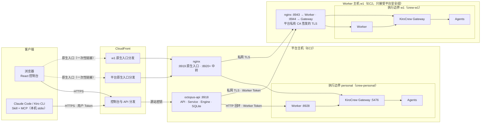
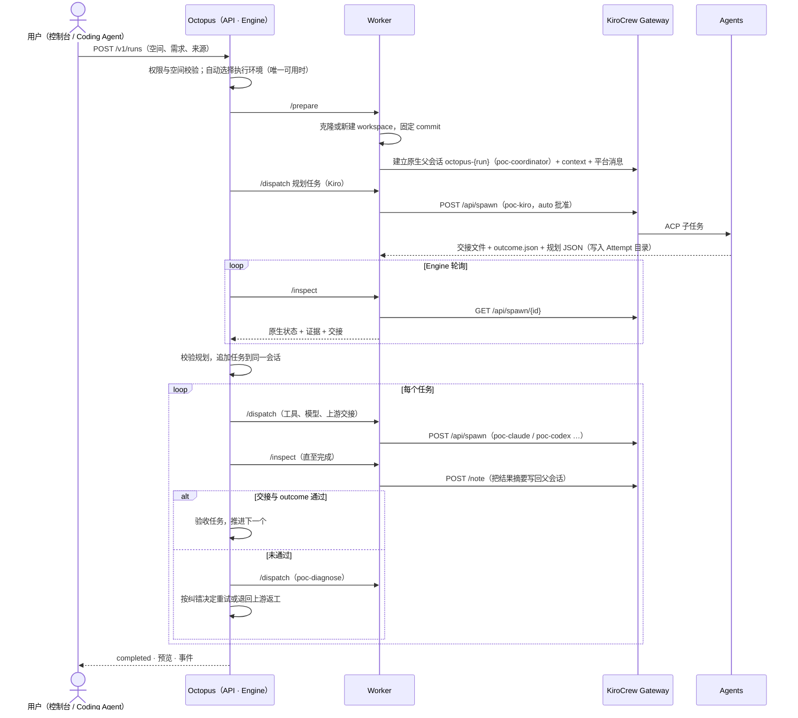
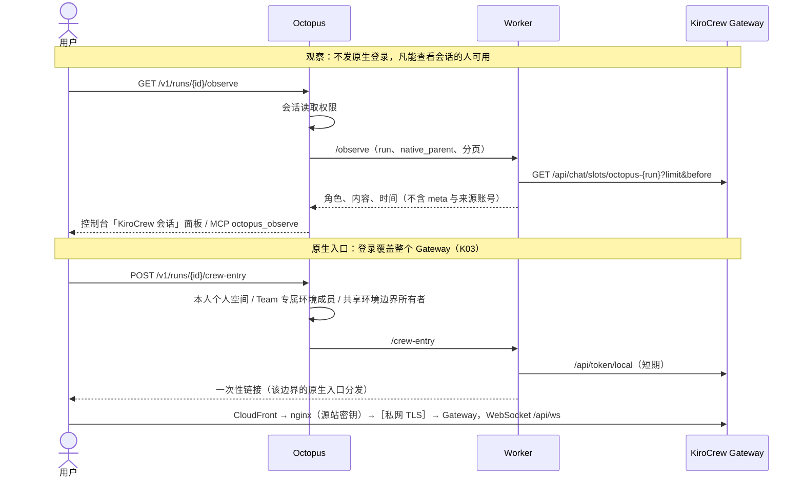

# KiroCrew ON 当前架构

状态：描述分支 `feat/m1-runtime-foundation` 当前代码与 EC2 部署（2026-10-12）。目标架构（含尚未实现的 Request、CLI、Feature 分支）见
`docs/superpowers/specs/2026-10-10-kirocrew-on-design.md` §4–§5；执行边界与归属规则见 `docs/WORKERS.md`。

## 1．部署拓扑

- 平台主机上的 personal 边界是**共享执行环境**（服务管理员与多位用户的个人空间、Team Hardware-Dev）；w1 是「Web应用软件研发组」的**专属执行环境**（D28–D30）。
- Worker 与它的 Gateway 必须在同一主机、同一 OS 用户：Worker 用本边界的 `crew_home/.local_secret` 向回环 Gateway 换取原生 token。

## 2．分层与职责

| 层 | 是什么 | 负责 | 不负责 |
|---|---|---|---|
| **Octopus 平台**（API + Service + Engine） | 平台进程，OS 用户 `octopus` | 身份、角色与权限；空间与执行环境（每次派发前核对会话的 Worker 仍服务其空间）；会话状态机与版本、每次写入的变更记录；按 Session 并发调度；质量判定（交接、outcome、规划校验）；纠错决定的应用；事件与审计 | 不运行 Agent；不直接访问任何 Gateway |
| **Worker** | 平台派驻在每个执行边界内的代理 | 源码准备；会话 ↔ 原生父会话的绑定；把平台操作翻译成 Gateway 调用；派发幂等与核对；收集证据（原生状态、路由日志、交接文件）；预览文件、观察、原生入口链接 | 不做权限判断（信任平台的 Worker Token 调用）；不保存平台数据 |
| **KiroCrew Gateway** | KiroCrew 原生后端，每个边界一个 | 原生会话（slot）与协调者 `poc-coordinator`；派生子 Agent（`poc-kiro` / `poc-claude` / `poc-codex` / `poc-opencode` / `poc-diagnose`）；批准、记忆、ACP 路由（composition 的 `PocProviderRegistry`） | 不知道 Octopus 的用户、Team 与权限；**从不调用 Octopus API** |
| **Agents** | Gateway 派生的 Coding Agent 进程 | 在源码目录开发与验证；写交接文件 `handoff.md` 与结论 `outcome.json` | 不读平台凭据；不派生其他子任务（指令约束） |

## 3．KiroCrew 与 Octopus 的交互原则

1. **单向驱动**：Octopus →（Worker）→ KiroCrew。KiroCrew 不回调平台；结果由 Worker 轮询 Gateway 与读取交接文件取得，经 `/inspect` 返回平台。
2. **平台是状态的唯一来源**：会话、任务、Attempt、版本、权限都在平台数据库；原生会话是**执行与对话记录**，平台不以它判定完成。
3. **一一绑定**：一个会话 ↔ 一个原生父会话 `octopus-<run-id>`（协调者，Worker 在 `parent.json` 记录）；一个 Attempt ↔ 一个原生子任务（`dispatch.json` 记录 native_id）。
4. **派发幂等**：Worker 先写 `dispatch.json` 再调用 `/api/spawn`；回执丢失时只核对、不重发（`dispatch_unknown`）。
5. **平台把进度写回原生会话**：准备完成、每个 Attempt 返回时，Worker 向父会话写一条说明（控制台面板中的「平台消息」），协调者据此向用户解释进度，但不自行派发任务、不改平台数据。
6. **质量由平台判定**：Agent 写的交接文件与 outcome 经 Worker 读出，由平台校验后才验收任务；失败时平台派发 `poc-diagnose` 子任务取得纠错决定，再由平台执行重试或返工。

## 4．接口逐层对照

| 用户可见操作 | Octopus `/v1` | Worker | KiroCrew Gateway（回环） |
|---|---|---|---|
| 提交需求 | `POST /v1/runs` | `/prepare` | `GET /api/chat/slots/octopus-<run>`；不存在时 `POST /api/chat/slots`（`poc-coordinator`）；`/context`、`/note` |
| 规划与执行任务 | Engine（无用户接口） | `/dispatch` | `POST /api/spawn`（`poc-<工具>`、模型、effort、cwd、`approval_mode=auto`） |
| 查看进度与证据 | `GET /v1/runs/<id>`、`/events` | `/inspect` | `GET /api/spawn`、`GET /api/spawn/<id>`；读 `subagents/<id>/state.json`、路由日志、交接文件；`POST …/note` 写回结果 |
| 自动纠错 | Engine | `/dispatch`（coordination） | `POST /api/spawn`（`poc-diagnose`，不能再派生） |
| 停止 / 关闭 / 重开 / 删除 | `POST /v1/runs/<id>/stop\|close\|reopen\|delete` | `/control` | `…/stop?force=true`、`/api/spawn/stop-all`；关闭前 `…/export` 备份并 `DELETE /api/chat/slots/<slot>`；重开 `…/resume`；删除 `DELETE /api/sessions/<parent>` |
| 观察原生会话 | `GET /v1/runs/<id>/observe` | `/observe` | `GET /api/chat/slots/<slot>?limit=&before=` |
| 在 KiroCrew 中打开 | `POST /v1/runs/<id>/crew-entry` | `/crew-entry` | `GET /api/chat/slots/<slot>`；`/api/token/local` 换取一次性链接 |
| 预览产出 | `POST /v1/runs/<id>/preview` | `/files` | — |
| 登记、健康与管理 | `/v1/workers*`、`/v1/admin/environments` | `GET /health` | — |

## 5．时序

### 5.1 提交、规划与执行

### 5.2 观察与原生入口

### 5.3 控制

停止：平台把 `desired` 写为 `stopped`，Engine 调 Worker `/control`，Worker 停止父会话与其子任务，直到原生侧确认无运行中的子任务。
关闭：再导出原生会话备份（`native-session-backup.gz`，空会话记录为观察文件）后删除原生 slot；重开：`/resume` 恢复。
删除：要求已有备份，再删除原生会话；平台数据保留删除记录。

## 6．信任与认证边界

| 连接 | 凭据 | 说明 |
|---|---|---|
| 客户端 → Octopus | 用户 Token（`read` / `execute` / `manage` / `admin`；平台管理需管理员账号且 Token 含 `admin`） | 登录 24 小时；`octopus connect` 签发 30 天 Token；CloudFront 注入源站密钥，平台只服务带该头的请求 |
| Octopus → Worker | Worker Token（Bearer） | 平台主机上为回环 HTTP；Worker 主机为私网 TLS，只信任平台私有 CA；Worker 不做用户级权限判断 |
| Worker → Gateway | 本边界 `.local_secret` → 短期原生 token | 只在回环；Worker 与 Gateway 同一 OS 用户 |
| 浏览器 → Gateway | 一次性入口链接 → Gateway 登录 Cookie（1 小时） | 覆盖整个 Gateway（K03），所以只发给有权使用整个边界的人 |
| Gateway → Agents | 同一 OS 用户的子进程（ACP） | Bedrock 经实例角色；kiro-cli 经设备码登录 |

权限只在 Octopus 判定：Worker 信任持 Worker Token 的平台，Gateway 不知道平台用户。因此用户、Team、角色与 scope 的规则全部落在 Octopus 的 API 与 Service 层
（`docs/superpowers/specs/2026-10-12-access-management-design.md`）。
