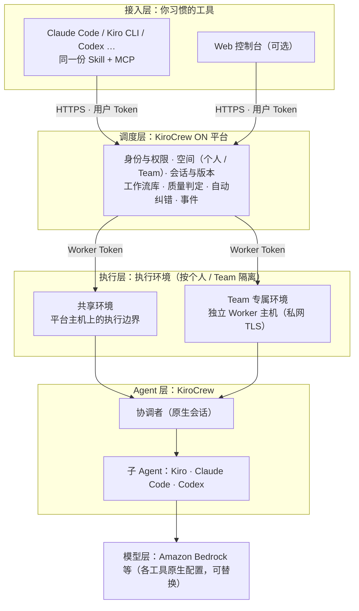

# KiroCrew ON MVP 0.1.0：产品、流程与架构

日期：2026-10-12　·　适用：分支 `feat/m1-runtime-foundation` 与 us-east-1 EC2 部署　·　图文版介绍：[`docs/KiroCrew-ON-MVP-0.1.0.html`](KiroCrew-ON-MVP-0.1.0.html)

状态标记：✅ 已上线（EC2 实测）· ◐ 部分可用 · ○ 规划中。规划中的内容不是已上线功能，顺序以负责人确认为准。

## 1．一句话

**KiroCrew ON 是一个 7×24 在线的研发协作空间：你在自己习惯的 Coding Agent（Claude Code、Kiro CLI 等）里用一句话交代任务，
后台由多个 Agent 分工规划、实现、互审并自动纠错；个人、Team 与组织在同一空间里共享会话、工作流与成果。**
它与具体工具和模型解耦，几乎没有学习成本。

## 2．它是什么，它不是什么

| 它是 | 它不是 |
|---|---|
| **后台协作空间**：任务交出去后在服务器上持续执行，关掉电脑也不中断；随时回来查看、续作 | 不是新的 IDE 或新的 Coding Agent：你继续用自己的工具 |
| **多 Agent 编排**：KiroCrew Agent 识别意图、补全需求、拆分任务、为每个任务选 Agent；Kiro、Claude Code、Codex 分工执行与互审 | 不是模型或模型网关：模型由各工具与 KiroCrew 原生配置提供（EC2 上经 Amazon Bedrock） |
| **共享空间**：个人空间、Team 空间；Team 成员共享会话与产出；工作流可共享给个人或 Team | 不绑定任何工具或模型：Agent 可以替换，工作流里的工具与模型可按任务指定 |
| **质量由平台把关**：交接文件与结论经平台校验才算完成；失败时自动诊断并返工 | 不是 CI/CD 或自动发布：不合并、不部署到生产；结果先供人查看与决定 |
| **自托管**：部署在你自己的 AWS 账号；执行环境按个人 / Team 隔离 | 不是聊天机器人：对话只是入口，会话、任务、证据都有结构化记录 |

## 3．面向谁

| 角色 | 在 0.1.0 中能做什么 |
|---|---|
| **个人开发者** | 在 Coding Agent 中提交需求、查看进度、观察 Agent 对话、预览产出、在原会话上续作；用控制台浏览自己的会话与工作流 |
| **Team 成员 / owner** | 在 Team 空间提交会话，成员共享查看与操作；owner 管理成员；Team 的专属执行环境成员可直接打开 KiroCrew 原生会话 |
| **平台管理员** | 创建用户与 Team；开通、共享、分配、改回专属、停用执行环境；登记独立 Worker 主机；查看全部执行环境的健康与负载 |
| **组织（规划）** | 组织层、跨 Team 共享、配额与排队（○ 1.0） |

## 4．工作流程（最终用户视角）

| # | 你做什么 | 平台在后台做什么 | 在哪里看 |
|---|---|---|---|
| 1 | **连接一次**：`octopus connect claude` 或 `octopus connect kiro` | 写入 MCP 配置与同一份 Skill，签发你的 Token | Coding Agent 中出现 `octopus_*` 工具 |
| 2 | **说需求**：「用 KiroCrew ON 做一个番茄钟，Codex 审查」 | 登记会话；选定所在空间的执行环境（唯一可用时自动选择） | Agent 回复会话 ID |
| 3 | 等待规划 | KiroCrew Agent 识别意图、补全需求、拆成 1–7 个任务并给每个任务选 Agent；平台校验后追加到同一会话 | 控制台「KiroCrew 规划」 |
| 4 | 去做别的事 | 按顺序派发任务（例如 Kiro 规划 → Claude Code 实现 → Codex 审查 → 真实验证）；校验交接与结论；未通过时自动诊断并返工 | 事件时间线、「KiroCrew 会话」面板 |
| 5 | **问进度**：「现在做到哪了？」 | Agent 调 `octopus_status` / `octopus_observe` 读取真实状态与 Agent 对话 | Coding Agent、控制台 |
| 6 | **看结果**：「给我预览」 | 生成隔离的预览链接；开发服务器类项目可在本机转发预览 | 浏览器 |
| 7 | **继续改**：「把 12 小时制改成补零」 | 在同一会话、同一工作区续作，下游任务重新审查 | 同一会话 |
| 8 | **团队协作** | Team 成员看到同一会话、产出与原生对话；工作流可共享复用 | 控制台、各自的 Coding Agent |

## 5．能力清单（0.1.0）

| 能力 | 状态 | 说明与证据 |
|---|---|---|
| Coding Agent 接入（Claude Code、Kiro CLI） | ✅ | `octopus connect` 写入 MCP 与 Skill（D27，`docs/CONNECT.md`）；Codex、OpenCode 等按文档手动接入 |
| 自然语言提交与 KiroCrew Agent 规划 | ✅ | D26；规划任务由 Kiro 执行，平台校验后追加任务 |
| 多 Agent 执行与互审（Kiro、Claude Code、Codex） | ✅ | M1 EC2 验收（`docs/handover/M1-EC2-EVIDENCE.md`）；OpenCode 未通过（K01），由代码改派 Claude Code |
| 交接与结论校验、自动诊断与返工 | ✅ | 协调者诊断（`poc-diagnose`），按轮数上限自动纠错 |
| 查看进度（MCP、控制台、事件流） | ✅ | `octopus_status` 精简 / 完整视图；SSE 事件流 |
| 观察原生 KiroCrew 会话 | ✅ | 控制台「KiroCrew 会话」面板、MCP `octopus_observe`（D30） |
| 在 KiroCrew 中打开原生会话 | ✅ | 个人空间本人、Team 专属环境成员、共享环境边界所有者（K03） |
| 预览产出 | ✅ | 静态页面隔离预览（1 小时）；开发服务器 `deploy.sh space <run-id>` |
| 续作与迭代 | ✅ | 同一会话与工作区；可改工具、模型、提示 |
| 工作流库 | ✅ | 模板、KiroCrew 推荐、导入 Agent 预先生成的工作流、版本、共享给个人 / Team |
| Team 与执行环境 | ✅ | 创建 Team 必须分配环境；共享 / 专属 / 空闲；独立 Worker 主机（D28–D30） |
| 自托管部署与扩容 | ✅ | CloudFormation + `deploy.sh`；`worker-host add <名称>` 一条命令加 Worker 主机 |
| 重启恢复、备份恢复 | ✅ | M1 验收 |
| 用户、Team、权限管理（改密码、停用、admin scope、审计） | ○ | 设计与第 1 期计划已完成（`docs/superpowers/specs/2026-10-12-access-management-design.md`） |
| 私有仓库（GitHub Connector） | ○ | 设计草案（`docs/superpowers/specs/2026-10-11-github-connector-design.md`） |
| 成果出库（Feature 分支、报告、PR） | ○ | M2 / M5 |
| 服务端检索、更多客户端一键接入 | ○ | M3 |

## 6．架构（MVP 0.1.0 初版）

- **解耦**：接入层只依赖 Skill + MCP 这一层薄协议，任何支持 MCP 的 Coding Agent 都能用；Agent 层由 KiroCrew 原生管理，工具与模型按任务选择；调度层不运行 Agent、不绑定模型。
- **单向驱动**：平台经 Worker 驱动 KiroCrew，KiroCrew 从不调用平台；会话状态以平台为准，原生会话是执行与对话记录。
- **隔离**：每个执行环境是一个独立的 OS 用户（或独立主机）、自己的 Gateway 与 Worker；Team 可拥有自己的 Worker 主机。
- 逐层接口、时序与信任边界见 [`docs/ARCHITECTURE.md`](ARCHITECTURE.md)；执行边界与归属规则见 [`docs/WORKERS.md`](WORKERS.md)。

## 7．设计原则

**代码与 Agent 的分工**

| 由代码负责（确定性） | 由 Agent 负责（需要理解或判断） |
|---|---|
| 会话登记、幂等、状态机、版本、权限 | 意图识别、需求补全、任务拆分与 Agent 映射（KiroCrew Agent） |
| 规划结果的校验与规范化 | 编码与真实验证（Claude Code / Kiro / Codex） |
| 交接文件与结论的校验、派发幂等、重启核对 | 审查判断、失败诊断与返工建议（协调者） |
| 执行环境选择、预览、观察、原生入口的授权 | 面向用户的进度说明（协调者对话） |

**约束**

- 平台 Engine 是唯一的业务派发者；KiroCrew 决定原生 Agent 会话如何运行；不绕过 KiroCrew 直接启动 Coding CLI。
- 技能、权限、认证使用各工具与 KiroCrew 的原生机制；Prompt 不能冒充权限控制。
- 共享工作流、共享会话、共享凭据是三件事，互不隐式授权；用户 Token、Worker Token、Gateway 原生凭据分开。
- 换工具、返工必须显式记录；状态、模型、测试与部署结论如实报告，未知显示未知，不把目标写成已上线。

## 8．已知限制（0.1.0）

| 限制 | 影响 | 处理 |
|---|---|---|
| OpenCode 执行未通过（K01） | 选 OpenCode 的任务由代码改派 Claude Code | M2 回退链；查明命中的工具门禁层 |
| 原生登录覆盖整个 Gateway（K03） | 共享环境的原生入口只对边界所有者开放 | 其他人用「KiroCrew 会话」面板观察；等 KiroCrew 提供单会话票据 |
| 协调者对话中的工具批准不可见 | 无人值守时批准请求 10 分钟后被拒（2026-10-12 实测） | 0.4：批准请求在控制台与 MCP 中可见 |
| 私有仓库无法准备源码 | 只能用公开仓库或新建项目 | 0.2：GitHub Connector 只读 |
| 成果不出库 | 代码留在执行环境，需预览或在主机上查看 | 0.3：Feature 分支与报告 |
| 用户管理不完整 | 不能改密码、停用用户（需直接改数据库） | 0.2：访问管理第 1 期 |

## 9．Roadmap

| 版本 | 主题 | 内容 | 对应 |
|---|---|---|---|
| **0.1.0（当前）** | 跑通协作闭环 | 连接 → 提交 → 规划 → 多 Agent 执行与互审 → 观察 → 预览 → 续作；Team 执行环境与独立 Worker 主机 | M1、D25–D30 |
| 0.2.0 | 可管理 | 用户与 Token 生命周期、admin scope 与审计、Team 与 Worker 管理、MCP 按角色调用；GitHub Connector 只读（私有仓库） | M4 子项、CONN-01 |
| 0.3.0 | 成果出库 | 候选 commit 与 Feature 分支推送、MCP 读取分支与 diff、Feature 报告 | M2 |
| 0.4.0 | 完成优先 | 瞬时重试、工具回退链、预算、看门狗、批准请求可见、命名质量门禁 | M2 |
| 0.5.0 | 处处可用 | Codex / Kiro IDE 一键接入、服务端分页与全文检索、diff 与报告视图 | M3 |
| 1.0.0 | Always-On 组织协作空间 | 组织层；会话共享给个人 / Team / 组织（viewer / collaborator）；Draft PR / MR；Issue、Webhook、定时触发；记忆按空间分层；配额与排队 | M4、M5 |

## 10．远景：7×24 Always-On 的共同协作空间

- **一直在线**：任务、审查、纠错在后台持续进行；需求可以来自你的一句话，也可以来自 Issue、Webhook 或定时计划（1.0）。
- **个人、Team、组织有机结合**：个人空间里试验，Team 空间里协作，组织层统一治理；会话、工作流与成果按需共享，权限清楚可追溯。
- **工作流即资产**：好的研发流程沉淀为可版本化、可共享、可推荐的工作流，新任务自动套用或由 KiroCrew Agent 推荐。
- **解耦与开放**：不绑定工具与模型；每个人用自己习惯的 Coding Agent 与 Skills 操作同一个协作空间，几乎没有学习成本。

## 11．文档索引

| 文档 | 内容 |
|---|---|
| [`docs/KiroCrew-ON-MVP-0.1.0.html`](KiroCrew-ON-MVP-0.1.0.html) | 图文版介绍（面向最终用户） |
| [`docs/ARCHITECTURE.md`](ARCHITECTURE.md) | 当前架构：拓扑、KiroCrew 与 Octopus 的逐层交互、时序、信任边界 |
| [`docs/WORKERS.md`](WORKERS.md) | 开发空间、Worker 与执行边界 |
| [`docs/CONNECT.md`](CONNECT.md) | 各 Coding Agent 的接入 |
| [`docs/OPERATIONS.md`](OPERATIONS.md) | 部署与运维 |
| [`docs/MVP-RELEASE.md`](MVP-RELEASE.md) | 里程碑、决策（D01–D30）与进度 |
| [`docs/BACKLOG.md`](BACKLOG.md) | 后续排期与延后项 |
| `docs/superpowers/specs/`、`docs/superpowers/plans/` | 各项设计与实施计划 |
