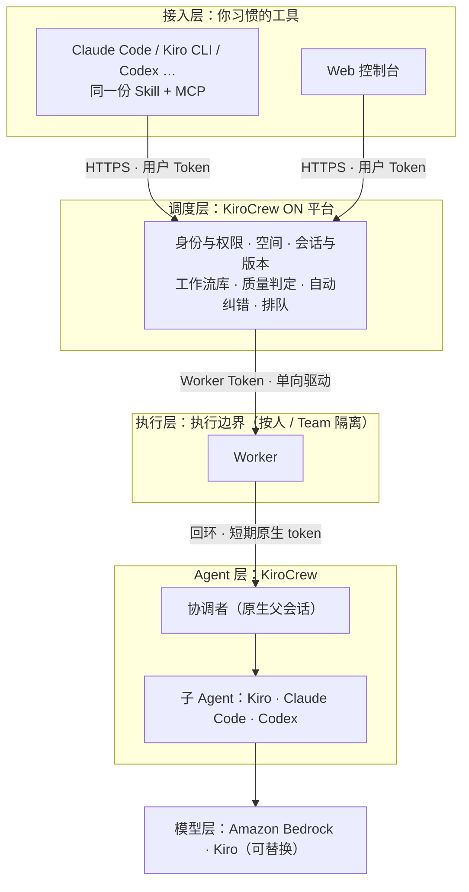
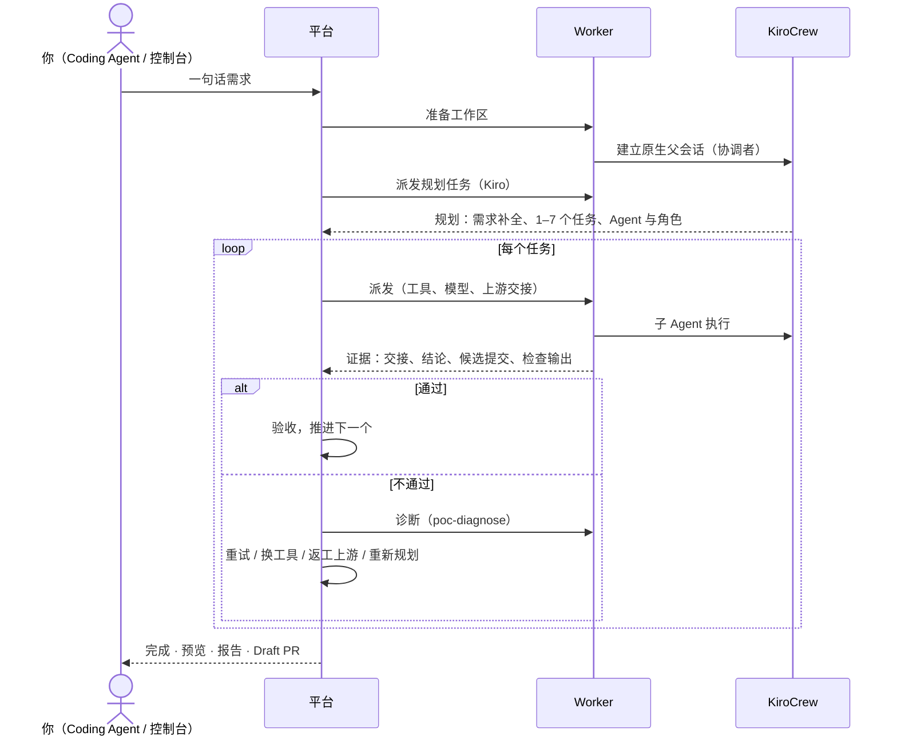
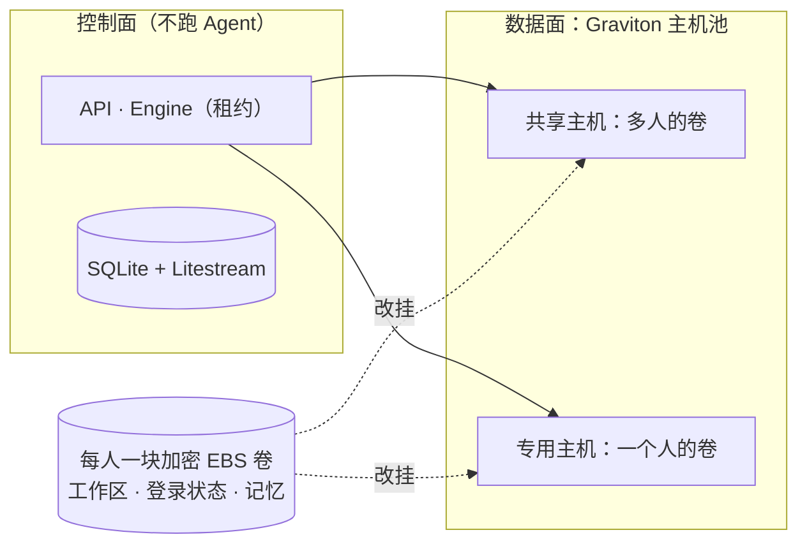

# KiroCrew ON 白皮书：7×24 在线的多 Agent 研发协作空间

版本：基于 MVP 0.2.0 预览版 `0.2.0rc1`（代码线 `feat/mvp-0.2.0`，EC2 运行 `9b587ec`）　·　日期：2026-11-20　·　HTML 版：[`docs/KiroCrew-ON-Whitepaper.html`](KiroCrew-ON-Whitepaper.html)

**怎么读**：每章正文写「是什么、怎么做」，章末的「解读」写「为什么这样做、代价是什么」。第 14 章是整体解读。凡写「已上线」的，都已在 AWS us-east-1 的部署上实测；规划中的内容会注明。细节以各章引用的文档为准。

## 摘要

**问题。** Coding Agent 已经能写出可运行的代码，但它们的工作方式仍是「一个人、一台电脑、一个 Agent」：电脑一关任务就停，「完成了」靠 Agent 自己说，规划、实现、审查往往是同一个模型，成果和经验也很难在团队里共享。

**方案。** KiroCrew ON 是一个自托管、7×24 在线的研发协作空间。你在自己习惯的 Coding Agent（Claude Code、Kiro CLI、Codex 等）里用一句话交代任务；后台由 KiroCrew Agent 规划，Kiro、Claude Code、Codex 分工实现、互审；交接与结论由平台亲自判定，不通过时自动诊断并返工。个人、Team 与全公司在同一个空间里共享会话、工作流与成果。平台不绑定工具与模型，接入只靠一份 Skill 加一个 MCP 服务器。

**现状。** 2026-10-10 立项，0.1.0（10-12）跑通协作闭环，0.1.1（10-24）完成控制台改版，0.2.0 预览版（10-26 起）在做单机版一键安装、自助执行环境与集群版底座。后端约 2.1 万行 Python，控制台约 1.1 万行 TypeScript，回归测试超过 2,500 项，留下 60 余项编号决策（D01–D75）。

**一句话解读。** KiroCrew ON 把「信任」从 Agent 身上移到了平台上：让 Agent 在隔离的边界里自由发挥，再由代码在边界外验收。

## 1．背景：Coding Agent 普及之后，缺的是什么

| 缺口 | 今天的表现 | KiroCrew ON 的回答 |
|---|---|---|
| **任务绑在个人电脑上** | 合上电脑、断网，任务就停；进度散在对话里，换台电脑接不上 | 任务在服务器的执行边界里持续执行；会话的状态、版本与证据都存在平台上，随时回来查看、续作 |
| **「完成了」靠 Agent 自己说** | Agent 倾向于报告成功：测试没跑、改动没审、验收项没对照 | 平台按命名门禁判定，亲自运行检查命令；独立的 Evaluator 逐条对照验收项。实现者自报的通过不作数 |
| **一个 Agent 包打天下** | 规划、实现、审查都是同一个模型，等于自己审自己 | 多 Agent 分工：Kiro 规划，Claude Code / Codex 实现与审查；审查任务不能用改动作者的那个工具 |
| **个人工具，团队用不上** | 会话、工作流、经验各在各人手里，交接靠复制粘贴 | 个人 / Team 空间；会话可共享、接手、公开分享；工作流有版本、可共享、可推荐；项目知识自动沉淀 |
| **工具与模型锁定** | 换一个 Agent，就要换一套流程和习惯 | 接入只是一层薄协议（Skill + MCP）；工具与模型按任务选，规划时可指定，也可由 KiroCrew Agent 推荐 |

> **解读**：这五个缺口有同一个根源：Coding Agent 是按「个人助手」设计的，没有「组织里的工作」所需要的三样东西——持续运行的地方、可核实的结果、可共享的记录。KiroCrew ON 不去做一个更好的 Agent，而是给现有的 Agent 补上这三样东西。

## 2．定位：它是什么，不是什么

| 它是 | 它不是 |
|---|---|
| **后台协作空间**：任务交出去后在服务器上持续执行，随时回来查看、续作 | 新的 IDE 或新的 Coding Agent：你继续用自己的工具 |
| **多 Agent 编排**：KiroCrew Agent 识别意图、补全需求、拆分任务、为每个任务选 Agent；各 Agent 分工执行与互审 | 模型或模型网关：模型由各工具原生配置（EC2 上经 Amazon Bedrock 与 Kiro） |
| **共享空间**：个人空间、Team 空间；会话、产出与工作流按需共享 | 绑定某个工具或模型的系统 |
| **质量由平台把关**：交接与结论经平台校验才算完成，失败时自动诊断并返工 | CI/CD 或自动发布：默认不合并、不部署生产，结果先给人看、由人决定 |
| **自托管**：部署在你自己的 AWS 账号；执行环境按人 / Team 隔离 | 托管 SaaS 或聊天机器人：对话只是入口，会话、任务、证据都有结构化记录 |

> **解读**：关键词是「空间」而不是「工具」。工具解决「怎么做」，空间解决「在哪做、谁能看、做到什么算完」。因此 KiroCrew ON 的大部分代码不在 Agent 怎么写代码上，而在会话状态机、权限、证据与判定上。

## 3．设计原则

1. **单向驱动**：平台 → Worker → KiroCrew。KiroCrew 从不调用平台；结果由 Worker 轮询 Gateway、读取交接文件后交回平台。
2. **平台是状态的唯一来源**：会话、任务、尝试（Attempt）、版本、权限都在平台数据库里；原生会话只是执行与对话的记录，平台不以它判定完成。
3. **代码负责确定性，Agent 负责判断**：

   | 由代码负责 | 由 Agent 负责 |
   |---|---|
   | 会话登记、幂等、状态机、版本、权限 | 意图识别、需求补全、任务拆分与 Agent 映射 |
   | 规划结果的校验与规范化 | 编码与真实验证 |
   | 交接与结论的校验、派发幂等、重启核对 | 审查判断、失败诊断与返工建议 |
   | 执行环境选择、预览、观察、原生入口的授权 | 面向用户的进度说明 |

4. **质量由平台判定**：Agent 写的交接文件 `handoff.md` 与结论 `outcome.json` 是证据，不是判决。
5. **薄接入，厚平台**：任何支持 MCP 的 Coding Agent 都能接入；复杂度留在平台。
6. **边界即隔离**：一个执行边界是一个独立的 OS 用户（或独立主机，0.2.0 起还有自己的加密卷），带自己的 Gateway 与 Worker。
7. **权限不靠 Prompt**：技能、权限、认证都用各工具与 KiroCrew 的原生机制；Prompt 不能冒充权限控制。用户 Token、Worker Token、Gateway 原生凭据分开。
8. **管理与使用分开**（D53）：使用者不需要了解运维步骤；需要管理员处理时，提示写明原因并指向管理员。
9. **默认一路跑完**（D70、D71）：规划完直接开始；只有缺凭证、缺只有用户才能给的输入时才停下等人。任何新增的拦截、等待或确认，都须先经负责人同意。
10. **如实报告**：状态、模型、测试与部署结论如实写；未知就写未知，不把目标写成已上线。

> **解读**：这十条针对的是 LLM Agent 的两类典型问题：**能力强但不可靠**（会自报成功、会越界、会忘记上下文），以及**会话短暂、彼此不通**。第 1–4 条把 Agent 当成「能干但需要验收的承包人」：边界内给足自由，边界外由代码验收。第 5–7 条把各方的职责切干净，任何一方都可以替换。第 9 条是产品立场：系统宁可继续推进、把问题记成提示，也不轻易让用户等。

## 4．系统架构

### 4.1　五层

<!-- html: figures/whitepaper-layers.html -->

| 层 | 是什么 | 负责 | 不负责 |
|---|---|---|---|
| **平台**（API + Service + Engine） | 平台进程，OS 用户 `octopus` | 身份、角色与权限；空间与执行环境；会话状态机与版本、每次写入的变更记录；调度（同一时间只有一个 Engine，经租约接口）；质量判定；纠错决定的应用；事件与审计 | 不运行 Agent；不直接访问任何 Gateway |
| **Worker** | 平台派驻在每个执行边界里的代理 | 准备源码；会话与原生父会话的绑定；把平台操作翻译成 Gateway 调用；派发幂等与核对；收集证据；预览、观察、原生入口链接 | 不做权限判断（只信任持 Worker Token 的平台）；不保存平台数据 |
| **KiroCrew Gateway** | KiroCrew 原生后端，每个边界一个 | 原生会话与协调者；派生子 Agent；批准、记忆、ACP 路由 | 不知道平台的用户、Team 与权限；从不调用平台 |
| **Agents** | Gateway 派生的 Coding Agent 进程 | 在源码目录开发与验证；写交接文件与结论 | 不读平台凭据；不派生其他子任务 |

### 4.2　部署拓扑（现状）

- **入口**：浏览器与 Coding Agent 经 CloudFront 访问平台。安全组只放行 CloudFront 的源站网段，平台只服务带源站密钥头的请求。
- **平台主机**（EC2）：API 与 Engine、SQLite、nginx；同一台主机上有多个执行边界，每人一个（D49）。
- **Worker 主机**：Team 的专属执行环境可以是独立主机，与平台同一 VPC，只接受平台访问；平台与它之间是平台私有 CA 签发的 TLS。
- **原生入口**：每个边界的 KiroCrew 原生页面经各自的 CloudFront 分发与平台 nginx 中转，凭一次性链接登录，登录 1 小时有效。

### 4.3　平台与 KiroCrew 的接口

| 用户可见的操作 | 平台 `/v1` | Worker | KiroCrew Gateway（回环） |
|---|---|---|---|
| 提交需求 | `POST /v1/runs` | `/prepare` | 建立原生父会话 `octopus-<run>`（协调者） |
| 规划与执行任务 | Engine（没有用户接口） | `/dispatch` | `POST /api/spawn`（`poc-<工具>`、模型、effort、cwd） |
| 查看进度与证据 | `GET /v1/runs/<id>`、`/events` | `/inspect` | 读子任务状态、路由日志、交接文件；把结果摘要写回父会话 |
| 自动纠错 | Engine | `/dispatch` | `POST /api/spawn`（`poc-diagnose`，不能再派生） |
| 停止 / 关闭 / 重开 / 删除 | `POST /v1/runs/<id>/stop` 等 | `/control` | 停止、导出备份、删除或恢复原生会话 |
| 观察原生对话 | `GET /v1/runs/<id>/observe` | `/observe` | 分页读原生会话 |
| 在 KiroCrew 中打开 | `POST /v1/runs/<id>/crew-entry` | `/crew-entry` | 换取一次性入口链接 |

> **解读**：Worker 这一层是整个架构的关键。它让平台**永远不直接碰 Gateway**，Gateway 也**永远不知道平台的用户是谁**。于是所有权限规则只落在一个地方，KiroCrew 的升级也只影响 Worker 这一层翻译。代价有两个：一是进度靠轮询，有秒级延迟；二是依赖 KiroCrew 原生接口的契约，所以 KiroCrew 按 commit 锁定版本，新版本要先通过原生契约检查才接受（D18）。

## 5．一个会话的一生

**会话**（Session，接口里叫 run）是 KiroCrew ON 的核心对象：一次需求从提交到交付、再到之后每次续作的全部历史。

<!-- html: figures/whitepaper-session.html -->

| # | 你做什么 | 平台在后台做什么 |
|---|---|---|
| 1 | **连接一次**：`octopus connect claude` 或 `octopus connect kiro` | 写入 MCP 配置与 Skill，签发你的 Token |
| 2 | **说需求**：「用 KiroCrew ON 做一个番茄钟，Codex 审查」 | 登记会话；核对权限与空间；选执行环境（只有一个可用时自动选） |
| 3 | 去做别的事 | KiroCrew Agent 识别意图、补全需求、拆成 1–7 个任务，给每个任务选 Agent 与角色（Spec、SDE、集成测试、安全测试、Challenge、Evaluator）；平台校验后直接开始 |
| 4 | 偶尔问一句「现在做到哪了？」 | 按依赖派发任务；每次尝试都提交候选、运行检查、核对交接；不通过时自动诊断并返工 |
| 5 | **看结果**：「给我预览」 | 生成隔离的预览链接，或在执行环境里运行应用（开发服务器、前后端两个进程）供远程预览；也可下载源码到本机运行 |
| 6 | **继续改**：「把 12 小时制改成补零」 | 在同一会话、同一工作区续作，只重跑受影响的任务，下游的审查自动重做；每次修订都留下快照，可对比 Prompt 的逐行变化 |
| 7 | **交付** | 发布到仓库：推送 `octopus/<run>` 分支并创建 Draft PR / MR（默认由人确认，也可设为自动）；会话结束前沉淀项目知识 |

> **解读**：会话与「聊天记录」最大的不同在于，它是**可审计的工程对象**：有版本号（防止基于过时的页面续作）、有修订历史、有每次写入的变更记录（谁、从哪个客户端、改了什么、为什么）、有每次尝试的证据。正因为如此，它才能被共享、被接手、被另一个人从中途接着做下去。

## 6．质量与可靠性

### 6.1　质量：层层不信任

每次尝试都由一组**命名门禁**判定，结果逐条写进证据，在控制台与 MCP 里都看得到。门禁有四种状态：通过、提示（记录但不拦）、失败（拦下并进入纠错）、跳过。

| 门禁 | 判什么 |
|---|---|
| `native_completed`、`identity_match` | 原生任务确实跑完；实际的后端与模型和配置一致 |
| `handoff_present`、`outcome_valid`、`outcome_pass` | 交接文件存在；结论格式正确且为通过 |
| `no_secrets` | 候选提交里没有疑似凭证或 `.env`。**安全底线，任何阶段都拦** |
| `diff_present` | 实现类任务确实有改动 |
| `checks_pass` | 平台以执行用户亲自运行任务声明的验证命令：每条 10 分钟、合计 20 分钟，记录退出码、耗时与输出末尾（凭证已隐去） |
| `review_bound` | 审查对准的是当前候选；审查者没有改代码（改了由平台撤回） |
| `evaluated` | 独立的 Evaluator 对每条验收项给出 pass / fail / pending 与证据 |

几条规则让这些门禁难以绕过：

- **审查独立**：安全测试、Challenge、Evaluator 不能使用被审查改动的作者工具。
- **改代码就要经过 Evaluator**：规划里没安排时，平台在会话完成前自动追加「Evaluator 验收」。
- **只发布已验证的候选**：会话分支当前所在、自身门禁全部通过、并且在最后一次代码改动之后有通过的审查。
- **按阶段把关**（D69）：发散（调研、头脑风暴）与设计中途的任务，部分失败只记提示、不拦；安全底线、登录失效、产出归属不可核实、必过检查、Evaluator 判不通过，在任何阶段都拦。

### 6.2　可靠性：先保证完成

D10 定下的次序是「先保证每个任务完成，其次提升完成质量」。为此有一组逐级升高的恢复手段：

| 层级 | 机制 | 默认 |
|---|---|---|
| 派发 | 幂等：Worker 先写 `dispatch.json` 再派发；回执丢失时只核对、不重发 | — |
| 瞬时失败 | 自动重试；排队一直没轮到的自动重新派发，不占次数 | 与看门狗重试合计 4 次 |
| 卡住 | 看门狗：安静太久或总时长太长，就停止原生任务并重试一次 | 安静 30 分钟 / 总长 170 分钟 |
| 做错 | 协调者诊断 → 重试、换工具、返工上游；返工尽量在原对话上续接，保留上下文 | 2 轮 |
| 计划不对 | 重新规划 | 每个会话 1 次 |
| 总量 | 会话预算：轮数、重试次数、时长 | 2 轮 / 4 次 / 720 分钟 |
| 环境 | 等待与自动恢复：Kiro 登录恢复、Worker 重新启用、凭证恢复后自动继续，等待时间不计入预算 | — |
| 资源 | 排队（执行环境内存不足、负载过高时）与并发上限（个人 / Team / 默认） | 默认不设上限 |
| 平台 | 重启后核对进行中的派发；备份与恢复；0.2.0 起 Litestream 持续备份 | — |

> **解读**：这里有一个有意为之的取舍。D71（2026-10-22 关卡检讨）之后，系统**几乎不再停下等人**：Evaluator 的「待人判断」项自动通过并记为提示，协调者的大部分拒绝改为按建议重试。这样会话不会卡在半夜无人确认的关卡上，代价是「通过」里可能带着提示。补偿在交付端：发布默认要人确认，而且只推已验证的候选；提示在会话页、报告与 MCP 里都会列出来。一句话：**执行端偏向自动，出口端偏向保守。**

## 7．协作模型

- **空间**：会话属于个人空间或 Team 空间（成员是 owner 或 member）。
- **执行边界**：每人一个（D49）。KiroCrew 是个人助手，一个 Gateway 对应一个主人、一份记忆、一个 Kiro 登录（Kiro Credit 按人计）。Team 会话运行在提交者自己的边界上。在别人的边界上，只有边界的主人能下达指令（R10）。
- **会话共享**（D64）：可共享给某个人、某个 Team 或全公司。查看者能看详情、时间线、观察原生对话、修订、报告、远程预览；协作者还能续作、停止、请求诊断。全公司只能查看。删除、发布、改派执行环境、更换凭证、原生入口不对共享开放。
- **接手**（D74）：协作者或 Team 成员可以把共享来的会话接手到自己的执行环境，提交历史不变，此后用自己的身份、凭证与用量续作；创建者可以接回。
- **公开分享**（D75）：把会话的页面或运行中的演示发给没有账号的人，可选四位授权码，有效期 1 天到永久，链接在会话自己的预览域名上。
- **工作流库**：参考模板、KiroCrew 推荐、导入 Agent 预先生成的工作流；改动形成新版本，已在跑的会话不受影响；可共享给个人或 Team。
- **在 KiroCrew 聊天里直接对话**（D73）：可以在原生页面里和协调者直接聊；聊天里改过的文件在续作前提交为候选，并提醒你同步修改需求。运行中的 Kiro 任务还可以「补充说明」，插入正在运行的这一轮。
- **知识沉淀**（D46）：改代码的会话完成前，平台追加一个只读的「Knowledge 沉淀」任务，最多写 5 条项目规则，此后同一空间、同一仓库的会话自动注入。团队层知识经仓库 PR 共享（D52）。
- **用量**：每次尝试记录 Kiro Credit、token、费用与时长，按会话汇总。

> **解读**：协作模型里最重要的一句话是「**共享会话、共享执行环境、共享凭证是三件事，互不隐式授权**」。把会话共享给你，不等于你能在我的边界上跑命令，也不等于你能用我的仓库凭证。这就是为什么需要「接手」：想在别人的会话上继续干活，就把它搬到你自己的边界上，用你自己的身份和凭证。这个设计让「协作」和「责任归属」始终对得上。

## 8．安全与信任

### 8.1　凭据各管一段

| 连接 | 凭据 | 说明 |
|---|---|---|
| 客户端 → 平台 | 用户 Token（`read` / `execute` / `manage` / `admin`） | 控制台登录 24 小时；`octopus connect` 签发 30 天 Token；新建账号、重设密码、设为管理员只认控制台登录 |
| Worker → 平台 | 一次性接入码（只用于登记） | 唯一的反向调用；库里只存 SHA-256；30 分钟到 24 小时有效，用一次即失效 |
| 平台 → Worker | Worker Token | 同主机走回环；独立主机走私网 TLS，只信任平台私有 CA；Token 已移出数据库（D59） |
| Worker → Gateway | 本边界的 `.local_secret` → 短期原生 token | 只走回环；Worker 与 Gateway 是同一个 OS 用户 |
| 浏览器 → Gateway | 一次性入口链接 → 1 小时的登录 Cookie | 原生登录覆盖整个 Gateway（K03），所以只发给有权使用整个边界的人 |
| Gateway → Agents | 同一 OS 用户的子进程 | Bedrock 经实例角色；kiro-cli 经设备码登录 |

### 8.2　权限只在平台判定

- 看不到的返回 404，看得到但不能做的返回 403 并说明原因。
- 管理员能查看与操作全部会话，越权操作写入审计；原生入口仍只给边界主人。
- 用户与 Team 只停用、不删除。
- 仓库凭证分个人、Team、平台三级，秘密只写、加密存储；会话固定使用哪一份凭证，并显示是谁的。
- Agent 没有仓库写凭证，推送与建 PR 只由平台在发布时做。

### 8.3　浏览器一侧

不另购域名（负责人 2026-10-27），控制台、会话预览与原生入口同属一个可注册域名，隔离按源站做：

- Cookie 一律 `__Host-`；
- 凭 Cookie 的写入必须来自控制台自己的 Origin，凭 Cookie 的子资源请求按 Fetch Metadata 拒绝；
- 没有一条 GET 会替用户做主动操作（逐条审计过）；
- 预览以 sandbox 下发，链接 10 分钟有效，每次取文件都复核权限；
- 会话观察与检查输出里的密钥由平台打码（D57）。

> **解读**：安全上的总体立场是「**底线，而不是关卡**」：少数不可让步的规则（秘密扫描、认证、产出归属核实、权限只在平台）任何时候都拦；其余尽量不打断用户。真正的隔离靠操作系统和网络（OS 用户、主机、私网 TLS、源站校验），不靠 Agent 的自觉。残余风险也写在明处：例如 Agent 做的演示页可以把这个域名的 Cookie 写满，让该浏览器暂时打不开；它读不到、也改不了任何人的数据，清除站点数据即可恢复。

## 9．部署与运维

### 9.1　0.1.x：自己的 EC2

CloudFormation 加 `deploy/aws/deploy.sh`，部署在 us-east-1、Amazon Linux 2023：`deploy.sh up && deploy.sh push`。`worker-host add <名称>` 一条命令加一台 Worker 主机，`boundary add <名称> --owner <用户>` 为一个人开一个边界。

### 9.2　0.2.0 单机版（P2，已部署 EC2）

- **一行安装**：`curl -fsSL https://<下载域名>/install.sh | sudo sh`。先预检（系统、架构、root、systemd、磁盘、内存、实例元数据），不满足的一次列全，什么也不改。
- **支持的组合**：AL2023、Ubuntu 22.04 / 24.04；x86_64 与 ARM64（推荐 Graviton）；另有 pip（`pip install kirocrew-on` 后 `sudo kirocrew-on setup`）与 Docker（一个容器、一个边界，用于试用）。
- **验签**：先用内嵌公钥验清单签名（没有签名不装），再核对版本与 wheel 的 sha256。
- **CloudFront 小栈**：Elastic IP、只放行 CloudFront 的入站规则、控制台 / 原生 / 预览三个分发、每日快照；装完核对主机角色只剩 Bedrock 调用与 SSM。
- **控制台里的运维**：「新建边界」「登录 Kiro」（设备码）「管理 › 部署」；需要管理员凭证的变更由部署套件 `kirocrew-on single …` 在管理员自己的电脑上执行，主机上不留凭证。

### 9.3　0.2.0 集群版（P3–P5，规划中）

<!-- html: figures/whitepaper-planes.html -->

- **用户的数据跟着卷走**：每人一块加密的 EBS 卷，放工作区、各 Agent 的登录状态和 KiroCrew 记忆。换主机就是改挂这块卷。
- **P0 实测**（设计前先测）：同可用区搬卷 200 次 0 失败，用户等待 p50 16.7 秒、p95 19.3 秒；m8g.large 一台能挂 31 块数据卷；30 块卷同时搬，40 秒内全部完成；跨可用区从快照恢复必须设预置初始化速率，否则 5 GiB 要 11 分钟。
- **扩缩**：按 CPU、内存、剩余挂载位扩容；尽可能不缩容、不搬用户，只回收空主机。
- **可用性**：目标 99.5%（负责人 2026-10-26 定）。Litestream 每秒同步，RPO ≤ 5 秒（实测 0.69 秒，恢复 4.4 秒）；另一可用区温备，RTO ≤ 15 分钟。温备所需的平台密钥材料由 KMS 托管。
- **可观测**：每分钟一行 CloudWatch EMF（进行中、等 Worker、等配额的会话，失联的 Worker 等）；Worker 的 `/health` 报告内存、CPU、负载与子 Agent 上限，供放置使用。

> **解读**：集群版的单位是「**人的卷**」，不是「主机」，也不是「容器」。Agent 需要一个完整的用户环境（登录状态、记忆、工具链），这些状态天然属于人；把它们放进一块随人走的卷，主机就成了无状态、可替换的算力。这也解释了为什么不直接上容器编排：Agent 进程的状态模型更像「一个人的工作站」，而不是「一个无状态服务」。另一个值得注意的做法是**先实测、再定设计**：P0 用不超过 20 美元的一次性资源，把卸挂时延、挂卷上限、跨区恢复这些会推翻设计的数字先测出来。

## 10．接入与生态

| 方面 | 现状 |
|---|---|
| Coding Agent | Claude Code、Kiro CLI 一条命令接入（`octopus connect`）；Codex 等任何支持 MCP 的客户端按 `docs/CONNECT.md` 手动接入 |
| MCP 工具 | 40 个：会话（提交、状态、续作、控制、观察、修订、补充说明、接手…）、工作流（匹配、推荐、解析、保存、共享）、交付（预览、运行应用、下载、发布）、本地联动（关联、拉回、同步）、管理（只接受 admin Token） |
| REST API | `/v1` 下 100 余个路径，附 OpenAPI 描述 |
| 命令行 | `octopus`（connect、login、pull、sync、worker enroll…）；`kirocrew-on`（setup、single…） |
| 执行的 Agent | Kiro（kiro-cli）、Claude Code、Codex；OpenCode 已停用（K01，未通过执行核实） |
| 模型 | Claude Code 与 Codex 经 Amazon Bedrock（实例角色）；Kiro 经各人的设备码登录 |
| KiroCrew | 开源的 KiroCrew Gateway，按 commit 锁定；平台用它的原生会话、派生、批准、记忆与 lessons |

> **解读**：接入层刻意做得很薄：一份 Skill 告诉 Agent「什么时候、怎么用这些工具」，MCP 提供工具本身。好处是几乎没有学习成本，用户在自己的 Agent 里说一句话就行；代价是体验受各客户端的 MCP 支持程度约束。项目在这里押的是「**MCP 会成为 Agent 之间的通用插口**」。

## 11．现状与数据

| 时间 | 版本 | 要点 |
|---|---|---|
| 2026-10-10 | 立项 | 迁入新旧两版资产，建立回归基线（D01、D05） |
| 2026-10-12 | **MVP 0.1.0** | 跑通协作闭环：连接 → 提交 → 规划 → 多 Agent 执行与互审 → 观察 → 预览 → 续作；Team 执行环境 |
| 2026-10-13 至 23 | 0.1.x 迭代 | 访问管理、仓库凭证、候选提交与命名门禁、发布 Draft PR / MR、恢复阶梯、角色卡片与 Evaluator、Knowledge、每人一个边界、排队与并发上限、会话共享、聊天协作 |
| 2026-10-24 | **MVP 0.1.1** | 控制台改版、Token 重新生成、列表瘦身（gzip 后约少 70%） |
| 2026-10-25 / 26 | 0.1.x 补充 | 接手（D74）、公开分享（D75） |
| 2026-10-26 至 28 | **0.2.0rc1** | P1 打底（接入码、全局 UID、ARM64、打包、Litestream、平台指标）；P2 单机版一键安装、控制台登录 Kiro |
| 2026-11-20 | 修复 | 控制台登录 Kiro 拿到的是固定地址，登录不了（见附录 A） |

| 工程指标 | 数值 |
|---|---|
| 后端 | `octopus/` 70 个模块，约 2.1 万行 Python |
| 控制台 | Vite + React + TypeScript，约 1.1 万行（不含测试） |
| 测试 | 后端 2,168 项、控制台 354 项、旧版 92 项（P2 的全量回归，干净检出） |
| 数据库 | SQLite，迁移到 19 |
| 决策记录 | D01–D75，60 余项，每项写明负责人何时定的 |
| 工程纪律 | 每个修复先有失败的测试；独立代码审查；部署前干净克隆做密钥扫描；EC2 上逐项实测并把结果写进文档 |

> **解读**：两周多从立项走到预览版，速度很快，原因之一是这个项目本身就大量用 Coding Agent 开发。但更值得看的是**密度**：60 余项决策、每次修复先写失败的测试、每个功能都有 EC2 实测记录。对 Agent 驱动的开发来说，这种「把判断写下来、把证据留下来」的纪律，正是 KiroCrew ON 想替用户自动化的那部分工作。

## 12．路线图

**0.2.0 余下的部分**

| 期 | 内容 | 状态 |
|---|---|---|
| P1b | KiroCrew 升到正式版 v0.10.0（原生页面会有变化） | 待负责人确认 |
| P2 第 9 项 | 新开 4 台 EC2，各用一条命令装通并跑一个真实会话 | 待负责人批准（约 3 美元） |
| P3 | 集群版底座：主机代理、用户卷、按 Host 路由的原生入口、迁移编排；先只开放给管理员 | 待 P0 余项 |
| P4 | 普通用户自助申请共享 / 专用主机，双向切换 | 待 P3 |
| P5 | 迁移现有部署与温备演练 | 待 P4 |

**之后的主题**：组织层与跨 Team 治理；Issue、Webhook 与定时触发；按费用的预算与用量上限；服务端分页与全文检索；更多客户端一键接入。

**目标驱动的自我迭代**（D76 设计稿，待负责人评审）：新增「目标」对象——一句话陈述、锁定的完成标准、预算与授权策略；一个目标跨多次迭代（规划 → 执行 → 平台亲自验证 → 差距评估 → 决定）。完成与否由代码规则决定；推送、生产部署、对外发布一律需负责人本人当场再认证后点头；迭代上限、费用、连续无进展等任一触发即停下，写清卡在哪。设计稿的出发点是「在 KiroCrew ON 上迭代 KiroCrew ON」。

> **解读**：从路线图能看出产品的重心在移动：0.1 解决「一个会话能不能可靠地跑完」，0.2 解决「谁来装、在哪跑、怎么扩」，D76 要解决的是「**跨会话的目标**」——让系统自己决定下一个会话做什么，人只在关键点点头。这一步一旦走通，KiroCrew ON 就从「执行请求的后台」变成「追求目标的后台」。设计稿里最审慎的部分恰恰是「点头」：它承认现在的控制台登录证明不了操作者是本人，所以要求当场再认证。

## 13．已知限制与风险

| 限制或风险 | 影响 | 现在的处理 |
|---|---|---|
| 原生登录覆盖整个 Gateway（K03） | 原生入口只能给边界主人 | 其他人用「KiroCrew 会话」面板观察；登录 1 小时到期，刷新凭据被拦下 |
| OpenCode 未通过执行核实（K01） | 不能选 OpenCode | 已停用 |
| 平台仍是单台主机 | 主机故障期间不可用 | 每日快照与备份恢复；温备在 P5 |
| Kiro 登录要人用设备码完成 | 边界的 Kiro 登录过期时，相关任务等待 | 控制台「登录 Kiro」；登录恢复后自动继续 |
| 补充说明只支持 Kiro | Claude Code、Codex 的运行中任务不能插话 | KiroCrew 的限制，等上游 |
| Knowledge 只在专属执行环境沉淀 | 共享环境的会话不积累项目知识 | KiroCrew 的 lessons 不能按空间隔离 |
| 同一域名下的 Cookie 写满 | 该浏览器暂时打不开控制台 | 读不到也改不了数据；清除站点数据即可恢复 |
| 依赖 KiroCrew 的原生接口 | 上游变化会影响 Worker | 按 commit 锁定；原生契约检查通过才接受新版本 |
| 自动通过的提示 | 「通过」里可能带待人判断的项 | 发布默认要人确认；提示在会话页、报告、MCP 中列出 |

## 14．解读：KiroCrew ON 在押注什么

### 14.1　一句话

把「**一个人 + 一个 Coding Agent + 一台电脑**」的工作方式，变成「**一个组织 + 多个 Agent + 一组后台执行环境**」的研发后台，而入口仍是每个人自己习惯的那个 Agent。

### 14.2　三个押注

| 押注 | 依据 | 代价 |
|---|---|---|
| **信任放在平台，不放在 Agent** | Agent 会自报成功。所以门禁由代码判，检查由平台亲自跑，Evaluator 独立于作者，发布只推已验证的候选 | 平台要理解每种任务的「完成」长什么样：门禁、阶段、契约的设计成本很高，D57、D69、D71 都是在调这里的松紧 |
| **薄接入、厚平台** | 用户不想换工具。一份 Skill 加 MCP，任何 Agent 都能接；复杂度集中在平台 | 体验受各客户端约束；平台必须把所有状态讲清楚（精简状态、观察、报告），因为用户只通过 Agent 的转述看它 |
| **边界即隔离** | 隔离交给操作系统、主机和卷，而不是 Prompt 或 Agent 的自觉；一人一个边界，与 KiroCrew 的「个人助手」模型对齐 | 运维更复杂：用户、端口、登录、卷都要按人管理。0.2.0 的大部分工作（接入码、全局 UID、自助申请、用户卷）就是在偿还这笔账 |

### 14.3　与常见做法的对照

| 做法 | 擅长 | KiroCrew ON 补上的 |
|---|---|---|
| 本机 Coding Agent | 交互快、上手零成本 | 后台持续执行、可核实的结果、团队共享 |
| 云端托管的单 Agent | 不占本机、可异步 | 多 Agent 分工与互审、自托管、按人 / Team 隔离、不锁定工具 |
| CI/CD 流水线 | 确定性、可重复 | 需求理解、任务拆分、失败诊断与返工这些需要判断的部分 |
| 通用多 Agent 框架 | 编排灵活 | 开箱即用的权限、会话状态机、证据、预览、发布与运维 |

KiroCrew ON 不和这些做法竞争谁更强，而是把它们拼起来：用 Agent 做判断，用流水线式的代码做验收，用协作空间管归属。

### 14.4　几处有意为之的取舍

- **自动与人控**：执行端偏向自动（不停下等人），出口端偏向保守（发布默认要人确认，D76 要求本人再认证）。
- **共享与隔离**：会话可以广泛共享，执行环境和凭证不随之共享；要动手就先「接手」。
- **实时与解耦**：单向驱动加轮询，换来平台与 KiroCrew 的彻底解耦，接受秒级的进度延迟。
- **复用与掌控**：大量复用 KiroCrew 原生能力（会话、派生、批准、记忆），但判定、权限、状态从不交给它。

### 14.5　给不同读者

- **开发者**：你不需要学新工具。把它当成「可以把任务丢过去、明早回来看结果的同事」：说需求、问进度、要预览、继续改，都在你自己的 Agent 里完成。
- **Team 负责人**：会话、工作流、知识都能在 Team 里共享，接手让交接不必从头讲起；并发上限与用量让成本看得见。
- **平台管理员与安全**：自托管在自己的 AWS 账号；凭据分段、权限只在平台判定、审计齐全；隔离靠 OS 用户、主机与私网 TLS；安装包验签。
- **决策者**：它是把 Coding Agent 从「个人效率工具」升级为「组织研发能力」的一层基础设施。现在是 MVP 阶段：单区域、单台控制面主机，集群版与温备还在路上。

### 14.6　成熟度判断

- **已经扎实的**：会话闭环、质量判定与恢复阶梯、权限与审计、共享与接手、单机版安装。这些都经过 EC2 实测，有回归测试保护。
- **还在路上的**：集群版与温备（P3–P5）、KiroCrew 正式版升级（P1b）、组织层、目标驱动的迭代（D76）。
- **要持续盯的**：对上游 KiroCrew 原生接口的依赖；「自动通过」带来的提示积累；单台主机的可用性。

## 附录 A．一次真实故障：控制台登录 Kiro 拿到的是固定地址（2026-11-20）

这个故障很小，但它把第 3 章「如实报告、证据先行」的工作方式演示了一遍。

- **现象**：在控制台点「登录 Kiro」，对话框里的验证地址每次都一样（`https://d-9067e1d68a.awsapps.com/start`），打开后进不了设备确认页，执行环境登录不了 Kiro。当时 EC2 上三个边界都是「Not logged in」。
- **证据**：取 EC2 上一次真实的登录日志看——kiro-cli 2.29.1 用 IAM Identity Center 登录时，先把给它的 Start URL 回显在提示行里，然后才输出设备码和真正的一次性地址。Worker 取的是输出中的**第一个**地址。
- **为什么测试没发现**：测试里模拟的 kiro-cli 不回显提示。
- **修复**：先补两个会失败的测试（模拟提示回显、模拟长地址分两次读到），再改为取「设备码之后、整行输出完的那个地址」。
- **核对**：在 EC2 的 kiro-cli 2.29.1 上，旧的解析复现出 `…/start✔`（39 字符）；新的解析取到 604 字符的一次性地址（AWS 现在给的是 `signin.aws/platform/authorize?request_uri=…`）。本机 kiro-cli 3.4.0 的 free 与 pro 两种登录也都取到完整地址。

> **解读**：模拟的输出永远比真实的干净。所以这类问题要回到真实的命令、真实的环境上核对，而不是只看测试通过与否。

## 附录 B．术语

| 术语 | 含义 |
|---|---|
| 会话（Session / run） | 一次需求从提交到交付、再到之后每次续作的全部历史 |
| 任务（Task） | 会话里的一个步骤，有类别、角色、工具、模型、验收项与验证命令 |
| 尝试（Attempt） | 一个任务的一次执行，对应一个原生子任务 |
| 候选（Candidate） | 一次尝试之后，Worker 在会话分支上做的提交 |
| 门禁（Gate） | 对一次尝试的命名判定：通过、提示、失败、跳过 |
| 执行边界（Boundary） | 一个 OS 用户及其 HOME，加上其中的 KiroCrew Gateway 与 Worker |
| Worker | 平台派驻在执行边界里的代理 |
| KiroCrew Gateway | KiroCrew 的原生后端，派生并管理 Coding Agent |
| 协调者 | 原生父会话里的 `poc-coordinator`，负责诊断与向用户解释进度 |
| Evaluator | 独立的验收角色，逐条对照验收项给出结论与证据 |
| 空间 | 会话的归属：个人空间或 Team 空间 |

## 附录 C．文档索引

| 文档 | 内容 |
|---|---|
| [`README.md`](../README.md) | 简介与上手 |
| [`docs/MVP-0.1.0.md`](MVP-0.1.0.md) · [`MVP-0.1.1.md`](MVP-0.1.1.md) · [`MVP-0.2.0.md`](MVP-0.2.0.md) | 各版本的产品说明、版本说明与验证 |
| [`docs/ARCHITECTURE.md`](ARCHITECTURE.md) | 架构：拓扑、逐层交互、时序、信任边界 |
| [`docs/WORKERS.md`](WORKERS.md) | 开发空间、Worker 与执行边界 |
| [`docs/CONNECT.md`](CONNECT.md) · [`docs/CONTINUE.md`](CONTINUE.md) | 客户端接入 · 续作 |
| [`docs/OPERATIONS.md`](OPERATIONS.md) | 部署与运维（门禁、恢复、共享、安全等各项行为的权威说明） |
| [`docs/MVP-RELEASE.md`](MVP-RELEASE.md) · [`docs/BACKLOG.md`](BACKLOG.md) | 里程碑与决策 · 后续排期 |
| `docs/superpowers/specs/`、`docs/superpowers/plans/` | 各项设计与实施计划 |
