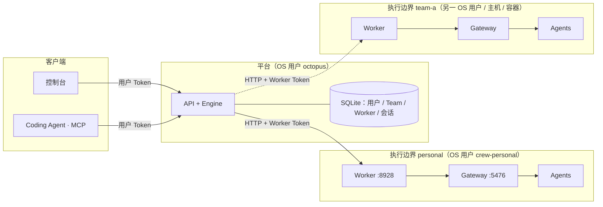
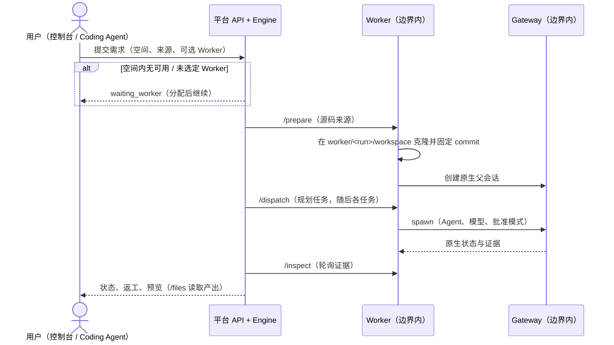

# 开发空间、Worker 与执行边界

状态：§1–§7 描述分支 `feat/m1-runtime-foundation` 当前代码与 EC2 部署（2026-10-11）；§8 为建议，未实施。

## 1．名词

| 名词 | 含义 |
|---|---|
| 开发空间 | 会话归属的空间：**个人空间**（一个用户）或 **Team 空间**（一个 Team，成员角色 owner / member） |
| 执行边界 | 一个 OS 用户（`crew-<边界>`）及其 HOME、数据目录，加上在其中运行的一个 KiroCrew Gateway 与一个 Worker |
| Worker | 平台派驻在执行边界内的代理（`octopus worker`）：准备源码、把任务交给本边界的 Gateway、回报证据、提供预览文件 |
| KiroCrew Gateway | KiroCrew 原生后端；派生并管理 Coding Agent（Kiro、Claude Code、Codex、OpenCode） |
| Agent | Gateway 派生的 Coding Agent 进程，与 Gateway、Worker 同一 OS 用户 |

**Worker 不是 KiroCrew 本身**：一个 Worker 代表一个执行边界，是平台调用这个边界的入口。

## 2．组成与连接

| 连接 | 方式与认证 | 代码 |
|---|---|---|
| 客户端 → 平台 | HTTPS（CloudFront）或 SSM 隧道；用户 Token，作用域 read / execute / manage | `octopus/security.py`、`octopus/server.py` |
| Engine → Worker | HTTP；`Authorization: Bearer <Worker Token>`；地址与 Token 由管理员登记，存于数据库 | `octopus/transport.py:11-27` |
| Worker → Gateway | 固定 `127.0.0.1:<gateway_port>`；读取本边界 `crew_home/.local_secret` 换取短期原生 token | `octopus/gateway_client.py:50-57, 71-77` |
| Gateway → Agent | ACP；同一 OS 用户的子进程 | KiroCrew |

因此 **Worker 必须与它的 Gateway 同一主机、同一 OS 用户**，不能指向任意一台远端 Gateway。
可以扩展的是平台 → Worker 这一段：任何一台运行「Gateway + Worker」的主机或容器，平台能访问其 Worker 地址时，即可登记给某个用户或 Team。

## 3．归属与调度规则

Worker 有三种范围（`workers.scope`，D28）：**专属**（`dedicated`，属于一个用户或一个 Team）、**共享**（`shared`，服务 `worker_spaces` 中登记的 Team 与个人空间）、**空闲**（`spare`，尚未分配，不能运行会话）。

| 规则 | 代码 |
|---|---|
| 只有平台管理员能登记 Worker（控制台「执行环境 · Worker」或 `POST /v1/workers`）；`spare: true` 登记为空闲执行环境，必须 `dedicated` 且执行边界从未登记过（含已停用） | `server.py`（`POST /v1/workers`） |
| 专属 Worker 只绑定**一个**用户或**一个** Team；Team 的专属 Worker 必须是 `dedicated`，`trusted-local` 只用于个人空间 | `server.py`（`POST /v1/workers`） |
| 平台自身的宿主账号只能作为管理员本机验证用的 `trusted-local` Worker | `server.py`（`POST /v1/workers`） |
| 同一 Gateway 边界不能登记两次；不同空间不能共用同一宿主账号（主机名 + uid） | `server.py`（`POST /v1/workers`） |
| 把专属 Worker 设为共享须管理员确认，原所属空间继续由它服务；之后由管理员把 Team 或用户的个人空间加入或移出 | `Service.share_worker`、`Service.worker_space` |
| 只有平台管理员能创建 Team，创建时必须指定 Team owner 与执行环境（共享环境或空闲环境）；空闲环境分配后成为该 Team 的专属环境，只分配一次 | `Service.create_team`、`give_environment`、`assign_spare` |
| 一个 Team 同一时间只有一个执行环境（`worker_spaces` 的部分唯一索引与 `give_environment` 校验） | `migrations.ENVIRONMENTS` |
| 某空间可用的 Worker：已启用，且为该空间的专属 Worker 或服务该空间的共享 Worker；空闲 Worker 永不可用 | `domain.space_workers` |
| 会话属于提交时选择的空间；Team 会话全体成员可见，个人会话只有本人可见；删除需会话所有者或 Team owner | `domain.run_access` |
| 提交时未指定 Worker：空间内**恰好一个**可用 Worker 时由服务端选用；Team 没有可用 Worker 时拒绝提交（409 `team_without_worker`）；个人空间有多个或没有时进入 `waiting_worker`，之后用 `assign-worker` 分配 | `Service.start`、`Service.operate` |

## 4．工作流

## 5．隔离：靠什么，不靠什么

| 维度 | 机制 | 不同边界之间 | 同一边界内部 |
|---|---|---|---|
| 端口 | 回环端口只是寻址，本机任何用户都能连接 | **不隔离** | — |
| Worker 接口 | Worker Token（`worker.token` 0600，边界用户所有） | 隔离 | Agent 可读 |
| Gateway 接口 | `.local_secret`（边界 `crew_home` 内）换取原生 token | 隔离 | Agent 可读 |
| 文件与源码 | 不同 OS 用户 + 0700 目录（HOME、`worker/`、`crew/`、`kiro/`） | 隔离 | 共享 |
| 工具登录 | 各边界 HOME 独立（kiro-cli 按边界登录） | 隔离 | 共享 |
| AWS 凭据 | 实例角色（Bedrock）由主机上所有进程共享 | **不隔离** | 共享 |
| 内核与主机资源 | 同一主机共享 | **不隔离** | 共享 |

结论：
- **执行边界的隔离单位是 OS 用户**；同一边界内的 Worker、Gateway 与所有 Agent 互相可读，靠 KiroCrew 原生沙箱与批准策略约束 Agent（D14）。
- `dedicated` 是 Worker 配置的**声明**（`worker_isolation`），平台据此放行 Team 登记，但不能验证（`worker.py:93`）。
- 同一主机上用不同 OS 用户区分 Team，能隔开源码与工具登录，但共享实例角色与内核；Team 之间需要更强隔离时，使用独立主机或容器。

### 会话共享不等于共享执行环境

| | 会话共享（谁能看、谁能改） | 执行隔离（代码在哪里运行、Agent 能接触什么） |
|---|---|---|
| 所在层 | 平台：数据库授权 | 执行边界：OS 用户、主机或容器 |
| 机制 | 当前 Team 会话对全体成员可见（`domain.py:70-79`）；M4 增加 `session_grants`，共享给个人 / Team / 公司（viewer / collaborator） | §5 表中的 OS 用户与密钥文件 |
| 与 Worker 的关系 | 无关：共享后会话仍在原 Worker 执行，被共享人经平台查看证据、预览，collaborator 可继续迭代 | 决定 Worker 的数量 |

- 个人与 Team 之间共享会话不需要共用 Gateway。原生入口登录覆盖整个 Gateway（K03），共享的会话不开放原生入口（总体设计 §安全）。
- 多个空间共用一个 Gateway（逻辑隔离）只在平台层成立：同一 Gateway 内所有会话的 Agent 是同一 OS 用户，能读取彼此的源码、工具登录、Worker Token 与 Gateway 密钥；仓库内容的提示注入可以借此读取并外传其他空间的代码；kiro-cli 账号与计费归属也合为一个。它只适用于互相信任的空间。

### 记忆：分层与共享

记忆全部存放在执行边界内，因此**按边界（即按 Team）隔离**，不同 Team 之间、个人与 Team 之间不共享。
依据 KiroCrew 0.10.0（`57df464`）源码与 EC2 上 personal 边界的实际文件：

| 层 | 范围 | 位置（边界内） | 写入者 | 同一边界内跨会话延续 |
|---|---|---|---|---|
| KiroCrew 全局记忆（偏好、项目、历史、语义 / 情景记忆、lessons） | 未选定成员的所有会话 | `crew/workspace/memory/`、`crew/memory.db`、`crew/memory_index.db` | Gateway（Agent 经 `learn_add` / `memory_recall`；空闲或满 30 条消息后自动整理） | 是 |
| KiroCrew 成员记忆 | 单个成员 | `crew/memory_stores/member-*/memory.db` | Gateway | 是 |
| KiroCrew 知识库 | 整个 Gateway，按 namespace | `crew/workspace/knowledge/knowledge.db` | Gateway | 是 |
| 仓库内的说明（`AGENTS.md`、`.kiro/steering/` 等） | 随仓库 | 工作区 | 人或 Agent | 随代码 |
| Codex 记忆 | 整个 HOME | `home/.codex/` | Codex | 是 |
| Claude Code 项目记忆 | 按项目路径 | `home/.claude/projects/<路径>/memory` | Claude Code | 否：每个会话的工作区路径不同 |

KiroCrew 的相关事实：
- 同一边界内的记忆分隔只是路由，不是保密边界（`memory_stores.py:14-15`）；Agent 能读到其他成员的记忆与 HOME 下各工具的记忆。所以有保密要求的 Team 必须使用专属环境（D28）。
- 没有在线共享或多租户机制；只有所有者发起的单向复制：同一安装内按条目 seed（≤ 50 条）、成员记忆打包导出 / 导入、整体可移植包、从其他 Agent 导入。快照中的记忆不脱敏；记忆不加密，可能含粘贴进来的密钥。
- 会话有记忆模式：`persistent`、`incognito`（只读不写）、`temporary`（不读不写）（`execution_context.py:18`）。
- 防投毒只有正则筛查与置信度门限；lessons 以「必须遵循」的方式注入，跨 Team 共享会让一个 Team 被污染的 lesson 影响另一个 Team。

### 会话共享时记忆如何处理

会话不随共享移动；共享方式决定在哪里执行、用谁的记忆：

| 方式 | 执行位置 | 记忆 | 适用 |
|---|---|---|---|
| 只看（viewer） | 不执行 | 不涉及；看平台记录（需求、规划、证据、返工、报告、预览） | 汇报、评审、跨 Team 参考 |
| 同一会话继续（collaborator） | 原会话所在边界 | 沿用原边界记忆；协作者的输入写入原边界记忆，并使用原边界的工具登录 | Team 内部；或所有者明确信任的人。跨边界时应以 `incognito` 运行，避免写入所有者的记忆 |
| 派生到自己的空间（fork） | 接收方的边界 | 不复制记忆库；传递会话上下文包：需求、规划、决策与诊断、报告、某个 commit 的代码，以及所有者审核后的少量 lessons（在接收方边界经 `learn_add` 写入，经过 KiroCrew 的投毒筛查） | 个人交给 Team、跨 Team 接力 |

派生时的代码可复用 Connector 设计中的 bundle 发件目录（源边界导出，平台转交目标边界导入），或经 Git 仓库推送（M5）。

## 6．`deploy/install/al2023.sh` 做了什么

用法 `al2023.sh <边界名>`；可重复执行。

| 层 | 步骤 |
|---|---|
| 主机层（共享） | 系统依赖；Node.js（校验 SHASUMS256）；OS 用户 `octopus`；KiroCrew ON 发布与 venv；KiroCrew 按锁定 commit 构建；kiro-cli（sha256 校验）；Claude Code / Codex / OpenCode（固定版本）；平台配置 `platform.toml` 与源站密钥；平台管理员初始化（`/etc/kirocrew-on/admin-password`）；切换 `current` 发布；`octopus-api` |
| 边界层（一个边界） | OS 用户 `crew-<边界>` 与目录；边界环境（Bedrock 经实例角色、PATH）；边界配置 `boundary-<边界>.toml`；原生对话入口（nginx）；以边界用户执行原生契约检查；`octopus-gateway@<边界>`、`octopus-worker@<边界>`；`bootstrap-worker` 把 Worker 登记到**管理员的个人空间** |

## 7．现状与差距

- EC2 上只有 `personal` 一个边界，其 Worker 归管理员个人空间；执行环境（共享、专属、空闲）上线后，由管理员把它设为共享环境并分配给 Team 与用户（`docs/OPERATIONS.md`「执行环境」）。分配前提交到 Team 空间会被拒绝并说明原因；此前已停在 `waiting_worker` 的会话显示 `attention`（`81394f9`），分配后可继续。
- 用 `al2023.sh <第二个边界>` 增加 Team 边界会遇到：

  | 问题 | 后果 |
  |---|---|
  | 边界配置只替换路径，端口仍为 `worker_port = 8928`、`gateway_port = 5476` | 与 personal 冲突，服务无法启动 |
  | `worker_isolation` 仍为 `trusted-local` | 登记到 Team 被拒 |
  | `bootstrap-worker` 只登记到管理员个人空间 | 个人空间出现第二个 Worker，MCP 不再自动选用，个人会话也进入 `waiting_worker` |
  | `deploy.sh kiro-login` 只针对 `stack.env` 的 `BOUNDARY` | 新边界的 kiro-cli 需手工登录 |
  | 原生对话入口（nginx、第二个 CloudFront 分发）只接一个 Gateway 端口 | 新边界的「在 KiroCrew 中打开」不可用 |
  | `deploy.sh push` 升级时只对 `stack.env` 的 `BOUNDARY` 做契约检查并重启 Gateway / Worker（`al2023.sh:258-263`） | 其他边界停留在旧版本 |

- Worker Token 以明文存于数据库（K10，`docs/BACKLOG.md`「共享与组织」）。

## 8．建议（未实施）

已确定（D28，修订）：创建 Team 时必须选择执行环境——共享环境（MVP 默认）或专属环境（独立边界，MVP 之后）。设计见 `docs/superpowers/specs/2026-10-11-team-execution-environments-design.md`。以下为专属环境与后续的建议：

1. **拆分安装**：主机层与边界层分开；边界层支持 `--team <team-id>`：按边界分配不冲突的端口，Team 边界写入 `dedicated`，`bootstrap-worker` 登记到指定 Team 而不是管理员个人空间。
2. `deploy.sh kiro-login [<边界>]` 与 `space` 支持指定边界。
3. 原生对话入口先只服务 personal；Team 边界的入口另行设计（按边界的路径或分发）。
4. Team 隔离强度分级并写入运维手册：同主机不同 OS 用户（当前可行，共享实例角色）→ 独立 EC2 或容器（每个 Team 独立实例角色）。
5. ~~`waiting_worker` 时给出 `attention`~~（已实现，`81394f9`）。
6. **M4 会话共享**按 §5「会话共享时记忆如何处理」设计：默认 viewer；跨边界继续开发用 fork；跨边界 collaborator 只在所有者明确同意时开放，并以 `incognito` 记忆模式运行（Gateway 在创建会话时支持 `memory_mode`，KiroCrew `dashboard/chat_handlers.py:810-817`；对已建会话收紧模式需核实）。
7. **个人空间**：MVP 中用户的个人空间可以共用共享环境，不必每人一个 Worker（D28 修订）；共享时按空间使用各自的 KiroCrew 成员分开积累记忆，但 HOME 下的工具记忆（Codex 等）仍共用。
