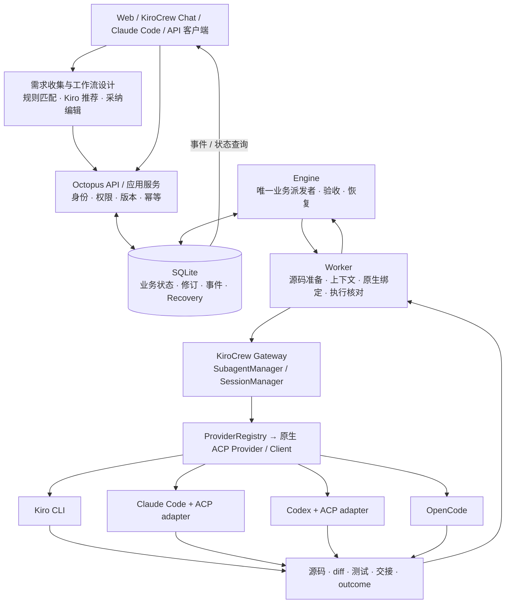
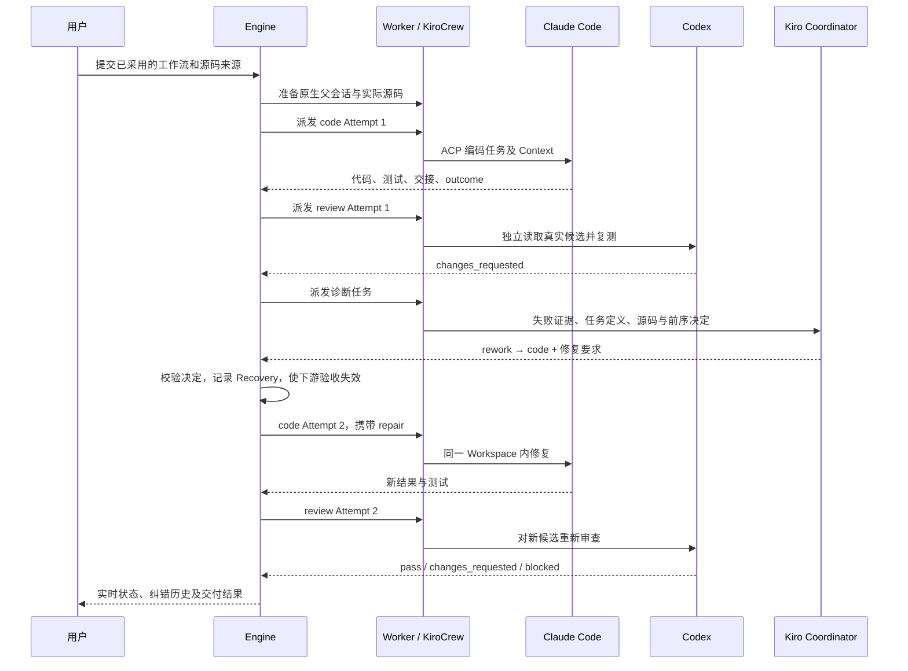
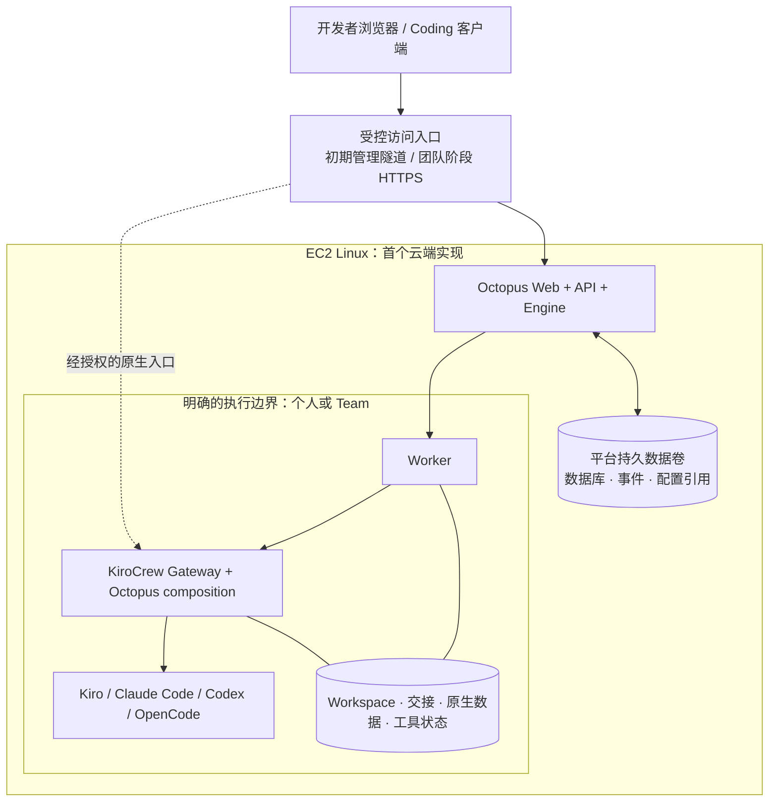

# Claude Code 项目交接 Prompt：KiroCrew Octopus 研发平台

整理日期：2026-10-10。用途：将本文件作为 Claude Code 的项目主任务提示词，在现有代码上继续迭代。

本文依据当前工作树、对话决策和仓库内报告整理。历史测试结果不是在本次文档生成时重新执行的结果。
“当前能力”“目标要求”“待验收”分别标注；不要把下面的目标直接当作已上线功能。

---

## 01．你的角色、任务与工作方式

你是这个项目的技术负责人和实施工程师。请接手 **KiroCrew Octopus**，基于已经实现的新旧两个版本，
继续构建运行在 EC2 后台、以 KiroCrew 原生机制和 ACP Harness 为执行底座的自动化研发平台。

用户通过 Web、KiroCrew Chat、Claude Code、Kiro CLI 或其他获授权的 API 客户端提交需求，
平台完成需求收集、工作流推荐、人工采纳或按预设策略准入、源码准备、编码、独立审查、纠错与交付。
用户可以持续查看真实进度，并在同一个开发 Session 和 Workspace 上继续迭代。

这是面向日常研发的最小可用产品，要能处理已有代码库、真实构建和测试、执行失败及服务重启。
不要把任务退化为静态展示、只能生成示例文件的演示器，或要求用户手写 Plan.md / Tasks 的操作脚本。

工作方式：

1. 先阅读实际源码和仓库规范，简明说明设计与主要取舍，再实施已经明确授权的工作。
2. 复用已有资产；允许逐步重构，不以换框架、重写前端或重新实现 ACP 作为默认方案。
3. 小批次交付可运行成果，修复影响真实流程的问题，保留必要验证证据。
4. 不因缺少一个云端参数停止所有工作。先完成不依赖该参数的代码、测试和部署材料，再集中询问缺项。
5. 用户已授权的可逆研发操作持续完成，不反复请求同一项确认。
6. 实际创建云资源、对外发布和仓库写回使用执行环境中已经明确的账号、范围与授权；不从本 Prompt 推断不存在的凭据或目标。
7. 状态、模型、测试和部署结论必须如实报告。未知值显示未知，阻塞给出证据与恢复条件。

## 02．先核对交接基线

仓库标识：`LiboMa/kirocrew-octopus`，remote URL 为 `https://github.com/LiboMa/kirocrew-octopus.git`。

整理时的本机状态：

| 项目 | 已知位置或状态 |
|---|---|
| 源码工作树 | `/Users/malibo/MyDev/Kiro-Family-Spaces/kirocrew-octopus` |
| 开发分支 | `codex/coordinator-recovery` |
| HEAD | `b1ba98f`；这只是已提交基线，不包含全部后续开发 |
| Git 状态 | 大量已修改和未跟踪文件，包括 `octopus/` 与新版文档，尚未提交 |
| 旧版实际运行目录 | `/Users/malibo/MyDev/Kiro-Family-Spaces/experiments/kirocrew-app-poc` |
| 原生 KiroCrew 数据 | 本机 `~/.kiro/crew/`；不是源码仓库 |
| Gateway | `http://localhost:5476/` |
| 旧版 Workflow Studio | `http://127.0.0.1:8917/` |
| 新版 Team 工作台 / API | `http://localhost:8918/` |
| 新版 Worker | 本机后台端口 `8928`，没有独立用户操作页面 |
| 新版业务数据库 | 源码工作树下 `state/mvp-1.0.0/octopus.sqlite3` |
| 本机 Worker 数据 | 旧运行目录下 `state/runs/mvp-1.0.0-worker` |
| 统一入口 | 仓库根目录 `入口.html`、`打开工作台.command`、`入口/*.webloc` |

这些地址是当时的本机部署参数，不是 EC2 固定配置，也不是持续在线保证。
旧版管理入口校验要求 `127.0.0.1:8917`；使用 `localhost:8917` 曾返回 403。

**开始工作前必须先检查 `git status`、当前分支、模块是否存在和实际服务配置。**
不能认为重新 clone 远端就获得了所有新功能；不能用 reset、clean 或覆盖目录清除本地开发成果。
若在新机器接手且缺少新增模块，先明确缺失清单，请用户提供完整工作树或包含这些文件的提交。
可以继续核对已获得的源码和准备设计，但不得宣称缺失实现已经存在。

### 阅读顺序与依据优先级

1. 当前代码：`octopus/`、`poc.py`、`api.py`、`workflow*.py`、`development_prompts.py`。
2. 当前功能：`docs/COORDINATOR-RECOVERY.md`、`docs/MVP-1.0.0-RELEASE.md`。
3. 接口与运行：`docs/MVP-1.0.0-API.md`、`docs/MVP-1.0.0-STARTUP.md`、`docs/STARTUP.md`。
4. 旧版契约：`WORKFLOW-MVP.md`、`docs/DEVELOPMENT-CONTRACT.md`、`docs/SESSION-OPERATIONS.md`。
5. 设计参考：`docs/MVP-1.0.0-PLAN.md`、`docs/architecture/OCTOPUS-V2-ARCHITECTURE.md`、
   `docs/architecture/OCTOPUS-V2-IMPLEMENTATION.md`。
6. 云与团队规划：`docs/experiments/EC2-001.md`、`docs/architecture/ENTERPRISE.md`、
   `docs/architecture/CONNECTORS.md`。

早期架构文档可能写着“尚未实现”，其中部分能力已经在新版实现；以代码和较新的验证报告逐项核对。
早期文件中的“EC2 仅规划”描述的是历史阶段；本次后续建设目标已包含 Linux / EC2 后台部署，
但截至交接时并没有完成 EC2 部署验收。

## 03．产品目标与必须保留的决策

产品主链路：

```text
收集用户需求与代码来源
  → 匹配模板 / KiroCrew 推荐工作流
  → 用户采用并调整任务、工具、模型、Effort
  → 固定本次执行配置，准备实际源码
  → Kiro 分析 / Claude Code 编码 / Codex 独立审查 / OpenCode 交付
  → 发现问题时诊断、返工、重新审查
  → 生成可预览的成果、开发报告与 Release 文档
  → 按授权交付至仓库或环境
  → 用户在原 Session 和 Workspace 继续下一轮研发
```

四个工具是可编辑模板的默认组合，不是硬编码的固定执行顺序。
用户可以只使用其中一个工具，或为多个 Task 选择同一工具的不同模型。
**工具范围：Kiro CLI、Claude Code、Codex、OpenCode；明确排除 Gemini CLI。**

持续保留以下决策：

- CLI 是可选客户端和运维入口，JSON / YAML / Markdown 是配置交换格式；它们不应成为用户唯一入口。
- 用户先定义任务，再为任务选 Agent / Coding Tool、Model、Effort 和提示词。
- 工作流定义修改生成新版本，下次运行生效；当前运行保留已有快照。
- “原 Session 继续”是另一种显式操作：保存执行修订并创建新 Attempt，保留原 Workspace。
- 共享工作流、共享运行、共享凭据是不同问题，不能互相隐式授权。
- 用户不需要自己开发 ACP、MCP 或平台接口；平台交付完整接入与配置向导。
- 保留旧版入口及旧历史，迭代新版不以删除旧数据为代价。
- 不允许重名或重复 Task 身份造成误操作；名称规则和 ID 唯一性由服务端保证。
- 工作台以任务状态和开发进度为中心，状态来自真实执行记录。
- 技能、权限、认证使用各 Coding 工具和 KiroCrew 的原生机制；Prompt 不能冒充权限控制。

## 04．已有两版能力：复用而不是遗漏

### 旧版：Workflow Studio / 8917

已有功能和资产：

- Web 引导构建、KiroCrew Chat 操作、JSON / YAML / Markdown 工作流导入导出。
- 工作流版本库、Session 列表、Tasks、1–8 个顺序阶段、阶段级工具 / 模型 / Effort。
- 意图生成及采纳，项目名称与目标填充，实例模板和任务提示词。
- 统一编辑入口、Session 独立草稿、侧栏调整、进度和产物预览。
- 原 Session 续作、阶段重试、配置修改、停止、关闭、恢复、导出和保留备份的删除操作。
- 研发源码准备：Git 来源 / ref、实际检出、基线记录、项目目录作为原生任务 cwd。
- 原生主协调者通过 `next / accept` 等框架操作和 KiroCrew 工具推进阶段。
- `poc.py` 的原生 provider factory 组合、后端路由与执行证据。

旧版的主协调者承担较多推进逻辑；它并不保证任何失败都自动恢复。
不能把旧版的演示模板限制原样复制为新平台的全局研发限制。

### 新版：Team MVP / 8918

已有功能和资产：

- 用户登录、可撤销用户 Token、个人空间、Team 和成员角色。
- 工作流默认私有；向指定用户或 Team 授权 `viewer / runner / editor`。
- Web、REST API、Python 客户端、stdio MCP 访问同一业务服务。
- SQLite 持久化工作流版本、Run、Task、Attempt、修订、事件、命令回执和 Recovery。
- 需求优先入口、15 个已有模板、规则匹配、真实 Kiro 推荐、采纳和动态任务提示词。
- 明确代码来源、Worker 准备源码、由 Engine 派发原生 KiroCrew 子任务。
- SSE 状态流及断线补读，任务详情中的真实执行证据。
- 原 Session 原地续作，选择任务、更换工具 / 模型 / Effort，保存历史 Attempt。
- 停止、备份后关闭、重新打开、导出、删除原生父对话等运维入口。
- “在 KiroCrew 中打开”已绑定父会话，复用原生认证。
- Coordinator 失败诊断、有限重试、上游返工与下游复审。
- 蓝白工作台、可调整侧栏、Tasks 主视图、历史执行与纠错记录。

不要假设旧版所有 UI、导入导出或运维细节都已经完整移植到新版。
先建立功能对照表，标注：已复用、部分实现、缺失、计划淘汰及替代方式。

### 当前仍需解决或验收

- Linux 无桌面运行与 EC2 实际部署。
- 真正独立的 Team 执行环境；已有 API 权限不等于完成运行隔离。
- OpenCode 完整交付、其模型 ID 与原生派发契约兼容。
- 新 Web 内对原生权限批准的完整代理。
- 大型已有代码库的 clone、依赖安装、构建、持续返工与交付。
- GitHub / GitLab Connector、Webhook、PR / MR 写回。
- 长期 Team Memory、任意 DAG / 并行分支、分布式高可用、SSO、配额与公平排队。
- 旧 Session 的明确归属迁移；不得擅自认领或全部归给新管理员。

## 05．架构主线与模块职责

以新版业务服务为继续迭代的主线，复用旧版成熟资产。先做模块化应用，不默认拆成大量微服务。



当前模块地图：

| 模块 | 继续承担的职责 |
|---|---|
| `poc.py` | 原生运行时组合、模板到后端映射、factory 扩展与参数适配 |
| `api.py` | 已有原生 HTTP / 认证等接入辅助；重构时集中其部署参数 |
| `workflow.py`、`workflow_library.py` | 旧版流程与版本库，保留兼容入口 |
| `workflow_workspace.py`、`workflow_sessions.py` | 旧版项目准备与 Session 操作，可提取复用 |
| `development_prompts.py`、`workflow_files.py` | 研发提示词与配置解析，避免新旧两套互相漂移 |
| `octopus/server.py`、`domain.py` | 统一 API、权限、业务命令、版本与运行管理 |
| `octopus/db.py` | 持久化、事务、唯一约束、事件 |
| `octopus/engine.py` | 工作流推进、派发、交接检查、停止与恢复 |
| `octopus/worker.py` | 执行环境、源码、原生父子身份、派发回执与实际状态 |
| `octopus/recovery.py` | 失败分类、诊断上下文、决定校验、返工与复审 |
| `octopus/intent.py`、`designs.py` | 模板规则、真实 Kiro 设计任务及结果校验 |
| `octopus/crew_entry.py` | 有权限的原生父会话跳转与认证交换 |
| `octopus/mcp.py`、`client.py`、`schema.py` | 客户端协议、业务工具和接口描述 |
| `octopus/ui/` | 新版工作台、向导、推荐、原生入口与纠错视图 |

关键边界：

1. Engine 决定“哪个业务 Task 现在执行”；KiroCrew 决定“原生 Agent 会话如何运行”。
2. 同一 Run 只有一个业务调度所有者，不能让旧协调协议与新 Engine 同时派发。
3. 新版主 Chat 用于理解、解释和提交业务命令；诊断 Agent 返回建议，Engine 校验并执行。
4. 普通业务代码不绕过 KiroCrew 直接启动 Claude / Codex CLI 或另建模型工具循环。
5. 原生能力不足时，先核实公开接口和现有扩展点；需要上游改动就明确标注并提交最小方案。

## 06．ACP 后端、模型、Effort 与认证

当前路由不是在 Agent JSON 中写一个模型名就完成，而是：

```text
Task.tool
  → 原生 Agent 模板
  → PocProviderRegistry 的 BACKENDS 映射
  → 对应 KiroCrew provider factory
  → ACP Provider / Client
  → Coding 工具或它的 ACP adapter
  → 工具自身配置的模型服务与认证
```

已用模板映射：

| 模板 | 后端 |
|---|---|
| `poc-coordinator`、`poc-kiro` | Kiro 默认 backend |
| `poc-claude` | `claude` |
| `poc-codex` | `codex` |
| `poc-opencode` | `opencode` |

当前组合要求 `session_sharing=false`、`pool_size=0`。
不要未经契约验证就改为跨后端共享 provider 实例、ACP Client 或工具内部 Session。

模型与参数要求：

- 从当前 Worker / Harness 的实际公布能力获取模型和 Effort，不硬编码推测的模型清单。
- 能力记录来源、采集时间、后端版本、账号与必要的工作目录作用域。
- `auto` 表示采用工具默认；未报告实际模型时不能用请求值填充“实际模型”。
- 区分 requested、实际 observed / resolved、核对结论和任务执行结果。
- 明确模型不匹配、组织限制或原生拒绝必须展示；模型回退需要明确策略和记录。
- 更换工具后重新校验模型和 Effort，不能保留另一个后端的无效选项。
- Token / usage 仅在原生可靠返回时汇总，标明统计范围；不支持时显示未报告，不估算为真实消费。
- 不同 Harness 对第三方 provider 的支持需分别核实；平台不承诺任意模型服务可通用直连。

当前 OpenCode 曾发生：默认执行返回空结果，带 `/` 的显式模型 ID 被原生 spawn 格式拒绝。
这些是需要复现与修复的兼容问题，不能通过隐藏失败或静默换工具宣告 OpenCode 已完成。

各工具继续使用自己的登录和 provider 配置。EC2 需要为该部署的执行身份配置认证，
不能认为本机已经登录就能在远程主机继续使用，也不整体复制个人 HOME。

## 07．对象、版本与 Session 身份

用户视角保持：

```text
个人 / Team
  └─ Workflow
      └─ 开发 Session
          └─ Task
              └─ Attempt / 执行历史
```

直接提交定制任务可以没有单独保存的 Workflow 条目，但必须保存本次流程快照。
开发 Session 在当前新版主要由 `runs` 记录承载；不要因为架构图中有独立 Session 概念就声称已有对应表。

必须区分这些 ID：

| 身份 | 语义 |
|---|---|
| Workflow / Version | 可复用定义及不可变版本 |
| 平台 Run / 开发 Session | 一轮可以持续续作的研发上下文 |
| 业务 Task | 在该 Run 内稳定的任务；对外用 `run_id/task_id` |
| Attempt | 某个 Task 的一次实际执行，保存配置和结果 |
| KiroCrew 原生父 Session | 平台 Run 绑定的原生对话 |
| KiroCrew 原生子 Task / Session | 每次派发形成的原生执行 |
| Coding Tool Session | Claude / Codex / Kiro / OpenCode 内部会话标识 |

“同一平台 Session”不等于“所有 Coding Agent 共用同一个原生 Session”。
当前新版新 Attempt 使用新的原生子任务，通过持久化上下文和同一源码恢复工作。

版本规则：

- 编辑工作流库生成新版本，已有 Run 快照保持不变。
- 原地续作保存 `revisions` 和新 Attempt；上游仍适用的交接保留，选中任务与下游旧验收失效。
- 在途 Attempt 不热改模型或任务；按停止 / 等待结束流程处理冲突。
- 工作流阶段增删排序与某次运行的任务配置修订分开处理；不能修改旧执行历史。
- 唯一名称至少满足当前同 Owner 下规范化唯一；跨 Owner 展示归属和 ID，避免看似同名误选。

## 08．需求收集、推荐与可配置自动执行

当前有需求提交与 `waiting_worker` 等持久化运行状态，尚不等于完整的需求收集队列产品。
在此基础上补齐任务收集视图，避免另造不相连的第二套任务系统。

目标交互：

1. 用户在同一个需求输入框提供目标、仓库和必要约束。
2. 自动提取可明确识别的仓库信息，匹配模板或已有有权运行的 Workflow。
3. 即时规则匹配明确标注为规则；“让 KiroCrew 推荐”是实际后台设计任务。
4. 后台设计得到任务列表、各任务提示词、工具建议和验收条件。
5. 用户采用后自动填充项目 / Session 名称、目标、任务和模型配置，并可继续编辑。
6. 用户提交后形成固定执行快照；源码就绪后后台开始研发，不依赖浏览器一直打开。
7. 暂缺 Worker、认证或必要输入时，保存需求并显示具体等待原因。

任务收集的新增设计需明确：提交者、个人 / Team、来源、目标、仓库/ref、优先级、
工作流选择、执行策略、时间戳以及与 Run 的关联。新增表和 API 先定义，再补迁移和权限测试。
不要把建议中的新接口名当成仓库已有路由。

自动执行分两种模式：

- 默认交互模式：推荐 → 用户采用 → 提交 → 自动研发与有限纠错。
- 可配置策略模式：用户或 Team 预先授权固定流程、仓库范围、执行身份和边界后，
  已满足条件的 API / Connector 任务可以直接准入运行，不逐次强制点击采用。

推荐不能暗中执行推荐出的业务流程。允许的直接运行模式必须显式配置并留存执行策略快照。
保持用户手动修改优先，切换 Session、关闭弹窗或迟到响应不得把旧建议覆盖到另一份草稿。

## 09．源码准备与真实研发环境

曾出现的关键故障：编码任务被派发到只有说明文档的 Workspace，目标应用源码实际在别处；
工作者正确报告 BLOCKED，平台却给用户造成“已有 Session 就应有源码”的误解。

必须建立并验证以下前置条件：

1. 区分新建项目与开发已有 Git 仓库。已有代码库需求不能默认选择空项目。
2. 用户明确提交仓库后，验证来源、权限和 ref，准备检出，保存实际 commit 和项目目录。
3. 需要根据仓库进行需求分析时，先完成有范围的只读检查或准备步骤；输入框每次变化不自动反复 clone。
4. 未完成源码准备不得派发业务编码 Task；页面应显示项目准备中、认证失败等真实状态。
5. Task cwd 指向真实项目，Context 指向该项目和交接文件。
6. 按项目规范和锁文件安装依赖、构建、测试、启动调试；网络和权限问题具体处理。
7. 继续原 Session 复用已有 Workspace 和修改，不能重新 clone 覆盖用户成果。
8. 更换仓库 / ref 是独立显式动作，需要说明影响，不能夹在普通重试中。
9. 同一 Workspace 的写入执行需要互斥；首版串行执行，先把正确性做好。
10. Review 必须绑定实际候选：基线、真实 diff、相关未跟踪文件和内容摘要。

不能再全局加入“仅演示目录、禁止安装依赖、只能标准库、不得进行真实研发”等旧 PoC 限制。
用户主动指定的离线、只读或技术栈约束仍应执行。

## 10．Context、Memory、Skills 与 MCP

跨工具共享依赖显式交接和持久化，不依赖某个模型记住所有聊天。

每个 Attempt 的 Context 至少能够定位：

- 原始需求、当前修订、任务目标和验收条件。
- 原始流程快照及本次工具 / 模型 / Effort。
- 仓库来源、基线、当前项目路径、候选代码。
- 上游交接、真实结果、测试输出、审查发现。
- 已失败 Attempt、Coordinator 决定和本轮 `repair` 要求。
- 文件来源、内容摘要、对应生产者与适用范围。

代码、完整日志和大产物保存为文件；SQLite 保存归属、状态、引用和必要摘要。
超长内容使用可追溯摘要和原文路径，关键约束不能只存在于易丢失的摘要里。
原生父会话 note 的长度有限，不能把 note 截断当成完整交接丢弃。

Memory 另行核对当前 KiroCrew 版本：

- 平台运行状态、聊天历史、工具私有历史、KiroCrew 长期 Memory 是不同的数据。
- 不把 Memory V1 / V2 理解为“本地短期”和“远程长期”的天然划分。
- 当前研发恢复链路不以向量 Memory 作为权威来源。
- 团队 Memory 的作用域、权限、保留期和召回引用需要独立设计；尚未完成时明确标注。

工具与技能加载：

- 核对实际启动参数、cwd、HOME、Agent 配置、项目规范和各工具的原生加载规则。
- 核对 `includeMcpJson`、受管理 MCP 与工具自带配置，不能假定本机所有 Skills / MCP 都自动加载。
- 区分“发现了配置”“成功加载”“真实调用过”三个层次。
- 保留用户已有配置，不用平台模板无差别覆盖用户 Skills、模型和权限设置。
- EC2 的工具、Skills、MCP、凭据配置形成可审计的部署清单；不同 Team 不隐式共享私人配置。
- 平台业务 MCP 使用普通用户 API 身份；原生受管理 MCP 身份由 KiroCrew 负责，不伪造其调用方式。

## 11．自动纠错与复审是必需功能

当前已有：新业务 Run 默认两轮自动诊断，可配置 1–5 轮或关闭。
没有纠错策略的历史 Run 默认不自动处理，不因为服务更新自行复活。



已有业务结果契约示例：

```json
{
  "decision": "changes_requested",
  "summary": "边界输入测试失败，需要修复实现",
  "failure_type": "tests",
  "findings": [
    {"file": "src/add.mjs", "line": 2, "issue": "返回值多加了 1"}
  ]
}
```

`decision` 为 `pass / changes_requested / blocked`。
`findings` 支持文字或具有问题说明的对象；非空 findings 不自动等于 JSON 无效。
格式合格、执行结束、测试通过和质量验收是不同条件。

已有诊断决定示例：

```json
{
  "action": "rework",
  "target_task_id": "code",
  "reason": "独立测试证实实现错误，问题来自编码阶段",
  "instructions": "依据失败用例修复实现，保留测试并复跑，然后重新提交审查"
}
```

`action` 为 `retry / rework / wait_for_user`：

- retry：当前失败 Task 的新 Attempt。
- rework：当前或上游 Task 返工，受影响下游重新执行。
- wait_for_user：说明缺失输入、认证、权限或配置，以及恢复步骤。

Engine 必须校验目标、归属、版本、当前状态和停止意图。
缺源码、认证、明确停止、未知派发结果不能通过盲目循环解决。
纠错次数、超时和未来成本上限要清晰展示；不能无限重试。
诊断 Agent 当前“不派生任务”的限制主要来自提示词，不得描述成已完成工具级隔离。
后续补齐执行能力约束时仍复用 KiroCrew 机制。

自动修复成功仍须独立复审；Coordinator 的解释可能有误，不能用其自述代替验证。

## 12．可靠调度、停止与恢复

保留已有幂等、版本、原生归属和迟到回执处理，并补真实故障测试：

- API 接收成功表示命令已登记，不表示研发已完成。
- 同一个 `request_id` 和相同请求返回原回执；不同内容应冲突。
- 修改用 `expected_version` 防止覆盖其他用户刚做的更新。
- 派发前记录 Attempt；远端回执不明时先核对，不直接生成第二次执行。
- `dispatch_unknown` 必须可见；不承诺跨平台与工具副作用绝对 exactly-once。
- API / Worker 重启先恢复观察原生状态；浏览器关闭不停止服务端任务。
- 同一 Run 只有一个有效业务派发者；过期 Attempt 返回不能完成新 Attempt。
- 停止先持久化意图并阻止新派发，再取消并核实原生父 / 子任务。
- 原生仍运行、排队或有待处理批准时，保持停止中，不伪造已停止。
- 关闭、归档、删除父对话、清理源码分别定义；不能连带清空其他 Sessions。
- 删除需要明确对象、备份校验和保留策略；日常升级不删除 Session 或 Workspace。
- SQLite 的一致性备份、原生会话导出、源码备份分别验证恢复能力。

UI 不应只显示“需要处理”。至少说明：当前 Task、原因类别、已发生什么、未发生什么、
可执行操作，以及真实错误 / 证据入口。

## 13．Web 产品与交互要求

延续蓝白风格。状态色可区分进行中、通过、等待、失败和停止，不必全部用蓝色。

- 左侧：个人 / Team、工作流及所属 Session，层级清楚，操作简约。
- 顶部：当前项目、Session、源码分支 / 基线、真实整体进度。
- 中央：Tasks、当前阶段、关键结果、失败原因、纠错记录。
- 侧栏 / 滑动抽屉：任务与 Agent 配置融合；先任务，后工具、Model、Effort、Prompt。
- 大尺寸引导窗口：统一需求输入、模板实例、推荐、采用、编辑、提交。
- 完成构建后可收起到左侧，主区域专注跟踪执行。
- 当前工作流保留一个明确编辑入口，删除 / 归档含义清楚。
- 左右栏可调宽；状态动画适量，并支持减少动态效果。
- Session 操作包含续作、模型调整、停止、关闭 / 恢复、导出和受控删除。
- 原生入口打开已绑定的 KiroCrew 父会话，包含正确认证，不另外创建 Run。
- 进度按已验收任务 / 当前有效任务计算；不得编造单 Task 内部百分比。
- 模板切换更新预设提示词；手动修改不被后台建议覆盖。
- 按用户、空间、Session 隔离草稿；处理迟到网络响应。
- 弹窗不能被轮询重绘闪退，不能重现 `WorkflowProgress is not defined` 等资源错配。
- 新旧工作台都可进入，但同一 Run 的管理归属必须明确。

## 14．统一 API 与 Coding 客户端接入

继续以现有 `/v1` 和 MCP 为基线，不要求客户端先编辑平台 JSON 配置才能提交任务。
新增能力通过相同业务服务暴露，统一认证、版本、幂等、事件与权限。

当前主要接口：

| 能力 | 已有 API |
|---|---|
| 登录与身份 | `POST /v1/login`、`GET /v1/me` |
| 接口发现 | `GET /v1/openapi.json` |
| 模板与匹配 | `GET /v1/workflow-templates`、`POST /v1/workflows/resolve` |
| Kiro 推荐 | `POST /v1/designs`、`GET /v1/designs/{id}` |
| 提交研发 | `POST /v1/runs` |
| 状态 / 事件 | `GET /v1/runs/{id}`、`GET /v1/runs/{id}/events` |
| 原地续作 | `POST /v1/runs/{id}/continue` |
| 手动诊断 | `POST /v1/runs/{id}/recover` |
| 运维 | 同一 Run 下的 `stop / close / reopen / delete / assign-worker` |
| 原生对话 | `POST /v1/runs/{id}/crew-entry` |
| 工作流 / 共享 | `/v1/workflows`、版本、shares、archive |

已有 MCP 工具包括：
`octopus_workflows`、`octopus_match_workflow`、`octopus_recommend_workflow`、
`octopus_workflow_recommendation`、`octopus_teams`、`octopus_runs`、`octopus_status`、
`octopus_start`、`octopus_continue`、`octopus_recover`、`octopus_control`、
`octopus_save_workflow`、`octopus_share_workflow`。

当前 MCP 是本地 stdio 适配到 HTTP API，不要宣称已提供远程 HTTP MCP。
Claude Code / Kiro 客户端可以运行该适配器连接 EC2 的平台 API。
如增加远程 MCP transport，单独实现身份、连接和协议测试。

客户端用户 Token、Worker Token、Gateway 原生凭据必须分开。
MCP 用户身份不会自动证明调用发生在某个 KiroCrew 原生 Chat 内。
若要绑定“当前 Chat”，必须核实可信宿主身份；不能仅信任模型传来的 `session_id`。

原生浏览器登录当前以 Worker / Gateway 为边界，不是单 Session 只读票据；
平台撤销 Team 成员不代表已经建立的原生浏览器登录同步失效。云端方案必须正视这个边界。

## 15．EC2 部署目标：在现有实现上移植

截至交接没有完成 EC2 部署。当前 `poc.py` 和部分启动器包含 `/Applications/...`、
macOS Python、zsh、Electron 和本机路径假设，不能直接拷到 EC2 宣称可用。

先验证目标 Linux 上原生 KiroCrew 的安装、无桌面启动、版本和扩展机制，
再移植 Octopus composition，保留 macOS 路径兼容。
整理时已验证的本机版本集合为 `0.7.1 / 0.7.2 / 0.8.0`；
这不代表所有这些版本都通过了 Linux / EC2 验收。

目标部署关系：



需交付：

1. **运行时配置**：解释器、KiroCrew 安装、工具路径、端口、数据根、HOME、公开 URL、日志目录统一配置。
2. **无桌面启动**：独立 API、Worker、Gateway 服务入口，不依赖 Electron 或打开浏览器。
3. **服务生命周期**：可用的 Linux 服务管理配置、就绪检查、优雅重启、日志与重启恢复。
4. **持久数据**：代码目录、平台数据、Worker 数据、原生 Crew 数据分离；升级不初始化已有数据库。
5. **凭据与环境**：各工具在所属身份下初始化认证；平台仅保存必要引用和受控连接信息。
6. **网络入口**：明确内部端口与对用户入口；验证 Host / Origin / Cookie、SSE、原生跳转和代理路径。
7. **组合启动**：服务必须加载 `PocProviderRegistry` 等现有组合逻辑；普通 Gateway 启动不代表已获得多后端路由。
8. **版本与回滚**：固定依赖和运行时版本，记录迁移与回退；不通过回滚元数据掩盖已执行的代码变更。
9. **备份恢复**：在独立目录或测试实例实际恢复平台、源码和必要原生数据，列明未覆盖内容。
10. **运维手册**：首次启动、升级、重启、日志、端口、认证过期、停止失败、磁盘与队列异常。

优先做一台 EC2 上的受控完整闭环。团队执行需要真实独立身份 / 容器 / 主机后再验收；
不能因为 API 能创建 Team 就把共享同一个宿主账号的环境描述为多租户隔离。
当前 `trusted-local` 是个人验证模式；`dedicated` 是部署声明，不会自动创建隔离。

基础设施脚本的 AWS region、实例、网络、域名与资源规格由目标环境明确。
不要复制旧设计里的候选参数为“经过验证的最低配置”，也不要在未运行时报告部署成功。

## 16．Team、Connector 与持续研发迭代

Team 阶段继续复用已有身份和共享能力，补齐：

- 至少两个用户、两个隔离边界的正向与越权测试。
- 团队成员变更对查询、SSE、导出、运行、原生入口的影响。
- Worker 的身份、资源和认证归属；忙碌、离线、排队和可恢复状态。
- 适度的并发 / 配额策略。单 Workspace 首先保持串行，跨 Worker 扩展另行验证。
- 分享 Workflow 不自动分享私人 Run、源码、Memory 或 provider 凭据。

GitHub / GitLab Connector 目前为规划。应作为输入与交付适配接入同一个业务服务：

```text
授权仓库 / Webhook / Issue / 手动需求
  → 事件校验、去重、用户与仓库范围核对
  → 明确源码 SHA 和工作流版本
  → 同一研发 Run 与 KiroCrew 调度
  → 真实候选、测试和审查
  → 按策略创建分支 / commit / PR 或 MR
  → 同步真实检查状态与报告
```

先做授权仓库读取和源码准备，再做事件输入，再做受控写回。
GitHub 与目标 GitLab 版本的认证和 Webhook 规则按实施时官方资料核实。
写回绑定已验证候选；交付 Agent 修改已审查代码时必须重新验证。
远端写入回执丢失先查询，避免重复分支 / PR / MR；远端基线变化要显示冲突。
自动合并或生产发布是单独策略，不是“自动研发”的隐含默认。

持续迭代要求将客户反馈、失败证据和新需求带入原 Session 的显式修订，
能够追踪每轮输入、代码候选、审查结果、发布记录和未解决事项。

## 17．真实验证基线与不能夸大的结论

据现有报告，最近一次 Coordinator 功能验证包含：

- 66 项后端回归通过：42 项 Team / Worker、8 项原生入口、16 项纠错。
- 85 项浏览器检查通过；其中模拟响应与真实原生实验分开记录。
- 6 项本机原生接入契约检查通过，用于 KiroCrew 0.8.0 兼容核对。
- 一个真实受控故障实验：Claude 代码 → Codex 测试拒绝 → Kiro 决定返工 →
  Claude 修复 → Codex 独立复测；保留同一 Run、父会话和 Workspace，最终两项测试通过。
- 更早的四阶段实验实际调用过 OpenCode，但 OpenCode 交付未通过，最后由显式改选 Claude 完成交付。

当前本机原始证据可能位于 `evidence/mvp-1.0.0/`，默认不提交公开仓库。
这些不是可随意发布的客户内容；缺少原始证据时应写“历史报告记录”，不要冒充自己刚刚复跑。
小型加法实验不代表大型仓库、Team 隔离、EC2 或所有模型组合已通过。

基线测试入口：

```bash
python3 -m unittest discover -s tests -p 'test_mvp.py' -v
python3 -m unittest discover -s tests -p 'test_crew_entry.py' -v
python3 -m unittest discover -s tests -p 'test_recovery.py' -v
python3 -m unittest test_workflow test_workflow_workspace test_workflow_library test_workflow_sessions -q
python3 build_workflow_ui.py --check
node --check octopus/ui/app.js
node --check octopus/ui/launch.js
node --check octopus/ui/recommend.js
node --check octopus/ui/crew.js
node --check octopus/ui/recovery-ui.js
```

实际运行前读 `tests/README.md`、CI 和相关模块依赖。
浏览器使用 `tests/mvp_browser_fixture.py` 及 `tests/mvp-*.browser.js`，
真实 ACP 实验使用单独明确的测试项目，不能在用户历史 Session 上做删除或故障注入测试。

## 18．实施阶段与完成条件

### 阶段 A：接手与回归

交付新旧功能对照表、当前事实清单、未提交文件清单、主要调用链、已知故障清单。
建立开发分支，保留已有工作树和运行数据；跑适用的基线测试。
先修复妨碍任务提交、源码准备、续作、纠错和状态可信度的问题。

完成条件：现有两版入口可用、关键行为可复现，哪些能力未验证有明确记录。

### 阶段 B：Linux 与配置解耦

实现可配置运行时、无桌面启动和服务管理，补路径与跨实例身份隔离测试。
复用原生 KiroCrew factory、SubagentManager、ACP 和认证，不改成自己的 CLI 调度器。

完成条件：目标 Linux 环境跑通 Kiro、Claude、Codex 的真实最小研发与返工；
OpenCode 单独核实，失败明确记录并提供用户可见的替换配置。

### 阶段 C：EC2 单机真实研发

在明确的测试环境部署，连接一个获授权的已有小型仓库。
从需求提交到 clone、编码、测试、独立 Review、故障返工、HTML 预览和报告形成完整链路。
通过 Web 与一个 Coding API 客户端查询同一 Run。

完成条件：远程操作真实成功；重启可恢复；证据包含实际后端、原生 ID、源码基线、diff、测试与产物。
没有完成 OpenCode 或其他关键目标时保留未通过项，不合并成“全部通过”。

### 阶段 D：任务收集与 Team

补齐需求收集队列和明确的自动准入策略。
在真实执行隔离下验证多个用户、工作流共享、权限变化、排队和持续 Session 迭代。

完成条件：用户 A / Team A 的运行与认证不能被无权用户访问，授权协作的路径完整通过。

### 阶段 E：仓库闭环与交付

实现 GitHub / GitLab Connector 的分阶段能力，建立候选和发布记录。
先在指定测试仓库验证真实写回、去重、冲突和审查失效。

完成条件：需求进入 → 自动研发 → 质量复审 → 获授权写回 → 状态报告可追踪。

各阶段都交付可运行结果。不要等所有 Enterprise 功能完成才提供可使用的 EC2 MVP。

## 19．验收矩阵

| 场景 | 必须观察到的结果 |
|---|---|
| 输入需求并采用 Kiro 建议 | 名称、目标、任务及提示词自动填充，用户修改保留 |
| 使用已有代码库 | 实际源码就绪后编码，记录 ref / SHA / cwd |
| Claude 编码、Codex 审查 | 路由证据与原生 ID 对应正确工具，Review 使用真实候选 |
| 模型受限或不匹配 | 请求与实际分开，给出原因，不静默成功 |
| 审查要求修改 | Coordinator 诊断，原 Workspace 返工，下游重新复审 |
| 缺源码或认证 | 明确等待原因，可恢复，不无限重试 |
| 原 Session 改模型续作 | Run / 父会话 / Workspace 保留，新增修订与 Attempt |
| 编辑工作流库 | 新版本只影响新运行，不篡改当前快照 |
| 切换 Session / 迟到推荐 | 输入、草稿、回执互不串用 |
| 停止中有迟到结果 | 不继续派发，不把旧结果算到新 Attempt |
| 派发响应丢失 | 保留未知状态并核实，不重复启动编码 |
| 服务或浏览器重启 | 状态可恢复，原生执行身份与持久化记录一致 |
| Team 分享与撤权 | 查看、运行、SSE、导出和入口权限都正确 |
| Skills / MCP | 明确配置来源、加载及实际调用的可验证范围 |
| Webhook 重放 / 写回重试 | 不产生无意的重复 Run 或 PR / MR |
| 交付修改候选 | 原审查结论失效，重新验证才可发布 |
| 备份恢复 | 在独立环境验证恢复，源数据与旧 Session 保留 |

测试分层记录：单元 / 集成替身、浏览器、原生契约、真实 ACP、Linux / EC2、
Team 隔离、Connector。不得互相替代。

## 20．每轮交付与立即开始的动作

每轮更新：

1. 可运行代码及必要迁移、配置、服务脚本。
2. 当前架构图、任务交互序列图、状态和恢复说明。
3. API / MCP、用户操作、启动 / 升级 / 回滚手册。
4. 验证报告：环境、版本、测试方法、真实结果、证据位置和未通过项。
5. Release Notes：新增功能、兼容变化、已知限制、下一轮工作。

沟通采用中文，先说结果和影响，再给必要依据。不要只回复计划或声称“已经生产可用”。

**现在开始：**

- 确认本地工作树是否包含新旧两版完整代码与当前开发分支。
- 阅读本 Prompt 指定的核心模块，输出简明的功能差异和实施顺序。
- 在保留历史数据的前提下运行适用的基线检查。
- 开始阶段 A / B 的可执行工作，将 Linux / EC2 所需配置从本机假设中分离。
- 只有遇到无法从仓库或环境获知的关键输入时才询问，并继续不依赖该输入的工作。

最终目标是：用户提交研发意图后，平台能通过 KiroCrew 与多 ACP Coding 后端持续完成真实研发迭代，
过程可配置、可观察、可恢复、可协作，结果有可核验的代码和测试。
