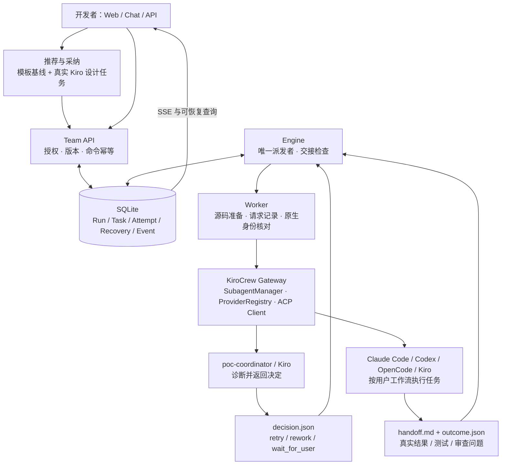
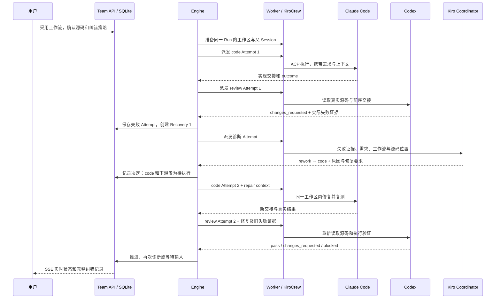

# Coordinator 推荐、诊断与返工

2026-10-10 · 分支 `codex/coordinator-recovery`。新版工作台 `8918`；旧版 `8917` 保留。

这轮补齐的是开发过程中的反馈循环：用户采用工作流，Coding Agent 执行，审查指出问题，
Coordinator 决定如何恢复，原实现者在同一工作区返工，审查者重新验证。
状态保存在 SQLite，实际执行仍通过 KiroCrew 的原生接口与 ACP Harness。

## 用户怎样操作

1. “发起开发任务”中输入一次需求。系统即时匹配模板，默认引导“Agent 推荐编排 → 审阅并采用”。
2. 点击“让 KiroCrew 推荐”，等待真实后台建议，点击“采用建议”。任务、工具和提示词都可以继续编辑。
3. 要直接使用模板，明确选择“手动编排 / 直接采用预设任务”；没有可用 Worker 时也能保存需求。
4. 明确选择新项目或 Git 仓库。输入中有明确的 GitHub / GitLab HTTPS 仓库 URL 时，会填入可编辑的代码来源。
   系统不再默认把已有项目需求放进空项目。
5. 检查工具、模型、Effort 和自动纠错策略。新业务运行默认开启，最多两轮；可设置 1–5 轮或关闭。
6. 执行后以中央 Tasks 和状态卡为主。“纠错记录”显示失败 Task、诊断原生 Task、决定和具体修复要求。
7. 已暂停的运行可以“诊断并修复”，或“配置并原地重跑”修改需求、工具、模型、Effort 与纠错策略。
   原地重跑不替换工作区，也不会自动改变既有源码来源。

编辑工作流库仍生成新版本，不改变正在运行的工作流。运行中的修复只增加新的执行 Attempt 和修订记录。
已有运行不会因为更新代码而自行复活；未携带纠错策略的旧运行默认关闭自动纠错。
用户明确启用纠错或请求诊断后，后续业务 Attempt 使用结构化结果契约。

## 架构与模块



| 模块 | 本轮职责 |
|---|---|
| `octopus/ui/launch.js`、`recommend.js` | 单一需求入口、推荐采纳、任务编辑、来源确认 |
| `octopus/domain.py` | 用户 / Team 权限、运行快照、人工诊断和原地续作 |
| `octopus/engine.py` | 串行派发、真实后端核对、结构化交接检查、停止与重启恢复 |
| `octopus/recovery.py` | 次数上限、诊断上下文、决定校验、返工和复审 |
| `octopus/worker.py` | 同一父 Session / Workspace 内经原生 `/api/spawn` 执行；读取交接及结果 |
| `octopus/db.py` | 附加 `recoveries` 表，保留失败执行、诊断执行、决定与状态 |
| `octopus/ui/recovery-ui.js` | 原因卡、自动纠错策略、历史记录与人工诊断入口 |
| `octopus/mcp.py`、`schema.py` | Chat 与 Web 使用相同 API，包含 `octopus_recover` |

新创建的原生父会话使用既有 `poc-coordinator` 模板；现存父会话绑定不被替换。
诊断使用同一父会话下的独立原生 `poc-coordinator` 子任务。父 Chat 负责交互和解释，Engine 统一派发业务任务。
这里没有让两个调度器同时启动业务子任务，也没有让诊断 Agent 直接修改平台数据库。

## 一次审查失败的完整交互



`retry` 只允许重试失败 Task；`rework` 可退回失败 Task 或其上游。
不能选择另一个运行的 Task，也不能跳过当前失败直接执行下游。
返工目标及其下游全部重新执行；旧的“通过”结论不能继续充当本轮审查结果。

## 上下文怎样保存

每个 Attempt 都有自己的 `instructions.md`、`context.json`、`dispatch.json` 和交接文件。
失败后，`recoveries.context` 保存完整需求、来源、源码路径、失败原生返回、实际证据、任务定义和此前决定。
新的业务 Attempt 还会收到独立的 `repair` 字段，包含具体失败、协调者决定及重新验证要求。
这份反馈也进入后续复审。文件和 SQL 是可恢复记录，不依赖某个模型持续记住聊天。

共享的是 Run、Workspace、文件产物和显式上下文。每次新 Attempt 创建新的原生子任务；
不等于跨 Claude、Codex 和 Kiro 共用同一个工具内部 Session。新上下文不能保证无成本或无限长，
大型仓库、过长返回和跨轮压缩仍需进一步验收。

## 状态应怎样理解

| 显示 | 实际含义 | 下一步 |
|---|---|---|
| 执行中 | 原生任务尚未完成 | 跟踪当前 Task 和权限 |
| 协调者诊断中 | 已记录失败，Kiro 正在分析恢复办法 | 查看纠错记录；可以停止 |
| 正在返工与复审 | 决定已执行，目标及后续步骤重新运行 | 等待新的测试与交接 |
| 等待补充项目或任务信息 | 缺源码、仓库来源或必要输入 | 补齐输入，不能靠盲目重试解决 |
| 等待认证或执行配置处理 | 权限、登录、模型等需要处理 | 按原生错误处理，再配置并重跑 |
| 某任务已停止 | 原生任务停止，不代表下游执行失败 | 无停止原因时明确显示未知 |
| 交接未通过 / 流程已暂停 | 本轮尚未满足验收，或已用尽纠错轮次 | 查看具体证据，诊断或原地重跑 |

`run-c5b5955e0653468dbabbb8cdab4c65b5` 在排查时停于 plan，
原生 Task `f0ddddb0` 已停止且没有返回停止原因，后续编码与审查没有开始。
此外它配置为 `source.type=new`，项目目录为空；这是与停止原因分开的另一个问题。
不能据此说“测试失败”，也不能推断谁点击了停止。

## 结果契约与可靠性边界

业务任务必须写：

```json
{
  "decision": "changes_requested",
  "summary": "实际运行边界用例失败，需要实现者修复",
  "failure_type": "tests",
  "findings": [
    {"file": "src/add.mjs", "line": 2, "issue": "返回值多加了 1"}
  ]
}
```

`decision` 还可以是 `pass` 或 `blocked`。`findings` 支持文字项和带问题说明的结构化项。
系统同时核对原生是否完成、交接是否存在、实际后端与明确指定的模型 / Effort 是否一致。
缺报告或无效报告不能默认为成功；审查发现必须修复的问题必须返回 `changes_requested`。
这些是交接机制，不是平台独立证明代码安全，也不能保证 LLM 的诊断永远正确。
Coordinator 不自行派发业务任务的职责由任务契约约束；本轮没有给原生模板新增细粒度工具 ACL。
平台 Engine 内的派发和恢复仍受事务、状态与幂等校验约束。

自动纠错有轮次上限。输入、认证、模型不符或明确停止不进行盲目自动重试。
用户明确请求一次人工诊断不受自动轮次上限阻止；后续自动处理仍按已使用的总轮次数计算。
运行停止或被修订后，迟到的诊断决定不能重新启动旧执行。
派发回执不明确时核实同一 Attempt，不再生成新的原生任务；记录失败后进程重启也能接上诊断。

当前仍为单 Engine / SQLite 的本地研发实现。独立 Team 隔离环境、任意 DAG、
大型项目、完整原生权限代理以及 OpenCode 的模型兼容性，需要分别验收。

## 验证与材料

自动测试覆盖审查退回、同工作区复审、次数上限、缺输入、手工诊断、权限、幂等、
停止竞态、丢回执、服务重启和结果格式兼容。浏览器覆盖推荐采纳、源码明确选择、
状态原因、诊断入口、原地重跑配置、旧入口和窄屏。

真实 ACP 实验记录单独保存在本机 `evidence/mvp-1.0.0/coordinator-native-run.json`；
验证统计和最终结果见 [本版 Release](MVP-1.0.0-RELEASE.md)。自动测试中的替身不当作真实 Coding 成功证据。
该实验已完成：同一 Run 中先处理一次报告格式失败，再处理 Codex 提出的实际测试失败，
Kiro 安排 Claude Code 返工后，Codex 重新审查通过；最终 2/2 任务完成，独立测试 2/2 通过。
