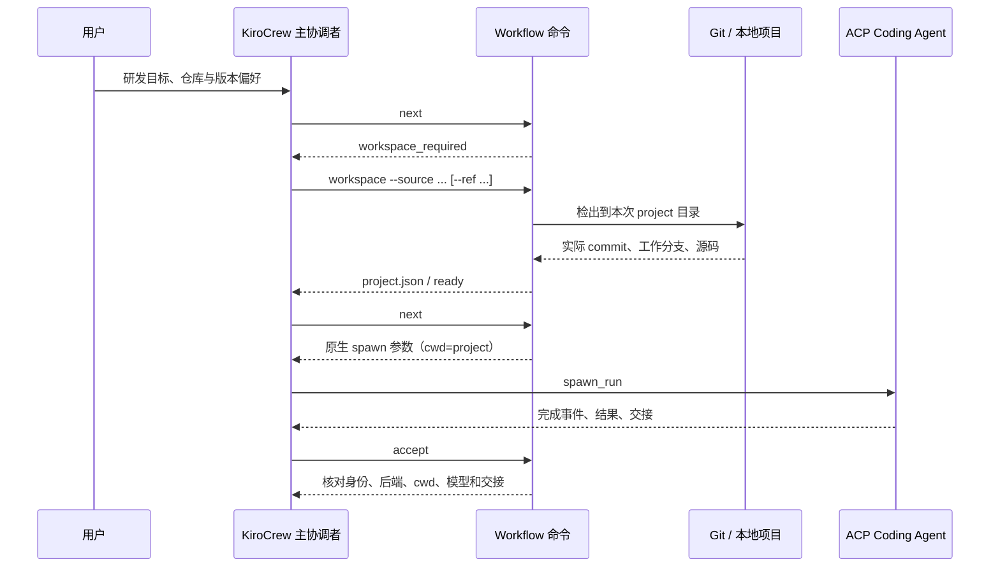

# Octopus 研发执行契约 v2

更新：2026-10-09。适用于新建的 Workflow Run。当前交付是单用户、本地研发调度
的最小单元；团队身份、租户隔离、分布式 Worker 和生产部署仍按后续计划实施。

## 研发动作按任务授权执行

共享提示词维护在 `development_prompts.py`，由原生 Agent 模板、意图生成器、
主协调者和每一步的完整指令共同使用。

| 职责 | 当前契约 |
|---|---|
| 意图设计 | 识别项目来源、ref、技术栈、任务范围和验收；允许使用工具核实用户指定仓库 |
| 主协调者 | 准备运行检出、记录基线、按原生 spawn_run 派发、等待完成和检查交接 |
| 研发执行者 | 在项目目录读取规范、按锁文件安装依赖、编码、构建、测试、调试 |
| 审查与交付 | 审查真实 diff，交付绑定已验证代码；实现再变更时明确复验要求 |
| 外部变更 | 提交、推送、PR/MR、部署和发布按用户明确要求及已有授权完成 |

删除了全局的“仅做静态 Web 演示”“禁止联网安装依赖”“禁止读取项目”
以及无条件“不提交、不发布”。原生工具的授权、认证及组织规则继续执行；
提示词不是权限开关。已有 Skills、工具、MCP 配置不会因更新提示词而重置。

用户明确选择标准库、离线、只读审查等约束仍属于本次任务要求。
保留的旧 `poc-pipeline-*` 演示运行采用原契约，不冒充新的通用研发流程。

## 源码必须先于派发就绪



新 Run 的 `workflow-run.json` 标记 `development_contract: 2`。
未准备项目时 `next` 只返回 `workspace_required`，不返回可执行的 spawn 参数。
命令由主协调者通过已有 Shell 工具调用；用户不需要手动执行：

```bash
python3 workflow.py workspace <run> --source https://host/team/repository.git
python3 workflow.py workspace <run> --source /absolute/local/repository --ref HEAD
python3 workflow.py workspace <run> --source git@host:team/repository.git --ref feature/example
python3 workflow.py workspace <run> --new
```

远程支持 HTTPS / SSH，本地支持 Git 仓库路径。未指定 ref 时固定检出时的默认 HEAD；
指定 ref 时解析为实际 commit。Git 使用原有 credential helper / SSH 配置，不另建凭据代理。
认证或网络失败保留错误；准备动作可用相同 Run 重试，不要求删除 Session。

本地来源有未提交文件且未指定 ref 时会提示选择基线；显式 `--ref HEAD` 表示只使用
已提交版本。当前不会静默忽略未提交改动，也未实现整个工作树快照复制。
仓库记录与输入来自协调者识别的用户需求；目前没有通用仓库选择器或任意自然语言
来源解析器，遇到多个不明确的来源，协调者需要澄清。

## 文件、版本与恢复

```text
state/runs/<run>/
  workflow-run.json        固定工作流及执行契约版本
  project.json             状态、来源、请求 ref、commit、工作分支和项目路径
  input.json               原始需求
  workspace/
    REQUEST.md
    <step>-instructions.md
    <step>-handoff.md
    <step>-result.txt
    project/               本次独立 Git 检出或新项目；所有步骤共用
```

源码准备先写暂存目录，成功后切换为 `workspace/project`；失败暂存与错误保留。
文件锁避免并发创建两个检出。准备成功后重复同一命令不会覆盖开发中的文件；
更换来源或 ref 需要新 Run。每次派发重新检查项目目录与基线 commit。

每个子 Agent 的 `cwd` 是实际项目检出，以便项目相对配置、AGENTS.md 和工具技能
按正确目录解析。交接仍用绝对路径传递，共享文件不代表共享模型私有上下文。
交接核对新增原生回执 cwd 检查；已报告的实际后端 cwd 也必须匹配。

合并阶段重试后，当前及下游旧交接先归档并失效，源码检出与基线保留。
新版 Run 仅在原生会话 cwd 与本次项目一致时选择续作；否则使用正确 cwd 新建任务。
重试按钮只登记状态，实际执行仍由原 KiroCrew 对话调用原生工具。

看板显示项目准备状态、来源、目录、分支和基线；它不计入业务任务 accepted 百分比。
Session 导出在原有文件之外附带 `project.json`，但不把整个源码目录当作 Session 对话包。

## 生效与当前验证范围

- 新 Agent 会话加载更新后的研发提示词；新 Run 使用 v2 的源码准备前置条件。
- 旧 Run 保留工作流快照、原 cwd 与已完成交接，不自动重跑或删除。
- 更改提示词不能撤销原生工具的权限要求，不能自动完成企业身份和权限治理。
- Git 准备已通过真实本地仓库检出、分支解析、并发、幂等、失败重试与数据保留测试。
- 依赖安装、构建和测试由原生工具按项目脚本执行，目前没有统一依赖缓存或环境镜像系统。
- 本轮没有执行客户仓库的业务修改、远程推送或生产部署；不以提示词更新宣称多团队生产验收完成。
