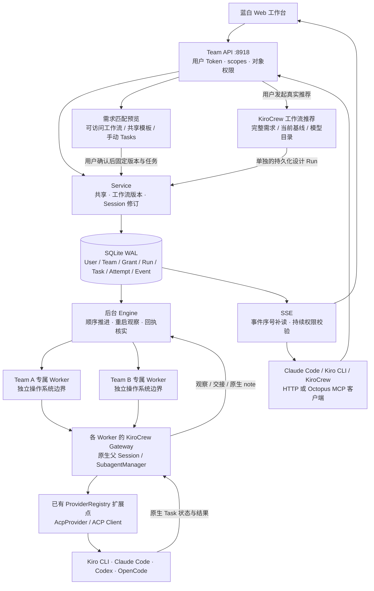
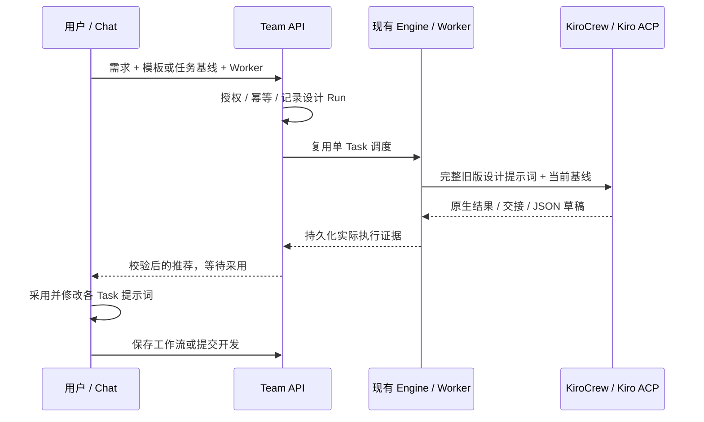
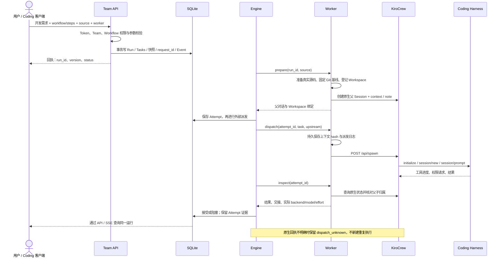
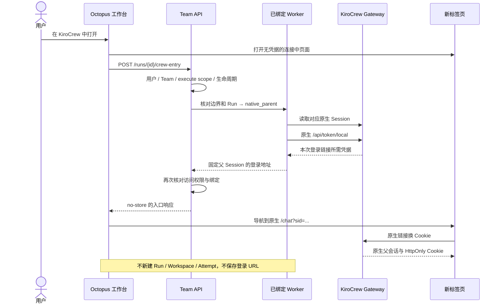
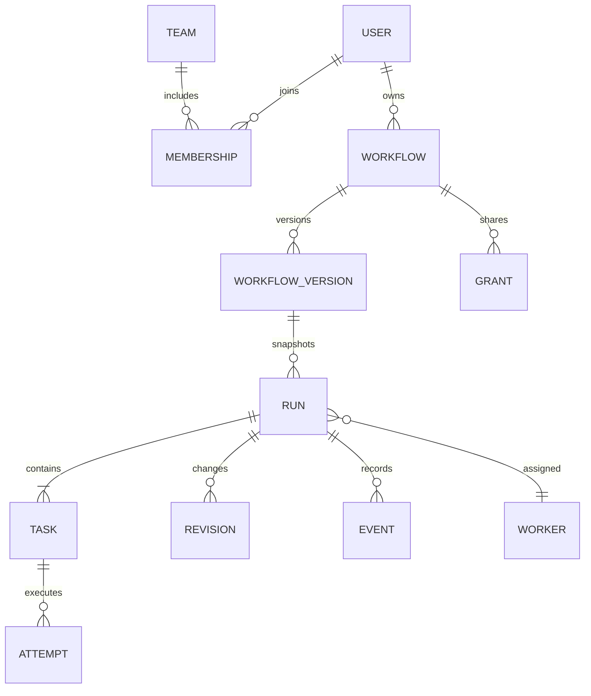

# MVP-1.0.0 配置与开发计划

日期：2026-10-09。状态：研发中；完成与验证范围以本版 RELEASE 文档为准。
2026-10-10 增补：推荐采纳、Coordinator 诊断与返工的 [当前架构及交互流程](COORDINATOR-RECOVERY.md)。

## 目标

KiroCrew 作为 Coding 执行底座，Octopus 提供 Team、工作流共享、统一 API、可恢复调度与实时状态。
CLI/MCP/Web 是同一 API 的客户端；工作流和运行状态存入 SQLite，不要求用户手动修改配置文件。
旧 8917 工作台与历史 Session 保留，新版默认独立使用 8918。

## MVP 配置模型

| 对象 | 配置与规则 |
|---|---|
| User | 用户名、密码登录、可撤销 API Token；Token 保存摘要，不保存明文 |
| Team | Owner / Member；Owner 管理成员；成员变化实时影响访问 |
| Workflow | 默认私有；不可变版本；按用户或 Team 授权 viewer / runner / editor |
| Workflow 分享 | Owner 管理授权；分享定义不自动分享运行、源码或认证 |
| Run / Session | 用户私有或显式 Team 运行；稳定 ID 与 Workspace；单独保存原生父对话 ID |
| Task / Attempt | 稳定业务任务 ID；每次重跑保存独立配置与证据；支持更换模型/Effort |
| Worker | 由管理员配置 Gateway、运行目录和执行边界；普通用户不能指定任意 Gateway、HOME 或服务器目录 |
| Source | 明确选择新项目或 Git 来源；实际源码准备完成后才派发 |

从可信 API 身份确定操作者，服务端逐项检查对象权限。不能只隐藏界面按钮。
API Token 不包含 Gateway owner 凭据；事件、导出、详情与写操作使用相同的授权规则。
原生浏览器入口另经显式、按需、禁止缓存的登录交换；不把原生登录链接注入模型任务。

## 实施顺序

1. 用户、Team、授权、版本与命令存储；跨用户/跨 Team 测试。
2. 统一 API、SSE、Python 客户端和标准输入输出 MCP 客户端。
3. 原生 KiroCrew Bridge、源码准备、后台调度、独立 Attempt 与原地续作。
4. 蓝白 Team 工作台：工作流、共享、创建研发任务、Tasks、状态与续作。
5. 原生契约实验、故障/权限测试、启动和 API 操作文档。

以上已经开始实施，使用独立的 `octopus/` 包。使用入口见
[启动说明](MVP-1.0.0-STARTUP.md)、[API / MCP 手册](MVP-1.0.0-API.md)；
验收结果与限制见 [Release](MVP-1.0.0-RELEASE.md)，不能把计划项直接当成已验收功能。

## 本版架构

需求入口由 `intent.py` 与 `Service.resolve_workflow` 统一提供，Web 启动向导和 Chat MCP 复用同一服务。
匹配只返回预览；点击提交才建立 Run 并进入现有 Engine。手动指定工作流 / 模板 / steps 优先，
匹配结果不直接修改工作流库，也不连接旧版全局 Gateway 身份。

推荐流程：

`designs.py` 复用旧版设计提示词和文档解析器。既不增加第二套 Coding CLI 调度，
也不让生成结束直接启动业务工作流。Worker 的 `workflow_design` 能力标记防止旧版执行器忽略设计上下文。

图中的 Team Worker 是部署边界；当前本机实际验证使用管理员个人 Worker，独立 Team 容器还未部署。
它复用原项目 `poc.PocProviderRegistry` 的组合入口，没有重写 Coding 工具执行循环。
API 与 Worker 的连接由管理员登记，任务提交者不能传入任意 Gateway 地址、HOME 或宿主路径。

## 一次研发任务的完整交互

后台业务调度由确定性的 Python Engine 推进；用户需要 Kiro 规划时，把 Kiro 作为流程第一个 Task。
原生 Gateway 负责实际子任务生命周期、ACP 会话、工具权限和工具调用。
这些职责拆开后，Chat/Web 不需要各自保存一份调度状态，也不要求一个 LLM 持续记住流程进行到了哪一步。

## 从工作台进入原生会话

Brainstorming 采用旧版认证入口方案：按钮在 Session 工具栏与推荐窗口，新标签页打开已绑定父会话。
`native_parent` 是导航依据，Worker 是认证所属边界；不从平台 Run ID 猜测原生 Session。

原生登录覆盖 Worker 的 Gateway 边界。当前平台成员校验约束本次入口发放，
不会把已发出的原生浏览器 Cookie 自动变为按 Run 隔离、或随平台撤权失效的票据。

## 对象关系与上下文保存

`Run` 是平台稳定的研发 Session；每次 `Attempt` 对应一个原生 Coding 子任务。
Task 采用 `run_id/task_id` 作为完整标识，不会因为两个工作流都叫 `code` 而混淆。
工作流版本固定首次执行配置，Session 修订负责显式续作；旧 Attempt 永不改写成新配置。

上下文分为三层：

1. **控制面数据**：SQLite 保存完整需求、任务说明、版本、授权、状态与事件。
2. **研发上下文**：Worker 保存 `context.json`、`instructions.md`、交接文件与 SHA-256，同一个 Run 复用同一个源码目录。
3. **工具内部上下文**：各 Harness 自己管理原生 Session；平台不假设不同工具共享 token 历史。

本版不自动注入宿主的 Global Memory / Lessons / Project Context，避免把其他开发空间的信息带进任务。
当前任务的明确需求、代码与前序结果会重新组装进上下文。
这属于持久化交接，不等于已经实现 Team 长期向量 Memory；用户级 / Team 级记忆策略留待单独设计。

## 模块职责与复用点

| 模块 | 职责 | 复用 / 边界 |
|---|---|---|
| `octopus/db.py` | SQLite 事务、表结构、事件 | 产品状态权威源 |
| `octopus/security.py` | 密码摘要、用户 Token 与 scopes | 不转发 Gateway owner 身份 |
| `octopus/domain.py` | Team、共享、版本、运行及续作 | HTTP 与 MCP 共同使用 |
| `octopus/server.py` / `schema.py` | REST、OpenAPI、SSE、Web 静态资源 | 一套 API，不建立并行文件协议 |
| `octopus/engine.py` | 顺序调度、Attempt、交接核对、停止状态 | 使用原生事实，不解析模型自述来猜实际后端 |
| `octopus/recovery.py` | 持久化诊断、有限返工、失败反馈与复审 | Coordinator 通过原生 ACP 决策，Engine 唯一派发 |
| `octopus/worker.py` | 源码准备、原生调用与证据核实 | 复用 `api.py` 与 `workflow_workspace.py` |
| `octopus/crew_entry.py` / `ui/crew.js` | 校验 Session 归属并打开原生父对话 | 复用旧版 `api.chat_entry_url` 与 KiroCrew 原生登录 |
| 原 `poc.py` | 四后端 provider factory 选择 | 使用 KiroCrew 原有 provider 扩展机制 |
| `octopus/client.py` / `mcp.py` | 可选 API / MCP 客户端 | Token 用户身份与服务端授权保持一致 |
| `octopus/ui/` | 需求入口、工作流、共享、状态、续作 | 保持蓝白设计；不承担授权决策 |

## 版本推进与生产使用门槛

| 阶段 | 范围 | 交付状态 |
|---|---|---|
| 1.0.0 研发基线 | API、Team 权限、共享、SQLite、Worker、Web、MCP、续作 | 已实现；以 Release 中实测结果为准 |
| 原生兼容收口 | OpenCode 模型 ID、首轮交付、各工具模型/Effort 与权限反馈 | 当前已发现原生限制，不能提前宣告通过 |
| 单团队受控试用 | 独立 Team Worker、账户生命周期、备份恢复、Git 项目与权限实测 | 需按真实 Team 部署验收 |
| Enterprise 演进 | SSO、配额、公网入口、GitHub/GitLab Connector、EC2、运维指标 | 设计与后续迭代；本次未部署 |

原历史工作台保持可用。未来迁移旧 Session 时，应先建立用户 / Team 归属和 ID 映射，
保留 Workspace、原生对话和全部原证据；不得以清空原数据来完成升级。

## 必须保持的行为

- 请求幂等：同用户同 request_id 相同请求返回同一对象，冲突请求拒绝。
- 并发编辑：保存/续作校验 expected_version。
- 原生派发回执不明时记录 unknown，不盲目重新创建任务。
- 模型请求与原生证据分别显示；没有实际值时显示未报告。
- 继续原 Session 不创建新工作区；旧 Attempt 与交接保留。
- 停止按原生状态确认；删除对话与清除源码分别处理。
- 单 Workspace 串行写入；租约和重启恢复不等于原生任务必定停止。
- 原生工具权限、账号和 Skills 仍由 KiroCrew / Coding 工具处理。

## Team 执行隔离

API 权限隔离与操作系统隔离是不同层。Worker 必须声明执行边界。
首版不得将一个共享 HOME/Gateway 描述为可安全运行互不信任团队代码的隔离平台。
本机可信协作和独立 Team Worker 两种部署方式必须在配置与界面明确区分。
跨 Team 的 Gateway/HOME/工作区分配由管理员管理，不由任务 Prompt 或用户传入路径决定。

## 验收

- 三个用户、两个 Team：授权、撤权、私有工作流、指定用户共享与版本编辑测试。
- 共享工作流可由接收者运行，原 Owner 的历史 Run 不随之泄露。
- 直接 API/MCP 提交定制任务、查询进度、SSE 补读、撤销 Token。
- 实际 KiroCrew 任务有真实父/子 ID，不能用模拟结果标示实际调用成功。
- 原 Session 换模型续作保留 ID/目录，历史证据可查。
- 测试、已知限制与部署边界写入 Release；现有 Session 不作为破坏性测试数据。
