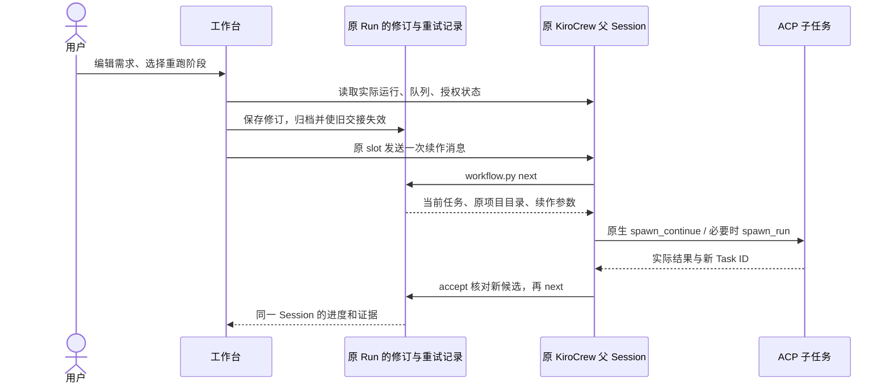

# 原 Session 续作与运维

更新：2026-10-09。入口仍是 Workflow Studio；执行仍交给 KiroCrew 原生父对话和 ACP 子任务。

## 修改失败任务，在原工作区继续

1. 选中原来的 Session，点击中央工具栏 **继续本 Session**。
2. 选择重跑阶段，编辑本次开发需求和该阶段任务说明。
3. 点击 **保存修订并继续**。工作台向原 KiroCrew 对话发送续作指令。
4. 继续在原 Session 查看任务进度、权限请求、交接和产物。

如果仍有父对话或子任务运行、排队、等待授权，先从 **Session 操作 → 强制停止**
停止本条会话，等待原生结束确认，再续作。失败步骤之前的阶段必须已经交接成功。
已完成的 Session 也可以选择某一阶段改进；该阶段及下游交接会失效并重新验证。
已写入的源码保留，不自动回滚到旧 commit。

本条路径不调用创建 Run / slot 的接口，也不重新克隆项目：

| 保留 | 修订 |
|---|---|
| Run ID、KiroCrew 父 Session ID、workspace / project 目录 | 当前需求与选定阶段的任务说明 |
| `workflow-run.json`、首次 `input.json`、首次 `REQUEST.md` | `retry-state.json` 中当前需求、任务说明和候选排除记录 |
| 原配置的工具、模型、Effort、步骤 ID 和顺序 | `continuations/<request_id>.json` 中的逐次修订 |
| 原始源码、旧候选、旧交接归档 | 新的任务执行、真实测试与交接证据 |

原生子任务优先通过 `spawn_continue` 续接，使用原会话的工具参数。如果原工具会话已经
不可续接，既有重试协议只允许在原生明确拒绝且确认没有派发后重建子任务；
**父 Session 与项目目录仍不改变**。不能承诺强制停止后所有工具进程或内部上下文仍在。
工作台用需求修订、源码及交接文件完成上下文传递，不以长期 Memory 代替项目状态。

结构性工作流修改仍通过 **编辑当前工作流** 保存下一版，只用于新的 Run。
本次续作不会偷偷采用另一个工作流版本。



## 停止、关闭和删除的区别

操作均集中在中央 **Session 操作** 菜单；只针对所选 Session，不停止整个 Gateway。

| 操作 | 原生机制 | 数据与恢复 |
|---|---|---|
| 强制停止 | `POST /api/chat/slots/{slot}/stop?force=true`，再 `POST /api/spawn/stop-all`，body 指定本 slot | 取消父对话及该会话的运行 / 排队子任务；不删除文件和历史，结束后可续作 |
| 关闭 | 停止确认、导出备份、`DELETE /api/chat/slots/{slot}` | 原生含义是关闭并保存历史，可重新打开 |
| 重新打开 | `POST /api/chat/slots/{slot}/resume`，key 是原 `dashboard:<slot>` | 保持原 ID 和工作区；原生工具进程可能重新建立，点击续作才发送研发任务 |
| 删除 | 先停止、备份和关闭，再 `DELETE /api/sessions/{key}` | 永久删除本条父对话的原生历史；保留工作区、子任务证据、修订、审计和备份，不提供直接续作 |

**删除前必须在对话框输入完整 Session ID。** 备份失败时不调用原生关闭 / 历史删除。
备份存于原 Run 的 `operations/<request_id>/session-backup.zip`，
可通过菜单下载。使用原生脱敏会话导出，不申请 Layer B 私有工具记录。
它是对话和运行记录备份，不是整个代码仓库或所有原生工具内部状态的完整快照。

关闭的 Session 位于 **归档 / 关闭**；删除后保留工作台审计项，可在 **已删除** 查看与下载备份。
工作流版本、源码目录不会因删除父对话而清空。“删除”不等于清除该任务的所有数据。

## 状态、并发与故障处理

- 每条 Run 使用独立操作锁。运行和停止之间有持久化状态门禁；
  `next` / `accept` 在停止、关闭、删除或准备修订时拒绝继续派发或接收候选。
- 停止回执与原生结束状态分别核对。还未结束时显示“停止中”，允许稍后重试同一操作，
  不把 HTTP 成功当作任务已终止。
- 原生 `stop-all` 对尚未执行的 spawn 审批保留独立拒绝流程；若因此仍未结束，
  在 KiroCrew App 拒绝该审批后再重试停止 / 关闭。工作台会保留“停止中”，不会提前删除。
- 续作请求有独立 ID。重复请求返回同一回执；同一 ID 携带不同内容会被拒绝。
- 如果发送超时，先用原生对话中的请求标记核对是否已收到。不能确认时保持
  `uncertain`，不盲目发送第二次；先核对原 App，或明确停止后再发新修订。
- 明确停止后的续作用新请求 ID；被取消的旧 ID 不能重新派发，避免旧重试记录吞掉本次修订。
- 停止和关闭的部分失败会保留实际进度与错误，不能当作成功。原生历史删除失败时，
  保留关闭状态和备份；不自动清理其他数据。
- `session-control.json` 保存操作回执；浏览器续作输入按 Run ID 独立保存，不跨 Session 共用。
- 原生权限与账号认证仍由 KiroCrew / 所选工具处理。

## 手动加载新版本

将验证过的代码同步到**原运行目录**后执行：

```bash
cd /absolute/path/to/existing-runtime
python3 workflow_launch.py
```

启动器重启自己的工作台进程并复用原 Gateway。本次功能使用现有原生接口，
无需为此重载 Gateway 或删除任何 Session。
新后台的 `/api/runtime` 会公布 `session_operations_v1`；旧进程未加载时按钮禁用并提示重启。

## 代码与验证

- `workflow_sessions.py`：原生运维、续作回执、操作锁、备份和状态门禁。
- `workflow.py`：任务修订、交接失效、观察器投影及工作台 HTTP 路由。
- `ui/workflow-session-ops.js`：独立操作对话框和按 Session 保存的续作输入。
- `test_workflow_sessions.py`：同一 Run / 工作区、重复请求、超时核对、运行拒绝、停止范围、
  关闭 / 重新打开、删除确认、备份失败、HTTP Origin 和目标校验。
- `tests/session-operations.browser.js`：交互、草稿隔离、禁用状态、失败面板、删除审计和窄屏。

测试使用临时文件与模拟原生响应。未对用户历史会话执行停止、关闭或删除，
也未把模拟回归称作一轮真实 Coding Agent 开发。
