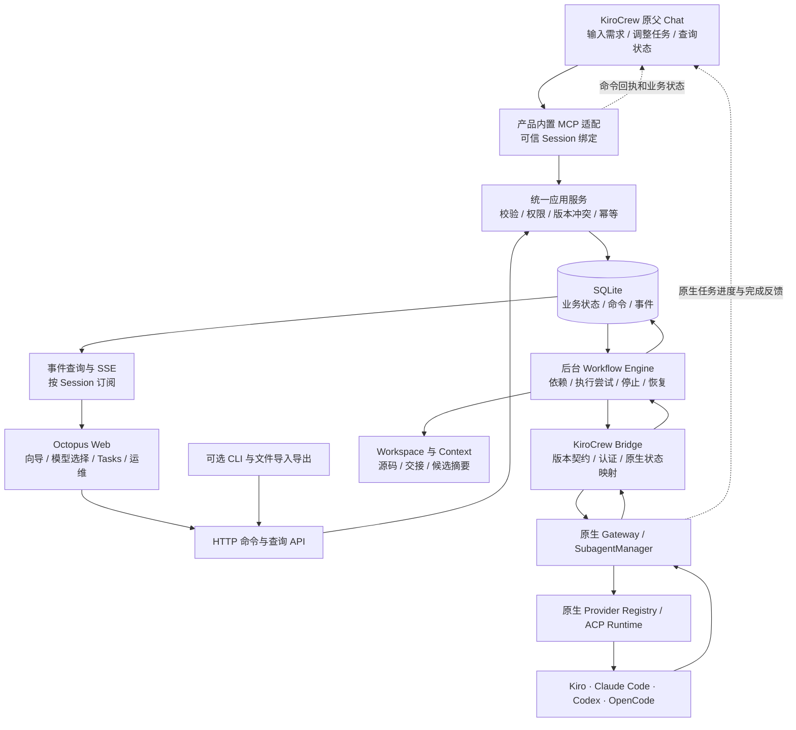
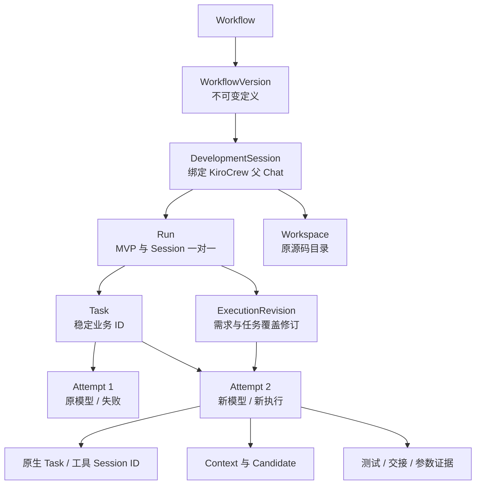
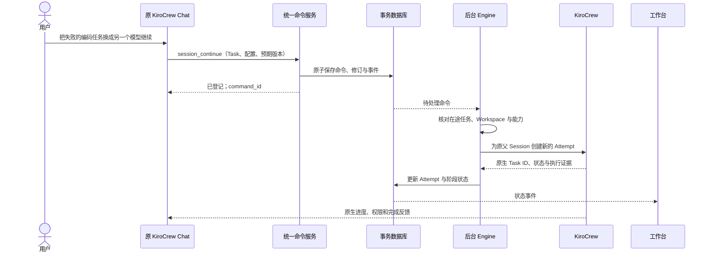

# Octopus V2：以 KiroCrew 为执行底座的研发平台

日期：2026-10-09  
状态：架构提案，尚未实现。本文没有迁移数据库、重启服务、修改已有 Session 或创建云资源。  
范围：先完成本地单用户、可恢复的研发 MVP；Dev Teams、EC2 和仓库 Connector 后续分阶段推进。

## 1. 结论与产品边界

推荐采用 **一个模块化应用服务 + SQLite 事务存储 + KiroCrew 执行桥接 + Chat/Web 两个入口**。

用户通过 KiroCrew Chat 或 Web 输入目标、选择任务和模型、查看进度、续作和停止。
Octopus 保存业务状态并按确定的规则调度；KiroCrew 继续管理父/子 Session、ACP、权限和 Coding 工具。

CLI 是可选的运维/自动化客户端；JSON、YAML、Markdown 是导入导出格式。
Coding 工具自身的 CLI 进程、原生配置文件和 ACP 的 JSON 消息可以继续存在。
需要改变的是业务状态和调度规则的归属，不是删除这些技术。

保留的产品约束：

- KiroCrew Chat 是原生研发入口；Web 提供向导、任务配置和状态视图。
- 工具范围为 Kiro、Claude Code、Codex、OpenCode，不包含 Gemini CLI。
- 用户无需手写 Plan.md、Tasks 或 MCP 接口代码；相关文档和接入由产品生成。
- 继续工作保留原父 Session、Run 和源码工作区。
- 工作流定义修改产生新版本；Task 重跑可产生独立的执行配置修订。
- 使用现有 KiroCrew 接口；产品内置自己的业务服务和适配模块，客户无需开发这些模块。
- 本地验收通过后再决定 EC2；本提案不把单用户 MVP 描述为多人生产平台。

## 2. 从现有代码得到的结论

以下是本次实际读取的源码事实；接口存在不代表新的整套调度方式已完成集成验证。
本机安装包基础版本为 0.7.2；部署兼容性需同时记录构建版本和边界源码摘要。

| 现有机制 | 代码位置 | 对新架构的意义 |
|---|---|---|
| 父 Agent 运行 CLI `next` / `accept` 推进流程 | `workflow.py:control_prompt`、`_next_step`、`_accept` | 规则可以提取为服务内函数，不必让 LLM 反复拼命令 |
| 单文件中混合快照、校验、派发参数、状态投影与 HTTP | `workflow.py` | 需要拆分职责，避免 UI 需求牵动执行和存储细节 |
| 续作更新只接受需求和任务说明 | `workflow.py:retry_stage` | 缺少 Task 执行修订，不是父 Session 必须固定模型 |
| 续作先要求父对话空闲，再向同一父对话发消息 | `workflow_sessions.py:continue_session` | Chat 内自调用会与运行状态检查冲突；命令接收应与执行分离 |
| 原生 HTTP 可以创建子任务，传父 Session、agent、model、reasoning_effort、cwd | 原生 `dashboard/handlers/messaging.py:359`、`:579` | 服务端有可核验的派发入口，仍由原生 SubagentManager 执行 |
| `/api/spawn/{id}/continue` 创建新的执行 ID，复用工具会话；读取 agent、model，当前处理器未读取新的 reasoning_effort | 原生 `dashboard/handlers/messaging.py:746` | 各路径的配置能力不同；不能假定所有字段都可在续作中改变 |
| 创建、状态、续作、停止等路由已注册 | 原生 `dashboard/server.py:1715` | 用独立桥接模块封装，固定支持的版本并做契约测试 |
| `/api/spawn` 属于 mixed internal 路由，存在原生认证与作用域检查 | 原生 `dashboard/server.py:796` 及相关 handler | HTTP 路由不是无认证的公开调度接口 |
| 原生受管理 MCP 的 Session 身份只投射到规定的控制组件 | 原生 `providers/mirrors/identity.py:1`；`acp/kas_agents.py:389` | 普通外部 MCP 不能假定会自动得到可信 Session 身份 |
| Provider Registry 已能在现有 factory 接口上路由多个后端 | `poc.py:PocProviderRegistry` | 复用此接入点，逐步去掉硬编码名称和全局配置耦合 |

一个需要修正的旧表述：**“换模型必然无法复用原生会话”并不是已验证的通用限制。**
原生 continue HTTP 接口存在 model 参数，ACP 也有会话配置能力；具体后端是否接受仍需协商和验证。
本提案为了形成一致的审计和 Effort 行为，首版选择“执行配置改变就创建新的子任务会话”。
这是产品策略；保持原父 Session 和 Workspace 不受影响。

## 3. 路线选择

| 路线 | 优点 | 代价 | 决定 |
|---|---|---|---|
| 继续扩展 CLI + 文件 + 父 Agent 调度 | 复用最多，增量速度快 | 命令、状态与 Chat 忙闲耦合，恢复和并发控制越来越复杂 | 保留兼容入口，不作为新业务核心 |
| Octopus 应用服务调度，KiroCrew 原生执行 | Chat/Web 同规则；可持久化、恢复和审计；保留 ACP 底座 | 需要业务命令、状态机和原生桥接的集成验证 | **推荐** |
| Octopus 直接实现各 Coding 工具的 ACP 客户端 | 对进程和事件控制更直接 | 重做会话、认证、权限、工具兼容；偏离复用 KiroCrew 的目标 | 本阶段不采用 |

推荐方案先部署为一个 Python 应用服务，后台调度循环与 HTTP/MCP 适配共享业务模块。
源码按边界拆分，首版不引入分布式微服务或外部任务队列。
前端先保留现有蓝白向导和 Tasks 视图，替换数据和命令接入；视觉重写不作为后端重构前提。

## 4. 总体架构



图中 HTTP、MCP 业务工具、Engine、事件服务和数据模型是 **Octopus 待开发功能**。
`POST /api/spawn` 等 KiroCrew 原生接口与这些业务 API 分属不同层。

业务命令决定“开发流程下一步是什么”；SubagentManager 决定“原生子任务如何准入和执行”。
两层分别拥有自己的状态，不能同时维护两套互相竞争的流程调度逻辑。

## 5. 模块与职责

| 模块 | 主要职责 | 不承担的职责 |
|---|---|---|
| Workflow Service | 模板、意图生成草稿、校验、保存版本、名称唯一、导入导出 | 不启动 Coding 工具 |
| Session Service | 父 Chat 绑定、Session 生命周期、关联 Workspace、导出 | 不把聊天文本当运行状态 |
| Command Service | 统一接收 Start / Continue / Retry / Stop 等动作，记录操作者与版本 | 不等待整个研发任务完成才返回 |
| Workflow Engine | 阶段依赖、任务准入、Attempt、重试、停止与恢复协调 | 不让 LLM 决定数据库状态是否合法 |
| KiroCrew Bridge | 原生派发、续作、查询、取消、原生 ID 映射、版本兼容 | 不重新实现 ACP / Coding Agent 工具循环 |
| Capability Service | 工具、模型、Effort、恢复能力、认证就绪状态与证据 | 不把静态模型名称当账号可用性保证 |
| Workspace / Context Service | 检出、原地续作、目录租约、上下文清单、来源与摘要 | 不共享所有工具私有历史或凭据 |
| Evidence / Review Service | 实际参数、候选、测试、审查、产物和报告 | 不把 Agent 自述“成功”视为全部验收通过 |
| Event / Query Service | Session 列表、Tasks 状态、进度、断线补读 | 不接受前端直接写任务状态 |

内部按 `domain / application / infrastructure / interfaces` 分目录即可。
这些首先是代码模块，不是需要分别部署的九个服务。

## 6. 数据模型：解决“原 Session 换模型”的根本问题



MVP 保持用户熟悉的 Workflow → Sessions → Tasks 层级；不增加要求用户理解的 Run 切换页面。
Session 与 Run 一对一，继续工作沿用两个 ID。代码中分开对象以区分对话生命周期与研发状态。

核心约定：

1. `WorkflowVersion` 固定流程结构和默认执行配置，修改生成新版本。
2. `Task` 是稳定业务身份；UI 显示可读序号，数据库 ID 在 Session 内不重复。
3. `ExecutionRevision` 保存本次需求和明确选择的 Task 配置覆盖，不改旧版本。
4. `Attempt` 保存一次实际执行的完整配置快照，包含工具、模型、Effort、上下文版本和原生 ID。
5. 运行中的 Attempt 不热改参数；修改形成待执行修订，等待结束或明确停止后再执行。
6. 第一个 MVP 保持任务结构与顺序固定；增加/移除/重排阶段使用新的 WorkflowVersion。
7. Session 关闭、Run 停止、Task 失败、Attempt 被取消是不同字段和事件。

建议的最小表：`workflows`、`workflow_versions`、`sessions`、`runs`、
`execution_revisions`、`tasks`、`attempts`、`workspaces`、`artifacts`、
`commands`、`events`。原生观察数据可放 events 与 Attempt 的 evidence 引用，不另建复杂事件溯源系统。

名称采用现有规范化规则，并在项目范围内加数据库唯一约束。
默认保留已删除工作流的名称占用，与当前行为一致。

### 参数解析规则

`当前 Attempt 配置 = 原 WorkflowVersion 的阶段配置 + 当前 ExecutionRevision 的显式覆盖`。

数据库同时记录：

- `requested`：用户选择的工具、模型、Effort 和能力清单版本。
- `resolved`：后端实际报告值与证据来源；未报告就是未知。
- `verification`：匹配、明确不匹配、无法核实，和执行成功/失败分别展示。

`auto` 可以选择，但实际模型须按原生证据显示。更换 Coding 工具后重新加载其模型/ Effort 选项。

## 7. Chat 与 Web 操作一致

Chat 和 Web 调用同一个 Command Service。以下名称为提议的 Octopus 业务接口：

从 Chat 首次开始研发时，默认绑定经过验证的当前父 Chat，再建立业务 Session/Run；
从 Web 新建时才按需要创建原生父 Chat。已经绑定 Run 的对话先进入现有对象，
不能因为一次新的自然语言输入就隐式替换绑定或另建 Workspace。

| 用户动作 | Chat MCP 工具示例 | Web API 示例 | 共同业务动作 |
|---|---|---|---|
| 从意图形成草稿 | `workflow_design` | `POST /v2/workflow-drafts` | 生成、校验、返回可编辑草稿 |
| 保存版本 | `workflow_save` | `POST /v2/workflows/{id}/versions` | 检查预期版本并保存 |
| 开始研发 | `session_start` | `POST /v2/sessions` | 创建/绑定 Session、Run、Workspace |
| 修改配置后续作 | `session_continue` | `POST /v2/sessions/{id}/continue` | 创建修订与后续 Attempt |
| 停止 | `session_stop` | `POST /v2/sessions/{id}/stop` | 先记录停止意图，再协调原生取消 |
| 查询进度 | `session_status` | `GET /v2/sessions/{id}` | 返回相同业务视图与版本 |
| 关闭/恢复/删除 | 对应 Session 工具 | 对应生命周期 API | 相同权限、备份和确认策略 |

所有写命令携带/派生 `command_id`、`expected_version` 和可信的操作者、Session 作用域。
相同 ID 与相同内容返回已有回执；相同 ID 不同内容报冲突。
有意再次执行是新命令、新 Attempt，不以“输入文本相同”全局去重。

一次 MCP/HTTP 调用返回“命令已登记 + 当前状态”，后台继续执行：



用户在 Chat 发出命令时，父 Chat 本来就可能处于回答中；因此不能再把“父 Chat 必须空闲”
作为接收业务命令的统一前提。必须核对的是将被续接的工具会话、在途 Attempt 和源码写入冲突。

命令要求停止父 Chat 时，先持久化动作，再异步执行原生停止；当前 Chat 回复可能因此中断，
但 Web 和后续查询仍能看到同一命令的实际结果。

### 必须先验证的 Chat 接入边界

MCP 提供结构化工具调用，但协议本身不保证 Octopus 知道这是哪个 KiroCrew Session。
本机代码还明确限制原生受管理凭据的投射范围，不能把外部 MCP 假装成受管理服务器。

第一阶段必须验证产品内置 MCP 如何通过现有扩展/注册机制取得可信 Session 绑定。
绑定应由宿主配置和平台验证，不能仅信任 LLM 提交的 `session_id` 或普通环境变量字符串。
产品自己的短期作用域授权与 Gateway owner 凭据分开，owner 凭据仅留在 Bridge。
如果现有机制无法可靠绑定，则此项判为不通过：先形成最小上游扩展提案，
不能用全局 owner token 或要求客户手工维护接口来冒充完成。

## 8. 唯一调度者与 KiroCrew Bridge

工作流推进归 Engine；主 Chat Agent 负责理解需求、解释状态和提交业务命令。
新会话的协调提示不再要求执行旧 `next/accept`，工具暴露也应限制为相应业务操作。
需要验证原生完成消息唤醒父 Chat 时不会再次触发旧的自主派发逻辑。

Bridge 建议定义内部操作：

```text
inspect_runtime()
create_or_bind_parent()
spawn_attempt()
continue_attempt()
inspect_attempt()
stop_session_tasks()
close_parent()
resume_parent()
export_parent()
delete_parent_history()
```

它们封装已核实的原生路由和认证，不作为额外 ACP 标准，也不直接调用工具 SDK 替代 KiroCrew。
对原生 API 的依赖集中在这一处，每个支持版本有契约测试。

首版以原生任务查询保证最终一致；原生实时事件可用于加速，但不假定 WebSocket 自带持久回放。
`silent`、完成回调、权限和通知行为需在契约实验中验证，不能为防重复调度直接关闭全部反馈。
归属始终核对 `parent_session`、原生 Task ID 和平台 Attempt，不靠任务文本的自述。

## 9. SQLite 和文件各自保存什么

| 数据 | 权威位置 | 文件的角色 |
|---|---|---|
| 工作流版本、Session、Task、Attempt、修订、命令、状态 | SQLite | 可导出快照，导入须经过业务校验 |
| 源码和依赖工作区 | 本地 Workspace | 实际可执行工程，记录基线和变更 |
| diff、交接、测试输出、报告 | 产物目录 + DB 内容摘要和归属 | 大内容按文件保存，按 Attempt/候选关联 |
| 原生 Chat / Coding 工具内部历史 | KiroCrew / 对应工具 | 平台保存引用，通过原生接口查询/导出 |
| 原生工具配置与认证 | 各工具自己的受控配置 | 平台记录引用、就绪状态和必要的非敏感摘要 |

SQLite 使用本机 WAL、短事务、外键、唯一约束和版本校验。
WAL 仍是一次一个 writer，也不用于多机共享网络文件系统。多机/多人阶段再验证 PostgreSQL 迁移。

`commands` 中的待处理记录同时承担初版持久派发队列；事务中一起保存业务变更和事件。
网络请求在事务外执行，避免持有数据库写锁等待 Agent。
JSON snapshot 是导出/调试产物，禁止界面、CLI 和 Engine 各自直接改一份状态文件。

备份使用数据库支持的一致性备份方式，配合产物清单；不能只复制一个正在写入的数据库主文件。
数据库备份、源码备份和原生会话导出分别标明覆盖范围。

## 10. Context、Workspace 与原地续作

新 Session 从用户选择的仓库/ref准备一个 Workspace，先记录来源、解析后的 commit、目录和准备状态。
源码未就绪时停在准备阶段，不能让编码 Task 只拿到几个说明文件就开始。
继续 Session 使用原 Workspace；已修改的源码保持现状，是否回滚是独立显式动作。

每个 Attempt 生成一个可追溯的 Context 清单：

- 当前需求和任务修订；本次配置与验收目标。
- 仓库基线、当前候选标识、需读取的源码和规范。
- 依赖阶段的交接、完整结果、测试与审查引用。
- 内容路径、摘要、生产 Attempt 和适用范围。
- 必要的摘要及原文引用；关键验收条件不能只存在于压缩摘要中。

工具读取本次 Context 文件与源码目录。通过源码、产物和业务记录恢复工作，
不承诺把 Claude/Codex 的私有窗口、KV Cache 或所有内部状态互相转换。
KiroCrew Memory 可作为有范围的可选补充，不成为恢复研发状态的唯一依据。

同一 Workspace 首版只允许一个写入 Attempt；声明“只读”的审查也应读固定候选，
不能与另一任务并发修改同一份可变源码。
工具自己的 Skills/MCP 按原生规则加载，平台显示配置来源与实际可核验状态，
不把“发现技能”标成“已经执行技能”。

## 11. Task 换模型与交接

推荐交互：选择原 Session → 选择 Task → 修改任务/工具/模型/Effort → 预览影响 → 继续。

1. 校验工具、模型、Effort、账号和当前作用域的能力。
2. 无在途冲突时创建新的 ExecutionRevision 和 Attempt；有冲突时明确显示等待或停止后重跑。
3. 对选定 Task 及其下游旧验收记录作失效标记，保留历史。
4. 配置不变且原生允许时使用 continue；配置改变时首版使用新原生子会话。
5. 父 Session、Run、Task 业务 ID 和 Workspace 保持不变。
6. 后端实际参数与本次请求分开记录，新 Attempt 只接受它自己的结果。

能力目录按后端、工具版本、账号作用域和必要的 cwd/Agent 范围区分。
记录来源和采集时间；需要会话初始化才能得知的能力，在执行前协商核对。
未经验证的候选不能被静态配置文件提升为“肯定支持”。

Review 绑定实际 Candidate：基线、diff 与受审文件内容摘要，包括相关未跟踪文件。
不能只用 base commit 标识包含未提交改动的候选。
测试通过、参数匹配、交接完整、审查通过分别记录。
OpenCode 整理交付后若改变已审查内容，旧 Review 失效；最终交付需针对新候选重新审查。

## 12. 停止、关闭、删除与故障恢复

Session 生命周期：`open / closed / deleted`。  
Run 状态：`preparing / ready / running / waiting_input / stopping / stopped / completed / failed`。  
Attempt 状态：`pending / dispatching / dispatch_unknown / running / waiting_approval / execution_succeeded / failed / cancelled`。  
Attempt 的交接/参数/Review 校验单独记录，不塞入单一“成功”字段。

停止顺序：

1. 事务保存停止意图，阻止新的业务派发。
2. 通过 Bridge 调用当前 Session 的原生父/子停止接口。
3. 核对运行、排队和未决审批；还有未结束项就保持 stopping。
4. 原生全部结束后才标 stopped。原生 spawn 审批可能需用户在 App 单独拒绝。
5. 关闭要在停止与备份完成后执行；删除按完整对象确认和保留策略执行。

明确删除父对话历史与清理 Workspace 是两种操作。首版保留源码、审计和备份，
不会把用户点击“删除 Session”解释为递归删除整个项目。

故障恢复：

- 命令 ID 和预期版本防重复提交与覆盖；同 Workspace 的租约控制写入。
- 派发前落盘 Attempt 与意图；收到原生 ID 后保存映射。
- 派发超时进入 `dispatch_unknown`。当前已核实的 HTTP handler 未提供可直接依赖的客户端幂等 ID；
  不把内部 Python 的 `_preassigned_id` 当成公开 HTTP 保证。
- 根据原生 ID、父 Session、平台标记和参数核对；零个或多个无法确定的匹配需要人工处理。
- 不盲目重发、不宣称 exactly-once。租约失效也不能证明已发出的原生任务停止。
- 重启后先核对原生实际状态，再恢复调度。旧 Attempt 的迟到事件只写旧记录，不推进新 Attempt。
- 单次数据库事务不可能连同远端 Agent 副作用一起回滚；补偿和不确定状态必须显式存在。

## 13. MVP 的生产边界与后续扩展

本地 MVP 要交付的可靠性包括：正确身份、正确参数、状态可恢复、原地续作、操作一致和数据保留。
它面向一个受信任操作员、一个本地主机。不能因此声称已完成多人隔离、HA 或任意代码安全执行。

后续 Dev Teams 增加可信登录、项目授权、审计主体和隔离 Worker；
每个 Worker 的 HOME、原生 Memory、凭据与工作区按安全边界隔离。
原生 owner cookie 留在 Worker，不交给每个浏览器或每个 MCP 工具。

GitHub/GitLab Connector 提交相同业务命令；PR/MR 发布绑定批准的 candidate。
具体部署和租户授权分别延续 ENTERPRISE.md 与 CONNECTORS.md 的计划，
不能通过开放本机端口或更换数据库就宣称已具备团队能力。

## 14. 与当前实现的迁移关系

| 当前资产 | 新实现的处理 |
|---|---|
| Provider Registry 多 ACP 路由 | 复用为 Bridge/运行时组合基础，补版本契约测试 |
| 模型匹配、归属检查和交接校验 | 提取到能力/证据服务，用新 Attempt 的配置核对 |
| Workspace 准备代码 | 提取为 Workspace Service，保留原路径和基线 |
| 模板、向导、Tasks、蓝白 UI | 复用，统一接入命令/查询 API |
| CLI | 调用统一业务服务，保留兼容命令 |
| JSON/YAML/Markdown 导入导出 | 保留为便携格式，状态写入走数据库 |
| 旧 Run 与原生 Sessions | 原地只读导入元数据，按对象显式交接管理权 |

不在同一 Run 上同时运行旧父 Agent 调度协议和新 Engine。
迁移先做备份、只读清点、对照导入和数据校验；切换时为每个 Run 记录调度管理权。
切换前须停稳旧调度，新 Engine 才能接管；回滚也必须先停稳新派发。
不能声称回滚元数据会撤回已经执行的代码修改。

实施阶段、真实契约实验和验收见 [实施路线](OCTOPUS-V2-IMPLEMENTATION.md)。

## 15. 依据与尚需实验的边界

本次仅做源码、协议资料和设计核对。没有执行新的真实 ACP 调度实验。

本地依据：

- `workflow.py`、`workflow_sessions.py`、`poc.py`、`api.py`。
- 安装包 `kiro_crew/dashboard/handlers/messaging.py`、`dashboard/server.py`。
- 安装包 `kiro_crew/providers/mirrors/identity.py`、`acp/kas_agents.py`、`subagent_manager/continuation.py`。
- 与本次设计一起生成的边界摘要：`evidence/architecture-v2/source-inventory.json`，该文件是本地证据，不作为分发包输入。

协议与存储资料（2026-10-09 核对）：

- ACP Session Setup：创建传 cwd/MCP；恢复取决于 agent 的 load 能力。`https://agentclientprotocol.com/protocol/session-setup`
- ACP Session Config Options：可公布模型/思考级别等配置；使用返回能力，不推断所有后端一致。`https://agentclientprotocol.com/protocol/session-config-options`
- MCP Tools 固定版本资料：结构化输入/输出是工具接口；不能代替应用自己的身份与状态管理。`https://modelcontextprotocol.io/specification/2025-06-18/server/tools`
- SQLite WAL：本机并发读取、单 writer、checkpoint 及备份注意事项。`https://www.sqlite.org/wal.html`

必须先实验再承诺的项目：Chat MCP 可信绑定、服务端直接派发的原生归属、
父 Chat 忙时的行为、完成通知和权限展示、四后端实际参数、异常取消与重启恢复。
这些实验失败时按实施路线处理，不用 CLI 绕行或隐藏状态差异冒充设计已经落地。
