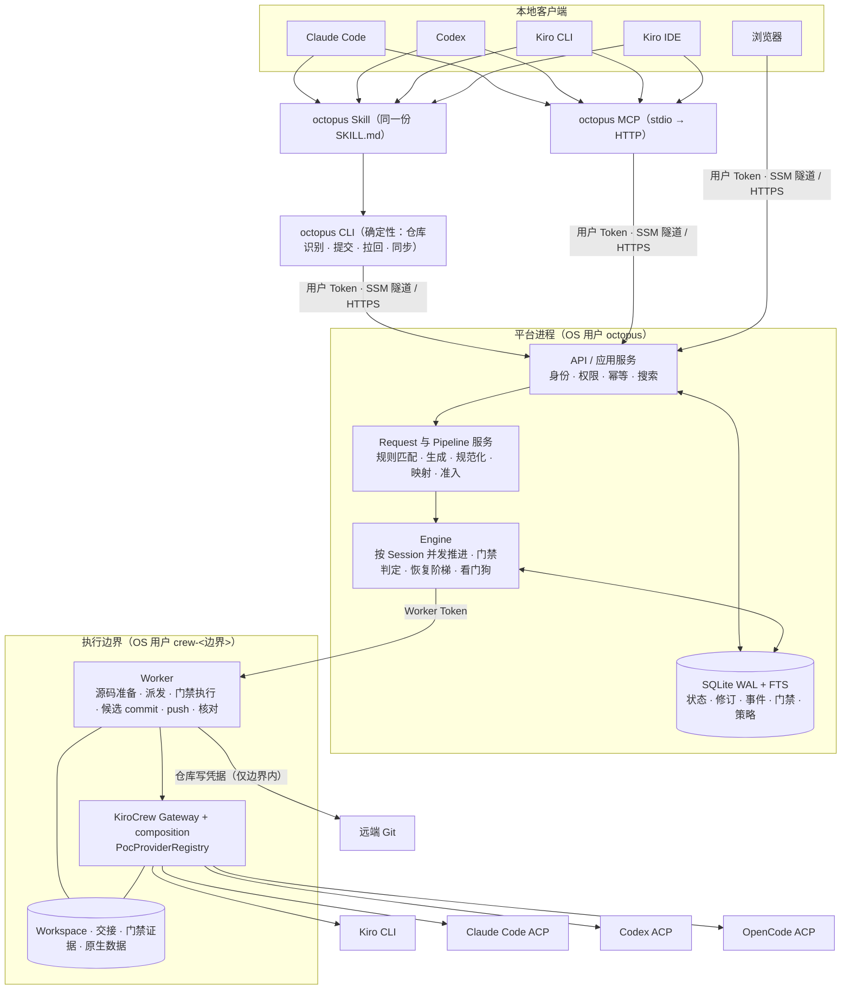
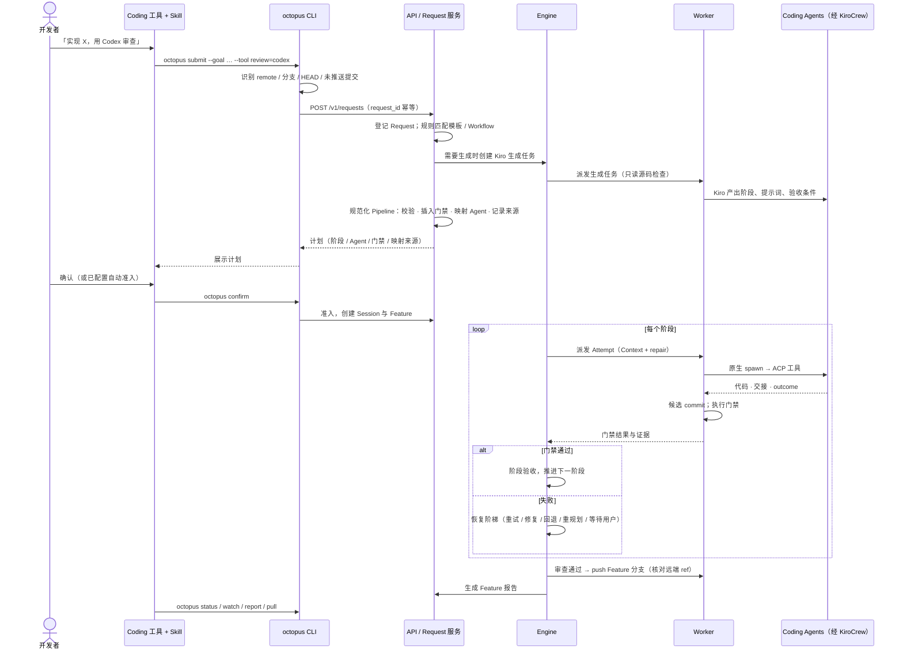

# KiroCrew ON 总体设计

日期：2026-10-10　·　状态：设计稿（待负责人审阅）　·　范围：M1–M5 总体设计，M1 另有详细实施计划

本文是 KiroCrew ON 的总体设计。“现有”指已在 `kirocrew-octopus` / `kirocrew-app-poc` 中实现的代码，
“目标”指本仓库要建设的能力，“待验证”指尚未在真实环境确认的假设。不要把目标当作已实现功能。

---

## 1．目标

开发者在自己的 AI Coding 工具（Claude Code、Codex、Kiro CLI、Kiro IDE）或 Web 中用自然语言提交开发任务；
后端登记请求，自动生成并编排研发 Pipeline，把每个阶段映射到合适的 Coding Agent，
在 Feature 分支上完成编码、确定性门禁、独立审查与纠错，持续监控直至完成；
开发者在本地与远端之间无缝切换：远端结果可拉回本地继续，本地修改可交给远端复审和续作。

**优先级**：① 每个任务能够完成（稳定性、自主编排、自动重试）→ ② 完成的质量更好 → ③ 使用体验。

### 成功标准（MVP）

1. 在 Claude Code 中一句话提交需求，后端自动生成 Pipeline 并映射 Agent，确认后在 EC2 上对真实仓库完成研发，
   审查通过后远端出现 Feature 分支，报告可在 Coding 工具和 Web 中查看。
2. 注入典型故障（测试失败、工具空结果、Gateway 重启、派发回执丢失）后，任务在预算内自动恢复并完成；
   预算耗尽时给出具体原因、证据与可执行操作，不无限重试、不伪造成功。
3. 四个客户端（Claude Code、Codex、Kiro CLI、Kiro IDE）均可通过同一 Skill + MCP 提交、查询、拉回、续作。
4. Web 控制台可按状态、仓库、分支、工具、时间与全文搜索 Session，并查看完整执行与纠错历史。

### 已确认决策

| ID | 决策 |
|---|---|
| D01 | `kirocrew-on/` 新仓库，迁入新旧两版资产；原目录与运行数据不动 |
| D02 | 总体 Design 覆盖全部阶段；详细实施计划先写 M1 |
| D03 | ~~M1 的 Linux 开发与验收直接在 EC2 上进行~~（2026-10-11 由 D12 取代；EC2 实例创建仍需单独授权） |
| D04 | EC2 使用 Amazon Linux 2023 x86_64 |
| D05 | 先等价迁入并建立回归基线，再在测试保护下分步重构 |
| D06 | 六项核心功能：Session 共享（个人 / Team / 公司）；Skills 对接；自动拆分与 Agent 映射（可在 Prompt 指定）；Branch + 报告跟踪 Feature；代码优先；请求全程托管与监控 |
| D07 | 首个可用版本审查通过后只推送远端 Feature 分支；PR / MR 后置 |
| D08 | 旧版的“根据需求自动生成 / 编排 Pipeline”是核心功能，与新版业务服务融合，不单纯以新版为主干 |
| D09 | Session 监控与管理以灵活、易用为目的，以查看和搜索为主，不以编辑为主 |
| D10 | 稳定性、自主编排、自动重试是核心；先保证完成，其次提升质量 |
| D11 | 与 Claude Code / Codex / Kiro CLI / Kiro IDE 直连，本地与远端智能联动，纳入 MVP |
| D12 | 先在本地（macOS）用本仓库代码以真实 ACP 跑通完整链路，再部署到远端 EC2（2026-10-11） |
| D13 | 自动生成任务（Pipeline 生成）参考旧版 `kirocrew-app-poc` 的实现：意图生成、Pipeline 规划阶段、确定性门禁与模板（2026-10-11） |

## 2．设计原则

1. **代码优先**：可以用代码实现的功能不依赖 Agent 的通用性。Agent 只做理解、拆分、编码、审查判断、诊断与叙述摘要。
2. **Engine 是唯一业务派发者**；KiroCrew 决定原生 Agent 会话如何运行；不绕过 KiroCrew 直接启动 Coding CLI。
3. **完成优先但不伪造**：自动恢复在预算内尽力完成；换工具、重规划都要显式记录并在报告中可见。
4. **真实状态**：所有状态来自持久化记录与原生核对；请求值与实际值分开；未知显示未知。
5. **身份分离**：用户 Token、Worker Token、Gateway 原生凭据、仓库写凭据互相独立；平台与执行分属不同 OS 用户。
6. **复用优先**：不重新实现 ACP，不换框架，前端沿用无构建原生 JS；逐步重构，不推倒重写。
7. **保留用户配置**：客户端接入只做合并式写入并备份原文件，不覆盖用户已有 Skills、MCP、模型和权限设置。

### 代码与 Agent 的分工

| 由代码负责（确定性） | 由 Agent 负责（需要理解或判断） |
|---|---|
| 请求登记、幂等、状态机、版本 | 需求理解，Pipeline 阶段拆分与提示词（Kiro） |
| 从 cwd 识别仓库 remote / 分支 / HEAD / 未推送提交 | 编码（Claude Code / Codex / OpenCode / Kiro） |
| Pipeline 规范化：schema 校验、阶段上限、插入门禁 | 审查判断（Codex 等） |
| 阶段 → Agent 映射：策略表 + 显式指定 + 回退链 | 失败诊断与重规划建议（Kiro Coordinator） |
| 模型 / 能力校验、派发、核对、迟到回执处理 | 报告中的叙述性摘要（标注为 Agent 生成） |
| 确定性门禁：测试、diff、哈希锁定、审查绑定候选 | |
| 候选 commit、Feature 分支、push、远端 ref 核对 | |
| 自动重试阶梯、预算、看门狗、重启核对 | |
| 报告生成（固定模板 + 结构化证据） | |
| 客户端接入配置写入、本地与远端关联 | |
| 搜索、过滤、权限、分享 | |

## 3．领域模型

```text
组织（一个部署一个，M4）
  └─ 个人空间 / Team
       ├─ Workflow（可复用 Pipeline 模板，不可变版本）
       └─ Request（一次自然语言研发请求）
            └─ Session（= 平台 Run；可持续续作的研发上下文）
                 ├─ Pipeline 快照（版本化；重规划生成新修订）
                 ├─ Feature（仓库 · 分支 · 基线 · 候选 · 推送状态 · 报告）
                 └─ Task（Pipeline 的一个阶段，run_id/task_id 稳定）
                      ├─ Attempt（一次实际执行：工具 / 模型 / Effort / 原生 ID / 结果）
                      │    └─ Gate 结果（每个门禁的确定性检查与证据）
                      └─ Recovery（诊断、决定、应用记录）
```

| 对象 | 现有承载 | 目标 |
|---|---|---|
| Workflow / Version | `workflows`、`workflow_versions`（新版） | 保留；spec 升级为 Pipeline schema 2，兼容旧 steps |
| Request | 无（新版只有 `runs.input`；旧版有 `intake` 文件） | 新表 `requests`，一等对象（M2） |
| Session | `runs` | 保留表名；增加 `request_id`、`feature_id`、`pipeline_revision` |
| Pipeline 快照 | `runs.snapshot` + `revisions` | 保留；重规划写新修订，不改历史 Attempt |
| Feature | 无（Worker 本地分支 `octopus/<run-id>`） | 新表 `features`（M2） |
| Task / Attempt | `tasks`、`attempts` | 保留；Attempt 增加 `fallback_from`、`retry_level` |
| Gate | 旧版 `gates/<stage>.json` 文件；新版散落在 Engine 验收逻辑 | 新表 `gates` + Worker 证据文件（M2） |
| Recovery | `recoveries` | 保留；action 增加 `fallback`、`replan`（M2） |
| 策略 | 只有 `recovery` 配置写在 Run 快照里 | 新表 `policies`：映射、准入、恢复预算，按个人 / Team 作用域（M2） |
| 执行边界 | `workers` | 保留；Worker Token 移出数据库，库内只留指纹与凭据引用（M4） |
| Session 授权 | 无 | 新表 `session_grants`（M4） |

## 4．组件与模块



### 模块地图（目标）与来源

| 模块 | 职责 | 来源 |
|---|---|---|
| `octopus/config.py` | 统一运行时配置：TOML 文件 + `OCTOPUS_*` 环境变量 + 命令行参数 | 新增 |
| `octopus/server.py` | HTTP 路由、认证、SSE、静态资源 | 新版 `server.py`；路由表替代 if 链，Worker 注册逻辑移入 domain |
| `octopus/domain.py` | 业务命令、权限、幂等、版本、搜索 | 新版 `domain.py` |
| `octopus/db.py`、`migrations/` | 持久化、事务、事件、schema 迁移 | 新版 `db.py` + 新增迁移 |
| `octopus/requests.py` | Request 登记、状态、准入 | 新增；吸收旧版 `pipeline.py` 的 `validate_request` / `capture_request` |
| `octopus/pipelines.py` | Pipeline schema 2、规范化、门禁插入、映射、回退链 | 新增；吸收旧版 `pipeline_spec.py` 阶段契约与新版 `domain.steps` |
| `octopus/intent.py`、`designs.py` | 模板规则匹配、Kiro 生成任务与结果校验 | 新版；旧版 `workflow_library.start_design` 的生成逻辑并入 |
| `octopus/engine.py` | 推进、派发、门禁判定、恢复阶梯、看门狗 | 新版 `engine.py`；改为按 Session 并发 |
| `octopus/recovery.py` | 失败分类、诊断上下文、决定校验、返工 / 回退 / 重规划 | 新版 `recovery.py` 扩展 |
| `octopus/worker.py` | 执行边界内的源码、派发、门禁执行、候选、push、核对 | 新版 `worker.py` |
| `octopus/gates.py` | 门禁实现（在 Worker 内运行） | 新增；吸收旧版 `pipeline.checkpoint` / `tests` / `validate_review` / 哈希锁定 |
| `octopus/sources.py` | 仓库来源校验、检出、基线、Feature 分支 | 旧版 `workflow_workspace.py` |
| `octopus/reports.py` | Feature 报告模板与生成 | 新增；参考旧版 `pipeline.report` 与 `workflow_library.session_documents` |
| `octopus/documents.py` | JSON / YAML / Markdown 安全解析与导入导出 | 旧版 `workflow_files.py` + `workflow_library.import/portable` |
| `octopus/prompts.py` | 研发契约与各角色提示词 | 旧版 `development_prompts.py` + `pipeline_spec` 角色提示词 |
| `octopus/gateway_client.py` | 原生 Gateway HTTP 与 token | 旧版 `api.py`（octopus 版） |
| `octopus/crew_entry.py` | 原生父会话入口与认证交换 | 新版 |
| `octopus/client.py`、`cli/`、`mcp.py` | 客户端协议、CLI 命令、MCP 工具 | 新版扩展 |
| `octopus/connect/` | 四个客户端的 Skill 与 MCP 配置合并写入 | 新增 |
| `octopus/ui/` | 监控控制台 | 新版 UI 演进 |
| `composition/` | `PocProviderRegistry`、`poc-*` 模板生成、Gateway 入口、`--check` | 旧版 `poc.py` |
| `skills/octopus/SKILL.md` | 四个客户端共用的 Skill | 新增 |
| `deploy/` | AL2023 安装、systemd、env 样例、CloudFormation、备份恢复 | 新增 |

旧版 Studio 的服务端与 UI（`workflow.py serve`、`ui/workflow*.js`、`pipeline.py serve`、`ui/live.*`）
随基线迁入以保持回归测试，但**不从本仓库部署**；8917 入口继续从原目录运行。
其可复用逻辑被上表的新模块吸收、对应功能在新控制台可用后，按功能对照表逐项移除旧代码。

## 5．主流程



### 请求状态

```text
received → matching → generating → planned → awaiting_confirmation → admitted
         → running → completed
                   ↘ waiting（缺输入 / 认证 / 批准 / Worker，可自动恢复）
                   ↘ blocked（预算耗尽或不可恢复，附原因与操作）
         ↘ rejected（校验失败）    ↘ cancelled（用户取消）
```

Request 与 Session 一对多：同一 Request 被重新规划或用户显式重开时可产生新 Session；
原 Session 续作不产生新 Request，而是新增修订。

## 6．Pipeline 自动生成与编排

### 6.1 生成来源与优先级

1. **显式指定**：请求中给出 Workflow ID / 模板名，或完整的阶段列表。
2. **规则匹配**：现有 15 个模板与有权运行的 Workflow 按关键词评分（新版 `intent.ranked`），结果标注为“规则”。
3. **Kiro 生成**：规则不足以确定或用户要求时，后台 Kiro 生成任务基于需求与只读源码检查产出阶段、
   各阶段提示词、验收条件与角色（新版 `designs.py`，并入旧版 `start_design` 的意图生成逻辑）。
   设计与实现参考旧版 `kirocrew-app-poc` 的生成链路（D13），分析见 `docs/handover/GENERATION-REFERENCE.md`。

生成结果**不直接执行**：一律经过代码规范化，再按准入策略决定是等待确认还是直接运行。

### 6.2 Pipeline schema 2

```yaml
schema: 2
name: 用户登录限流
stages:                       # 1–8 个顺序阶段（MVP 不做 DAG / 并行）
  - id: plan
    role: plan                # plan | code | test | review | deliver | custom
    name: 需求分析与验收测试
    prompt: …
    acceptance: ["新增限流测试在当前基线上失败", "…"]
    tool: auto                # auto 表示由映射策略决定
    model: auto
    effort: auto
  - id: code
    role: code
    …
checks:                       # 仓库检查命令；来源记录为 request / workflow / repo / detected
  - name: unit
    run: npm test
```

兼容：schema 1（现有 `steps[]`）读取时转换为 `role: custom`，门禁按原 `execution_contract` 推导；不改写历史快照。

### 6.3 规范化（代码执行）

1. schema 校验、阶段数 1–8、ID 与名称唯一（服务端保证）。
2. 按角色插入门禁（见 6.4）；用户或 Workflow 可以加门禁，不能移除角色的必备门禁。
3. 映射 Agent（见第 7 节），按 Worker 实际公布能力校验模型与 Effort。
4. 解析 `checks`：显式给出优先；否则读取仓库内 `.octopus.yml`；否则按锁文件 / 清单确定性推断
   （如 `package.json` 的 `test` 脚本、`pyproject.toml` + `pytest`），并记录推断来源。推断不到时 code 阶段的检查门禁标记为“未配置”，
   报告中显示为风险而不是通过。
5. 生成不可变的 Pipeline 快照与 sha256，进入 Session。

### 6.4 门禁目录（Worker 内运行，结果入库）

| 门禁 | 适用角色 | 判定 | 来源 |
|---|---|---|---|
| `native_completed` | 全部 | 原生任务完成，无错误、无 `BLOCKED` 行，结果非空 | 新版 Engine |
| `identity_match` | 全部 | 实际后端 / 模型 / Effort 与请求一致或在允许的回退范围内 | 新版 Engine、旧版 `_accept` |
| `handoff_present` | 全部 | `handoff.md` 存在，记录 sha256 | 新版 |
| `outcome_valid` | 全部 | `outcome.json` 符合契约（`pass / changes_requested / blocked`） | 新版 `recovery.outcome` |
| `tests_fail_on_baseline` | plan（产出验收测试时） | 新验收测试在基线上失败 | 旧版 `pipeline.checkpoint` |
| `artifacts_locked` | plan 之后全部 | 规划锁定的规格 / 计划 / 验收测试哈希未被修改 | 旧版哈希锁定 |
| `diff_present` | code | 候选相对基线有真实变化，范围符合约束 | 旧版 diff 检查 |
| `checks_pass` | code、deliver | 运行 `checks`，记录命令、退出码、耗时、输出摘要与日志路径 | 旧版 `pipeline.tests` 泛化 |
| `review_bound` | review | 审查结果引用的候选 commit 等于当前候选；无 high / critical 未解决项 | 旧版 `validate_review` |
| `candidate_unchanged` | review 之后全部 | 已审查候选未被后续阶段修改，否则使审查失效并重新审查 | 旧版“核心未变” |

**候选 commit**：每个改代码的 Attempt 结束后，由 Worker 代码把工作区变化提交为 Feature 分支上的候选 commit
（提交信息模板包含 Session / Task / Attempt）。审查、推送、报告都绑定这个 SHA。

### 6.5 编排与重规划

- Engine 按 Pipeline 顺序推进；上游验收结果作为下游 Context。
- 恢复阶梯（第 8 节）可能产生 `replan`：Coordinator 给出重规划理由，Kiro 生成剩余阶段，
  代码按 6.3 规范化后写入新的 Pipeline 修订；仍然有效的已验收阶段保留，失效的下游阶段重新执行。
- 用户在原 Session 续作（更换工具、模型或补充要求）同样生成修订与新 Attempt，不改历史。

## 7．Agent 映射策略

**优先级（高 → 低）**：本次请求的显式指定（CLI 参数 / Skill 转换的 Prompt 指定）→ Workflow 阶段配置 →
个人 / Team 映射策略 → 平台默认。每个阶段记录 `mapping_source`。

平台默认（可编辑的策略数据，不是硬编码执行顺序）：

| 角色 | 默认工具 | 默认回退链 |
|---|---|---|
| plan | Kiro CLI | — |
| code | Claude Code | Codex |
| test | Codex | Claude Code |
| review | Codex | Claude Code（必须与 code 阶段实际工具不同） |
| deliver | OpenCode | Claude Code |
| custom | Claude Code | — |

规则：

- 显式指定不可用（未安装、未认证、模型不支持、传输格式不支持）时**拒绝并说明**，不静默替换；
  用户可以在请求中允许回退（`--allow-fallback`），这时按回退链执行并记录。
- review 角色的实际工具必须与被审查的 code 阶段不同（独立审查），映射与回退都遵守：
  回退链中与 code 阶段实际工具相同的项被跳过；没有可用的独立工具时进入等待并说明原因。
- 模型 `auto` 表示采用工具默认；实际模型以原生报告为准，未报告显示“未报告”。
- 更换工具后重新校验模型与 Effort，不保留另一后端的无效选项。

## 8．稳定性、自主编排与自动重试（完成优先）

### 8.1 失败分类与恢复阶梯

| 级别 | 触发 | 处理（谁决定） | 默认预算 |
|---|---|---|---|
| L0 瞬时重试 | 派发回执未知、Gateway 暂不可用、ACP 进程退出、空结果、Attempt 超时、看门狗判定卡住 | 代码：先核对原生状态，确认未在运行后以相同配置新建 Attempt，指数退避 | 每阶段 2 次 |
| L1 修复重试 | 门禁失败（检查失败、`changes_requested`、diff 为空、锁定被改） | Coordinator 诊断 → `retry` / `rework`，携带 `repair`；代码校验目标与状态 | 每 Session 3 轮（1–8 可配） |
| L2 工具回退 | 模型不可用、传输不支持、同一工具连续 L0 失败 | 代码：按回退链切换工具，新 Attempt，记录 `fallback_from` 与原因 | 每阶段 1 次 |
| L3 重规划 | Coordinator 判定阶段拆分不可行或缺少阶段 | Coordinator → `replan`；Kiro 生成剩余阶段；代码规范化为新修订 | 每 Session 1 次 |
| L4 等待 | 缺源码 / 输入、认证过期、待批准、Worker 离线 | 进入 `waiting`，展示具体原因；条件探测满足后**自动恢复** | 不计入预算 |

- 预算可按个人 / Team / Request 配置；默认值在 M2 实测后定稿，并在报告中显示消耗。
- 明确停止、权限拒绝、仓库授权不足不进入自动重试。
- 自动修复成功后仍须重新通过门禁与独立审查；Coordinator 的自述不能替代验证。
- 预算耗尽进入 `blocked`：说明当前阶段、原因类别、已发生 / 未发生的事、可执行操作和证据入口。

### 8.2 运行可靠性

- **按 Session 并发推进**：Engine 用工作线程池推进不同 Session；同一 Session 单线程；
  同一 Workspace 写入互斥；每个执行边界有并发上限（对齐原生 `max_subagents`）。解决现有单线程串行阻塞问题。
- **看门狗**：对运行中的 Attempt 定期核对原生状态与活动迹象（任务状态、原生持久化记录的更新时间）；
  超过无进展阈值判定卡住，先停止原生任务并核实，再进入 L0。活动迹象的可靠来源在 M1 实测确定（待验证）。
- **重启核对**：API / Worker / Gateway 任一重启后，先从 SQLite 与 Worker 落盘记录恢复，再核对原生状态；
  原生已遗忘的内存任务按落盘证据处理，不假定完成。保留现有 `dispatch_unknown` 与 Attempt 标记核对机制。
- **幂等**：所有命令带 `request_id`；同内容返回原回执，不同内容冲突；修改带 `expected_version`。
- **权限批准**：后台研发不能因原生批准请求无人处理而静默卡住。批准请求在控制台、CLI 与 MCP 中可见并可处理
  （代理到原生批准接口），并计入 L4 等待原因。各边界使用 KiroCrew 原生批准策略；不关闭沙箱，不默认全部自动批准。
  原生批准接口的写操作契约待验证。

## 9．客户端直连与本地 / 远端联动

### 9.1 组成

| 组件 | 说明 |
|---|---|
| `octopus` CLI | 确定性命令：`login`、`connect`、`submit`、`plan`、`confirm`、`status`、`watch`、`report`、`pull`、`sync`、`continue`、`approvals`、`search` |
| `octopus mcp` | 现有 13 个工具 + 新增请求、计划确认、搜索、报告、批准、关联工具；stdio → HTTP，**不宣称远程 HTTP MCP** |
| `skills/octopus/SKILL.md` | 四个客户端共用一份：何时使用、如何把自然语言中的工具 / 检查指定转成结构化参数、展示计划并请用户确认、如实转述状态 |
| `octopus connect <client>` | 合并式写入 Skill 与 MCP 配置，写前备份，支持 `--dry-run` 显示差异，可重复执行 |

本机已核实的配置位置（M3 实施时按各工具官方资料再核对）：

| 客户端 | Skill | MCP 注册 |
|---|---|---|
| Claude Code | `~/.claude/skills/<name>/SKILL.md` | `claude mcp add` 或项目 `.mcp.json` |
| Codex | `~/.codex/skills/<name>/SKILL.md` | `~/.codex/config.toml` 的 `[mcp_servers.<name>]` |
| Kiro CLI | `~/.kiro/skills/<name>/SKILL.md` | `~/.kiro/settings/mcp.json` |
| Kiro IDE | 共用 `~/.kiro/skills`（**待验证**），另写工作区 `.kiro/steering/octopus.md` | 工作区 `.kiro/settings/mcp.json` |

### 9.2 联动场景

1. **本地发起、远端执行**：在本地仓库中提交；CLI 识别 remote、分支、HEAD。存在未推送提交时提示：
   先推送（可用 `--push-base` 由 CLI 使用用户本地 git 凭据推送当前分支），否则远端看不到这些修改。
2. **远端结果回到本地**：`octopus pull` 用本地 git fetch Feature 分支，并把报告、交接、门禁结果、审查发现写入
   本地 `.octopus/sessions/<id>/`（加入 `.git/info/exclude`，不进入用户提交），本地 Agent 可直接读取继续工作。
3. **本地修改交给远端**：开发者在本地 Feature 分支上修改并推送后，`octopus sync` 让远端 Workspace 快进到该提交，
   重新执行门禁与独立审查；不能快进时显示冲突，不覆盖。
4. **会话关联**：`pull` 后本地工作树写入 `.octopus/session.json`；之后在该目录中的 `status / continue / sync`
   默认指向该 Session。关联只是便利，访问仍按用户 Token 与 Session 权限校验；不把模型传来的 `session_id` 当作身份证明。
5. **状态感知**：`watch` 跟随 SSE 输出关键事件；MCP `octopus_status` 支持事件游标，Agent 可增量读取；
   待批准、等待原因、预算消耗在 Coding 工具中可见。

### 9.3 认证

- 客户端使用用户 Token（`octopus login` 获取，0600 存放于用户配置目录，可撤销）；不使用 Worker Token。
- M1–M3 经 SSM 端口转发访问；Team 阶段（M4）提供 HTTPS 入口。
- 本地推送使用开发者自己的 git 凭据；远端推送使用执行边界内的仓库写凭据。两者互不传递。

## 10．Session 监控控制台（Web）

定位：**查看和搜索为主，管理操作为辅，不以编辑为主**。

- **列表**：按状态、仓库、分支、阶段、工具、发起客户端、提交者 / Team、时间范围过滤；全文搜索需求、标题、报告摘要；
  服务端分页与排序（替代现有逐行权限检查）。全文检索使用 SQLite FTS5，不可用时退回 LIKE 并在健康检查中提示。
- **详情**（只读为主）：Pipeline 阶段与门禁状态、当前阶段、各 Attempt（工具 / 模型 / 原生 ID / 结果）、
  恢复阶梯记录（含回退与重规划）、事件时间线、diff 摘要、检查输出、Feature 分支与推送状态、报告。
- **操作**（少而明确）：停止、续作（补充反馈）、重试阶段、处理待批准、关闭 / 重新打开、导出、复制 CLI 命令。
- **编辑**：Pipeline 与 Workflow 编辑保留现有入口但不作为主路径；主要通过 Coding 工具与 CLI 完成。
- 延续蓝白风格；状态色区分进行中、通过、等待、失败和停止；进度按已验收阶段 / 当前有效阶段计算，不编造百分比。

## 11．Feature 分支与报告

- **分支**：`<前缀>/<短名>-<短 ID>`，前缀默认 `octopus`，可按 Team 配置；由代码保证唯一；续作沿用原分支。
- **推送**（M2）：
  - 由 Worker 代码执行；只推送已通过门禁与审查的候选 commit；交付后又改代码必须重新验证。
  - 写凭据按仓库授权，属于执行边界；不写入 Workspace，不进入 Agent 上下文。
  - 只推送平台创建的 Feature 分支；不推送默认分支，不 force push。
  - 推送前后查询远端 ref；回执丢失先查询再决定；远端分支被他人改动时显示冲突。
- **报告**：固定章节模板，可按 Team / Workflow 指定模板；代码从结构化证据生成 Markdown 与 HTML。
  章节：需求原文与修订 · Pipeline 与映射来源 · 各阶段结果 · 门禁与检查输出 · 审查发现 · 恢复记录（含回退 / 重规划）·
  diff 摘要 · 分支与推送状态 · 未解决事项 · 实际后端与模型 · 用量（仅原生可靠报告时）。
  Agent 撰写的叙述性摘要单列并标注来源。

## 12．运行时与部署（EC2 · AL2023 x86_64）

### 12.1 运行时配置

单一来源 `octopus/config.py`：TOML 配置文件 + `OCTOPUS_*` 环境变量 + 命令行参数（优先级递增）。覆盖：
Python 解释器、KiroCrew 安装位置、各工具与 ACP 适配器路径、端口、数据根、执行边界 HOME、公开 URL 与允许的 Host、
日志目录、原生入口 origin。macOS 路径作为平台默认值之一保留，不再写死。

### 12.2 进程与目录

| 服务 | OS 用户 | 说明 |
|---|---|---|
| `octopus-api.service` | `octopus` | Web + API + Engine，监听回环 |
| `octopus-worker@<边界>.service` | `crew-<边界>` | Worker，监听回环 |
| `octopus-gateway@<边界>.service` | `crew-<边界>` | `composition` 启动的 KiroCrew Gateway，监听回环 |

```text
/opt/kirocrew-on/<版本>/        代码（只读，按版本并存，便于回滚）
/opt/kirocrew/<版本>/venv/      固定版本的 KiroCrew 运行环境（composition 在此解释器中运行）
/etc/kirocrew-on/               配置与 env 文件（凭据只放引用或 0600 文件）
/var/lib/octopus/platform/      平台 SQLite、引擎锁、备份
/var/lib/octopus/boundaries/<边界>/
    home/                       执行用户 HOME（各工具认证在此初始化）
    crew/                       KIROCREW_HOME
    kiro/                       KIRO_HOME（poc-* Agent 模板）
    worker/                     Worker 数据与 Workspace
/var/log/kirocrew-on/           日志
```

### 12.3 组合启动

- `composition` 在 KiroCrew 自带解释器中导入 `kiro_crew`，替换 `ProviderRegistry` 后在同一进程内启动 Gateway
  （`--no-open --port`）；`--check` 构建每个后端的 factory 并核对路由，作为就绪检查的一部分。
- 风险：任何 re-exec 都会丢失组合（K11）。启动时确认未启用 live-target 与 jail re-exec，并在健康检查中报告组合特性。
- Linux 沙箱依赖非特权 user namespace；不经官方 launcher 启动时在 AL2023 上实测（K12）。不关闭沙箱。

### 12.4 安装、版本与回滚

- 固定版本：KiroCrew、Kiro CLI、Claude Code、Codex、OpenCode、两个 ACP 适配器（`package-lock.json`）、Node、Python。
- 安装脚本可重复执行；先探测并记录实际版本，再写部署清单。
- 升级前一致性备份 SQLite（备份 API），再执行迁移；代码按版本目录并存，回滚切回旧目录并按迁移记录处理；
  不通过回滚元数据掩盖已执行的代码变更。

### 12.5 网络入口

- 所有服务监听回环；M1–M3 通过 SSM 端口转发访问 API / 控制台，原生入口按需单独转发。
- Host 白名单与 Origin 校验支持隧道端口和后续反向代理；SSE 在隧道与代理下验证。
- 基础设施以 CloudFormation 模板描述（实例、卷、IAM 角色、安全组无入站规则）；region、实例规格、子网等参数由目标环境给出，
  候选值不等于已验证最低配置；只在获得明确授权后创建。

### 12.6 备份恢复

平台 SQLite（备份 API）、Worker 落盘记录与 Workspace、原生 Session 导出分别备份；在独立目录实际恢复验证，列明未覆盖内容。

## 13．安全与边界

- 用户 Token：哈希存储、可撤销、带作用域（现有）。Worker Token：平台调用 Worker 时必须出示，不能只存哈希；M4 起改为数据库之外的 0600 凭据文件（或加密存储），数据库只保留指纹与引用。M1–M3 维持现状：数据库文件 0600、目录 0700。
- 原生浏览器登录覆盖整个 Gateway（K03）：原生入口只对执行边界所有者开放；共享 Session 不开放原生入口。
- 仓库写凭据只存在于执行边界内，以 0600 文件或凭据助手提供给 Worker 的 git 进程，不进入 Workspace 与 Agent 上下文。
- 同一宿主账号上的多个 Team 不构成多租户隔离；Team 隔离在 M4 以容器或独立主机实现后再验收。
- 分享 Workflow 或 Session 不自动分享源码访问凭据、Memory 或 provider 凭据。

## 14．数据与迁移

- 迁移机制：`migrations/` 中按序号的迁移步骤；启动时比较 `schema_version`，迁移前自动做一致性备份；
  任何迁移都不初始化已有数据。
- schema 2（M2）新增：`requests`、`features`、`gates`、`policies`、FTS 检索表；`runs` 增加 `request_id`、
  `feature_id`、`pipeline_revision`；`attempts` 增加 `fallback_from`、`retry_level`。
- schema 3（M4）新增：`organizations`、`session_grants`。
- 新应用使用独立数据根；导入现有 `octopus.sqlite3` 只能通过显式的只读导入工具，并保留原归属，不擅自认领旧 Session。

## 15．测试与验收

分层记录，互不替代：

| 层 | 内容 | 环境 |
|---|---|---|
| 单元 / 集成替身 | 迁入的 66 项后端与旧版回归；新增 Request、Pipeline 规范化、映射、门禁判定、恢复阶梯、搜索、迁移 | 本机 + CI |
| 浏览器 | 迁入的 Playwright 脚本；控制台搜索与详情 | 本机 |
| 原生契约 | `composition --check`、spawn schema、路由日志（`test_routing` 的后继） | 本机 macOS + EC2 |
| 真实 ACP | 独立测试项目上的最小研发、返工、故障注入 | EC2 |
| 客户端联动 | 四个客户端的 connect / submit / pull / sync | 本机 → EC2 |
| Linux / EC2 | 无桌面启动、重启恢复、备份恢复、隧道访问 | EC2 |
| Team 隔离 / Connector | M4 / M5 | 另定 |

真实 ACP 实验使用单独明确的测试项目，不在用户历史 Session 上做删除或故障注入。证据留在部署环境，仓库只提交脱敏摘要。

## 16．里程碑

**MVP = M1 + M2 + M3 在 EC2 上完成验收。**

| 里程碑 | 范围 | 完成条件 |
|---|---|---|
| **M1 运行底座** | 迁入两版资产与回归基线；运行时配置；composition 包；依赖解耦；schema 迁移；按 Session 并发的 Engine 与 Worker / Gateway 不可用退避；无桌面服务与 systemd；EC2 单边界部署；备份恢复；运维手册 | 先在本机 macOS、再在 EC2 上，Kiro、Claude Code、Codex 真实最小研发与返工跑通；Gateway / Worker / API 重启后自动恢复；OpenCode 单独核实并如实记录 |
| **M2 核心闭环** | Request；Pipeline schema 2、生成、规范化、门禁目录；映射策略与回退链；准入；完整恢复阶梯（L0–L4）与看门狗；批准代理；候选 commit、Feature 分支推送；报告；Claude Code 基础 Skill 用于验收 | 从 Claude Code 一句话提交到远端 Feature 分支与报告；故障注入在预算内恢复完成 |
| **M3 客户端直连与控制台** | 四个客户端 connect / Skill / MCP；pull / sync / 会话关联 / watch；控制台列表、搜索、详情与少量操作 | 四个客户端完成提交、查询、拉回、续作；控制台搜索与详情覆盖第 10 节 |
| **M4 共享与组织** | 组织层；Worker Token 移出数据库；Session 共享给个人 / Team / 公司（viewer / collaborator）；权限变化对查询、SSE、导出、运行的影响；Team 执行隔离；排队与配额；HTTPS 入口 | 越权测试通过；授权协作路径完整；隔离在真实独立身份 / 容器 / 主机上验收 |
| **M5 仓库闭环** | Draft PR / MR；Webhook / Issue 输入；写回去重与冲突；检查状态同步 | 需求进入 → 自动研发 → 复审 → 获授权写回 → 状态可追踪；重放不产生重复 Run 或 PR / MR |

## 17．风险与待验证事项

| 编号 | 事项 | 影响 | 验证时机 |
|---|---|---|---|
| R01 | AL2023 上 KiroCrew 安装路径、自带解释器与 composition 导入方式 | M1 无法启动 | M1 EC2 探测第一步 |
| R02 | 非官方 launcher 启动时 Linux 沙箱（user namespace）是否可用 | 原生 spawn 失败 | M1 |
| R03 | 各工具在无桌面 Linux 执行用户下的认证方式（device flow / API key） | 真实研发无法运行 | M1，需负责人提供认证方式 |
| R04 | OpenCode 空结果与模型 ID 格式拒绝（K01 / K02） | deliver 阶段需回退 | M1 复现，M2 回退链兜底 |
| R05 | 看门狗可依赖的原生活动迹象 | 卡住检测准确性 | M1 实测，M2 实现 |
| R06 | 原生批准接口的写操作契约 | 批准代理 | M2 |
| R07 | Kiro IDE 是否读取 `~/.kiro/skills` | Kiro IDE Skill 安装位置 | M3 |
| R08 | 组合在 re-exec 后丢失（K11） | 多后端路由失效 | M1 健康检查覆盖 |
| R09 | 单 SQLite 在并发 Engine 下的写竞争 | 吞吐与延迟 | M1 压测基线 |

## 18．需要的外部输入

| 输入 | 用于 | 时机 |
|---|---|---|
| EC2 创建授权、实例规格、VPC / 子网、IAM / SSM | M1 部署 | M1 EC2 阶段开始前 |
| 各工具在 EC2 执行用户下的认证方式 | M1 真实研发 | 同上 |
| KiroCrew 固定版本（本机当前 0.8.0） | 版本固定 | 同上 |
| 获授权的测试仓库及写凭据形式 | M2 闭环与推送 | M2 开始前 |
| 报告模板的指定格式（如有） | M2 报告 | M2 |
