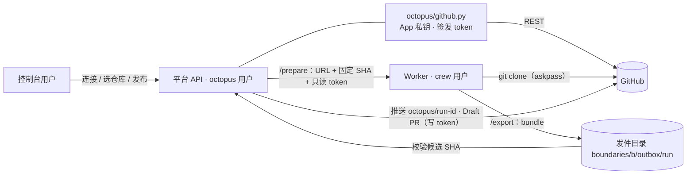

# GitHub Connector 设计（草案）

状态：**设计中**（2026-10-11）。§1–§5 已由负责人确认；§6 列出进入实施前仍需确认的问题。
归属：`docs/BACKLOG.md`「分支与仓库闭环」（M5 范围）；其中 CONN-01（只读克隆）可前移，因为私有仓库的 Session 目前无法准备源码。
继承设计：`docs/inherited/docs/architecture/CONNECTORS.md`（D30、CONN-01～05）；总体设计见 `2026-10-10-kirocrew-on-design.md`。

## 1．目标与范围

- 连接一个 GitHub **个人账号**或**组织**后，控制台列出其下全部仓库（含私有）；发起开发时从列表选择仓库与 ref。
- Worker 用短期只读 token 克隆私有仓库；主机上不需要也不保留任何 GitHub 登录。
- **发布**：Session 完成后由所有者在控制台点「发布」（人工门禁），平台推送 `octopus/<run-id>` 分支并创建 Draft PR。
- 不在本轮：Webhook / Issue 输入、Checks 状态回写、自动合并、GitLab、GitHub Enterprise Server。

成功标准：
1. 以私有仓库 `LiboMa/vector-space-3d-demo`（run-63b33288… 因缺少凭据失败）为例，从列表选中即可克隆，不在主机上手工配置凭据。
2. 卸载 App 或把仓库移出安装范围后，列表与后续准备、发布立即被拒绝。
3. token 不出现在工作区（含 `.git/config`）、Prompt、日志与错误信息中。
4. 失败时控制台显示真实原因（前置项 P1）。

## 2．已确定决策

| ID | 决策 |
|---|---|
| C1 | 平台级 **GitHub App**：管理员注册一次，可安装到任意账号；**一次安装 = 一个 Connector**（个人账号、组织各一个）。不使用个人 PAT / Deploy Key 作为正式方案 |
| C2 | 可见范围按归属：个人账号的 Connector 只有连接人可用；组织的 Connector 由管理员创建，再授权给 Team 或用户。平台在列出仓库、准备源码、发布时都校验授权（防混淆代理） |
| C3 | 第一版权限：Metadata 只读、Contents 读写、Pull requests 读写；不开 Webhook |
| C4 | **读写分离**：只读 token（单仓库、Contents 只读、1 小时）交给 Worker 克隆；写操作由平台（`octopus` 用户）执行，写 token 与 App 私钥不进入执行边界 |
| C5 | App 私钥与 Client Secret 放在 `/etc/kirocrew-on/`，`root:octopus 0640`，不放实例角色可读的 SSM / Secrets Manager（执行用户经实例角色调用 Bedrock，同样能读到）；JWT 用主机 `openssl` 签名，不新增 Python 依赖 |
| C6 | 连接流程：控制台跳转 App 安装页（带 `state`）→ 安装回调同时请求用户授权 → 平台用授权码换用户 token，核对 `GET /user/installations` 包含该安装后才登记，防止伪造 `installation_id` 冒领 |
| C7 | 不建在 KiroCrew 原生连接之上（评估见 §5）；借用其三个做法（§3 末） |
| C8 | 对 Connector 仓库，总体设计 §11 与 §安全「仓库写凭据属于执行边界、经凭据助手交给 Worker 的 git」改为「写回由平台执行」；实施时同步修订总体设计 |

## 3．组成与数据流

1. **`octopus/github.py`**（只在平台进程运行，唯一接触私钥的模块）：签 App JWT；签发安装 token 时按单个仓库和单项权限收窄；列出安装下的仓库、ref 解析为 SHA、查找或创建 PR、OAuth 授权码换用户 token 与核对安装。token 只在内存中使用，不落盘、不写日志。
2. **Connector 注册表**：登记安装（账号或组织、安装 ID、归属人）与组织 Connector 的授权。
3. **克隆**：源码类型 `{type:"github", connector, repo, ref}`。平台先解析出固定 SHA、签发只读 token，经 `/prepare` 交给 Worker；Worker 的 git 通过 askpass 使用 token，remote 保持 `https://github.com/<owner>/<repo>.git`。
4. **发布**：Worker 把 `octopus/<run-id>` 导出为 bundle（以克隆时的固定 SHA 为前置），写入发件目录（`octopus` 组只读）；平台核对 bundle 基于该 SHA、分支头等于控制台展示并经所有者确认的 commit，再在平台自己的裸仓库中推送并创建 Draft PR。

借用 KiroCrew 的做法：
- 克隆后把工作区的 push 地址设为不可用（KiroCrew 用 `DISABLED_NO_PUSH`），Agent 在工作区执行 `git push` 会失败，推送只经平台「发布」。
- 只推送单个 ref：`<sha>:refs/heads/octopus/<run-id>`；Draft PR 语义对齐 `gh pr create --draft`。
- 主机不保留 GitHub 登录：安装脚本检查执行用户没有 `gh` 登录、`~/.ssh` 私钥与 `GITHUB_TOKEN` / `GH_TOKEN`。

## 4．安全要点

- **威胁模型**：Worker、Gateway 与所有 Agent 以同一 OS 用户运行，同一 uid 能读取 0600 文件与 `/proc/<pid>/environ`。因此进入执行边界的只有只读 token；它能读到的内容 Agent 已经通过克隆拿到。
- **平台授权**：每次列出、准备、发布都按 C2 校验「这个平台用户能否使用这个 Connector 的这个仓库」；无权访问返回 404（与现有对象一致）。
- **GitHub 侧兜底**：建议仓库或组织用 ruleset 限制 App 只能推 `octopus/*`，默认分支需 PR 审查、禁止 force push。
- **不泄露**：拒绝含凭据的 URL（现有 `normalize_source`）；git 报错写入错误信息前去除可能的凭据片段；审计记录申请人、仓库、权限与过期时间，不记录 token。
- **撤销**：GitHub 侧卸载或移出仓库后，签发 token 失败即拒绝；平台侧可停用 Connector，立即拒绝后续列出、准备与发布。

## 5．为什么不建在 KiroCrew 原生能力上

评估基于锁定版本 KiroCrew 0.10.0（`57df464`）源码：

| 需求 | KiroCrew 现状 | 结论 |
|---|---|---|
| 连接账号或组织并列出全部仓库 | `connections/` 是给 Agent 用的 GitHub 远程 MCP（OAuth App，推荐 scope `read:org`、`public_repo`）；后端无列仓库接口；Code Review Sage 只列最近 100 个个人仓库 | 不满足 |
| 用短期 token 克隆私有仓库 | 克隆依赖主机现有 `gh` 登录或 SSH（`apps/builtins/auto_improvement/backend/clone_setup.py`）；无按 Session 签发的短期 token | 部分 |
| 推送分支、建 Draft PR | `auto_improvement` 可用（`backend/commit.py`、`profiles/github_repo/pr_recipe.py`），但绑定其改进循环、`auto-improvement/*` 分支与主机 `gh` 登录 | 部分 |
| 写凭据不被同一 OS 用户的 Agent 读取 | 文档与代码明确不防同 uid；OAuth 授权在 `~/.aws/sso/cache`、`gh` 登录在 `~/.config/gh`，都在共享 HOME；严格沙箱只用于单个内置应用且不支持时退化为不隔离 | 不满足 |

另外：连接按机器而非按用户（「一台机器只能有一个账号的授权」，`docs/architecture/design-notes/mcp-oauth-ownership.md`），断开影响整个边界；OAuth 回调固定 `127.0.0.1:48101`，在 EC2 上需手工粘贴回调地址；相关 HTTP 路由为未公开的内部接口，升级 KiroCrew 时容易失效。
接口按 `CONNECTORS.md` 的契约（`authorize_repository`、`resolve_revision`、`materialize_workspace`、`publish_candidate`、`revoke_connection`）定义，KiroCrew 日后支持按用户的 GitHub App 连接时可替换实现。

## 6．待细化（进入实施前确认）

1. **数据模型**：Connector、组织授权、发布记录的表结构；`runs.source` 的 `github` 形态；schema 版本号与 M2 规划的 schema 2 协调。
2. **API 与控制台**：设置菜单「代码仓库连接」；向导中的仓库选择器（分页、搜索）；发布按钮、进度与结果（分支、PR 链接）。
3. **发布细节**：平台裸仓库位置与清理；重复点击与回执丢失时先查询已有分支和 PR；远端分支被他人改动时的冲突表现；bundle 大小上限。
4. **撤销与过期**：卸载、移出仓库、App 权限变更后的界面与错误码。
5. **测试**：GitHub API 替身覆盖签发、收窄、授权与错误路径；真实 GitHub 测试仓库验收（个人账号与组织各一，包含撤销与越权）。
6. **配置与部署**：`platform.toml` 新键（App ID、slug、Client ID、两个密钥文件路径、回调地址）；`octopus-api` 的可写目录（平台裸仓库）；发件目录的属组与权限；App 注册步骤写入运维手册。

## 7．前置与过渡

- **P1 错误信息丢失**（与 Connector 无关，可先做）：`octopus/worker.py:488` 只透传 `security.Error`，`octopus/sources.py` 的提示均为 `ValueError`，控制台只显示 `Worker 操作未完成 (ValueError)`。改为抛 `security.Error`（400），并补测试。
- **P2 私有仓库过渡**：Connector 上线前如需使用私有仓库，用 fine-grained PAT：只授权单个仓库、Contents 只读、有效期不超过 30 天，只给执行用户并启用 `credential.useHttpPath`；不配置写权限；Connector 上线后撤销。
- **交付顺序**：CONN-01（连接、列仓库、只读克隆）→ CONN-03（发布：推送与 Draft PR）→ 其余按 `docs/BACKLOG.md`。
