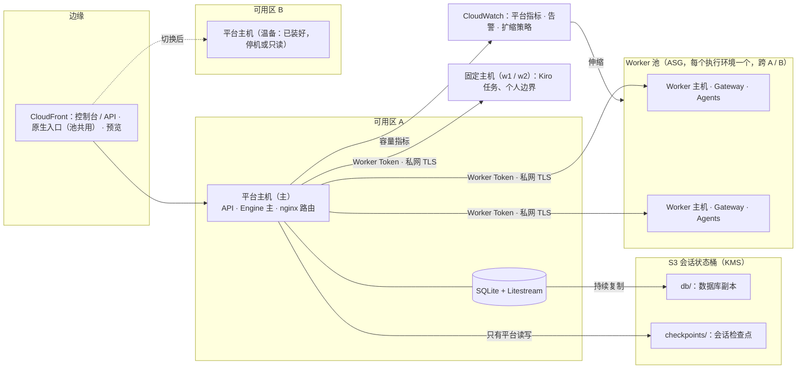

# MVP 0.2.0 核心：高可用与自动扩容（规划草案）

状态：草案，2026-10-23 起草，待负责人一起评审。本稿不改变任何现有行为。标「〔待负责人决定〕」的条目是负责人还没有拍板的选择，
每一项都给出了推荐值和不推荐的备选。所有新增的等待、停下或确认，都单独列在第 9 节，按负责人的规则先确认再做。

与已有设计的关系：
- **执行层的细节**沿用《无状态 Worker 池》设计稿：`docs/superpowers/specs/2026-10-23-stateless-worker-pool-design.md`。
  它在 `.worktrees/worker-pool` 中，尚未提交，配套 IaC 是 `deploy/aws/kirocrew-on-state.yaml`、`kirocrew-on-worker-pool.yaml`。
  那份设计稿的 P0–P3 并入本稿第 8 节的 M0–M4。本稿补上它没覆盖的三块：
  1. 平台层（API、Engine、数据库）的高可用；
  2. 自动扩容用什么信号、按什么规则伸缩；
  3. 监控、演练与验收。
- 依赖：
  - D60 排队可见、D61 并发上限：扩容信号的来源；
  - D49 每人一个边界、D28 执行环境：决定哪些边界能进池；
  - D58 bundle、D57 打码扫描：检查点复用；
  - KiroCrew 升级（`docs/research/2026-10-23-kirocrew-release-cadence.md` §5：0.2.0 的第一步是升到最新正式版）。

## 1 目标与衡量

| 指标 | 现在（实测或推算） | 0.2.0 目标〔待负责人决定〕 |
|---|---|---|
| 控制台与 API 月可用性 | 没有测量。单机单可用区；部署时重启有约 30 s 的 502 / 504 | **99.5%**（每月停机 ≤ 3.6 h，含计划内）；备选 99.9% 需要第 5 节方案 C |
| 平台数据 RPO | 24 h（DLM 每日快照，保留 7 天） | **≤ 5 s**（Litestream 持续复制） |
| 平台主机丢失后的 RTO | 人工重建，没有演练过 | **≤ 15 min**（温备 + 脚本切换，演练实测）；方案 C 为 ≤ 2 min |
| 会话工作的 RPO | Worker 主机丢失时，其上会话的工作区与原生对话全部丢失 | 丢失的最多是**进行中那一次尝试**（检查点在每次候选被接受后写入） |
| 执行环境排满时的等待 | 只能等 KiroCrew 内存门槛放行，或人工加主机 | 持续排队 3 min 内开始扩容；新主机 **≤ 10 min** 可接任务 |
| 空闲成本 | 固定主机 24 h 运行 | 池在没有任务 30 min 后缩到下限（下限可为 0） |

## 2 现状：单点与故障面（2026-10-23）

| 组件 | 现在 | 单点后果 | 已有的缓解 |
|---|---|---|---|
| 平台主机 `kirocrew-on-m1` | m7i.xlarge，单可用区 us-east-1a，EIP。同机运行 API、Engine、SQLite、nginx（原生入口中转 8920–8928、预览 8929），**以及共享执行边界 personal** | 整个平台不可用；personal 边界上的会话一起中断 | EC2 自动恢复告警（只针对 `StatusCheckFailed_System`）；DLM 每日快照 |
| Engine | 与 API 同一进程；单实例租约用 `engine.lock` 的 `flock` | 进程挂掉时整个推进停止 | systemd `Restart=on-failure`；重启后从 SQLite 与 Worker 落盘记录恢复（EC2 实测无重复派发） |
| 数据库 | SQLite WAL，40 MB；0 次锁冲突 | 主机盘损坏时最多丢 24 h | 迁移前自动备份；`backup` / `restore-verify` |
| CloudFront（控制台、原生入口、预览 3 个分发） | 都只有一个源站：平台主机 | 源站不可用就是全站不可用 | — |
| Worker 主机 w1 | 固定主机；每台主机一个原生入口分发加一个平台中转端口（共 9 个，已用 2） | 该 Team 的会话全部停下 | — |
| KiroCrew Gateway | 每个边界一个进程 | 重启或崩溃会让运行中的任务被取消；事件循环卡住时被看门狗结束（上游 #11576） | 部署先排空（`.maintenance`，最多 30 min）；被取消的任务由纠错自动重试 |
| 会话与 Worker 的绑定 | `runs.worker_id` + `native_parent` + 工作区路径；只在 `waiting_worker` 时能换，而且换过去要从头准备 | 主机丢失即丢失这台主机上所有会话的工作区 | — |
| Kiro CLI 登录 | 每台主机一次设备码登录，需要人在浏览器里完成 | 自动加入的主机上没有 Kiro | — |
| Worker 健康信息 | 能力、版本、工具与模型；**没有内存、负载、在跑任务数**（D57 Task 14 已并入 D60，内存数字没有做） | 平台无法按容量放置任务，也无法据此扩容 | KiroCrew 的内存门槛与排队（D60 让它可见） |

## 3 范围

**做**
1. 平台层：数据可恢复（秒级 RPO）、平台主机不再承担执行（「去执行化」）、温备与脚本切换。之后视负责人的决定，做主备自动切换（第 5 节）。
2. 执行层：Worker 池（IaC），按平台给出的容量信号自动扩出；会话可移动之后再自动缩回。
3. 会话可移动：每次候选被接受后写检查点，换主机时从检查点重建（沿用 Worker 池设计稿 §4）。
4. 原生入口池化：一个分发加平台路由，不再每台主机一个分发。
5. 不停机变更：Worker 主机做不可变替换（AMI 预制，加实例刷新与排空）；平台按所选方案做滚动或切换。
6. 可观测性：指标、告警、运行手册、每季度一次的故障演练。

**不做（0.2.0）**
- 多区域、全球多活。
- 进行中的尝试跨主机迁移（进程状态不可迁移；主机丢失时该尝试按现有规则重试）。
- EFS 等共享 NFS（理由见 Worker 池设计稿 §3.1）。
- Spot 实例跑 Agent 任务：任务长、中断只提前 2 分钟通知；以后可以只用于检查命令。
- 平台 API 多活写入（方案 C 只做「多副本 API + 单一 Engine 主」）。

## 4 目标架构

要点：
- **平台主机只做平台**：把共享边界 personal 迁到一台 Worker 主机上。平台主机上的状态就只剩数据库（已复制）和配置（在 IaC 与 SSM 中），换主机变成「恢复数据库加切换源站」。
- **执行环境是一组 Worker**：现在「一个 Team 同一时间只有一个执行环境」，而且环境等于一台 Worker。改为环境可以有多台 Worker 主机（池），放置时选负载最低的一台。
- **扩缩由平台的信号驱动**：Auto Scaling 不看 CPU，而是看平台算出的「每台主机的待办量」。

## 5 平台层高可用：三个方案

| | A 温备 + 脚本切换（推荐 0.2.0 先做） | B 主备、SQLite 留在主机上 | C 多副本 API + PostgreSQL（0.2.0 后段或 0.3.0） |
|---|---|---|---|
| 做法 | Litestream 把数据库持续复制到 S3。另一可用区准备一台装好同一发布的主机（停机，或由启动模板随时起）。切换脚本：起备机，`litestream restore`，启动 API，再把 EIP 或 CloudFront 源站改到备机 | 两台主机，靠租约选主；备机不能读主机的 SQLite | RDS PostgreSQL Multi-AZ 或 Aurora Serverless v2。ALB 后面 2 个 API 副本；Engine 用数据库租约选一个主（advisory lock 加 fencing epoch）；CloudFront 的源站改为 ALB |
| RTO | ≤ 15 min（需演练实测） | 与 A 相同：还是要恢复数据库 | ≤ 2 min（切主是自动的） |
| RPO | ≤ 5 s | ≤ 5 s | ≈ 0（同步复制） |
| 部署停机 | 仍有约 30 s 的重启窗口 | 同左 | 滚动部署，没有停机 |
| 代码改动 | 小：Engine 租约改成接口；配置进 SSM；切换脚本 | 比 A 多却不比 A 好 | 大：数据层改为可用 PostgreSQL（约 1,860 个测试要在两种库上跑），连接池，Engine 主选举，会话 Cookie 与限流状态共享 |
| 月成本增量（us-east-1 粗估） | 备机停机时只有 EBS（约 $10–40）；S3 极小 | — | RDS db.t4g.medium Multi-AZ 约 $94，加 ALB 约 $20，再多一台 API 主机 |
| 结论 | **0.2.0 先做** | 不做 | 负责人要 99.9% 或「部署不停机」时做〔待负责人决定〕 |

两个注意点：
- **CloudFront 源站故障转移不适合 API**：CloudFront 的源站组只对 GET、HEAD、OPTIONS 故障转移，POST（提交、续作、批准）不会转移。方案 A 因此用「切换脚本 + 健康告警」，不依赖源站组。方案 C 用 ALB 做健康检查。
- **Engine 的单主是正确性要求**：两台主机同时推进同一会话会重复派发。现在的 `flock` 只在同一台主机上有效；方案 A 靠「备机不启动 API」保证单主，方案 C 改用数据库租约加 epoch（与会话租约 `X-Lease-Epoch` 的做法相同）。M0 就先把租约抽成接口。

## 6 执行层自动扩容

### 6.1 伸缩单位与放置
- **池按执行环境划分**：
  - 每个 Team 的专属环境，或一个共享环境，对应一个 Auto Scaling Group，带同一个池标签；
  - 不同 Team 不共用池主机（保持 D28 的隔离，Worker 池设计稿 §6）。
- **数据变更**：
  - `worker_spaces` 允许一个空间对应多台 Worker（同一 `environment_id`）；
  - 放置时在该环境「已启用、未排空、健康」的 Worker 中选负载最低的；
  - 已有会话在会话可移动（M4）之前仍粘在原主机上。
- **不进池的边界**：D49 个人边界（以那个人的身份运行，R10），以及需要 Kiro 的任务（6.4）。

### 6.2 扩容信号（平台计算，每分钟发布到 CloudWatch，维度为执行环境）

| 指标 | 来源 | 含义 |
|---|---|---|
| `Inflight` | D61 已在数的「同时运行的任务」，按环境汇总 | 在跑的原生任务与检查 |
| `Waiting` | 状态为 `ready`、等着开始下一个任务的会话；Attempt 证据里有 `queued`（D60）的；`never started` 重新派发的 | 有活但没开始。D61 的配额等待**不算**：那是人为上限，加机器也没用 |
| `Capacity` | 每台 Worker 的并发槽位：按机型配置（例如 m8g.4xlarge 可同时跑 6 个 Agent〔待实测〕），由 Worker 健康信息上报 | — |
| `MemoryAvailableMb`、`Posture` | Worker 健康信息新增：读 `/proc/meminfo` 的 MemAvailable 与 KiroCrew 的 posture | 用来校正容量，也用于告警 |
| `BacklogPerHost` | (`Inflight` + `Waiting`) / 健康主机数 | **伸缩依据**（AWS 推荐的按积压伸缩方式） |

Worker 健康信息要补上 `memory_available_mb`、`inflight`、`capacity`、`draining`。这是原 D57 Task 14 中被放下的那部分，在 M0 做。

### 6.3 伸缩规则〔数值待负责人决定〕
- **扩**：目标跟踪 `BacklogPerHost ≤ Capacity`。额外规则：`Waiting > 0` 持续 3 min 时至少 +1，`MaxSize` 内每次最多 +2。
- **缩**（M4 之后）：主机 30 min 没有在跑的任务，而且其上的会话都已写检查点，才进入排空。用 ASG 实例保护：平台给有进行中尝试的主机设缩容保护，结算后撤掉，保证 ASG 只挑空闲主机。
- **下限与上限**：每个环境 `MinSize`（工作时间 1，夜间 0，按计划动作）、`MaxSize`（默认 4，见 6.5）。外加一个成本告警：池的月花费超过阈值就通知负责人，不自动停服务。
- **缩短加入时间**：每次发布用 EC2 Image Builder 预制 AMI，把 Node、工具、KiroCrew、本发布都装进去；新主机开机只做证书与登记，目标 ≤ 5 min。也可以加 ASG 温池（预先初始化后停机的实例）。

### 6.4 自动扩容的阻塞项
1. **Kiro 登录**：沿用 Worker 池设计稿 §5.5 推荐的 A。池主机只承接走 Bedrock 的工具（Claude Code、Codex、OpenCode）；需要 Kiro 的任务（规划、诊断、`kiro` 工具）放在固定主机。规划与诊断都用 Kiro，所以每个环境至少保留一台固定主机，或者与 Kiro 团队确认非交互登录。〔待负责人决定〕
2. **原生入口**：池化之前，每加一台主机就要建一个 CloudFront 分发（要几分钟），平台的中转端口也只剩 7 个。M3 改为池共用一个分发，平台 nginx 按 Worker 路由。KiroCrew Gateway 能否在子路径下运行，要 kirocrew-on-ce 确认；不能的话改按 Host 头路由加通配证书。
3. **KiroCrew 记忆在主机本地**：KiroCrew 的记忆库与 lessons 在边界的 crew 目录里，池主机缩容后就没了。选项：
   - 池主机的会话用 `incognito` 记忆模式（只读不写），lessons 继续经 D52 团队层知识；
   - 缩容前导出记忆包到状态桶，新主机导入（导入要过 KiroCrew 的投毒筛查）。

   〔待负责人决定，推荐前者〕
4. **会话粘在主机上**：M4（会话可移动）之前只能扩、不能缩。否则缩容会丢掉还开着的会话的工作区。

### 6.5 安全
- 加入时，Worker Token 经 KMS 加密的 SSM 参数交接，不出现在 Automation 的输出里；私有 CA 证书的 CSR 在主机上生成，私钥不出主机；退役时撤销 Token 与证书。
- 池主机的实例角色没有状态桶权限（本机所有进程包括 Agent 都能用这个角色）；检查点只经平台读写。
- SSM Automation 只能对带池标签的实例执行；审计记录谁、为什么触发了扩缩与排空。

## 7 部署、可观测性与演练

**不停机变更**
- **Worker 主机不可变**：发布 → Image Builder 预制 AMI → 更新启动模板 → ASG 实例刷新（每次替换 1 台，替换前经终止钩子排空）。固定主机照旧 `deploy.sh push`。
- **平台主机**：方案 A 保持现在的原地升级（约 30 s 重启窗口）；升级前 Litestream 复制健康是部署的前置检查。方案 C 改为滚动部署。

**监控与告警**（CloudWatch，告警发到现有 SNS，负责人邮件）
- 平台：
  - CloudFront 5xx 比例；
  - API 健康探测（另一个可用区的 Synthetics 或 Route 53 健康检查）；
  - Engine 循环心跳（新指标：最近一次推进的时间）；
  - Litestream 复制滞后；
  - 磁盘使用率（根卷曾扩到 500 GiB）。
- 执行层：
  - 每个环境的 `Waiting`、`BacklogPerHost`，以及排队最久的等待时长；
  - Worker 不健康数；
  - `MemoryAvailableMb` 低于阈值；
  - Gateway 重启次数（#11576）。
- 运行手册（OPERATIONS 新增一节）：平台主机切换、数据库从 S3 恢复、池扩缩异常、手动排空与退役、原生入口路由表修复。

**演练**（每期验收的一部分，之后每季度一次）
- 平台主机：停掉主机 → 按手册切到备机，记录实测的 RTO 与 RPO。
- Worker 主机：运行中强制终止一台池主机 → 进行中的尝试自动重试；会话从检查点在另一台继续（M4 之后）。
- 扩容：在测试环境制造 6 个并发会话 → 记录从开始排队到新主机接任务的时间。
- Gateway：`kill -9` Gateway → 任务自动重试；平台把该 Worker 标为不健康，期间不往它上面放新任务。

## 8 分期（每期单独评审、E2E、负责人确认后再部署）

| 期 | 内容 | 用户可见的变化 | 验收 | 回滚 |
|---|---|---|---|---|
| **M0 准备** | KiroCrew 升到最新正式版（契约测试与原生测试，先在临时边界）；Graviton 支持与 w2（Worker 池设计稿 P0）；Worker 健康信息加内存、在跑数、容量；平台发布 6.2 的指标与 7 的告警；Engine 租约抽成接口（行为不变） | 多一台环境；有告警 | 指标在 CloudWatch 可见；告警演练能收到邮件；回归全绿 | 退役 w2；关掉指标发布 |
| **M1 数据可恢复** | 部署状态栈；平台主机装 Litestream；OPERATIONS 写恢复流程（Worker 池设计稿 P1a） | 无 | 从 S3 恢复到一台新主机，`restore-verify` 通过；RPO 实测 ≤ 5 s | 停 Litestream |
| **M2 平台主机去执行化 + 温备** | 共享边界 personal 迁到一台 Worker 主机：会话在迁移窗口结算后，用「新边界、旧会话不移动」的方式过渡〔细节待评审〕；另一可用区准备备机启动模板与切换脚本（EIP 或 CloudFront 源站） | 迁移窗口内共享环境暂停接新任务 | 演练：停主机 → 15 min 内在备机恢复服务，会话继续推进、没有重复派发 | 切回原主机 |
| **M3 池：自动扩出** | Worker 池栈与加入 / 排空自动化（Worker 池设计稿 P1b）；执行环境可有多台 Worker、按负载放置；原生入口池化（P1c）；AMI 预制；扩容策略（只扩，缩容靠人工排空） | 排满时自动加主机；池主机可以「在 KiroCrew 中打开」 | 6 个并发会话在 10 min 内被新主机接走；人工排空不中断进行中的尝试 | `Desired=0`；回到每台主机一个分发 |
| **M4 会话可移动 + 自动缩回** | 租约、检查点、重建（Worker 池设计稿 P2，开关 `session_mobility` 默认关、逐环境打开）；缩容策略与实例保护；池主机的记忆策略（6.4.3） | 空闲时自动缩容；会话可以在两次尝试之间换主机 | 两个本地 Worker 的集成测试；EC2 上会话跨主机继续，工作树与分支一致；旧主机恢复后写入被拒 | 关开关；缩容策略改为手动 |
| **M5（可选）平台主备** | 方案 C：PostgreSQL、ALB、2 个 API 副本、Engine 选主 | 部署不停机；RTO ≤ 2 min | 演练：终止主 API 主机 → 2 min 内自动恢复 | 切回单机 SQLite（迁移前保留副本） |

顺序的理由：
- 先能看见（M0），再能恢复（M1），再去掉平台单点（M2），然后扩（M3），最后缩（M4）；
- 每一期单独就有价值，任何一期停下都不留半成品；
- M3 只扩不缩，所以在会话可移动之前不会丢工作区。

## 9 新增的等待、停下或确认（按负责人规则，逐项确认后才做）

| 可能新增的 | 为什么会出现 | 推荐的不阻塞做法 |
|---|---|---|
| 平台按容量「等待执行环境容量」再派发 | 能精确控制每台主机的负载 | **不新增等待**：平台照旧立即派发到负载最低的主机，排满时由 KiroCrew 自己的排队（D60，已可见）兜底；扩容只读信号，不拦任务 |
| M2 迁移共享边界时暂停接新任务 | 迁移需要一个静默窗口 | 安排在空闲时段；会话显示「执行环境维护中，稍后自动继续」（已有的 `.maintenance` 行为），不需要用户操作 |
| 换主机时会话等检查点或重建 | M4 的移动 | 只在两次尝试之间移动；重建期间会话保持「准备中」，自动继续，不需要用户操作 |
| 缩容前等会话结算 | 排空 | 由 ASG 生命周期钩子等，不影响用户 |
| 扩缩要人批准 | 成本 | 不需要批准：用 `MaxSize` 与成本告警限住，超出只通知负责人 |

## 10 需要负责人决定的问题（按影响排序）

1. 可用性目标：99.5%（方案 A）还是 99.9%（需要方案 C，0.2.0 工作量大约翻倍）？RTO 15 min 能否接受？
2. 平台主机去执行化（M2）：共享边界 personal 迁出的时间窗口与过渡方式。
3. 执行环境改为「一组 Worker」（数据模型变更），以及每个环境的 `MinSize` / `MaxSize`、夜间缩到 0、月成本告警阈值。
4. 池主机不跑 Kiro（6.4.1）：规划与诊断留在固定主机，可以吗？要不要向 Kiro 团队要非交互登录？
5. 池主机的 KiroCrew 记忆：`incognito`，还是缩容前导出、新主机导入？
6. 原生入口池化的路由方式（子路径还是 Host 头），由 kirocrew-on-ce 确认 KiroCrew 是否支持子路径。
7. 检查点的保留数量（默认 5）与大小上限（100 MB）。
8. M0–M5 的顺序，以及每期的验收方式（是否每期都做 EC2 故障演练）。

## 11 下一步

1. 与负责人逐项过第 10 节。之后把结论写进本稿，分为 0.2.0 计划条目（`docs/progress.json` 新模块「0.2.0 高可用与扩容」）。
2. 与 Worker 池设计稿的作者（`.worktrees/worker-pool`，未提交）对齐，把两份合并成一份设计加一份实施计划（按 superpowers writing-plans 的格式拆任务）。
3. M0 不改变用户体验，可以先开工：指标、告警、Worker 健康信息、Engine 租约接口、KiroCrew 升级评估。M2 及以后的期，等第 10 节定下来再开工。
