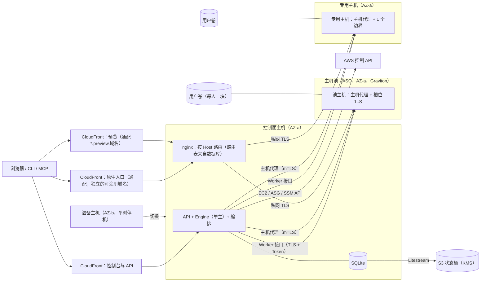

# MVP 0.2.0：部署模式、Worker 自助申请与 Worker 池（统一设计）

日期：2026-10-25　·　状态：设计稿，待负责人评审。本稿不改变任何现有行为，也没有创建任何 AWS 资源　·　分支 `docs/mvp-020-design`（基于 PR #8 的 `docs/mvp-020-inputs`）

本稿合并了五份输入：负责人的决定（BACKLOG）、EBS 卷迁移评估、Worker 自助接入（接入码）设计、无状态 Worker 池草稿（未提交）、高可用与自动扩容规划草稿。
两份草稿里与本稿冲突的部分以本稿为准，取舍逐条列在 §2.3；两份草稿不再单独推进，实施计划按本稿写〔设计者决定〕。

---

## 0　结论先行

1. **两种部署模式，一套发布物。**
   - 单机版：控制面与数据面在同一台 EC2 上，就是现在 EC2 的形态。
   - 集群版：一台控制面主机，加一个 Graviton 主机池（单可用区，ASG），再加按需开出的专用主机。数据面只用 arm64；单机版允许 x86（S33）。
   - 单机版可以原地升级为集群版，不必重装（§4.2.6）。
   - 单机版主机装完只保留 Bedrock 的调用权限；之后凡是要 AWS 写权限的操作，都由管理员在自己电脑或 CloudShell 上运行部署套件驱动（S29）。
2. **数据面伸缩的单位是主机，迁移的单位是用户卷。**
   - 每人一块加密 gp3 卷，默认 30 GiB、ext4。卷上有工作区、各 Agent 的家目录与登录状态、KiroCrew 记忆。
   - 换主机就是卸下卷、挂到另一台。同可用区内用户可见约 20–60 s【推断，待 T6 实测】（E §1.7）。
3. **不搬用户。**
   - 迁移只在两种情况下发生：共享 ↔ 专用切换、主机故障。
   - 只回收已经没有任何用户卷的主机。不整理装箱，不夜间卸卷，专用主机不自动停机（B:351–354）。
4. **认证信息只放在用户卷上。**
   - Claude Code、Codex 的 Key 由用户在申请时填写，平台只在内存中转交，写进该用户边界里工具自己的凭证位置。
   - Kiro CLI 由用户在控制台用设备码自己登录。
   - 平台数据库、SSM、Secrets Manager、日志里都不留这些信息（B:340、B:342）。
5. **AWS 写权限只在控制面。**
   - attach、建卷、开机都由控制面调用。编排器的 AWS 操作有两种后端：集群版控制面主机用「本机角色」，单机版用「部署套件外部驱动」（S29）。
   - 每台 Worker 主机上有一个 root 运行的**主机代理**，只接受控制面的 mTLS 调用，负责挂载与启停。
   - Worker 实例角色显式拒绝卷、快照与 KMS grant 的写操作（E §1.5）。
6. **主机加入不经人手，也不传秘密。**
   - 控制面经 SSM 取主机生成的 CSR，签好后推回证书。CSR 和证书都不是秘密，之后只走 mTLS。
   - 每个边界的 Worker Token 由控制面生成，经 mTLS 写到用户卷上。
   - 接入码（N）保留给人工接入的主机与本地全栈（§6.7、§6.8）。
7. **原生入口按 Host 路由。**
   - 用一个通配 CloudFront 分发 `*.<原生入口的域名>`，这个域名必须是与控制台不同的可注册域名（CE2）。平台 nginx 按 Host 查路由表（来自数据库），转发到用户所在主机的槽位端口。
   - 迁移时只改路由表里的一行，主机名与 `crew_url` 都不变（§8.2）。
   - 依据：KiroCrew 0.10 没有子路径支持（F7）。
8. **现有代码有两处会挡住迁移，0.2.0 必须改。**
   - Worker 身份由主机名推导（`octopus/worker.py:1152`、`:1165`）：换主机后，引擎不再保存它的健康信息（`octopus/engine.py:247–250`），原生入口返回 409（`octopus/crew_entry.py:96–99`）。
   - 执行用户的 UID 由各主机的 `useradd --system` 各自分配（`deploy/install/al2023.sh:121`、`deploy/install/boundary.sh:56`）。
   - 0.2.0 引入写在卷上的 `boundary_id`，以及由控制面分配的全局 UID（§7.2）。
9. **平台层采用 H 的方案 A。**
   - Litestream 持续备份，RPO ≤ 5 s；另一可用区温备，脚本切换，RTO ≤ 15 min（待演练）。
   - 可用性目标待负责人决定。
   - **新发现**：温备要能解开数据库里密封的 Worker Token 与仓库凭证，需要凭证主密钥；签发新主机证书需要 Worker CA 私钥；调用主机代理需要控制面的 mTLS 客户端私钥。它们现在都「不出主机」（`deploy/install/al2023.sh:219–232`），要不要用 KMS 托管，须负责人决定（§10.3）。
10. **分六期。** P0 实测（≤ $20）→ P1 打底（用户体验不变，含 KiroCrew 升到正式版；升级改变体验就单列 P1b，S32）→ P2 单机版一键安装 → P3 集群版底座（只开放给管理员）→ P4 自助申请与切换 → P5 迁移现有部署与平台温备（§15）。
11. **待负责人决定的事项见 §17。** 最重要的三项：可用性目标；温备所需的密钥材料是否托管；用户不填 Key 时是否沿用平台的 Bedrock。

### 0.1　出处记号

| 记号 | 指 |
|---|---|
| B:行号 | 本工作树 `docs/BACKLOG.md`「MVP 0.2.0 重要更新：两种部署模式与 Worker 自助申请（负责人 2026-10-24）」一节（第 327–361 行） |
| E §x | `docs/research/2026-10-25-ebs-volume-move-assessment.md` |
| N §x | `docs/superpowers/specs/2026-10-24-worker-enrollment-design.md` |
| P §x | `.worktrees/worker-pool/docs/superpowers/specs/2026-10-23-stateless-worker-pool-design.md`（未提交），同目录 `deploy/aws/kirocrew-on-state.yaml`、`kirocrew-on-worker-pool.yaml` |
| H §x | `.worktrees/mvp-020-ha/docs/superpowers/specs/2026-10-23-mvp-0.2.0-ha-autoscaling-plan.md`（7bc7b73） |
| F7 | 另一会话已确认的事实：KiroCrew 0.10 没有子路径（base-path）支持，原生入口须按 Host 路由、每个 Gateway 一个主机名；Kiro CLI 只能用设备码登录 |
| K:行号 | KiroCrew 安装指南 `/Users/malibo/MyDev/Kiro-Family-Spaces/reference/KiroCrew-contributor-guide/docs/guides/install.md` |
| CE 审阅 / CE1–CE12 | kirocrew-on-ce 审阅 2026-10-25 与同日复审（经协调者转达）；逐条见 §2.4 |
| `文件:行` | 本工作树的现有代码 |
| 〔设计者决定〕 | 负责人没有逐条确认、由设计者定的，可以调整 |
| 〔待负责人决定〕 / 〔需负责人批准〕 | 列入 §17 / §14 |

---

## 1　意图与原因

**要解决的问题**

- **执行环境靠人一台台加。**
  - 现在每加一个执行边界或一台 Worker 主机，都要管理员经 SSM 执行 `deploy.sh boundary add` 或 `worker-host add`。
  - Worker Token 会留在 SSM 的命令历史里（`deploy/aws/deploy.sh:588`）。
  - Kiro 也要管理员替用户发起设备码登录（`deploy/aws/deploy.sh:606` 起）。
  - 平台主机上只能放两三个边界（OPERATIONS §3「每人一个边界」）。
- **会话粘在主机上。**
  - 工作区、原生父会话、登录状态、KiroCrew 记忆都在主机本地盘上，主机丢了就全丢（H §2）。
- **原生入口不能扩。**
  - 每个边界或每台 Worker 主机一个 CloudFront 分发，加平台主机上的一个中转端口，一共只有 9 个（`deploy/aws/stack.env:13–19`）。
  - 每建一个分发要几分钟（P §5.4）。
- **只能在 EC2 上由我们自己部署。**
  - 安装脚本只支持 AL2023 x86_64（`deploy/install/al2023.sh:2`、`:99`、`:180–182`，`deploy/aws/deploy.sh:210`）。
  - 没有安装包、频道与版本发布。

### 1.1　目标

| 目标 | 怎样算达成 |
|---|---|
| 单机版一行安装 | 在新开的 EC2 上（AL2023 / Ubuntu 22.04 / 24.04，ARM64 / x86_64）执行一条命令，就能用打印出的地址和初始密码登录控制台，并跑通一个会话。时长 ≤ 20 min〔设计者决定，P2 实测后定稿〕 |
| 集群版自助申请 | 从点「申请 Worker」到「就绪」（不含用户在浏览器确认设备码的时间）：共享且池里有空位时 ≤ 3 min；专用 ≤ 8 min〔设计者决定，P0 / P4 实测后定稿〕 |
| 换主机不用重新登录 | 迁移后 kiro-cli、Claude Code、Codex 的登录仍然有效，会话与记忆不变（B:342、B:350；T5 必须通过） |
| 一次迁移的用户可见时长 | p95 ≤ 60 s（E §1.7、T6） |
| 主机故障的影响 | 只丢该主机上进行中的那次尝试。其余用户自动换到别的主机：≤ 31 人时 ≤ 10 min〔设计者决定，演练定稿〕 |
| 平台的 RPO / RTO | ≤ 5 s / ≤ 15 min（H §1、§5；目标值〔待负责人决定〕） |
| 不新增等待 | 除 §14 列出并经负责人批准的之外，不新增任何让用户等待或确认的步骤 |
| P1 不改变用户体验 | P1 部署后，控制台、会话、MCP、CLI 的行为与之前一致 |

### 1.2　非目标（0.2.0 不做）

- 多区域、全球多活；平台 API 多活写入（H §3）。
- 进行中的尝试跨主机迁移：进程状态不可迁移。主机丢失时，该尝试按现有规则重试（P §1、H §3）。
- EFS 等共享 NFS（P §3.1、E §2.6）。
- Spot 实例（H §3）。
- 跨账号挂卷：卷不能跨账号挂载（E §1.4）。
- 在 Docker 里运行集群版的数据面（§4.4）。
- x86_64 的数据面主机：主机池与专用 Worker 只用 arm64（S33）。
- 外部 DNS 提供商：集群版 0.2.0 只支持同账号的 Route 53 公有托管区，外部 DNS 留到后续版本（S35）。
- 把 Team 的专属 Worker 主机（D28，例如 w1）并进主机池。它们照旧由 `deploy.sh worker-host` 管理〔设计者决定〕。
- KiroCrew 原生能力（成员、频道）：另见 BACKLOG「MVP 0.2.0 输入：KiroCrew 原生能力」。

### 1.3　反目标（明确不许做）

| 不许做 | 出处 |
|---|---|
| 新增让用户等待或确认的步骤，除非在 §14 列出并经负责人批准 | 任务要求；H §9 |
| 为省钱搬动用户：整理装箱式迁移、夜间卸卷、按空闲时长停专用主机 | B:352 |
| 另设集中存放认证信息：数据库、SSM、Secrets Manager、S3 检查点都不行 | B:340 |
| 在仍然活着的主机上强制 detach | E §1.3.3 |
| 让 Worker 实例角色拥有卷、快照、开机、KMS grant 或状态桶的任何权限 | E §1.5、P §5.3 |
| 把用户卷写进 `/etc/fstab` | E §1.3.4 |
| 让 ASG 自己挑实例来缩容 | E §3.1 |
| 把秘密放进 SSM 命令、UserData、CloudFormation 明文参数或日志 | N §1；`deploy/aws/deploy.sh:225–235`（现有做法：秘密只经 0600 文件） |

---

## 2　决定清单

### 2.1　负责人的决定（逐条，按原话意思）

| # | 决定 | 出处 |
|---|---|---|
| D1 | 两种部署模式都一键部署。安装方式对标 KiroCrew：一行安装脚本、pip（指向频道索引）、Docker、源码构建 | B:331 |
| D2 | 单机版的控制面与数据面在同一台 EC2 上 | B:332 |
| D3 | 用户先在自己的 AWS 账号里开一台 EC2、登录进去，再执行一行安装脚本。装在这台机器上，不从用户电脑远程创建 | B:333 |
| D4 | 脚本自己检测系统与架构，开的是什么就装在什么上。检测到 x86_64 照装，但明确提示推荐 ARM64（Graviton）；开机器前的说明也把 Graviton 写成首选 | B:334 |
| D5 | 装好 KiroCrew 与 KiroCrew ON（API、Engine、数据库、Worker、Gateway，systemd 常驻）；用这台机器的 IAM Role 或用户提供的 AK/SK 在其账号里建 CloudFront 回源到本机（用回源密钥保护）；建管理员；打印控制台地址与初始密码 | B:336 |
| D6 | 集群版：控制面与数据面分开部署，向导分两步，由部署套件统一掌控 | B:338 |
| D7 | 用户用自己的账号登录控制台，自助「申请 Worker」，申请时填入自己的认证信息：Kiro CLI、Claude Code、Codex，一人一 Key | B:339 |
| D8 | 认证信息不另设集中存放，不需要 Secrets Manager。直接写进该用户执行边界里各工具自己的凭证位置，随用户的 EBS 卷走（2026-10-25） | B:340 |
| D9 | 后台自动分配 Graviton Worker，自动加入并纳管。开机、安装、注册、证书、健康检查对用户不可见；控制面完成初始化与集成注册 | B:341 |
| D10 | Kiro CLI 用设备码登录，用户自己登录自己的：申请时控制台显示设备码，用户在浏览器里确认一次。登录状态存在用户的 EBS 卷上，换机器不用重登（2026-10-24） | B:342；F7 |
| D11 | 参照业界的控制面 / 数据面做法：控制面持有期望状态并调度，数据面只认短期凭证、可以随时替换 | B:343 |
| D12 | 接入码设计放进 0.2.0 一起设计；里面待定的三点随「Worker 自助申请」一起定 | B:344 |
| D13 | 共享 Worker 与专用 Worker 两种申请都支持，用户自选 | B:345 |
| D14 | 共享 Worker 不独占 EC2，多人共用主机，每人一个隔离的执行边界（各自的执行用户与端口），后台由 Auto Scaling 配合 | B:346 |
| D15 | 每人独占一块加密 EBS 卷作为工作空间：工作区、各 Agent 的家目录、登录凭证、本地数据库 | B:347 |
| D16 | 池整体 CPU / 内存压力过高时，ASG 开新节点，挂上独立的 EBS 开始工作 | B:348 |
| D17 | 专用 Worker 独占一台 EC2，同样挂用户自己的 EBS | B:349 |
| D18 | 共享与专用之间切换，只是把 EBS 改挂到另一台 EC2。在两次尝试之间进行：停掉旧主机上该用户的进程 → 卸卷 → 挂到新主机 → 启动。会话、记忆、登录状态不变 | B:350 |
| D19 | 缩容按评估的选项 A，尽可能不缩容（2026-10-25） | B:351 |
| D20 | 不为省钱搬动用户：不做整理装箱式迁移，不做夜间卸卷（不采用选项 C），专用 Worker 不自动停机 | B:352 |
| D21 | 只回收已经没有任何用户卷的主机；空置时长阈值取长，具体值进设计 | B:353 |
| D22 | 新用户优先放进已较满的主机（只影响新放置）。迁移只在切换或主机故障时发生，在两次尝试之间、用户空闲时进行，期间新任务进平台现有的排队 | B:354 |
| D23 | 规模化前置：gp3 存储配额（当前 50 TiB）提前提额；实施前做小规模实测（12 项，约 $5–8，上限 $20，含换主机后三种登录是否仍有效），需负责人配合登录 | B:355 |

BACKLOG 中已经标为〔设计者决定〕的几项，本稿沿用：
- 支持的系统列表（B:335）；
- 单机版升级为集群版不必重装（B:337）；
- KiroCrew 记忆放在卷上（B:347）；
- 回收阈值（B:353）；
- 三条 AWS 限制（B:356–359）；
- 「每人一块 EBS、改挂即迁移」取代「git bundle 搬家」作为主路径，bundle 保留为跨可用区与备份手段（B:361）。

### 2.2　设计者决定（均为〔设计者决定〕，可以调整）

| # | 决定 | 理由 | 见 |
|---|---|---|---|
| S1 | 四种安装渠道共用同一份发布物：一个 wheel，加一份签名的版本清单 | 版本只有一个事实来源；对标 KiroCrew（K:148–221、K:351–366） | §4.4 |
| S2 | 单机版不建用户卷，边界仍是根卷上的目录（同 D49）；升级为集群版时，再一次性拷到用户卷 | 单机版主机的实例角色由同机所有 Agent 共用，不能给它建卷与挂卷的权限 | §4.2.5–4.2.6 |
| S3 | 集群版的控制面主机不跑任何执行边界（去执行化） | 它的实例角色持有 attach、开机等权限，同机的 Agent 都能用这个角色 | §5.3 |
| S4 | 每台 Worker 主机一个 root 运行的主机代理（mTLS，只接受控制面）；控制面只经它操作主机 | 挂载、建用户、启停都需要 root；Worker 以用户 UID 运行，做不了（E §1.5） | §6.2、附录 B |
| S5 | 主机加入：控制面经 SSM 拉取 CSR、推回证书，之后只用 mTLS；Worker Token 由控制面生成，经 mTLS 下发 | SSM 里只出现非秘密；不需要数据面回调控制面 | §6.8 |
| S6 | 接入码只用于人工接入与本地全栈。三点待定：只有管理员签发；默认 30 min、最长 24 h；P1 就把 `worker-host register` 改用接入码 | 自动路径用不到接入码；现有的 Token 留在 SSM 历史里是安全债 | §6.7 |
| S7 | 人工接入时 Worker 调一次 `POST /v1/workers/enroll`，作为「数据面不回调」的唯一例外 | 只发生一次、在纳管之前；平台照旧回调 `/health` 核实（N §4）。这条改动了负责人归纳的不变式，〔待负责人决定〕 | §5.2 |
| S8 | 边界身份 `boundary_id` 由控制面分配，主机代理写进渲染出的 Worker 配置（卷外、root 所有），健康信息里的 `boundary` 由它推导；卷上的 root 文件只供主机代理校验（CE3）；迁移时由控制面更新 URL 与 `host_principal` | 现在的身份绑定主机名，换主机就被拒（`octopus/engine.py:247–250`） | §7.2 |
| S9 | 全局 UID / GID = 100000 + 序号，永不复用；自助申请的边界名为 `u<序号>` | E §1.6、R7；避开 `login.defs` 默认范围 | §7.2 |
| S10 | 卷：ext4（`-i 8192`）、30 GiB，用量 80% 时自动加 10 GiB；挂载选项 `nodev,nosuid`；不写 fstab；挂载前校验序列号与文件系统 UUID | E §1.3.4、§1.3.5、§2.3 | §7.1 |
| S11 | 所有用户卷共用一把 CMK 加密 | 可以对密钥状态告警；以后跨账号共享快照只能用 CMK；每月 $1（E §1.4） | §11 |
| S12 | 主机池、专用主机、用户卷与控制面主机都在同一可用区（现为 us-east-1a）；温备放在另一可用区 | EBS 只能挂同 AZ 的实例（B:357、E §1.1）；不产生 AZ 间流量费 | §7.6、§10 |
| S13 | 一台主机上的边界按槽位编号，端口由槽位号推导 | 端口可预知，安全组用三条范围规则即可 | §8.1 |
| S14 | 原生入口用通配分发加 nginx 按 Host 路由；集群版需要自有域名，而且必须与控制台属于不同的可注册域名（硬性要求，CE2） | F7；现有的分发加中转端口方案只有 9 个端口 | §8.2 |
| S15 | 迁移期间，引擎对该用户的新任务按「执行环境迁移中」等待，做法仿照 D61 的配额等待：不计预算、不占重试，结束后自动开始 | B:354「进平台现有排队」；`octopus/engine.py:549` | §7.3 |
| S16 | 静默判定沿用 E §1.7，原生连接用平台 nginx 按 Host 记录的最近请求时间来判断 | 原生流量本来就经过控制面主机的 nginx | §7.3 |
| S17 | 扩容由控制面计算，直接调用 `SetDesiredCapacity`；ASG 不自行伸缩，实例全部开启缩容保护，暂停 `AZRebalance` 与 `ReplaceUnhealthy` | 「控制面持有期望状态」（D11）；E §3.1 | §8.5 |
| S18 | 池主机没有用户卷持续 24 h 才回收；专用主机在用户卷离开后 1 h 终止；池至少保留 1 台 | D21「阈值取长」；专用主机不能服务别人 | §9 |
| S19 | Claude Code / Codex 的 Key 经 Worker 的新接口写入（Worker 以该用户的 UID 运行），不经主机代理 | 最小权限：root 不碰用户凭证 | §6.3 |
| S20 | Kiro 设备码登录改在控制台完成，经 Worker 的新接口发起；`deploy.sh kiro-login` 保留 | D10；现在是管理员经 SSM 发起（`deploy/aws/deploy.sh:606`） | §6.4 |
| S21 | 用户卷由 DLM 做快照：每日一份留 7 天，每周一份留 4 周。跨可用区恢复用「快照 + 初始化速率」，由管理员手动触发 | E §2.5、§1.1 | §7.6–7.7 |
| S22 | 会话租约、S3 检查点、CodeArtifact 不进 0.2.0 的主路径；git bundle 备份推到以后 | 卷已经承载这些状态；bundle 只带代码，不带凭证（E §1.8） | §7.7 |
| S23 | 专用主机不进 ASG：控制面用同一个启动模板直接 `RunInstances`，给每台配 EC2 自动恢复告警 | 每人一台，ASG 帮不上忙；平台主机已有同样的告警（`deploy/aws/kirocrew-on-ec2.yaml:493–507`） | §6.2 |
| S24 | 主机原地升级（同 `al2023.sh`：Gateway 的指纹变了才排空重启），新 AMI 只用于新开的主机 | 升级不算迁移的理由（D22） | §8.6 |
| S25 | Docker 渠道只做单机版、单边界 | KiroCrew 的沙箱在容器里需要额外权限（K:1015–1016） | §4.4 |
| S26 | KiroCrew 改装官方 wheel（锁定版本与哈希），源码构建只留在源码渠道 | 一行安装要快。**前提**（缺一不可）：① P1 已把 KiroCrew 升到一个正式版（S32）；② 该版本在 KiroCrew 的 CDN 上有签名清单与 wheel（K:148–202）；③ 我们的原生契约验证在该版本上通过。前提不满足时，`install.sh` 照旧按 `deploy/versions.env` 钉住的源码提交构建（清单里注明来源是 wheel 还是 git） | §4.4 |
| S27 | 申请自动通过，不设审批；管理员可以限制：是否允许自助、专用的数量与机型 | 审批等于新增等待（§14）；专用主机有成本 | §6.1 |
| S28 | 停用用户时释放其边界，卷卸下后保留 30 天（另留最后一份快照），之后删除。保留期〔待负责人决定〕 | 平台不删除用户（D31）；卸下的卷照常计费（E §2.2） | §6.6 |
| S29 | **AWS 操作的两种后端。** 编排器的 AWS 操作抽象为「本机角色」与「部署套件外部驱动」两种后端：集群版控制面主机用前者；单机版用后者。单机版主机装完，实例角色只保留 Bedrock 的调用权限（`bedrock:InvokeModel*` 等），不留任何 AWS 写权限。装完以后要写权限的操作（给新边界开公网原生入口的 CloudFront、改栈、平台数据的异地备份、升级为集群版）一律由管理员在自己电脑或 CloudShell 上，用管理员凭证运行部署套件来驱动 | 单机版主机的实例角色由同机所有进程共用，Agent 也能用（`docs/WORKERS.md:102`）：给它任何写权限，就等于给了 Agent。集群版控制面主机上不跑边界（S3），所以可以持有写权限 | §4.2.4–4.2.6、§5.2 |
| S30 | 单机版在控制台新建的边界，默认只走本机隧道 / localhost 入口（同 `deploy/install/boundary.sh:70` 的现状）；要公网原生入口时，控制台提示管理员运行部署套件的一条命令 | 开公网入口要建 CloudFront，属于写操作，按 S29 只能在主机外做 | §4.2.5 |
| S31 | 单机版不跑 Litestream。平台数据靠 DLM 每日根卷快照（安装时建策略，由 DLM 的服务角色执行，主机角色不需要权限），加上部署套件驱动的异地备份：部署套件用管理员凭证生成一个短时效、只能写一个对象的预签名 URL，经 SSM 让主机做一致性备份后上传。Litestream 只在集群版控制面主机上跑 | Litestream 要持续写 S3，而单机版主机不留写权限（S29）。预签名 URL 只能写一个对象、很快过期，主机角色因此不需要任何 S3 权限 | §4.2.4、§10.3 |
| S32 | KiroCrew 升到正式版放进 P1（与 H 的 M0 一致）。升级时：重做原生契约验证（`tests/kirocrew_contract.json` 与主机上的原生测试）；在新版本上重新确认「是否支持子路径」。原生入口仍按 Host 路由，确认结果只做记录。升级必须在不改变用户体验的前提下完成，做不到就单列一期 P1b | 一行安装与官方 wheel 的前提（S26）；H §8 M0 把它列为 0.2.0 的第一步。升级会重启所有 Gateway（`docs/research/2026-10-23-kirocrew-release-cadence.md` §3），所以照现有做法先排空 | §15 |
| S33 | **数据面只用 arm64。** 主机池与专用 Worker 只用 Graviton；专用 Worker 的机型只在 Graviton 系里选（m8g / c8g / r8g，备选 m7g / c7g / r7g）。单机版允许 x86_64，控制面主机不限架构。从 x86 来源（m1、x86 单机版）迁入时，迁移流程清掉与架构有关的可重建产物（`node_modules`、`.venv`、Playwright 浏览器、uv / npm / pip 缓存），并在首次任务前重建 | 全池同一架构，卷在主机之间来回迁移时，`node_modules` 里的原生扩展与各工具版本才保持可用（E R12、§1.3.5）；只在数据面要求，单机版就不必限制用户开什么机器（D4） | §7.9、§15 P5 |
| S34 | `personal` 共享执行环境按 OPERATIONS 原计划退役（OPERATIONS §3「以后（第 3 期）……退役共享 `personal`」，`docs/OPERATIONS.md:174`）：P5 之前，先把它服务的空间改到各自的个人边界或 Team 环境。w1 保持 Team 专属主机，继续由 `deploy.sh worker-host` 管理，不并入池 | personal 是多个空间共用一个系统账号的环境（OPERATIONS §3），不符合每人一个边界；w1 是 D28 的 Team 主机，并入池不在 0.2.0 范围（§1.2） | §4.2.7、§15 P5 |
| S35 | 集群版作为产品给别人部署时，0.2.0 要求同账号里有 Route 53 公有托管区（通配证书的 DNS 验证与通配记录都写在那里）；外部 DNS 提供商留到后续版本 | 现有的 `console_zone` / `preview_certificate` 已经按这个前提实现（`deploy/aws/deploy.sh:110`、`:138`），部署套件可以全自动完成；外部 DNS 要人工改记录，等于新增步骤 | §4.3、§8.2 |

### 2.3　与草稿冲突时的取舍（以 BACKLOG 为准）

| 草稿里的说法 | 负责人的决定 | 本稿的做法 |
|---|---|---|
| E §3.2 选项 A：静默时合并装箱，主机空出后 10 min 回收 | 不做整理装箱式迁移，阈值取长（B:352–353） | 不合并；池主机空置 24 h 才回收（§9） |
| E §3.3：超过约 100 人时改用选项 C | 不采用选项 C（B:352） | 不做；成本随之偏高，在 §13 写明 |
| E §3.6：专用 Worker 按时段停机 | 专用 Worker 不自动停机（B:352） | 不停机；用户卷离开后 1 h 才回收主机（S18） |
| P §1、§4：两次尝试之间无状态，会话租约加 S3 检查点作为主路径 | 每人一块 EBS，改挂即迁移；bundle 只作备份（B:361） | 卷就是状态；不做租约与检查点（S22） |
| P §5.5 方案 A：池主机不跑 Kiro | 用户自己用设备码登录，状态存在卷上（B:342） | 池主机照常跑 Kiro（§6.4） |
| P §6：池主机按 Team 分配，不同 Team 不共用一台主机 | 共享 Worker：多人共用主机，每人一个隔离的边界（B:346） | 多人共用主机，靠 OS 用户、0700 目录、cgroup 隔离；需要更强隔离的选专用（§8.1、§11） |
| P §5.4、H §6.4.2：原生入口按子路径 `/w/<id>/` 路由 | — | KiroCrew 不支持子路径（F7），改按 Host 路由（§8.2） |
| P §5.3、H §6.5：加入时 Worker Token 经 KMS 加密的 SSM 参数交接 | 控制面持有期望状态（B:343） | Token 由控制面生成，经主机代理的 mTLS 下发，不经 SSM（S5） |
| H §6.1：每个执行环境一个池，按 `BacklogPerHost` 伸缩 | 按 CPU / 内存 / 剩余挂载位扩容（B:348、B:358） | 扩容信号见 §8.5。用户的任务只能在他的卷所在的主机上跑，按积压加主机帮不到已有用户 |
| H §6.3：主机 30 min 无任务就进入排空与缩容 | 尽可能不缩容（B:351） | 只回收空主机（§9） |
| H §6.4.3：池主机的 KiroCrew 记忆用 `incognito` | 记忆放在卷上（B:347） | 照常 `persistent`，随卷走 |
| H §1：执行环境排满时 ≤ 10 min 内有新主机可接任务 | 迁移只在切换或故障时发生（B:354） | 新主机只承接新用户与迁移。已有用户遇到主机繁忙时，由 KiroCrew 自己的排队兜底（D60）；要不要为性能迁走个别用户，列入 §17 |
| N §2：不做 Worker 证书自动签发 | 后台自动纳管，证书对用户不可见（B:341） | 集群版自动路径由控制面签发主机证书（§6.8）；N 的人工接入路径不变 |

### 2.4　kirocrew-on-ce 审阅 2026-10-25 的要求

来源：kirocrew-on-ce 审阅 2026-10-25（经协调者转达）。逐条写进正文，标「CE 审阅」。「硬性要求」实施时不可省略；「〔设计者决定〕」可调整，但要说明理由。

| # | 要求 | 类型 | 写在 |
|---|---|---|---|
| CE1 | **共享主机上，一个边界的内存会拖住其他边界。** KiroCrew Gateway 按整机可用内存推迟子任务派生（EC2 2026-10-21 日志「Subagent spawn deferred: only 2.47 GB available, need 2.50 GB」，预热时阈值 3.0 GB）；posture=tight 时它回收最老的未认领父会话，并 SIGKILL 其子进程（BACKLOG「共享与组织」，`docs/BACKLOG.md:28`，run-16848466），在共享主机上这就成了跨租户杀进程；`/tmp` 是整机 tmpfs（Agent 残留曾占 4.7 GB）；空闲的 kiro-cli-chat 链（每条约 370 MB）不回收。要求：① P0 加一项实测（N 个空闲 Gateway + 1 个重负载边界，T13）；② 确认 KiroCrew 能否读 cgroup v2 的 `memory.max` / `memory.current`，不能就向上游提（对外操作，须负责人同意，同 `docs/BACKLOG.md:320` 的先例）；③ 每个边界自己的 cgroup 配额，加 `PrivateTmp=yes`（tmp 放在磁盘上、按边界配额，也隔离租户之间的临时文件）；④ 空闲运行时的回收归主机代理负责；⑤ 每台主机放几人，按 Gateway 基线 RSS 加预热链计算，不只看挂载上限 | 硬性要求 | §8.1、§8.4、§16 T13、附录 B |
| CE2 | **原生入口的域名。** `*.native.<域名>` 不能与控制台同属一个可注册域名：否则原生页面与控制台同站，`SameSite=Strict` 失去 CSRF 保护，原生页面还能写不带 `__Host-` 前缀的 Cookie。要求：原生入口用独立的可注册域名（像预览域名那样单独配置）；nginx `map $host` 只用精确键，`default ""` 返回 404，不回落到任何上游；CloudFront 必须用转发 Host 的源请求策略 | 硬性要求 | §8.2、§17 #8 |
| CE3 | **`boundary_id` 不从用户可写的卷上读。** 由主机代理把控制面给的 `boundary_id` 写进渲染出的 Worker 配置，Worker 上报它；`volume.json` 由 root 所有（放在卷根下 root 所有的目录里，用户的家目录是子目录），只供主机代理做序列号 / UUID / 属主校验 | 硬性要求 | §7.1、§7.2 |
| CE4 | **root 主机代理写用户可控的目录。** 卷内任何 root 写入或 chown 都不能跟随符号链接（`openat` + `O_NOFOLLOW` / `openat2` 的 `RESOLVE_NO_SYMLINKS`），也不对用户路径做 `chown -R`；Worker / Gateway / nginx 的配置渲染到卷外 root 所有的路径（`/var/lib/kirocrew-host/<boundary>/`），再交给 systemd 单元 | 硬性要求 | §7.1、§7.9、§11、附录 B |
| CE5 | **自动加入的信任锚。** 签证书之前，要求实例属于我们的 ASG（系统标签 `aws:autoscaling:groupName`），或者是编排器自己启动、记在 `hosts` 里的实例 ID；而且启动模板 ID 与实例配置文件都对得上。除控制面角色外，所有角色都禁止对 `kirocrew:*` 键做 CreateTags / DeleteTags。SAN 由 CA 按 `DescribeInstances` 的结果（私网 IP、主机 ID）自己设，忽略 CSR 里的 SAN | 硬性要求 | §6.8、§11 |
| CE6 | **接入码（N）。** 映射符合 N 的 §3–§5 与 §4。两处差异要写明：① N 里 Token 由 Worker 自己生成，本稿改为编排器生成、经 mTLS 下发；② `POST /v1/workers/enroll` 经 CloudFront、不需要鉴权，没有有效接入码时要便宜地返回 404，并按来源限流。第一期就切换部署脚本——同意 | 〔设计者决定〕 | §6.7 |
| CE7 | **温备的密钥托管。** KMS 托管是合理做法，还要把控制面的 mTLS 客户端私钥（§6.8）一起托管；密钥策略只允许控制面角色 Decrypt（外加写明的应急通道），显式拒绝 Worker 角色，每次 Decrypt 都触发 CloudTrail 告警；写明这是平台密钥材料，与「用户凭证不用 Secrets Manager」（D8）不冲突。托管与否仍由负责人决定 | 〔设计者决定〕；托管与否〔待负责人决定〕 | §10.3 |
| CE8 | **端口。** 按槽位派生、迁移后会变的回环端口，只有在卷上没有持久化它们时才行（KiroCrew 会话库、`crew_url`、Worker 的 gateway_url）：保留 T6 的核对。T6 不过时，改用全局序号派生，约 6–7 千用户后会超过 32768 的上限；KiroCrew 若改走 UDS，可以去掉这层耦合，记为备选 | 〔设计者决定〕 | §8.1 |
| CE9 | **登记校验。** 0.2.0 里修掉现有的两处注册不一致（BACKLOG 2026-10-24）；迁移事务要跑与 `POST /v1/workers` 相同的唯一性校验（跨空间的 `host_principal`、平台主机规则） | 硬性要求 | §5.3 第 9 条、§7.2、§7.3 |
| CE10 | **静默判定。** 还要求没有活着的原生 WebSocket：访问日志看不到持续的连接，要由 nginx 按 Host 统计升级连接数，或由 Gateway 上报 | 硬性要求 | §7.3 |
| CE11 | **池主机的整机 `/tmp`**（kirocrew-on-ce 复审 2026-10-25 补充），无论是否用 `PrivateTmp` 都要做：四项 `fs.protected_*` sysctl（`protected_symlinks=1`、`protected_hardlinks=1` 是 AL2023 默认；`protected_regular=2`、`protected_fifos=2` 不是）；`/tmp` 放磁盘并设大小上限；定期清理只删「属主 UID 已没有存活进程」的文件。理由：`TMPDIR` 只是建议，Chrome / Playwright 等仍写 `/tmp` 的固定路径；共享的粘滞 `/tmp` 允许抢占名字。T13 扩展：第二个租户不能读取或抢先占用第一个租户的 `/tmp` 产物；T13 证明 owner-token 在单元自己的挂载命名空间下可用，就首选 `PrivateTmp` | 硬性要求 | §8.1、§11、§16 T13 |
| CE12 | **预览域名与控制台同站**（kirocrew-on-ce 复审 2026-10-25 补充）：已记进 BACKLOG「预览域名与控制台同站」一节（PR #8 分支 `docs/mvp-020-inputs` 的 4570a19）。修复与 CE2 是同一个负责人决定（改用独立的可注册域名）；另有一项与域名无关、成本低的「有副作用的 GET 请求审计」，可以先做 | 引用；GET 审计为〔设计者决定〕放进 P1 | §8.2、§15 P1、§17 #8 |

---

## 3　名词与总体架构

### 3.1　名词

| 名词 | 含义 | 注意 |
|---|---|---|
| 控制面 | Octopus 平台：API、Engine、SQLite、nginx（控制台、原生入口、预览的转发）、私有 CA、AWS 编排 | 单主（§5） |
| 数据面 | Worker 主机上的执行边界：Worker、KiroCrew Gateway、Agents、预览进程 | 可替换 |
| 主机 | 一台 Worker EC2：**池主机**（在 ASG 里，多人共用）或**专用主机**（一人独占） | 都运行主机代理 |
| 共享 Worker（用户可见的叫法） | 用户的执行边界放在池主机上 | **不是**现有的「共享执行环境」：那是 D28 的 `scope='shared'`，多个空间共用**同一个**边界与系统账号，能互相读源码、登录与记忆（OPERATIONS §3）。新用户的边界在数据模型里仍是 `scope='dedicated'`、`owner_id=该用户`，放在哪类主机另记 `host_mode = pooled \| exclusive`〔设计者决定〕。用户界面里怎么叫，〔待负责人决定〕 |
| 专用 Worker（用户可见的叫法） | 用户的执行边界独占一台主机 | 同上，`host_mode = exclusive` |
| 执行边界 | 一个 OS 用户 `crew-<名>`，加一个 Gateway 和一个 Worker（D49） | 一人一个 |
| 用户卷 | 每人一块加密 gp3，挂在边界目录上 | §7.1 |
| 槽位 | 一台主机上边界的编号 1..S，用来推导端口 | §8.1 |
| 主机代理 | 每台 Worker 主机上的 root 服务 `octopus host-agent` | 附录 B |
| 接入码 | N 的一次性码，前缀 `kce_`，库里只存哈希 | §6.7 |
| 静默 | 没有运行中或待派发的尝试、没有原生连接、没有运行中的预览，且最近活动超过 10 min | E §1.7 |

### 3.2　总体架构（集群版）

### 3.3　组件：新增、改动、不变

| 组件 | 状态 | 说明 |
|---|---|---|
| `install.sh`、wheel、频道索引、签名清单、Docker 镜像 | 新 | §4.4 |
| 部署套件 `kirocrew-on cluster …` / `kirocrew-on single …`（CLI，由管理员在自己电脑或 CloudShell 上运行，接替 `deploy.sh`） | 新 | §4.2.4–4.2.6、§4.3 |
| 编排器的 AWS 后端：「本机角色」与「部署套件外部驱动」 | 新 | S29、§4.2.4 |
| 主机代理 `octopus host-agent` | 新 | 附录 B |
| 编排器：卷、主机、迁移、扩容、回收（在 Engine 进程内，单主） | 新 | §6–§9 |
| 数据面栈：启动模板、ASG、Worker 角色、安全组、CMK、DLM、SSM 文档、通配原生分发 | 新；参考 P 的 `kirocrew-on-worker-pool.yaml` | §4.3 |
| 状态栈：S3 + KMS，用于 Litestream 与密钥托管 | 改：沿用 P 的 `kirocrew-on-state.yaml`，去掉 CodeArtifact 与 `checkpoints/` | §10 |
| Worker：`boundary_id`、容量字段、`/tool-auth/*` 接口 | 改 | §6.3、§6.4、§7.2 |
| 平台：申请、卷、主机、迁移的表与接口；原生路由表渲染；迁移等待 | 改 | 附录 A |
| `al2023.sh` → 按 OS 与架构分支的安装步骤 | 改 | §4.2 |
| D28 Team 的 Worker 主机、`deploy.sh worker-host` | 不变（`register` 改用接入码） | §6.7 |
| 会话状态机、门禁、发布、预览代理 | 不变（预览路由随迁移更新） | §8.3 |

---

## 4　两种部署模式

### 4.1　对比

| | 单机版 | 集群版 |
|---|---|---|
| 适合 | 一个人或一个小团队、试用 | 多人、自助申请 |
| 主机 | 用户自己开的 1 台 EC2 | 1 台控制面主机 + 主机池（ASG）+ 按需的专用主机 |
| 安装 | 在这台 EC2 上执行一行脚本（D3） | 部署套件分两步（D6） |
| 架构 | x86_64 或 arm64（推荐 arm64，D4） | 数据面只用 arm64；控制面主机不限（S33） |
| 执行边界 | 同机的目录（D49） | 每人一块 EBS，挂在池主机或专用主机上 |
| AWS 写操作 | 主机角色装完只保留 Bedrock 调用权限；写操作由管理员在主机外运行部署套件（「部署套件外部驱动」后端，S29） | 控制面主机的实例角色（「本机角色」后端），主机上不跑边界（S3） |
| 原生入口 | 主人的边界用平台自己的原生分发；新建的边界默认只走本机隧道 / localhost，要公网入口时由部署套件开通「每边界一个分发 + 中转端口」，最多 9 个（`deploy/aws/stack.env:13–19`；S30） | 通配分发 + 按 Host 路由（§8.2）；要求同账号的 Route 53 公有托管区（S35） |
| Claude Code / Codex | 默认经实例角色用 Bedrock（现状，`deploy/install/boundary-lib.sh:55–69`），也可以填自己的 Key | 用户自己的 Key（D7）；没填时怎么办〔待负责人决定〕 |
| Kiro | 控制台设备码（P2 起） | 同左 |
| 平台数据 | DLM 每日根卷快照，加部署套件驱动的异地备份；不跑 Litestream（S31） | Litestream + 温备 |
| 升级 | 可以升级为集群版（§4.2.6） | — |

### 4.2　单机版

#### 4.2.1　用户看到什么

1. 按说明开一台 EC2：首选 Graviton（例如 m8g.xlarge）、AL2023 arm64、根卷 ≥ 50 GiB（D4）。安装用的权限二选一（D5）：给实例角色临时加上安装权限，或在执行脚本的 shell 里提供 AK/SK（见 4.2.4）。
2. 用 SSM 或 SSH 登录这台机器，执行 `curl -fsSL https://<下载域名>/install.sh | sudo sh`。
3. 等它跑完。脚本打印：控制台地址、管理员用户名、初始密码（只打印这一次，另存在 root 0600 的文件里），以及下一步「在控制台登录 Kiro」。
4. 打开控制台，用初始密码登录，在「我的设置 › 执行环境」用设备码登录 Kiro（§6.4），然后就可以提交会话。

#### 4.2.2　系统与架构检测

| 检测到 | 做什么 |
|---|---|
| AL2023 aarch64 | 安装（推荐的组合） |
| AL2023 x86_64 | 照装，开头和结尾各打印一次「推荐 ARM64（Graviton）：同等性能价格更低……」（D4） |
| Ubuntu 22.04 / 24.04，aarch64 或 x86_64 | 用 apt 安装；x86_64 同样提示 |
| 其他系统（AL2、Ubuntu 20.04、Debian、RHEL 等） | 列出受支持的系统后以退出码 2 结束，不硬装（B:335） |
| 不在 EC2 上（IMDSv2 不可达） | 说明原因后退出：单机版要从实例元数据取区域、实例 ID 和角色。本机开发走源码渠道〔设计者决定〕 |
| 不是 root 也没有 sudo、没有 systemd、空闲磁盘 < 40 GiB、内存 < 8 GiB | 说明原因后退出〔设计者决定，数值待 P2 实测〕 |

**现有代码只支持 x86_64 的地方**（都是新工作）：
- `deploy/install/al2023.sh:99`：Node 的 `linux-x64`；
- `deploy/install/al2023.sh:180–182`：kiro-cli 的 `x86_64`；
- `deploy/aws/deploy.sh:210`：x86_64 AMI。

P §5.6 已核实 arm64 的发布物都有：kiro-cli 2.33.1 的 `kirocli-aarch64-linux.zip`，Node v22.23.3 的 `linux-arm64`。

**Ubuntu 要另外处理**：
- apt 的包名，包括 Playwright Chromium 需要的 16 个库（`deploy/install/al2023.sh:31`）；
- AppArmor 代替 SELinux 的 `semanage` 步骤；
- 22.04 没有 Python 3.12，改用 uv 管理的 CPython，做法同 KiroCrew（K:204–221）。

#### 4.2.3　安装做什么

每一步都可以重复执行，重跑只补缺。步骤沿用 `al2023.sh` 的逻辑，拆成与 OS 无关的步骤，再加按 OS 的包管理分支。

| # | 步骤 | 与现在的差别 |
|---|---|---|
| 1 | 预检：OS、架构、资源、IMDSv2、出网、实例角色的权限 | 新 |
| 2 | 系统依赖（dnf / apt）、nginx | 加 apt 分支 |
| 3 | Node（按架构，用 `SHASUMS256.txt` 校验） | 加 arm64 |
| 4 | Python 3.12（系统包，或 uv 管理的 CPython） | 新 |
| 5 | KiroCrew：官方 wheel，锁版本与 sha256（S26） | 现在是在主机上从源码构建（`deploy/install/al2023.sh:141–168`） |
| 6 | kiro-cli：官方清单，按架构，校验 sha256 | 加 aarch64 |
| 7 | Coding 工具（npm 固定版本，`deploy/versions.env`） | 不变 |
| 8 | KiroCrew ON：wheel，先验签版本清单 | 现在是 `git archive` 打的包（`deploy/aws/deploy.sh` `push`） |
| 9 | OS 用户与目录：`octopus`，主人的边界 `crew-<名>`（UID 按 §7.2 的规则分配） | UID 改为固定规则 |
| 10 | 配置：`platform.toml`、边界配置、私有 CA、凭证主密钥、源站密钥 | 源站密钥在本机生成，只写本机 0640 文件，不经 SSM〔设计者决定：单机版里部署者与主机是同一台〕 |
| 11 | 原生契约检查（全部边界通过才切换 `current`） | 不变（`deploy/install/al2023.sh:330–343`） |
| 12 | systemd：`octopus-api`、`octopus-gateway@`、`octopus-worker@` | 不变 |
| 13 | CloudFront：建一个小 CloudFormation 栈 `kirocrew-on-single`，内容是 EIP（可选）、CloudFront 前缀列表的安全组规则、控制台 / 原生 / 预览三个分发（注入源站密钥），以及根卷的 DLM 每日快照策略（S31） | 由 `kirocrew-on-ec2.yaml` 中与主机无关的部分改写而来 |
| 14 | 管理员：随机密码，root 0600 | 不变（`deploy/install/al2023.sh:361–387`） |
| 15 | 把主人的边界登记为管理员个人空间的 Worker | 不变 |
| 16 | 打印地址、账号、初始密码与下一步 | 新 |

#### 4.2.4　CloudFront 与权限

- **两种凭证，任选其一**：
  - 实例角色；
  - 用户在当前 shell 里提供的 AK/SK（环境变量或交互输入）。脚本只在本进程中使用，**不写盘、不写进配置**〔设计者决定〕。
- **安装需要的最小权限**（缺了就打印这份清单后退出）：
  - CloudFormation：建、改、查本栈；
  - CloudFront：建分发、打标签；
  - EC2：查前缀列表、加安全组入站规则、分配与关联 EIP、查实例；
  - 有自定义域名时另加 Route 53 与 ACM；
  - 用 Bedrock 时另加 `bedrock:InvokeModel*`。
- **装完只留 Bedrock 的调用权限**〔设计者决定，S29〕。
  - 理由：单机版主机的实例角色由同机所有进程共用，Agent 也能用（`docs/WORKERS.md:102`）。
  - 用实例角色安装的：脚本最后用 `iam:SimulatePrincipalPolicy`（或试调用）核对角色已经没有写权限，否则打印要卸下的策略，并在控制台「管理 › 部署」持续标红，直到卸下。
  - 用 AK/SK 安装的：角色本来就只需要 Bedrock。
- **装完以后的写操作，由部署套件在主机外驱动**〔设计者决定，S29〕。
  - 管理员在自己电脑或 CloudShell 上运行 `kirocrew-on single <命令>`，用管理员凭证执行，主机上不留管理员凭证。
  - 编排器在单机版里用「部署套件外部驱动」后端：它不调用 AWS 写 API，只在数据库里记一条「待执行的 AWS 变更」（附录 A `aws_requests`，参数里不含秘密），控制台显示要运行的那条命令。
  - 部署套件用管理员 Token 读取待执行项，执行完再回报。要在主机上做的 root 步骤（例如渲染中转配置），由部署套件经 SSM 完成，做法同现在的 `deploy.sh boundary native`（`deploy/aws/deploy.sh:759`）。

  | 操作 | 命令 |
  |---|---|
  | 给某个边界开公网原生入口 | `kirocrew-on single native <边界>` |
  | 平台数据的异地备份 | `kirocrew-on single backup`：生成预签名 URL，经 SSM 让主机执行 `octopus backup` 后上传（S31） |
  | 更新单机版的栈（例如加自定义域名） | `kirocrew-on single up` |
  | 升级为集群版 | §4.2.6 |
- **`--no-cloudfront`**：只装不建分发，经 SSM 端口转发访问（同 `deploy.sh tunnel`）〔设计者决定〕。

#### 4.2.5　单机版里的数据面

- 控制面与数据面同机，正是负责人定的单机版形态（D2）。H §4.2「数据面跑在控制面主机上」这条偏离，在单机版里**按设计保留**。
- 执行边界是根卷上的目录 `/var/lib/octopus/boundaries/<名>/`（D49）。不建用户卷，因为实例角色由同机的 Agent 共用，不能给它建卷与挂卷的权限（S2）。
- 再加人时，照 D49 在同机开边界（控制台的「管理 › 执行环境 › 新建边界」取代 `deploy.sh boundary add`）。这一步只在本机做 root 操作（建 OS 用户与目录、启动服务），不需要 AWS 权限。
- 新建边界的原生入口默认只走本机隧道 / localhost（`crew_url = http://localhost:<10000+Gateway 端口>`，同 `deploy/install/boundary.sh:70`）〔设计者决定，S30〕。
  - 要公网入口时，控制台在该边界的详情里提示：「需要从公网打开 KiroCrew 时，请管理员在自己电脑或 CloudShell 上运行 `kirocrew-on single native <边界>`」。
  - 这条命令建该边界的分发（沿用每边界一个分发 + 中转端口，最多 9 个），经 SSM 渲染中转配置，并改写 `crew_url`。
  - 配置了域名时也可以用通配方案（§8.2）。

#### 4.2.6　升级为集群版（不重装）

**原则**〔设计者决定，S29〕：
- 升级过程中，这台主机上还跑着边界、还有 Agent，所以它的实例角色在整个第 1、2 步里都**不加任何写权限**。
- 第 1、2 步的每一个 AWS 写操作（建栈、建卷、attach / detach、主机加入用的 SSM 命令），都由管理员在自己电脑或 CloudShell 上运行的部署套件，用管理员凭证执行。
- 编排器在这两步里仍用「部署套件外部驱动」后端，只记录状态、等部署套件来执行。
- `kirocrew-on cluster upgrade` 可以中断后续跑，进度存在平台数据库里。

| 步 | 谁、用什么凭证 | 做什么 | 用户感受 |
|---|---|---|---|
| 1 | 部署套件，管理员凭证 | 部署状态栈与数据面栈（§4.3；需要同账号的 Route 53 公有托管区，S35），池里起第 1 台主机。主机加入（§6.8）里的 SSM 命令也由部署套件发出；签发证书由部署套件经 SSM 在本主机上以 root 调私有 CA | 无 |
| 2 | 部署套件，管理员凭证 | 逐个边界：用户静默时（§7.3），停掉该边界 → 建一块用户卷，attach 到**本主机** → 经 SSM 以 root 拷贝（`rsync -aHAX`，改属主为全局 UID；来源是 x86 时排除与架构有关的产物，见 §7.9）→ detach → attach 到池主机 → 经平台的管理员接口让主机代理准备边界 → 切换 Worker 的地址与原生路由 | 每人一次，期间新任务排队（与迁移相同）；来源是 x86 时，首次任务前还要重建依赖。这是一次性的新增等待〔需负责人批准，§14 W4〕 |
| 3 | 部署套件，管理员凭证 | 确认本主机上已经没有任何启用的边界（`personal` 已按 §4.2.7 退役），才给这台主机的角色加上控制面策略；编排器的后端从「部署套件外部驱动」切到「本机角色」。去执行化完成（S3） | 无 |
| 4 | 编排器，本机角色 | 原生入口切到通配分发（S35） | 「在 KiroCrew 中打开」的地址变成新的主机名，旧分发保留一段时间后删除 |

- 第 2 步是拷贝，不是移动：根卷上的旧目录保留到负责人确认之后再删，所以随时可以回滚。
- 现在的 EC2 部署（`kirocrew-on-m1`）走的就是这条路径（§15 P5）。迁到用户卷上的只有 D49 的个人边界（owner、alice 等）。
  - `personal` 不迁，按 §4.2.7 退役（S34）。
  - **w1 不动**：它是 D28 的 Team 专属主机，继续由 `deploy.sh worker-host` 管理，不并入池，也不经过这条路径（S34）。
  - m1 是 x86（m7i.xlarge，`deploy/aws/stack.env:4`），所以第 2 步对它要按 §7.9 清理并重建依赖。

#### 4.2.7　`personal` 共享执行环境退役（P5 之前，S34）

依据：OPERATIONS §3 早已计划「退役共享 `personal`」（`docs/OPERATIONS.md:174`）；退役规则见 OPERATIONS §3「Worker 管理」（`docs/OPERATIONS.md:117`）。步骤〔设计者决定〕：

| 步 | 做什么 | 用到的现有接口 |
|---|---|---|
| 1 盘点 | 列出 personal 服务的个人空间与 Team，以及其上进行中的会话 | `GET /v1/admin/environments` |
| 2 个人空间 | 已有自己边界的人（如 owner、alice）：把 personal 从他的空间移出；新会话本来就优先落到自己的边界（`octopus/domain.py:309–320`）。还没有边界的人：先给他开一个（P4 之前由管理员建，P4 之后可以自助申请），再移出 | `DELETE /v1/workers/<personal>/spaces {"user_id"}`；「管理 › 用户 › 改执行环境」 |
| 3 Team | personal 是某个 Team 的执行环境时，改到该 Team 的专属环境（例如 w1）或另一个合适的环境；没有就先为 Team 开一台 D28 Worker 主机（`deploy.sh worker-host add`） | `POST /v1/teams/<id>/environment {"worker_id"}` |
| 4 等进行中的会话结束 | 移出空间以后，personal 上不再有新会话；等已有的进行中的会话自然结束。不先停用它，免得多任务会话在两个任务之间进入「等待执行环境」 | 退役在有进行中的会话时会被拒绝（`docs/OPERATIONS.md:117`） |
| 5 退役 | 退役 Worker；停服务；把边界配置改名，让以后的 `push` 不再检查它；数据目录保留到负责人确认 | `POST /v1/workers/<id>/retire`；`systemctl disable --now octopus-gateway@personal octopus-worker@personal`；按 OPERATIONS §3 的移除步骤 |
| 6 平台主机不再有主边界 | 安装改为「控制面主机，没有边界」的模式：`al2023.sh` 现在把 `stack.env` 的 `BOUNDARY=personal` 当作主边界，平台自己的原生分发 8919 也指向它；P5 起不再安装、登记主边界 | 实施者事项（§18） |

**对用户的影响**：
- personal 上已结束的旧会话照常可以查看（退役后历史会话保留引用）。
- 要续作这些旧会话时，按现有规则在会话页「分配 Worker」改到新环境，在新环境重新准备工作区，已完成的任务保留（OPERATIONS §3「派发前核对」）。
- 这是现有的退役规则，不是新机制，但会在 P5 时让一部分人碰到，列入 §14 W12。

### 4.3　集群版：向导两步，由部署套件统一掌控

| 步 | 命令 | 建什么 | 之后 |
|---|---|---|---|
| 1 控制面 | `kirocrew-on cluster init control-plane`（管理员在自己电脑或 CloudShell 上运行，用管理员的 AWS 凭证；不在任何一台 KiroCrew ON 主机上运行，主机上也不留管理员凭证，S29） | 平台栈（`kirocrew-on-ec2.yaml` 演进：另一 AZ 的子网，供温备用；池子网）；状态栈（S3 + KMS：Litestream、密钥托管）；控制面角色的策略；装发布；Litestream；温备的启动模板 | 控制台可用；「管理 › 部署」显示还差第 2 步 |
| 2 数据面 | `kirocrew-on cluster init data-plane` | 数据面栈：启动模板与 AMI、ASG（Min 1，Max 由参数给）、Worker 角色、Worker 安全组、用户卷的 CMK、DLM 快照策略、主机加入用的 SSM 文档、EventBridge（EBS / KMS 事件 → SNS）、通配原生分发 + ACM 通配证书 + Route 53 记录 | 第 1 台池主机自动加入；控制台显示「数据面就绪」，开放「申请 Worker」 |

**前提**〔设计者决定，S35〕：
- 部署集群版的账号里，必须已有覆盖所选域名的 Route 53 公有托管区。
- 第 2 步在里面写 ACM 的 DNS 验证记录与通配别名记录（同现有的 `console_zone` / `preview_certificate`，`deploy/aws/deploy.sh:110`、`:138`）。
- 找不到托管区时，部署套件说明原因后停止。外部 DNS 提供商留到后续版本。

**「部署套件统一掌控」指：**
- 所有栈都经变更集创建、更新，含资源替换的一律拒绝。沿用 `deploy/aws/deploy.sh:78–108` 的 `change_stack` 做法。
- `kirocrew-on cluster status` 与控制台「管理 › 部署」显示栈版本、池规模、配额余量。
- 日常的扩容、卷、专用主机由控制面在这些栈给定的资源与权限内完成，不再改栈。集群版控制面主机上不跑边界，所以编排器在这里用「本机角色」后端（S29）。
- IAM、启动模板这类要改权限或结构的变更，只经部署套件进行。

**AMI〔设计者决定〕：**
- 第 2 步在用户自己的账号里，用发布物预制 AMI（EC2 Image Builder 管道，或「开一台、装好、做镜像」的脚本）。AMI 里装好系统依赖、Node、Python、KiroCrew、工具、本发布与主机代理，不含任何秘密。
- 新主机开机后只做加入（§6.8），目标 ≤ 5 min（H §6.3）。
- 预制失败时退回「开机时安装」，约 10–20 min（`deploy/aws/deploy.sh:282`「首次安装约 10–20 分钟」）。

### 4.4　安装渠道与发布

| 渠道 | 用法 | 装什么 | 对标 KiroCrew | 新工作 |
|---|---|---|---|---|
| 一行脚本 | `curl -fsSL https://<下载域名>/install.sh \| sh`；`sh -s -- --channel <频道>`；`--version <版本>` | 单机版的全部步骤（§4.2.3） | `cli.sh`：`--channel` / `--version`，版本清单签名，校验失败就停，不提供只校验哈希的退路（K:148–202） | `install.sh`、清单签名与校验、多 OS 分支 |
| pip | `pip install --pre kirocrew-on --extra-index-url https://<更新域名>/feed/<频道>/simple/`，然后 `sudo kirocrew-on setup` | Python 包与 CLI；系统级步骤（用户、systemd、nginx、Node、工具）由 `setup` 完成，与 `install.sh` 共用代码 | 每个频道一个 PEP 503 简单索引（K:351–366） | 打包（仓库现在没有 `pyproject.toml`）、索引生成 |
| Docker | `docker run … <镜像>:<版本>` | 单机版单边界，用于试用（S25） | GHCR 多架构镜像（K:476–479） | Dockerfile、多架构构建；KiroCrew 沙箱在容器里需要 `unshare` / `mount`（K:1015–1016） |
| 源码 | `git clone`，加 `deploy/install/…`；`tools/local_stack.sh` | 开发与我们自己的 EC2（`deploy.sh push`） | 源码安装 | 维持现状 |

**发布物（每个版本一个不可变目录）〔设计者决定〕：**
- `kirocrew-on-<版本>-py3-none-any.whl`：含 `octopus`、`composition`、预先构建好的 Web 控制台（现在是在主机上用 npm 构建，`deploy/install/al2023.sh:135`）、`deploy/` 下的模板与脚本、`package.json` / 锁文件（ACP 适配器用）。
- `SHA256SUMS`。
- `manifest.json`：版本、频道、wheel 的 sha256，以及钉住的依赖：KiroCrew 版本与 wheel 的 sha256、Node 版本与各架构的 sha256、kiro-cli 的取法、各 Coding 工具的版本。这些现在写在 `deploy/versions.env`。
- `manifest.sig`：在 CI 里用 KMS 非对称密钥签名；`install.sh` 内嵌公钥，用 openssl 验签。

**可变的指针：**
- `feed/<频道>/latest.json`；
- `feed/<频道>/simple/kirocrew-on/`（PEP 503）。
- 字节与指针分两个域名，同 KiroCrew（K:362–368）。

**频道：** `stable` 与 `preview` 两个，`nightly` 不对外〔设计者决定〕。版本号按 PEP 440，与 KiroCrew 的对照表一致：`preview` 写作 `0.2.0rcN`。

**托管：** S3 + CloudFront。下载域名、对外是否公开、镜像仓库用 GHCR 还是 ECR Public，〔待负责人决定〕。

**全部是新工作**：仓库里没有 `pyproject.toml`、没有 Dockerfile，发布只有 `git archive` 上传到栈的构件桶 `releases/<sha>.tar.gz`（`deploy/aws/deploy.sh` `push`）。

---

## 5　控制面 / 数据面：分工与不变式

### 5.1　分工（在 H §4.1 基础上调整）

| | 控制面：Octopus 平台 | 数据面：执行边界（Worker + Gateway + Agents） |
|---|---|---|
| 做什么 | 请求、身份与权限、会话状态机、调度与放置、门禁与结论、审计；**AWS 编排**（卷、主机、扩容、回收）；**期望状态**（每块卷该挂在哪台主机、哪个槽位）与对账；原生 / 预览路由表 | 只为某个工作区干活：准备源码、交给 Gateway、跑检查、出候选与 bundle、收证据、预览与下载 |
| 不做什么 | 不运行 Agent；不直接读写工作区（集群版主机上也不跑边界） | 不做权限判断；不保存平台数据；**不调用控制面**（例外见 5.2）；不调用 AWS 写 API |
| 状态 | 唯一的事实来源 | 用户卷：工作区、登录、记忆。卷可以迁移（取代 H 的「两次尝试之间无状态」） |
| 伸缩 | 纵向；Engine 单主 | 横向；单位是主机 |

### 5.2　不变式（实现时据此评审）

1. **单向驱动。**
   - 控制面调数据面：Worker 接口、主机代理接口；控制面调 AWS：EC2、ASG、SSM。
   - 数据面不回调控制面。
   - **唯一例外**：人工接入时，`octopus worker enroll` 调一次 `POST /v1/workers/enroll`（N §3）。它只发生一次、在纳管之前，只带身份材料，平台照旧回调 `/health` 核实（S7，〔待负责人决定〕）。集群版的自动路径没有例外。
2. **数据面可替换。** 任何一台主机丢失，只影响它上面进行中的那次尝试；用户卷保留，由控制面挂到别的主机。
3. **控制面单主。**
   - 同一时刻只有一个 Engine 推进会话，也只有它做编排。现在靠 `flock`（`octopus/engine.py:207–208`），P1 抽成接口（H §4.2）。
   - 每个用户一把迁移锁，存在数据库里。
   - EBS gp3 不支持多重挂载，同一时刻只有一台主机能写同一个用户的数据，这是第二道保证（E §0）。
4. **数据面之间互不感知。** 卷的移动经控制面调用 EC2 API 完成；主机代理之间、Worker 之间都不通信。
5. **AWS 写权限只在控制面**〔设计者补充〕。
   - 数据面的实例角色没有任何编排权限（§11）。
   - 集群版的写权限在控制面主机的角色上（「本机角色」后端），这台主机不跑边界。
   - 单机版的写权限不在任何主机上，只在管理员运行的部署套件里（「部署套件外部驱动」后端，S29）。
   - 原则：**有 Agent 的主机，实例角色不带 AWS 写权限。**
6. **对账**〔设计者补充〕。控制面周期性地把 `DescribeVolumes`、主机代理的 `/health` 与数据库对照：不一致的发告警并按期望状态修复，从不按数据面上报的内容改期望状态。

### 5.3　现在偏离的地方，以及 0.2.0 怎么收口

| # | 偏离 | 现在（出处） | 收口 | 期 |
|---|---|---|---|---|
| 1 | 数据面跑在控制面主机上 | personal 与 D49 的边界都在平台主机上（OPERATIONS §3；H §4.2） | 单机版按设计保留；集群版去执行化（S3） | P5 |
| 2 | 数据面流量经过控制面主机 | 原生中转 8920–8928、预览 8929（`deploy/aws/stack.env:13–19`；`deploy/aws/deploy.sh:400`） | 保留在控制面主机上，但路由表来自数据库（无状态，切换时跟着控制面走，H §4.2）；原生入口改为通配分发 + 按 Host 路由 | P3 |
| 3 | Worker 身份绑定主机名 | `octopus/worker.py:1152`、`:1165`；`octopus/engine.py:247–250`；`octopus/crew_entry.py:96–99` | `boundary_id`（P1），迁移时由控制面更新（P3） | P1 / P3 |
| 4 | 执行用户的 UID 由各主机各自分配 | `deploy/install/al2023.sh:121`；`deploy/install/boundary.sh:56`；P §2：两台主机上都是 uid 992 | 全局 UID：P1 起新边界就用；旧边界在 P5 搬家时一次性 chown | P1 / P5 |
| 5 | Worker Token 留在 SSM 命令历史里 | `deploy/aws/deploy.sh:588` | 人工路径改用接入码（P1）；集群版由控制面生成 Token（P3） | P1 / P3 |
| 6 | Kiro 登录由管理员经 SSM 发起 | `deploy/aws/deploy.sh:606` | 在控制台用设备码，由用户自己登录 | P2 |
| 7 | 控制面单主只在一台主机上成立 | `octopus/engine.py:207–208`（flock） | 抽成接口（P1）；温备靠「备机不启动 API」保证单主（P5） | P1 / P5 |
| 8 | 控制面不知道数据面的容量 | 健康信息里没有内存、在跑数、容量（H §2） | Worker 健康信息补字段（P1），主机代理 `/health`（P3） | P1 / P3 |
| 9 | 登记校验有两处不一致 | 刷新模型只核对 `boundary`（`octopus/server.py:825–835`）；只和已启用的 Worker 比对边界（`octopus/server.py:870`）；BACKLOG「执行环境登记的两处不一致」 | 修好。`boundary_id` 的唯一性检查包括已停用、已退役的 Worker，否则一块卷的身份可能被登记给另一个人 | P1 |
| 10 | 有 Agent 的主机，实例角色带写权限 | m1 的主机角色能写构件桶的 `backups/*`（`deploy/aws/kirocrew-on-ec2.yaml:231–234`），而 m1 上跑着 personal 等边界 | P5 之前不再给 m1 的角色加任何写权限：Litestream 在 P1 只在临时的控制面主机（没有 Agent）上验证，m1 等去执行化之后才开（S31）；P5 去执行化之后，这条自然满足 | P1 / P5 |

---

## 6　Worker 自助申请

### 6.1　用户看到什么

**入口：**
- 「我的设置 › 执行环境」卡片上的「申请 Worker」。
- 用户还没有自己的 Worker 时，提交页上方有一行提示：「申请自己的 Worker，任务在你自己的环境里跑」。这只是提示，不挡提交：没有自己的 Worker 时，照旧用管理员分配的环境（`octopus/domain.py:309–320`）。

| 步 | 共享 Worker（默认、推荐） | 专用 Worker |
|---|---|---|
| 1 选类型 | 「与其他人共用主机，你有自己隔离的环境」 | 「独占一台主机」，显示估计月成本（例如 m8g.xlarge 约 $131/月，E §2.7）、开机约几分钟，以及管理员给的剩余名额 |
| 2 认证信息 | Claude Code Key（可选）、Codex Key（可选），密码型输入框；说明「Kiro 在下一步用设备码登录」 | 同左 |
| 3 提交，进度页 | ① 准备主机 → ② 创建工作空间 → ③ 启动执行环境 → ④ 登录 Kiro：显示设备码与链接，15 min 内有效 → ⑤ 就绪 | 同左；① 多出「开机」 |
| 4 完成 | 卡片显示：类型、状态、Kiro 登录状态、Claude Code / Codex「已设置 / 未设置」（不显示值）、卷用量；操作：更新 Key、重新登录 Kiro、改为专用 | 同左；操作是「改为共享」 |

- **用户在第 4 步点「稍后登录」**：Kiro 任务等待登录，提示沿用现有的过期处理（OPERATIONS §8「过期处理」），不新增步骤。
- **就绪之后**：这个边界就是用户自己的唯一边界，新会话自动放到这里（`octopus/domain.py:309–320` 的 `own`）。已有会话留在原来的环境，与 D28「更换时旧会话不迁移」一致。
- **管理员的限制（S27）**，在「管理 › 设置 › 执行环境」：
  - 是否允许自助申请（集群版默认允许）；
  - 是否允许专用；
  - 专用的数量上限（默认 0，即先不开放）；
  - 专用可选的机型（默认 m8g.xlarge）。只能在 Graviton 系里选：m8g / c8g / r8g，备选 m7g / c7g / r7g；设置页不列 x86 机型，接口也拒绝（S33）；
  - 卷的默认大小（30 GiB）；
  - 池的上限 `MaxSize`；
  - 月成本告警阈值。
- **超出限制时**直接说明原因并指向管理员（D53「管理与使用分开」），不进入等待。
- **不设审批**：审批等于新增等待，要的话须负责人批准（§14、§17）。

### 6.2　后台做什么（用户都看不到，D9）

| # | 谁 | 做什么 | 失败时 |
|---|---|---|---|
| 1 | API | 校验：允许自助、此人还没有自己的 Worker、专用名额。建申请记录 | 400 / 409，说明原因 |
| 2 | 编排器 | 分配序号，得到 UID / GID、边界名 `u<序号>`、`boundary_id`、文件系统 UUID、原生主机名的短码；生成 Worker Token（32 字节随机，立即用凭证主密钥密封入库，同 D59） | 重试 |
| 3 | 编排器 | **共享**：按 §8.4 选主机。没有能放的就按 §8.5 扩容，等新主机加入。**专用**：用启动模板 `RunInstances`（同 AZ、管理员允许的机型），按 §6.8 加入 | 换主机重试；开机报容量不足时换备选机型（E R20） |
| 4 | EC2 | `CreateVolume`：gp3、加密（CMK）、30 GiB、同 AZ，打标签 `kirocrew:managed`、`kirocrew:owner`、`kirocrew:boundary` | 重试；配额不足时告警管理员（E R15） |
| 5 | EC2 | `AttachVolume`：设备名由控制面按每台主机的分配表选，不立即复用刚释放的名字（E §1.3.3） | 按 E §1.3.3 处理 |
| 6 | 主机代理 | `PUT /v1/boundaries/<boundary_id>`：首次时 mkfs，然后挂载、建用户、建目录（按 §7.1 的 root 写卷规则）、把 Token 与配置渲染到卷外的 `/var/lib/kirocrew-host/<boundary>/`、原生契约检查、启动、`wait-ready`（附录 B） | 幂等，重试 |
| 7 | 平台 | 带 Token 调 `/health`，按 `validate_worker` 的规则核实（`octopus/transport.py:127–136`）；登记为该用户的 Worker（`scope='dedicated'`，`host_mode`）；写入原生路由并让 nginx 重载 | 回到第 6 步 |
| 8 | 浏览器 → API → Worker | 写入 Claude Code / Codex 的 Key（§6.3） | 卡片显示「未设置」，可以再填 |
| 9 | Worker | 发起 Kiro 设备码登录；控制台显示设备码；轮询 `whoami`（§6.4） | 过期后可以重新发起 |
| 10 | 平台 | 就绪。审计 `worker.apply`：记类型、主机、卷，不记 Key、URL、Token | — |

- **每一步都幂等，失败自动重试**：指数退避，遵守 EC2 的限流（E §1.3.6）。
- **连续失败超过阈值**：申请标为失败，显示「申请未完成：<原因类别>；请联系管理员」。
- **清理**：已建的空卷卸下删除，已开的专用主机终止。已经有数据的卷从不自动删。

### 6.3　写入用户自己的认证信息（D7、D8）

| 工具 | 用户提供 | 写到哪里（都在用户卷上，属主是该用户的 UID，0600） | 用户没提供时 |
|---|---|---|---|
| Kiro CLI | 设备码登录（§6.4） | kiro-cli 自己在 HOME 下的登录状态 | Kiro 任务等登录（现有行为） |
| Claude Code | API Key | Claude Code 在 HOME 下自己的配置。具体文件与键，由实施者按 `deploy/versions.env` 钉住的版本核实 | 〔待负责人决定〕：沿用平台的 Bedrock（实例角色，现状），或者该工具在这个边界上不可用 |
| Codex | API Key | `~/.codex/auth.json`，`~/.codex/config.toml` 里的提供方改为对应项 | 同上 |

**规则：**
- **只经内存中转。**
  - 申请表里的 Key 留在浏览器页面的内存里，等边界就绪（第 8 步）才发给 `PUT /v1/me/environment/tool-auth/<工具>`。
  - API 在请求处理中转给 Worker 的新接口 `PUT /tool-auth/<工具>`（私网 TLS + Worker Token）。Worker 以该用户的 UID 运行，所以由它写入；root 不经手（S19）。
  - 页面中途关了，Key 就丢了，卡片显示「未设置」，可以再填。
  - 平台不在数据库里暂存 Key，哪怕是密封后的〔设计者决定〕。
- **不记录。** API 访问日志本来就不记请求体（OPERATIONS §7）；审计只记 `tool_auth.set`（工具名与时间）；Worker 不记 Key。
- **打码。** Worker 把已写入的 Key 加进检查输出的打码列表（现在已有自己的 Token，`octopus/worker.py:285`）；D57 的 `SECRET_RULES` 另外兜底。
- **工具模式不是秘密，放在主机上。**
  - 现在每个边界的环境文件都写着 `CLAUDE_CODE_USE_BEDROCK=1`（`deploy/install/boundary-lib.sh:55–62`），Codex 写成 amazon-bedrock（`:64–69`）。
  - 改为由主机代理按控制面给的模式渲染。模式不是秘密，放在主机上的 `/etc/kirocrew-on/boundary-<名>.env`；Key 本身只在卷上。
- **只显示状态。** 卡片只显示「已设置 · 某天更新」，从不回显 Key 的任何一部分。
- **Key 失效时**：任务失败类型为 `auth`，会话按现有规则等待（OPERATIONS §8「过期处理」），提示改成指向「我的设置 › 执行环境 › 更新 Key」。

### 6.4　Kiro 设备码登录（D10、F7）

- **Worker 新接口**：
  - `POST /tool-auth/kiro/login`：在 `script(1)` 伪终端里以本边界用户运行 `kiro-cli login --use-device-flow`，从日志里解析验证地址与设备码后返回；
  - `GET /tool-auth/kiro`：返回 `whoami` 的结果。
  - 做法照搬 `deploy/aws/deploy.sh:606` 起的 `kiro_login`：kiro-cli 即使给齐参数仍有交互提示，所以在伪终端里自动回车，以 `whoami` 为准。
- **参数**：许可类型、IdC 起始地址与区域，现在在 `deploy/aws/stack.env:28–31`，改为平台设置，由控制面随请求下发。
- **谁能看到设备码**：只有边界主人，同 R7「原生入口只开放给边界主人」。设备码不进审计和日志。kiro-cli 自己的登录日志写在卷上的 `logs/` 下（现状），保留 14 天〔设计者决定〕。
- **登录状态**：在 HOME 下，随卷走（D10）。换主机后是否仍然有效，由 T5 验证（§16）。
- **过期**：Worker 每分钟检查一次（`octopus/worker.py:298–322`），控制台显示「已过期」，用户在卡片上点「重新登录 Kiro」。
- **`deploy.sh kiro-login`**：保留给 D28 的 Team 主机与回滚。

### 6.5　健康检查与纳管

| 层 | 谁查 | 查什么 | 不合格时 |
|---|---|---|---|
| 主机 | 控制面每 30 s 调主机代理 `/health`；EC2 状态检查 | 实例 ID、架构、发布版本、槽位、内存、CPU、各边界状态 | 连续 N 次失败 → 按 §7.5 处理主机故障 |
| 边界 | Engine 现有的健康探测（`octopus/engine.py:235–257`） | Worker 的 `/health`：`boundary`、`host_principal`、`isolation`、工具、Kiro 登录 | 现有行为：不派发、自动重试 |
| 卷 | 主机代理 | 用量、文件系统状态 | 超过 80% 自动扩容（§7.1） |

**「纳管」的意思**：在「管理 › 执行环境」里出现一行（D28 的统一管理入口），详情里多出主机、槽位、卷、AZ、`host_mode`。管理员可以：释放（§6.6）、改为专用 / 共享、触发迁移（只用于排障，写审计）。

### 6.6　回收

| 情况 | 做什么 |
|---|---|
| 用户切换共享 / 专用 | §7.4 |
| 管理员退役这个 Worker | 现有规则（有进行中的会话就拒绝，OPERATIONS §3）→ 主机代理释放 → 卸卷 → 卷留着（同下一行） |
| 管理员停用这个用户（平台不删除用户，D31） | 释放边界、卸卷、做最后一份快照；卷保留 30 天后连同快照删除（S28，保留期〔待负责人决定〕）。期间重新启用就重新放置挂载 |
| 申请失败 | 只清理这次新建的空资源（§6.2） |
| 孤儿卷、孤儿快照 | 每天按标签与数据库对账，只告警、不自动删（E R22） |

### 6.7　与接入码设计（N）的衔接

**定位：**
- 集群版的自动路径**不用**接入码：主机由控制面开出或纳管，边界的 Token 由控制面生成（§6.8）。
- 接入码用于三处：
  - `deploy.sh worker-host register` 与 `boundary add`（我们自己的 EC2）；
  - 人工接入的主机，即控制面没有 SSM 通道的机器；
  - `tools/local_stack.sh` 的本地全栈（N §5）。
- N 的表、四个接口、`worker enroll` 命令、控制台的「用接入码」照 N 实现。

| N §7 待定的点 | 建议〔设计者决定〕 | 理由 |
|---|---|---|
| 1 谁能签发 | **只有管理员**（与 A3 一致） | 普通用户要自己的 Worker 时走「申请 Worker」，绑定由控制面按固定规则建立（主人 = 申请者、专属隔离、自己的卷），用不到接入码。注意：自助申请本身是一条由普通用户触发建立绑定的新路径，这是负责人决定的（D7），不等于放宽接入码 |
| 2 有效期 | 默认 30 min，最长 24 h | 采纳 N §4 |
| 3 部署脚本何时改 | **P1 就改**：`worker-host register` 不再经 SSM 读 Token，`bootstrap-worker` 保留给回滚 | Token 留在 SSM 历史里是现有的安全债，改动小。`boundary add` 在平台主机本地读 Token，不经 SSM，可以一起改，以保持一致。kirocrew-on-ce 同意第一期切换（CE6） |

**与 N 的对照**（CE 审阅，CE6）：
- 本稿对 N 的映射符合 N 的 §3–§5（流程、接口与数据）与 §4（安全）。
- **差异 ①：Token 由谁生成。**
  - N 里，Worker 首次启动时自己生成 Token（`octopus/__main__.py:172–176`），`worker enroll` 再把它交给平台。
  - 本稿的集群版自动路径里，Token 由编排器生成，立即密封入库，经主机代理的 mTLS 下发（§6.2 第 2、6 步）。人工接入路径仍照 N。
  - 〔设计者决定〕Token 不放在用户卷上，由主机代理在每次准备边界时写到卷外 root 所有的 `/var/lib/kirocrew-host/<boundary>/worker.token`（属组为该边界的用户，0640），释放时删除（§7.1）。
  - 理由：审阅指出卷快照（§7.7）会带出 Token 的新副本。这一改动改正的**只是「快照里不再有副本」**：Token 不在卷上，快照里就没有它；控制面手里有密封的那一份，每次准备时重新下发即可。
  - **不改变谁能读到它**：Worker 以该边界用户的身份运行，要读这个文件，所以该 UID 下的 Agent 仍然能读到它（属组可读）。这与现状相同：现在 Token 在边界目录里，属主就是该用户（`octopus/__main__.py:172–176`）。本稿不声称「Agent 读不到 Token」（CE 复审）。
  - 单机版与旧边界的 Token 仍在根卷的边界目录下，所以根卷的 DLM 快照里有它的副本，这是现状。
- **差异 ②：`POST /v1/workers/enroll` 经 CloudFront，不需要鉴权。**
  - 要求先做最便宜的检查：取接入码的 SHA-256 查表，查不到、过期、已用一律直接返回 404。这一步之前不调 Worker 的 `/health`，也不做其他校验。
  - 按来源限流：CloudFront 给的访问者地址，例如 `CloudFront-Viewer-Address`。
  - 这与 N §4 的「错误的接入码一律返回 404，并按来源限速」一致，这里写成实现要求。

### 6.8　主机加入（集群版，不传秘密）

| # | 谁 | 做什么 | 在 SSM 里出现什么 |
|---|---|---|---|
| 1 | ASG 或编排器 | 从启动模板开机。AMI 里已装好全部软件，主机代理处于「未加入」状态；UserData 里没有秘密 | — |
| 2 | 编排器 | 发现新主机：池主机靠轮询 ASG 的 `Pending:Wait`（启动生命周期钩子，心跳超时 30 min）；专用主机是自己开的 | — |
| 3 | 编排器 → SSM | 用 SSM 文档 `kirocrew-on-host-join csr`（只能对带 `kirocrew:role=worker` 标签的实例执行）。主机代理生成 TLS 私钥（不出主机）与 CSR，打印 CSR | CSR（不是秘密） |
| 4 | 编排器 | 先核对信任锚（见表下，CE5）；再校验 CSR 格式（同 `deploy/aws/pem.py`），用私有 CA 签发。**SAN 由 CA 按 `DescribeInstances` 的结果自己写**：私网 IP，加 `<主机 ID>.worker.kirocrew-on`。CSR 里的 SAN 与其他扩展一律忽略，只取公钥。现有的 `worker_tls` 已经这样做：SAN 来自签发方的扩展文件，不复制 CSR 的扩展（`deploy/aws/deploy.sh:498`、`:508`） | — |
| 5 | 编排器 → SSM | `kirocrew-on-host-join install`：装上服务器证书与 CA 证书。主机代理开始在 8942 端口监听 mTLS，只接受由同一 CA 签发、CN 为控制面的客户端证书 | 证书（不是秘密） |
| 6 | 编排器 → 主机代理 | mTLS 调 `GET /v1/health`，核对实例 ID、架构、发布版本、槽位数 → 主机状态改为 `ready`；完成生命周期动作 `CONTINUE` | — |

**信任锚（硬性要求，CE 审阅 CE5）**——签证书之前，以下条件全部满足，否则不签发，主机标为 `rejected` 并告警：

| 条件 | 怎样核对（只用 `DescribeInstances` 等控制面自己的查询，不信主机上报的内容） |
|---|---|
| 实例是我们的 | 池主机：系统标签 `aws:autoscaling:groupName` 等于本池的 ASG 名，这个标签只有 Auto Scaling 能写；专用主机：实例 ID 是编排器自己 `RunInstances` 启动、并已记在 `hosts` 表里的 |
| 启动方式对得上 | 系统标签 `aws:ec2launchtemplate:id` 等于数据面栈的启动模板 ID；`IamInstanceProfile` 等于 Worker 的实例配置文件 |
| 状态对得上 | 实例在 `pending` 或 `running`，处在本池的 `Pending:Wait` 生命周期里（池主机），或处在编排器记录的「加入中」（专用主机）；同一个实例 ID 只能加入一次 |
| 标签不可伪造 | 本方案创建的所有角色，除控制面角色外（Worker 角色、单机版主机角色等），都显式拒绝对 `kirocrew:*` 键做 `ec2:CreateTags` / `ec2:DeleteTags`（条件 `aws:TagKeys` 匹配 `kirocrew:*`）。管理员自己的人员角色不由本方案创建，部署套件用它们运行；建议管理员用 SCP 把这项拒绝扩展到控制面角色与管理员之外的全部主体（§18） |

- 这里由 SSM 的 IAM 鉴权（AWS 保证命令送到的就是这个实例 ID）加上面的信任锚，充当 Kubernetes 一次性 bootstrap token 的角色（D11），所以不需要接入码，也不需要数据面回调。
- 加入失败时生命周期动作是 `ABANDON`，ASG 回收这台实例（P §5.3）。
- 控制面的 mTLS 客户端证书由同一 CA 签发，私钥放在控制面主机上，root 0600。
- 单机版升级为集群版的过程中，编排器还在用「部署套件外部驱动」后端，所以上表里「编排器 → SSM」的调用改由部署套件用管理员凭证发出（§4.2.6，S29）。

### 6.9　接口与数据（概要；草案见附录 A、B）

**平台新接口：**
- `POST /v1/me/environment/applications`（申请）、`GET …/applications/<id>`（进度）；
- `PUT /v1/me/environment/tool-auth/<工具>`；
- `POST /v1/me/environment/kiro-login`、`GET /v1/me/environment/kiro-login`；
- `POST /v1/me/environment/switch {"to": "shared"|"dedicated"}`；
- 管理员：`GET /v1/admin/hosts`、`GET /v1/admin/volumes`、`POST /v1/admin/boundaries/<id>/move`（排障用）、`GET|PUT /v1/admin/settings/environments`。

**Worker 新接口：** `PUT /tool-auth/<工具>`、`POST /tool-auth/kiro/login`、`GET /tool-auth/kiro`；健康信息加 `boundary_id`、`memory_available_mb`、`inflight`、`capacity`（H §6.2）。

**新表：** `hosts`、`volumes`、`boundaries`（序号、UID、`boundary_id`、槽位、原生短码）、`moves`、`worker_applications`；`workers` 加 `host_mode`、`boundary_id`。

---

## 7　存储与迁移

### 7.1　用户卷

**挂载点**：`/var/lib/octopus/boundaries/<名>/`，与现在的路径相同（OPERATIONS §1），所以各工具与工作区的路径都不用改。

**卷的根目录由 root 所有**（root:root 0755；CE 审阅 CE3、CE4，硬性要求）：
- 用户能写的内容都在子目录里，边界用户不能在根下增删或改名任何东西。
- 现在的边界目录归边界用户所有（`deploy/install/al2023.sh:122`），根下还直接放着 Token 与几个运行文件。新卷改成下面的布局；从旧边界拷入时按这个布局放（§4.2.6、§7.9）。

| 卷上有什么 | 路径（相对挂载点） | 属主 |
|---|---|---|
| HOME：kiro-cli 登录、Claude Code / Codex 的配置与 Key、npm 和 uv 的缓存 | `home/` | 边界用户，0700 |
| KIROCREW_HOME：记忆、会话、`.local_secret` | `crew/` | 边界用户，0700 |
| KIRO_HOME | `kiro/` | 边界用户，0700 |
| 工作区（每个会话一个）、`.maintenance` | `worker/` | 边界用户，0700 |
| 路由证据、组合标记、Worker 自己的状态（包括 §7.9 的依赖重建记录） | `state/`：现在放在边界目录根下的 `provider-routing.jsonl`、`gateway-runtime.json`，由渲染出的配置改指到这里 | 边界用户，0700 |
| 日志 | `logs/` | 边界用户，0700 |
| 卷的身份记录：`boundary_id`、用户、UID、卷 ID、文件系统 UUID、格式版本、`checked_release` | `.kirocrew-on/volume.json` | root，目录 0700、文件 0600。**只供主机代理**做序列号 / UUID / 属主校验；Worker 不读它（CE3） |

**不在卷上的**：由主机代理在每台主机上，渲染到卷外 root 所有的 `/var/lib/kirocrew-host/<boundary>/` 下，再交给 systemd 单元（经 drop-in 指定配置路径；CE4，硬性要求）。
- Worker / Gateway 的配置（相当于今天的 `/etc/kirocrew-on/boundary-<名>.toml`），其中写着控制面给的 `boundary_id`（CE3）；
- 环境文件（工具模式，§6.3）；
- systemd 的资源上限片段；
- nginx 的槽位配置；
- **Worker Token**：`worker.token`，root:crew-<名> 0640，每次准备时由控制面重新下发，释放时删除（§6.7 差异 ①）。放在卷外只是为了卷快照里没有副本；该边界的 Worker 与它的 Agent 同一个 UID，仍然读得到，与现状相同；
- Gateway 指纹：现在由 root 写在边界目录根下（`deploy/install/boundary-lib.sh:121`、`:161`）；
- 依赖待重建的清单（§7.9）。

发布、工具、KiroCrew 运行环境照旧装在主机上。

**root 写卷的规则**（硬性要求，CE4）：
- 主机代理对卷内的任何写入、建目录、改属主，都从卷根的目录 fd 出发，逐级用 `openat(…, O_NOFOLLOW | O_DIRECTORY)`（或 `openat2` 加 `RESOLVE_NO_SYMLINKS`）打开；建文件用 `O_CREAT | O_EXCL | O_NOFOLLOW`；查属主用 `fstatat(…, AT_SYMLINK_NOFOLLOW)`。
- 从不对用户路径做 `chown -R`、`chmod -R`，也不用会跟随符号链接的 shell 命令。只在 mkfs 之后的空文件系统上建顶层目录，之后只核对、不改写。
- 需要改属主的场景只有一个，即从旧边界拷入（§7.9）：在边界已停、该 UID 没有进程时，用 `rsync -aHAX --numeric-ids --usermap/--groupmap` 在**目标**上直接写成新的 UID / GID。rsync 不带 `-L` / `-K`，符号链接按链接复制。

| 参数 | 值 | 出处 |
|---|---|---|
| 类型与性能 | gp3，自带 3,000 IOPS / 125 MB/s，不额外购买 | E §2.1 |
| 大小 | 默认 30 GiB；重度用户 50 GiB；用量超过 80% 时自动加 10 GiB（`ModifyVolume` 后在线 `resize2fs`；24 h 内最多 4 次，**不能缩小**） | E §2.3 |
| 文件系统 | ext4，`mkfs.ext4 -i 8192`（30 GiB 约 390 万个 inode）。UUID 由控制面生成，mkfs 时写入 | E §1.3.5：`e2fsck -p` 能自动修复，同 UUID 不挡挂载，日志回放不限架构 |
| 挂载 | `nodev,nosuid`；不加 `noexec`，因为 Agent 要在工作区里跑程序；不写 fstab，由主机代理按需挂载 | E §1.3.4 |
| 找设备 | `/dev/disk/by-id/nvme-Amazon_Elastic_Block_Store_vol<去掉连字符的卷 ID>` | E §1.3.4 |
| 挂载前校验 | ① `lsblk` 的 SERIAL 等于卷 ID；② `blkid` 的 UUID 等于记录；③ `dumpe2fs -h` 的状态是 clean，否则先 `e2fsck -p`；④ 挂载后：卷根是 root:root 0755；`.kirocrew-on/volume.json` 由 root 所有，内容（卷 ID、UUID、`boundary_id`、UID）与控制面记录一致；各顶层子目录不是符号链接，属主等于该 UID（`fstatat` + `AT_SYMLINK_NOFOLLOW`）。**任何一项不符就拒绝挂载并告警** | E §1.3.3、R5：挂错卷就是跨用户数据泄露；CE3、CE4 |
| 加密 | 一把 CMK（S11） | E §1.4 |
| 标签 | `kirocrew:managed=<栈>`、`kirocrew:owner=<用户 ID>`、`kirocrew:boundary=<boundary_id>` | IAM 的条件靠它们（§11） |
| NVMe 超时 | AMI 里确认 `nvme_core.io_timeout` 为最大值 | E §1.3.3 |

### 7.2　全局 UID 与边界身份

**UID / GID**（S9；E §1.6）：
- 控制面按序号分配：UID = GID = 100000 + 序号，永不复用。这样避开 `login.defs` 的默认范围 1000–60000 与 65534。
- 主机代理挂载时 `groupadd -g`、`useradd -u -g -M -d <挂载点>/home -s /bin/bash crew-<名>`；同一 UID 已被别的名字占用就拒绝挂载。
- 释放时 `userdel`（不删目录），所以主机上只有当前挂着的用户。
- 主机层的 `octopus` 用户（单机版）不需要读用户卷。

**边界身份**（S8）：
- **现状**：`boundary` = sha256(主机名:UID:crew 目录)，`host_principal` = sha256(主机名:UID)（`octopus/worker.py:1152`、`:1165`）。换主机后：
  - 引擎不再保存健康信息（`octopus/engine.py:247–250`）；
  - 原生入口返回 409 `worker_changed`（`octopus/crew_entry.py:96–99`）；
  - 走「更新连接」会被当作重新部署，清掉 `last_team`（`octopus/server.py:786–816`）。
- **0.2.0**：
  - **`boundary_id` 来自渲染出的配置，不来自卷**（硬性要求，CE 审阅 CE3）。
    - 主机代理把控制面给的 `boundary_id` 写进卷外 root 所有的 Worker 配置（§7.1）。Worker 从配置里读它，健康信息多报 `boundary_id`，`boundary` 改为 sha256(`boundary_id`:UID)。
    - Worker 不读卷上的任何文件来确定身份，所以边界用户改不了自己上报的身份。
    - 配置里没有 `boundary_id` 的旧边界照旧，不受影响。
  - `host_principal` 的含义不变，仍由主机名推导，换主机就会变。
  - 迁移由控制面编排，所以在迁移的同一个事务里，控制面用新主机上核实过的 `/health` 更新 `workers.config` 的 URL 与 `capabilities`，不清 `last_team`，写审计 `boundary.move`。
  - **这个事务要跑与 `POST /v1/workers` 相同的唯一性校验**（硬性要求，CE9；`octopus/server.py:838–883`）：
    - `boundary` 不得与其他任何 Worker 相同，包括已停用、已退役的；
    - 不同空间不得复用同一个 `host_principal`；
    - 平台主机账号规则：控制面主机上的 Worker 只能是管理员的 trusted-local。
    - 不通过就回滚迁移（§7.3「迁移失败」），并告警。
  - 引擎与原生入口的核对逻辑不用改。P1 还要修好现有的两处登记不一致（§5.3 第 9 条，CE9）：
    - `GET /v1/workers/<id>/capabilities` 只核对 `boundary`，要和引擎一样同时核对 `host_principal` 与 `isolation`；
    - 非空闲的登记只和已启用的 Worker 比对 `boundary`，要改为和全部 Worker 比对。
- **真正的绑定靠 Token。**
  - Token 由控制面生成并密封保存，每次准备边界时经 mTLS 下发到卷外的配置目录，不在卷上（§6.7 差异 ①）。
  - 即使旧主机上同一个槽位换给了别人，平台拿旧地址调过去也会因为 Token 不同得到 401，不会错连到别人的边界。

### 7.3　一次迁移（同 AZ；D18、D22）

**什么时候迁**：只在三种情况下——用户切换共享 / 专用（§7.4）、主机故障（§7.5）、管理员排障。

**静默判定**（S16；E §1.7）：
- 没有运行中或待派发的尝试；
- 没有运行中的预览；
- 最近 10 min 内，平台 nginx 的原生入口按 Host 记录的访问日志里没有该边界的请求（只记路径，不记 `?token=`，同现有的 `kirocrew_native` 日志格式）；
- **没有活着的原生 WebSocket**（硬性要求，CE 审阅 CE10）。
  - 访问日志要到连接结束才写，看不到仍在持续的连接，所以光看日志不够。
  - 两种做法二选一，实施者在 P3 定：
    - 平台 nginx 按 Host 统计当前的升级连接数（例如能按 Host 分区计数的状态模块，或 njs）；
    - 或由该边界的 Gateway 上报活跃的 WebSocket 数（KiroCrew 若已有相应接口），经 Worker 的健康信息带回。
  - 统计取不到时视为「不静默」，不迁移；主机故障除外。
- 最近活动超过 10 min。

主机故障时不等静默。

| 步 | 做什么 | 典型 | 长尾 |
|---|---|---|---|
| 0 | 判定静默，加该用户的迁移锁，Worker 状态改为 `moving`；新任务进入等待：会话保持「就绪」，「需要处理」写「排队：执行环境迁移中（约 1 分钟）」，事件 `run.environment_wait`；做法仿照 D61 的 `_quota_wait`（`octopus/engine.py:549`），不计时长预算，不占重试（S15） | < 1 s | — |
| 1 | 主机代理释放：写 `.maintenance`；停预览、Worker、Gateway；该 UID 的残留进程 SIGTERM，10 s 后 SIGKILL | 3–10 s | 30 s |
| 2 | 确认没有其他挂载命名空间引用这块设备，`sync` 后 `umount`（不用 lazy） | < 2 s | 5 s |
| 3 | `DetachVolume`，每 1 s 轮询一次，直到卷回到 `available`（不用 SDK 的 waiter） | 3–10 s | 30–60 s；卡在 busy 时没有上限，按 §7.8 处理 |
| 4 | `AttachVolume`，等到 `attached` 且设备节点出现 | 3–10 s | 20–60 s |
| 5 | 主机代理准备：校验，必要时 fsck，挂载，建用户，渲染配置，启动，`wait-ready`。卷上记录的 `checked_release` 与主机的发布相同时，跳过原生契约检查 | 5–30 s | 60 s |
| 6 | 控制面核实 `/health`，在同一事务里跑与 `POST /v1/workers` 相同的唯一性校验（CE9），再更新 URL 与 `capabilities`；改原生路由并让 nginx 重载；把该 Worker 的预览记录标为已停（下次打开时在新主机上重启，P §4.4）；释放迁移锁，排队的任务出队 | 1–3 s | — |
| 合计 | | **约 20–60 s** | **1–3 min**（E §1.7【推断】，以 T6 为准） |

- **限额**（E §3.1）：每人每天最多被迁 2 次（故障除外）；每台主机同时最多迁 4 人；全局同时最多迁 20 人。所有轮询合并成一次带卷 ID 列表的 `DescribeVolumes`（E §1.3.1、§1.3.6）。
- **迁移失败**（E §3.4）：
  - 先挂回原主机，在原主机上出队；
  - 原主机已经没了，就挂到任何一台有空位的主机；
  - 都不行就保持排队，并告警管理员。提示里写明原因并指向管理员。
- **迁移中途控制面重启**：迁移状态机存在 `moves` 表里，重启后从断点继续。EC2 调用都是幂等的：先查卷的状态再决定下一步。

### 7.4　共享 ↔ 专用切换（D18）

| 方向 | 步骤 | 用户感受 |
|---|---|---|
| 共享 → 专用 | ① 在卷所在的 AZ 开专用主机并加入（§6.8），用户照常在共享主机上工作；② 等用户静默；③ 按 §7.3 迁过去 | 卡片显示「正在准备专用主机」→「将在你空闲时切换」→「已切换」。只有约 1 min 的切换窗口里新提交的任务会排队（E §3.6） |
| 专用 → 共享 | ① 在池里预留一个槽位（不够就扩容）；② 等静默；③ 迁移；④ 专用主机在卷离开 1 h 后终止（S18，留作回滚窗口） | 同上 |

用户一直不静默，就一直等，不强迫迁移。专用主机在此期间照常计费，卡片上写明。

### 7.5　主机故障

| 阶段 | 做什么 |
|---|---|
| 判定 | 主机代理 `/health` 连续 N 次失败（建议 N=4，30 s 间隔），**并且** EC2 状态检查失败或 SSM 失联〔设计者决定，T8 后定稿〕。只有一项失败时先告警，不动卷 |
| 隔离 | **先隔离，再动卷**：`StopInstances`（池主机先解除缩容保护，再 `TerminateInstanceInAutoScalingGroup`）。不在活着的主机上强制 detach（E §1.3.3）。实例停掉后卷会被释放；只有主机已经失联、卷又迟迟不释放时，才用 Force，之后下一次挂载前必须 fsck |
| 恢复 | 对每个用户：按 §8.4 选新主机 → attach → 主机代理准备（这里必然要 fsck，ext4 用 `e2fsck -p`）→ 核实 → 更新路由。按「有排队任务的用户优先」排序，遵守 EC2 限流（一台 31 人约 60 次写调用，E §1.3.6） |
| 对会话的影响 | 进行中的尝试按现有规则判为 blocked，自动重试一次，不占纠错轮次（H §7「演练」）；其余的照常继续 |
| 专用主机 | 先等 EC2 自动恢复（CloudWatch `StatusCheckFailed_System` → recover，同平台主机）。10 min 内没恢复，就隔离它，把卷挂到池主机上先服务（E §3.6），再给用户开一台新的专用主机，静默时切回 |
| 意外终止 | 健康检查替换、人为误删时，有终止生命周期钩子兜底：主机代理趁机释放。即使钩子没生效，用户卷是启动后才挂上去的，`DeleteOnTermination` 默认为保留，实例终止后卷还在（E §3.1） |

### 7.6　跨可用区：只用于故障转移

- **平时**：用户卷、池、专用主机都在同一个 AZ（S12；B:357）。
- **AZ 故障时**：管理员按运维手册触发「跨 AZ 恢复」，不自动执行〔设计者决定〕：
  1. 用最近一份 DLM 快照，在目标 AZ 建卷，开启初始化速率 200 MiB/s（5 GB 约 $0.012–0.018，E §1.1）；
  2. 在目标 AZ 起池，挂卷，启动。
  - 有快照时，单人约 3–8 min（E §1.1【推断】）。
  - RPO 等于快照间隔：每日快照即 24 h，〔待负责人决定〕。
  - 1000 人时，写调用约 7 min 才能发完（E §1.3.6），要排队。
  - 不用 FSR：每个快照每个 AZ 每小时 $0.75，还限 5 个快照（E §1.1）。

### 7.7　快照与 bundle（只作备份手段）

- **DLM 快照（S21）**：
  - 选卷靠标签 `kirocrew:managed`；每日一份留 7 天，每周一份留 4 周；约 $0.40–1.00/人/月（E §2.5）。DLM 本身不收费。
  - 快照在用户静默时做，或先 `fsfreeze`（E R16）。
  - 另外，切换和故障恢复之前，若距上次快照已超过 6 h，先补一份增量快照；它只用于事后排查，不阻塞迁移〔设计者决定〕。
- **git bundle**（B:361）：0.2.0 不做（S22）。
  - 它只带代码，不带凭证、记忆与依赖（E §1.8）；EBS 快照已经覆盖了跨 AZ 与备份。
  - 以后若要比快照更细的代码 RPO，就在每次候选被接受后，由平台把会话分支的 bundle 写进状态桶。复用 D58 的 `pull_bundle`，Worker 角色不碰桶（P §4.2）。

### 7.8　失败模式（摘自 E §1.3.3）

| 现象 | 处置 |
|---|---|
| detach 卡在 `busy` 或 `detaching` | 主机代理检查残留进程与命名空间引用后重试卸载；还不行就隔离主机；不在活着的主机上 Force |
| attach 卡在 `attaching` | 换设备名重试；检查 KMS 权限（缺权限时会静默卡住）；检查挂载名额 |
| `VolumeInUse` 已经挂着 | 缩容与退役一律走「排空 → 卸卷 → 终止」，不靠实例终止来释放卷 |
| 序列号或 UUID 不符 | 拒绝挂载，告警为「严重」，人工处理 |
| 文件系统不是 clean | `e2fsck -p`，记录耗时；修不好就挂只读，告警，人工处理 |
| `AttachmentLimitExceeded` | 名额核算有错：标记该主机不可放置，告警 |
| KMS 密钥不可用 | 已挂着的卷不受影响，**暂停一切卸卷**（卸下就挂不回去，E §1.4），告警 |

### 7.9　从 x86 来源迁入（一次性；S33）

数据面只用 arm64，所以卷在数据面内部的迁移都是 arm64 到 arm64。只有从 x86 来源拷入时要处理架构问题，即 m1（m7i.xlarge）的个人边界，以及 x86 单机版升级为集群版（§4.2.6 第 2 步）〔设计者决定〕。

| 项 | 做法 |
|---|---|
| 拷贝时不带过去的（与架构有关、可以重建） | 各工作区的 `node_modules/`；`.venv/` 与 `venv/`；Playwright 浏览器（HOME 下的 `.cache/ms-playwright/`）；uv / npm / pip 缓存（HOME 下的 `.cache/uv/`、`.npm/`、`.cache/pip/`）。实施者可以按实测扩充清单（例如 Rust 的 `target/`），但只能是可以重建的产物 |
| 照常带过去的 | 源码与 git 历史、候选提交、工作区里的其他文件；各工具的登录与配置；KiroCrew 的记忆与会话库。它们与架构无关；kiro-cli、Claude Code、Codex、KiroCrew 本身装在主机上，不在卷上。旧的 `worker.token` 不带过去：Token 由控制面重新下发（§6.7 差异 ①） |
| 怎么拷 | 边界已停、该 UID 没有进程时，用 `rsync -aHAX --numeric-ids --usermap/--groupmap`，排除「拷贝时不带过去的」那一行列出的产物，直接在目标卷上写成新的 UID / GID，并按 §7.1 的新布局放置；不对用户路径做 `chown -R`（CE4） |
| 标记 | 主机代理不往用户的工作区里写标记（CE4）。它把这次迁入的编号和需要重建的工作区列表，写到卷外的 `/var/lib/kirocrew-host/<boundary>/rebuild-deps.json`（root 所有，边界用户可读）；Worker 把已重建的工作区记在卷上自己的 `state/` 里 |
| 首次任务前重建 | 该会话下一次派发前，Worker 发现自己的工作区在清单上、但 `state/` 里还没有这次迁入编号的记录，就先以边界用户身份按锁文件重建依赖：`package-lock.json` 用 `npm ci`，pnpm / yarn 用对应命令，`uv.lock` 用 `uv sync`，`requirements*.txt` 装进 `.venv`；有 `.octopus/preview.json` 的 `install` 时以它为准。会话显示「准备中：重建依赖」，完成后在 `state/` 里记下 |
| 重建失败 | 不挡派发：任务照常开始，Agent 有 shell，可以自己装依赖；事件里记下失败原因 |
| 缓存与浏览器 | 不预先重建，用到时自动重新下载 |

时长【推断】：每个会话 0.5–3 min，只在搬家后的第一个任务发生一次，计入 §14 W4。

---

## 8　共享主机

### 8.1　每个用户一个执行边界

| 项 | 做法 |
|---|---|
| 执行用户 | `crew-u<序号>`，全局 UID（§7.2） |
| 进程 | `octopus-gateway@<名>`、`octopus-worker@<名>`、预览单元；unit 文件不变（`deploy/systemd/octopus-worker@.service`） |
| 资源上限（硬性要求，CE 审阅 CE1） | 每个边界有自己的 cgroup 配额。沿用 `boundary_limits`（`deploy/install/boundary-lib.sh:79–89`：Gateway 的 `MemoryHigh` / `MemoryMax` / `CPUQuota` / `TasksMax`，`OOMPolicy=continue`；Worker 4G），再加 cgroup v2 的按设备 I/O 限额（systemd `IOReadIOPSMax` / `IOWriteIOPSMax` 等）。Gateway、Worker、预览单元放进同一个按边界的 slice（例如 `kirocrew-<boundary>.slice`），配额按 slice 计，这样一个边界的全部进程合起来受同一个上限约束。池主机上的默认值在 T11、T13 之后定（E §1.2、§3.5） |
| 临时文件（硬性要求，CE1） | 每个边界的临时文件**放在磁盘上、按边界配额、租户之间互不可见**，不落在整机的 tmpfs `/tmp` 上（Agent 残留曾占 4.7 GB）。若 T13 证明 owner-token 引导在单元自己的挂载命名空间下仍可用，**首选** `PrivateTmp=yes`，并让该边界的私有 tmp 落在它自己的卷上（例如 `BindPaths=<挂载点>/tmp:/tmp`、`<挂载点>/var-tmp:/var/tmp`；配额就是卷的大小）。**已知冲突**：现有单元特意没开 `PrivateTmp`，因为「KiroCrew 的 owner-token 引导需要主机的 user 与 mount 命名空间」（`deploy/systemd/octopus-gateway@.service:22–23`、`octopus-worker@.service:22–23`）。所以 T13 必须先核实 KiroCrew（P1 升级后的版本）在 `PrivateTmp=yes` 下引导与沙箱都正常。不行时的退路，要满足同样的三条：把 `TMPDIR` / `TMP` / `TEMP` 指到卷上该边界自己的 `tmp/`（0700）；池主机的 `/tmp` 按下一行加固；同时向上游提（对外操作，须负责人同意）。两种做法都必须满足下一行 |
| 池主机的整机 `/tmp`（硬性要求，无论是否用 `PrivateTmp`；CE 复审，CE11） | ① sysctl：`fs.protected_symlinks=1`、`fs.protected_hardlinks=1`、`fs.protected_regular=2`、`fs.protected_fifos=2`。前两项是 AL2023 的默认值，后两项不是，要在 AMI 里写进 `/etc/sysctl.d/`，主机代理在 `/health` 里核对。② `/tmp` 放在磁盘上（屏蔽 `tmp.mount`，不用整机内存的 tmpfs），并且是一个有固定大小上限的独立文件系统（例如根卷上单独的分区或回环文件系统，建议 20 GiB〔设计者决定，T13 后定〕），写满只影响 `/tmp`，不拖垮根卷。③ 主机代理定期清理（建议每 15 min），**只删除「属主 UID 已经没有存活进程」的文件**：只针对执行用户的 UID 段（≥ 100000），不碰 root 与系统的文件；遍历时不跟随符号链接（§7.1 的规则）。**理由**：`TMPDIR` 只是建议，Chrome / Playwright 等工具仍会写 `/tmp` 里的固定路径；共享的粘滞 `/tmp` 允许抢占名字，别的租户可以先建一个可预测的路径或符号链接，等受害者的进程去打开。`protected_regular` / `protected_fifos` 让这类以 `O_CREAT` 打开他人已建文件的做法直接失败，`protected_symlinks` / `protected_hardlinks` 挡住符号链接与硬链接的把戏。另外，Gateway 与 Worker 的单元都设了 `UMask=0077`（`deploy/systemd/octopus-gateway@.service:21`、`octopus-worker@.service:21`），新建的文件默认是 0600、目录 0700，其他租户读不到；预览进程是 Worker 的子进程，沿用同一 umask |
| 共享主机上的内存互扰（CE1） | KiroCrew 按**整机**可用内存决定是否推迟派生子任务（EC2 2026-10-21：「only 2.47 GB available, need 2.50 GB」，预热时阈值 3.0 GB），所以一个重负载边界会让同机其他边界的派生被推迟。posture=tight 时，KiroCrew 回收最老的未认领父会话并 SIGKILL 其子进程（`docs/BACKLOG.md:28`，run-16848466），在共享主机上就成了跨租户杀进程。应对：① T13 实测，并确认 KiroCrew 能否读 cgroup v2 的 `memory.max` / `memory.current`，按边界而不是按整机判断；不能的话向上游提（须负责人同意）；② D63 已把 `session.eager_spawn` 关掉，减少未认领的父会话（`docs/BACKLOG.md:28`），池主机上必须保持关闭；③ 放置时给整机留出高于 KiroCrew 阈值的余量（§8.4）；④ 主机代理回收空闲的运行时（下一行） |
| 空闲运行时回收（CE1，主机代理的职责） | 空闲的 kiro-cli-chat 链（每条约 370 MB）现在不回收。主机代理定期按边界查：先经该边界的 Gateway 接口确认哪些会话与子任务仍在运行，对确认已空闲、超过阈值时长（建议 30 min〔设计者决定，T13 后定〕）的运行时链，优先用 KiroCrew 自己的接口关闭；没有接口时，只对已确认不属于任何运行中任务的进程发 SIGTERM。从不碰正在运行的任务；每次回收写主机代理的审计日志，并计入指标（§12） |
| 槽位与端口（S13，建议值，实施者可以调整，但必须低于 32768，避开临时端口范围，也不能与现有的 8918–8945、47000–47999 冲突） | 槽位 s = 1..S。Gateway 回环端口 15000+s；Worker 回环端口 16000+s；Worker TLS 17000+s；Gateway TLS 18000+s；预览 TLS 19000+s；预览应用共用 47000–47999（现有规则：核对监听者是本边界的用户，OPERATIONS §3）；主机代理 8942。专用主机只用槽位 1 |
| 每台主机的槽位数 S | 挂卷上限 − 1（根卷）− 2（运维余量）：m8g / c8g / r8g 为 29，m7g / c7g / r7g 为 24（E §1.2）。这只是上限：实际能放多少人按 §8.4 的内存公式算（CE1），通常比 S 小 |
| 安全组 | 只放行平台的安全组：17001–17031、18001–18031、19001–19031、8942 四条规则 |
| 主机的 nginx | 每个槽位三个 TLS server（Worker、Gateway、预览），共用这台主机的证书；预览的校验头由该边界的 Token 推导，做法同 `render_worker_preview`（`deploy/install/al2023.sh:59–70`）。挂载时渲染，释放时删除 |
| 不隔离的部分 | 回环端口只是寻址，同机任何用户都能连上，但 Gateway 与 Worker 都要令牌（`docs/WORKERS.md:97`）；实例角色（Bedrock）与内核是共用的（`docs/WORKERS.md:102–103`）。需要更强隔离的人选专用 Worker |

**端口随槽位变化的条件**〔设计者决定，CE 审阅 CE8〕：
- 迁移后槽位号可能变，回环端口也就跟着变。这只有在卷上**没有持久化这些端口**时才行：KiroCrew 的会话库、`crew_url`、Worker 的 gateway_url 都不能写死端口。`crew_url` 用的是主机名（§8.2），本来就不含回环端口。
- 保留 T6 的核对。
- T6 不过时的退路：
  - 改用按用户全局序号派生的回环端口，迁移后不变。但每人要占好几个端口，约 6–7 千用户后就会超过 32768 的上限（临时端口范围从这里开始）。
  - 更彻底的备选：KiroCrew 改走 Unix 域套接字（UDS），可以去掉端口这层耦合，需要上游支持，记为后续。

### 8.2　原生入口：按 Host 路由，随卷迁移而更新（S14、F7）

**现在**：
- 每个边界或每台 Worker 主机一个 CloudFront 分发，平台 nginx 一个中转端口（`server_name _`，按端口区分，`deploy/nginx/kirocrew-boundary.conf:6–8`），一共只有 9 个端口（`deploy/aws/deploy.sh:400–423`）。
- KiroCrew 0.10 没有子路径支持，P §5.4、H §6.4.2 的 `/w/<id>/` 方案不可行（F7）。

**0.2.0（集群版）：**

| 环节 | 做法 |
|---|---|
| 域名（硬性要求，CE 审阅 CE2） | 原生入口用一个**与控制台不同的可注册域名**（不同的 eTLD+1）。例如控制台在 `<控制台>.example.com`，原生入口就在 `*.native.example-native.net`，不能用 `*.native.example.com`。理由：同属一个可注册域名时，原生页面与控制台是「同站」，控制台会话 Cookie 的 `SameSite=Strict`（OPERATIONS §1「登录会话」）就挡不住从原生页面发起的请求，失去 CSRF 保护；原生页面还能给上级域名写不带 `__Host-` 前缀的 Cookie。用哪个域名列入 §17 #8 |
| 主机名 | 每个边界一个：`<短码>.<原生入口的域名>`，短码不透露用户名，例如 `n7k2q9`〔设计者决定〕 |
| 证书与 DNS | us-east-1 的 ACM 通配证书 `*.<原生入口的域名>`，Route 53 通配 A / AAAA 别名；这个域名的公有托管区要在同一个账号里（S35）。现有的 `preview_certificate` 已经这样处理会话预览的通配域名（`deploy/aws/deploy.sh:138`） |
| CloudFront | 一个分发，通配别名，源站是控制面主机的一个固定端口（取现有 CloudFront 安全组规则范围内的一个端口，并从 `relay_port` 的分配里排除，做法同预览端口 8929），注入源站密钥。**必须用转发 Host 的源请求策略**（硬性要求，CE2）：现有的原生分发用的是 Managed-AllViewerAndCloudFrontHeaders-2022-06（`deploy/aws/kirocrew-on-native.yaml:53`），它会把访问者的 Host 转给源站；沿用它，P3 验收时核对 nginx 收到的 Host 确实是 `<短码>.<原生入口的域名>` |
| 平台 nginx | 一个 server：校验 `X-Origin-Verify`，然后 `map $host` 查出上游 `<主机私网 IP>:<18000+s>` 与 TLS 名称 `<主机 ID>.worker.kirocrew-on`，`proxy_pass https://…`，用 `proxy_ssl_name` 校验私有 CA，支持 WebSocket。map 文件由控制面从数据库渲染，原子替换后 `nginx -s reload`。**map 只用精确键**（完整主机名，不用通配或正则），`default ""`；查不到上游时直接返回 404，**绝不回落到任何上游**（硬性要求，CE2） |
| Gateway | `crew_url = https://<短码>.<原生入口的域名>`，由主机代理写进边界配置。Gateway 保留自己的令牌登录、Host 与 CSRF 检查（OPERATIONS §3「原生 KiroCrew 对话」） |
| 迁移时 | 只改 map 里这一行的上游，重载 nginx。主机名与 `crew_url` 不变，所以 Gateway 信任的来源也不变 |
| 原生登录 | Gateway 重启后浏览器里的入口登录失效，用户再点一次「在 KiroCrew 中打开」即可。静默判定已经排除了有原生连接的情况，所以迁移不会打断正在看的页面 |
| 访问日志 | 按 Host 记录（只记路径），用于静默判定 |

- **集群版需要自有域名**：cloudfront.net 的默认域名不能给每个边界一个子域名。0.2.0 还要求这个域名的 Route 53 公有托管区就在部署集群版的同一个账号里（S35）；外部 DNS 提供商留到后续版本。
- **单机版没有域名时**：新建边界默认只走本机隧道 / localhost；要公网入口时，由部署套件开通每边界一个分发（最多 9 个，S30）。
- **预览域名也同站（CE12）**：现在的会话预览域名 `preview.tinyboat.blog` 与控制台 `kirocrew-on.tinyboat.blog` 同属 `tinyboat.blog`（`deploy/aws/stack.env:22`、`:25`）。
  - kirocrew-on-ce 已把它记进 BACKLOG「预览域名与控制台同站（2026-10-25，0.2.0 设计审阅时发现）」一节（PR #8 分支 `docs/mvp-020-inputs` 的 4570a19），其中列了现有的防护、挡不住的情形与修法。
  - 挡不住的要点：同站时 `SameSite=Strict` 不起作用，预览页发起的 GET 会带上登录 Cookie，所以任何有副作用的 GET 都是 CSRF 入口。
  - **修复与 CE2 是同一个负责人决定**：预览与原生入口都改用与控制台不同的可注册域名，在 §17 #8 一起定。
  - **可以先做的**〔设计者决定〕：「有副作用的 GET 请求审计」与域名无关、成本低。逐个核对平台 API 与控制台里的 GET 路由，凡有副作用的都列出来；放进 P1，只出清单，要改的另行评审。

### 8.3　预览

- 会话预览已经按 `<run-id>.<预览域名>` 走平台 nginx 的 `auth_request`（`deploy/install/al2023.sh:304–326`），再到 Worker 主机的预览 TLS 端口。
- 迁移时，平台把该 Worker 的预览记录标为已停，并清掉其中的地址；用户下次打开时，在新主机上按 `preview.json` 重启（P §4.4）。

### 8.4　装箱放置（D22；E §3.5）

**硬约束**（任何一条不满足就不放）：
- 同一 AZ；
- arm64；
- 主机状态 `ready`；
- 有空槽位（已扣掉 2 个余量）；
- 优先选发布版本与当前版本相同的主机。

**每台主机能放几人**（硬性要求，CE 审阅 CE1）：按内存算，不只看挂载上限。

人数上限 = min(S, ⌊(内存总量 − 系统预留 − KiroCrew 阈值余量) ÷ 每人的内存基数⌋)

- **S**：槽位数（§8.1）。
- **系统预留**：主机代理、nginx、内核与页缓存的底线。建议 2 GiB〔设计者决定，T13 后定〕。
- **KiroCrew 阈值余量**：KiroCrew 按整机可用内存判断，预热要 3.0 GB、派生要 2.5 GB（CE1）。所以整机可用内存必须始终高于 3.0 GB，再加一个余量（建议 1 GiB），才不会让一个人的负载推迟其他人的派生。
- **每人的内存基数**：Gateway 空闲时的基线 RSS，加预热链（每条 kiro-cli-chat 约 370 MB × 每人保持的条数），加活跃份额（同一时刻活跃的比例 × 一次活跃尝试的增量）。基线 RSS 与预热链用 T13 的实测值；在那之前，按 E §1.2 的假设（空闲 0.3–0.6 GiB、活跃 1.5–3 GiB、25% 同时活跃）加上预热链来估。
- 8.5 节的「还能放几人」就用这个上限减去已放的人数。

**软约束**：
- 放进来之后，按上面的每人基数估算，整机可用内存仍高于「KiroCrew 阈值余量」；已有用户用近 7 天的 p95 RSS。
- 主机 CPU 近 1 h 的 p95 低于 60%。
- 实例 EBS 的 IOPS 预算：m8g.2xlarge 基线 12,000，重度用户按 3,000 计（E §1.2）。
- 重度用户分散到不同主机（反亲和）。

**怎么选**：在满足条件的主机里，选**已用槽位最多**的（MostAllocated）；一样多时选 CPU 低的。

**只影响新放置**：迁移目标也按同样的规则选，不搬已有用户（D22）。

### 8.5　扩容信号与规则（D16；B:358）

**编排器每分钟为每台主机计算：**
- 空槽位数；
- 内存余量（主机代理读 `MemAvailable`）；
- CPU 近 15 min 的均值与近 1 h 的 p95；
- 由此得出「还能放几人」。全池加总得到可放置余量 F。

| 规则〔设计者决定，T11 之后修正〕 | 动作 |
|---|---|
| 有放不下的申请或迁移 | 立即 +1 |
| F < 3（全池还能再放的人少于 3） | +1 |
| 池的 CPU 均值 > 70% 或内存 > 75%，持续 15 min | +1。新用户因此放到新主机上，**不搬已有用户** |
| 冷却 | 每 10 min 最多 +1；到 `MaxSize` 就停，并告警管理员 |
| 不做 | ASG 的目标跟踪、按积压伸缩、自主缩容 |

**ASG 的设置**（E §3.1）：
- 混合机型：首选 m8g.2xlarge，备选 m7g.2xlarge（只有 24 个槽位）；全部是 Graviton，同一个 arm64 AMI（S33）。
- 所有实例开启缩容保护。
- 暂停 `AZRebalance` 与 `ReplaceUnhealthy`：替换主机由控制面按 §7.5 决定。
- 有启动与终止两个生命周期钩子。
- `HealthCheckType` 为 EC2。

**说明**：主机繁忙时，已有用户的任务只能在他自己的卷所在的主机上跑，所以扩容帮不了他们。这时靠每个边界的资源上限与 KiroCrew 的排队（D60，OPERATIONS「排队」）兜底。为了性能迁走个别用户，目前不允许（D22），列入 §17。

### 8.6　主机的升级与补丁

- **发布升级**：控制面对每台主机经主机代理触发原地升级，做法同 `al2023.sh`：
  - 所有边界的原生契约检查都通过才切换；
  - Gateway 只在指纹变了才排空重启（`.maintenance`，最多 `DRAIN_MINUTES`，`deploy/install/boundary-lib.sh:116–172`）；
  - 主机之间逐台进行。
  - 这不是迁移，用户的卷不动（S24）。
- **AMI**：每个发布预制一份，只用于新开的主机。
- **系统补丁与内核**：需要重启的补丁，就在维护窗口里逐台重启。重启期间那台主机上的用户新任务排队，约 1–2 min（E §3.6 开机时间的量级）。这是一种新增等待；另一个办法是换主机，但那就要迁移用户。用哪种〔待负责人决定，§14、§17〕。

---

## 9　缩容：尽可能不缩容（D19–D22）

| 规则 | 值 | 出处 |
|---|---|---|
| 能回收的主机 | 只有已经没有任何用户卷的主机（数据库与 `DescribeVolumes` 都确认），而且不是池里的最后 1 台 | D21；S18 |
| 池主机空置多久才回收 | 24 h〔设计者决定〕。一台 m8g.2xlarge 空转一天约 $8.6（E §2.7 单价），而主机只在有人转专用或被停用时才会空出来，所以阈值取长的代价很小 | D21「阈值取长」 |
| 专用主机 | 用户卷离开后 1 h 终止。它不能服务别人，这 1 h 是回滚窗口 | S18 |
| 回收怎么做 | 解除缩容保护 → `TerminateInstanceInAutoScalingGroup --should-decrement-desired-capacity` | E §3.1 |
| 不做 | 整理装箱式合并、夜间卸卷（选项 C）、按空闲时长停专用主机、休眠、冷存 | D20 |
| 回收后容量不够 | 回收前先确认全池可放置余量 F 仍 ≥ 3，否则不回收 | §8.5 |

**与评估选项 A 的差别**（E §3.2）：
- 评估的 A 包含「静默合并」与「空主机 10 min 回收」，本稿两样都不做。
- 主机数因此可能高于评估里的下限 ⌈用户数 ÷ 31⌉：有人离开后留下半空的主机，新用户又优先放进较满的主机（D22），半空的主机不会被优先填上。成本影响见 §13。

---

## 10　平台层高可用（来自 H §5，0.2.0 推荐方案 A）

### 10.1　推荐

| | A 温备 + 脚本切换（推荐 0.2.0 先做） | C 多副本 API + PostgreSQL（以后） |
|---|---|---|
| 做法 | Litestream 把 SQLite 持续复制到状态桶的 `db/`；另一 AZ 准备一台温备主机（启动模板，或平时停机）；切换脚本：起备机 → `litestream restore` → 取托管的密钥（10.3）→ 从数据库渲染原生 / 预览路由 → 启动 API → 把 EIP 改关联到备机（CloudFront 的源站是由 EIP 推导出的 DNS 名，`deploy/aws/kirocrew-on-ec2.yaml:300–304`，所以分发不用改） | RDS / Aurora PostgreSQL；ALB 后面 2 个 API；Engine 用数据库租约选主 |
| RPO / RTO | ≤ 5 s / ≤ 15 min（需要演练实测） | ≈ 0 / ≤ 2 min |
| 部署停机 | 仍有约 30 s 的重启窗口（OPERATIONS §6） | 滚动部署，不停机 |
| 月成本增量 | 备机停机时只有 EBS，约 $10–40 | RDS Multi-AZ 约 $94，ALB 约 $20，再加一台 API 主机 |
| 出处 | H §5 | H §5 |

**注意：**
- CloudFront 的源站组只对 GET / HEAD / OPTIONS 做故障转移，POST 不转移，所以方案 A 用「切换脚本 + 健康告警」，不依赖源站组（H §5）。
- 单主靠「备机不启动 API」保证。切换脚本必须先确认主机已停（或已隔离），才能在备机上启动 API。

### 10.2　可用性目标〔待负责人决定〕

- 99.5%：每月停机 ≤ 3.6 h，含计划内，方案 A。
- 99.9%：需要方案 C，0.2.0 的工作量约翻倍（H §1、§10.1）。

**数据面不受平台切换影响**：Worker 都在私网，温备主机在同一 VPC、用同一个安全组，切换后照常调用。

### 10.3　新发现：温备需要的密钥材料

| 密钥 | 现在 | 温备拿不到会怎样 |
|---|---|---|
| 凭证主密钥 `/etc/kirocrew-on/credentials.key` | 只在主机上生成，「不进 SSM、不进备份；在别处恢复的数据库需要同一份文件」（`deploy/install/al2023.sh:225–232`） | 仓库凭证与 **Worker Token**（D59 用它密封，`octopus/server.py:813`、`:880`）都解不开，温备连不上任何 Worker |
| Worker CA 私钥 `/etc/kirocrew-on/worker-ca.key` | 只在主机上，root 0600（`deploy/install/al2023.sh:219–224`） | 已有主机的证书照常可用，但不能再签发新主机与控制面的客户端证书 |
| 控制面的 mTLS 客户端私钥（§6.8） | 只在控制面主机上，root 0600 | 温备调不了任何主机代理，也就不能挂卷、迁移、重新下发 Token（CE 审阅 CE7） |

**建议**（托管的做法为〔设计者决定，CE7〕；**托管与否〔待负责人决定〕**）：
- **托管什么**：三样都托管——凭证主密钥、Worker CA 私钥、控制面的 mTLS 客户端私钥。
- **放在哪里**：用状态栈专门的一把 KMS 密钥加密后，放到状态桶的 `escrow/` 下。
- **密钥策略**：
  - 只允许控制面角色 `kms:Decrypt`；
  - 外加一条写明的应急通道：一个平时无人使用的应急角色，由负责人持有，用法写进运维手册；
  - 显式拒绝 Worker 角色与单机版主机角色。
  - 桶策略同样只放行这两个主体读 `escrow/`。
- **每次 Decrypt 都告警**：EventBridge 按 CloudTrail 里针对这把密钥的 `Decrypt` 事件触发，经现有的 SNS 发给负责人。正常情况下只有温备切换时才会出现。
- **与 D8 不冲突**：这是平台自己的密钥材料，不是用户的认证信息。D8「认证信息不另设集中存放、不用 Secrets Manager」管的是用户的 Kiro / Claude Code / Codex 凭证，它们照旧只在用户卷上（§6.3）。
- **改变了什么**：这改变了 D35「凭证主密钥不出主机」的约定，所以要负责人决定。

**不托管时的代价**（CE7）：
- 故障切换意味着要经主机代理重新下发每一个 Worker Token；而主机代理的 mTLS 要靠 CA 与客户端私钥，它们也没托管，所以温备要先生成新 CA，再经 SSM 让每台主机重新加入（§6.8）。
- 仓库凭证解不开，要由用户重新录入，这是一个新增步骤。
- RTO 也会远超 15 min。

**Litestream**（P §5.2）：
- **只在集群版控制面主机上跑**〔设计者决定，S31〕：它要持续写 S3，只有不跑边界的主机才能持有这个写权限（S29）。
  - 单机版改用 DLM 每日根卷快照，加部署套件驱动的异地备份（预签名 URL），RPO 为 24 h，或者取上次手动备份的时间。
  - m1 在 P5 去执行化之后才开 Litestream（§5.3 第 10 条）。
- 装固定版本，写 systemd 单元，把 `/var/lib/octopus/platform/` 下的数据库复制到 `s3://<状态桶>/db/`。
- 每次部署前把「复制健康」作为前置检查（H §7）。
- 现有的 DLM 每日快照保留（`deploy/aws/kirocrew-on-ec2.yaml:464–477`）。

---

## 11　安全

| 项 | 做法 | 出处 |
|---|---|---|
| 凭证只在用户卷上 | 工具自己的凭证文件，0600，属主是该用户的 UID，所在目录 0700；平台数据库、SSM、Secrets Manager、S3、日志、审计都没有；只经内存中转 | D8；§6.3 |
| 边界之间的隔离 | 全局唯一的 UID / GID；0700 目录；`nodev,nosuid`；每个边界自己的 cgroup（内存、CPU、任务数、I/O）；各自的 Token。**不隔离**：回环端口（靠令牌保护）、实例角色、内核 | `docs/WORKERS.md:93–108`；§8.1 |
| attach 只在控制面 | 控制面角色：`ec2:AttachVolume` / `DetachVolume` / `ModifyVolume` / `CreateSnapshot` 加条件「卷带 `kirocrew:managed` 标签、实例带 `kirocrew:role=worker` 标签」；`CreateVolume` 要求 `ec2:Encrypted=true` 且创建时带标签；`RunInstances` 只能用指定的启动模板；`iam:PassRole` 只能传 Worker 角色；ASG 的四个动作只限本池；`ssm:SendCommand` 只限加入文档与带标签的实例；CMK 的 `kms:CreateGrant` 加条件 `kms:GrantIsForAWSResource=true` | E §1.4、§1.5 |
| Worker 实例角色最小权限 | Bedrock（若保留为退路）、读发布包、SSM 托管核心。**显式拒绝**：卷与快照的所有写操作、`RunInstances`、`iam:PassRole`、对 EBS CMK 的 `kms:CreateGrant` / `Decrypt`、状态桶 | E §1.5、R8；P §5.3 |
| 卷的校验 | 序列号、UUID、属主三项校验，不符就拒绝（§7.1） | E R5 |
| 加密 | EBS 用 CMK；Litestream 与托管的密钥用状态栈的 KMS 密钥，桶只允许 TLS、禁止公开（P `kirocrew-on-state.yaml`）；私网流量用私有 CA 的 TLS | E §1.4；P §5.1 |
| KMS 与 SCP | EBS 授权是发给实例的「仅身份角色」的；SCP 或密钥策略里按 `aws:SourceIp` / `aws:SourceVpc` 拒绝的条件，要把它排除在外 | E §1.4 |
| 主机代理 | root；只监听 8942；只接受 CA 签发、CN 为控制面的客户端证书；接口幂等，参数格式严格校验（同 `deploy/aws/deploy.sh` 对边界名的正则）；不接受任意命令；写本地审计日志 | 附录 B |
| 主机加入 | SSM 里只出现 CSR 与证书；私钥不出主机。签证书前核对信任锚：本池 ASG 的系统标签或 `hosts` 里的实例 ID，启动模板 ID 与实例配置文件对得上；SAN 由 CA 按 `DescribeInstances` 设，忽略 CSR 里的 SAN；除控制面角色外，本方案的所有角色都禁止对 `kirocrew:*` 键做 CreateTags / DeleteTags（硬性要求，CE 审阅 CE5） | §6.8 |
| root 写卷（硬性要求，CE4） | 主机代理对卷内的任何写入、建目录、改属主都不跟随符号链接（`openat` + `O_NOFOLLOW` / `openat2` 的 `RESOLVE_NO_SYMLINKS`，`fstatat` + `AT_SYMLINK_NOFOLLOW`），从不对用户路径 `chown -R`；Worker / Gateway / nginx 的配置与 Worker Token 渲染到卷外 root 所有的 `/var/lib/kirocrew-host/<boundary>/`，再交给单元。现有的 `boundary_restart` 以 root 用 shell 重定向在边界目录里写 `.maintenance` 与指纹（`deploy/install/boundary-lib.sh:135`、`:161`），会跟随符号链接；池主机上改由主机代理按这条规则实现 | §7.1、附录 B |
| 卷上的身份（硬性要求，CE3） | 卷根与 `.kirocrew-on/volume.json` 由 root 所有，只供主机代理校验；Worker 上报的 `boundary_id` 来自卷外的配置，边界用户改不了 | §7.1、§7.2 |
| 共享主机上的跨租户影响（硬性要求，CE1） | 每个边界一个 cgroup slice（内存、CPU、任务数、I/O）；临时文件放在该边界自己的卷上，租户之间互不可见（`PrivateTmp=yes` 或退路）；整机 `/tmp` 加固：`fs.protected_*` 四项 sysctl、`/tmp` 放磁盘并限大小、只清理属主已无存活进程的文件（CE11）；放置时给整机留出高于 KiroCrew 内存阈值的余量；空闲运行时由主机代理回收。KiroCrew 在 posture=tight 时回收父会话并 SIGKILL 子进程，这在共享主机上会跨租户，T13 必须核实 | §8.1、§8.4 |
| 入站 | Worker 主机不对公网开放；控制面主机只放行 CloudFront 前缀列表，并校验源站密钥（现状） | `deploy/aws/kirocrew-on-ec2.yaml:154–171` |
| IMDS | IMDSv2 必选（现状） | `deploy/aws/kirocrew-on-worker.yaml` |
| 原生入口 | 用与控制台不同的可注册域名，原生页面与控制台不同站（硬性要求，CE2）；短码不透露用户名；入口登录 1 h（K03）；按 Host 精确匹配，只路由到对应边界，查不到返回 404，不回落（CE2）；CloudFront 转发 Host | §8.2 |
| 设备码 | 只给边界主人看，不进审计和日志 | §6.4 |
| 单机版 | 装完实例角色只留 Bedrock 的调用权限，并核对、持续提示；AK/SK 不写盘；之后的写操作由主机外的部署套件用管理员凭证执行，主机上不留管理员凭证；异地备份用一次性的预签名 URL | S29、S31；§4.2.4 |
| 集群版的数据面架构 | 只用 Graviton（arm64）；专用 Worker 的机型也只在 Graviton 系里选 | S33 |
| 审计 | `host.join`、`volume.create` / `attach` / `detach`、`boundary.prepare` / `release` / `move`、`worker.apply`、`tool_auth.set`（只记工具名）、`kiro.login.start`；都不记 Key、Token、URL、设备码 | OPERATIONS §3 的审计惯例 |

---

## 12　监控、告警、运维手册、故障演练

### 12.1　指标（控制面每分钟发布到 CloudWatch，命名空间 `KiroCrewOn`）

| 类 | 指标 |
|---|---|
| 池 | 就绪主机数、空槽位数、可放置余量 F、待放置数、全池与每台主机的 CPU / 内存、`MaxSize` 的余量 |
| 共享主机互扰（CE1） | 每台主机的整机可用内存与 KiroCrew 阈值（3.0 GB）之差；每个边界的「派生被推迟」次数（来自 Gateway 日志或 D60 的 `attempt.queued`）；posture=tight 的次数与因此被回收的父会话数；主机代理回收的空闲运行时数；每个边界的临时文件用量 |
| 安全 | 信任锚不过而拒绝加入的次数（CE5）；原生入口 map 查不到而返回 404 的次数（CE2）；卷上身份校验失败数（CE3）；托管密钥的 Decrypt 次数（CE7） |
| 卷 | 已挂卷数、单卷最高用量 %、attach 失败数、detach 卡住数、fsck 次数、**序列号或 UUID 不符数（必须为 0）** |
| 迁移 | 迁移时长的 p50 / p95、失败数、进行中数、迁移期间排队的任务数 |
| 申请 | 申请时长、失败数、等待 Kiro 登录的人数 |
| 平台 | Litestream 复制滞后、Engine 最近一次推进的时间、API 与 CloudFront 的 5xx 比例（H §7） |
| AWS | gp3 存储配额使用率、vCPU 配额使用率、EC2 API 限流次数、KMS 密钥状态与 EBS attach 失败事件（经 EventBridge） |
| 成本 | 池与专用主机的月成本估计 |

### 12.2　告警（发到现有的 SNS，负责人邮件）〔阈值为设计者决定，P3 后调整〕

| 告警 | 条件 |
|---|---|
| 严重 | 序列号 / UUID 不符；卷上身份校验失败；KMS 密钥不可用；主机故障；跨 AZ 恢复被触发；Litestream 滞后 > 60 s；托管密钥被 Decrypt（CE7）；信任锚不过的加入请求（CE5）；KiroCrew 回收了**另一个边界**的父会话（CE1） |
| 高 | 迁移 p95 > 120 s；detach 卡住 > 5 min；申请失败；`MaxSize` 已到；F = 0 持续 10 min；单卷用量 > 90% 且自动扩容失败 |
| 中 | 配额使用率 > 70%；孤儿卷或孤儿快照；单台主机 CPU > 85% 持续 30 min（热点）；整机可用内存低于 KiroCrew 阈值加余量持续 5 min（CE1）；月成本超过阈值 |

### 12.3　运维手册（OPERATIONS 新增一节）

- 主机故障与手动隔离；
- 卷卡在 detaching / attaching；
- fsck 与只读挂载的处理；
- 序列号不符的排查；
- 跨 AZ 恢复（快照 + 初始化速率）；
- 平台切换到温备；
- KMS 密钥被禁用；
- 配额将满时提额；
- 切换卡住时的人工处理；
- T5 若失败后的重新登录指引；
- 孤儿资源清理；
- 原生路由表重建；
- 单机版升级为集群版（含从 x86 迁入时的依赖重建，§7.9）；
- 单机版的部署套件命令：公网原生入口、异地备份、改栈（§4.2.4）；
- `personal` 退役（§4.2.7）；
- 回滚每一期。

### 12.4　故障演练（作为每期验收的一部分，之后每季度一次）

| 演练 | 期望 |
|---|---|
| 强制终止一台带 3 个测试边界的池主机 | 进行中的尝试自动重试；3 个边界在 10 min 内回到别的主机；登录与记忆都在 |
| 在活着的主机上让 detach 卡住（残留进程） | 按手册隔离；不发生强制 detach |
| 篡改记录的 UUID | 拒绝挂载，严重告警 |
| 停掉控制面主机 | 15 min 内在温备上恢复；会话继续推进，没有重复派发（H §7） |
| `kill -9` 某个 Gateway | 任务自动重试；不影响同机的其他边界 |
| 禁用 CMK（测试账号） | 停止一切卸卷，告警 |

---

## 13　成本（us-east-1 按需价；数字引自 E）

| 项 | 单价或月成本 | 出处 |
|---|---|---|
| 用户卷 gp3 | 30 GiB $2.40 / 50 GiB $4.00 / 100 GiB $8.00 每人每月；attach / detach 不收费 | E §2.2、§2.3 |
| 快照（每日 7 + 每周 4） | 约 $0.40–1.00 / 人 / 月 | E §2.5 |
| 池主机 | m8g.xlarge $131、m8g.2xlarge $262、m8g.4xlarge $524 每台每月 | E §2.7 |
| 专用主机 | 不停机（D20）：m8g.xlarge 每人约 $131 / 月，另加卷 | E §2.7、§3.6 |
| CMK | $1 / 月 | E §1.4 |
| 跨 AZ 恢复 | 初始化速率约 $0.012–0.018 / 人 / 次 | E §1.1 |
| 平台温备 | 约 $10–40 / 月（停机时只有 EBS） | H §5 |

| 规模（全部共享） | 主机数下限（E 的选项 A，每台 31 人） | 主机月成本（m8g.2xlarge） | 卷 + 快照（30 GiB） |
|---|---|---|---|
| 100 人 | 4 | 约 $1,050 | $280–340 |
| 500 人 | 17 | 约 $4,450 | $1,400–1,700 |
| 1000 人 | 33 | 约 $8,650 | $2,800–3,400 |

（E §2.4、§2.7）

**本稿的差别：**
- 按 2 个余量计，每台放 29 人；不做合并，可能有半空的主机。主机数会**高于**上表，按 CPU 与内存先到顶来估，每台约 20 个活跃用户（E §1.2【推断】），以 T11 为准。
- 例子【推断】：50 人全部共享，约 3 台 m8g.2xlarge 约 $786，加卷 $120、快照 $20–50、CMK $1，合计约 $930–960 / 月，另加控制面主机。
- 不采用选项 C（D20），所以超过约 100 人后，主机成本会明显高于存储成本（E §0.5）。这是负责人「不为省钱搬动用户」的已知代价。

**配额**：
- gp3 当前 50 TiB；1000 人 × 50 GiB 就会超出，要提前申请（E §2.3、D23）。
- 按需 vCPU 配额 1,152；33 台 2xlarge 用 264 个，在配额内（E §2.7）。

---

## 14　新增的等待与确认（逐项；按负责人规则）

| # | 可能新增的 | 何时 | 时长 | 状态 |
|---|---|---|---|---|
| W1 | 申请时在浏览器确认 Kiro 设备码 | 申请时，一次 | 用户操作 | 负责人已同意（D10） |
| W2 | 迁移窗口里新提交的任务排队 | 切换共享 / 专用、主机故障 | 约 20–60 s，长尾 1–3 min | 负责人已同意「期间新任务进平台现有排队」（D22） |
| W3 | 申请时等新主机开机：池里没空位时，或专用主机 | 申请时 | 池主机约 2–5 min（预制 AMI）；专用同样 | 〔需负责人批准〕。缓解：保持全池可放置余量 F ≥ 3，使共享申请通常不用等开机 |
| W4 | 单机版升级为集群版时，每人一次的拷贝搬家；来源是 x86（m1、x86 单机版）时，每个会话搬家后的第一个任务前还要重建依赖（§7.9） | 升级时，一次 | 拷贝几 GB 约 1–3 min【推断】，期间任务排队；依赖重建每个会话 0.5–3 min【推断】 | 〔需负责人批准〕 |
| W5 | 主机打需要重启的补丁时，该主机上用户的任务排队 | 维护窗口 | 约 1–2 min | 〔需负责人批准〕，也可以换做法（§8.6） |
| W6 | 用户切换时要等自己空闲 | 用户主动切换 | 不定 | 用户自己发起的，不打断进行中的工作；不需要批准〔设计者判断〕 |
| W7 | 主机故障后，进行中的那次尝试重做 | 故障时 | 一次尝试 | 现有行为（H §2、OPERATIONS §6），不是新增 |
| W8 | 专用 Worker 的管理员审批 | 申请时 | 不定 | **本稿不做**（S27）；要的话〔需负责人批准〕 |
| W9 | 换主机后重新登录 kiro-cli / Claude Code / Codex | 每次迁移 | 用户操作 | **不允许出现**：T5 不过，P3 不开工，回报负责人（§16） |
| W10 | 跨 AZ 恢复后，丢掉快照之后写入的工作 | AZ 故障时 | — | 由快照频率决定（§7.6），〔待负责人决定〕 |
| W11 | 删除时输入名称确认 | — | — | 不在本稿范围（BACKLOG「青岩改版终审延后项」） |
| W12 | 续作 `personal` 上的旧会话时，要在会话页「分配 Worker」到新环境 | P5 之后，有人续作 personal 上的旧会话时 | 一次操作，外加新环境重新准备工作区 | 现有的退役规则（`docs/OPERATIONS.md:117`），不是新机制；P5 前在控制台公告。退役的时间窗〔需负责人批准〕 |
| W13 | 单机版要公网原生入口时，管理员要运行一条部署套件命令 | 单机版新建边界后，按需 | 管理员操作一次 | 只影响管理员，普通用户默认用 localhost 入口（S30）；〔设计者判断：不需要批准〕 |

---

## 15　分期

**每期的规矩**：单独评审 → 本机回归 → E2E → EC2 验收 → 负责人确认后才部署或合并（用户的全局规则：E2E 测试完、负责人确认之后再推）。

| 期 | 范围 | 用户可见的变化 | 验收 | 回滚 |
|---|---|---|---|---|
| **P0 实测** | E §5 的 12 项，加 CE 审阅要求的 T13（§16），在一次性的测试资源上进行 | 无 | 得到各项实测值，回填本稿（槽位数、每台人数、迁移时长、开机时长、T5 与 T13 的结论） | 删资源 |
| **P1 打底（不改变用户体验）** | ① 安装脚本支持 ARM64（Node、kiro-cli 按架构；AMI 按机型的架构选，P §5.6）；② 打包：wheel、清单、签名、内部 `preview` 频道（不公开）；③ `boundary_id` 与全局 UID 分配器（只用于新边界）；④ Worker 健康信息补容量字段（H §6.2）；⑤ 状态栈与 Litestream 的代码、恢复手册（P §5.1–5.2），只在临时的控制面主机（没有 Agent）上验证，m1 上 P5 才开（S31）；⑥ 接入码第 1 期（N §6），`worker-host register` 改用接入码（S6）；⑦ 修好两处登记不一致；⑧ Engine 租约抽成接口；⑨ 平台级指标与告警；⑩ **KiroCrew 升到正式版**（S32，同 H M0）：先在临时边界上重做原生契约验证（`tests/kirocrew_contract.json` 改版本号、主机上的原生测试全过），在新版本上重新确认「是否支持子路径」并记录；再按现有排空规则部署；⑪ 有副作用的 GET 请求审计（CE12）：只出清单，要改的路由另行评审，所以不改变用户体验 | 只有管理员的「登记 Worker」多出「用接入码」一种方式 | 全量回归；本地 E2E；EC2 部署后控制台、会话、MCP、原生入口的行为不变；在临时控制面主机上从 Litestream 恢复，`restore-verify` 通过，实测 RPO ≤ 5 s；在临时 arm64 主机上用 `worker-host add` 装通；KiroCrew 新版本上原生契约验证通过，EC2 上一个真实会话跑通；GET 审计清单经 kirocrew-on-ce 复核 | 各项都是增量或有开关：停 Litestream；保留 `bootstrap-worker` 旧流程；KiroCrew 切回 `deploy/versions.env` 原来钉的提交 |
| **P1b KiroCrew 升级（只在需要时单列）** | 若 ⑩ 做不到「不改变用户体验」（例如原生页面、成员或派发行为有用户可见的变化），就把 ⑩ 拆出来单列一期，先评审这些变化，经负责人确认后再部署；P1 的其余各项照常进行（S32） | 视 KiroCrew 的变化而定，评审时列出 | 同 P1 的 ⑩，加上逐条核对用户可见的变化 | 切回原来钉的提交 |
| **P2 单机版一键安装** | `install.sh`（AL2023 / Ubuntu × arm64 / x86_64）、pip、Docker（单边界）、源码；CloudFront 小栈（含根卷的 DLM 策略）；控制台里的 Kiro 设备码（Worker 新接口）；控制台「新建边界」（同机，默认只走 localhost 入口，S30）；编排器的「部署套件外部驱动」后端与 `kirocrew-on single native / backup / up`（S29、S31）；装完核对角色只剩 Bedrock 权限 | 新渠道；Kiro 可以在控制台登录（`deploy.sh kiro-login` 仍然可用） | 四种组合各在新开的 EC2 上一条命令装通，并跑通一个真实会话；重跑幂等；时长达标；x86 上有推荐提示；不支持的系统按预期退出；装完角色上没有写权限（模拟核对）；在 CloudShell 里用 `single native` 给新边界开出公网入口；`single backup` 的备份能用 `restore-verify` 恢复 | 不发布频道；现有 EC2 不受影响 |
| **P3 集群版底座（只开放给管理员）** | 部署套件两步；数据面栈；主机代理；主机加入；用户卷；槽位端口；通配原生入口与 Host 路由；迁移编排与迁移等待；静默判定；DLM；告警与运维手册；管理员为测试用户建边界、手动迁移 | 普通用户无变化 | 测试用户在两台池主机之间迁移 20 次，p95 ≤ 60 s；迁移后原生入口可用，三种登录仍然有效，记忆不变；主机故障演练；UUID 篡改演练；在测试账号禁用 CMK 的演练 | 关掉集群功能开关；测试边界移回；池 `Desired` 降到最低 |
| **P4 自助申请与切换** | 控制台的申请（共享 / 专用）、写入认证信息、Kiro 设备码、管理员限制、切换、停用与保留、空主机回收、自动扩容 | 普通用户可以申请自己的 Worker | ≥ 3 个测试用户（2 共享、1 专用）申请成功；在有会话运行时双向切换：等到空闲才切，会话继续，不用重新登录；把槽位上限调小，模拟扩容；空主机按阈值回收 | 关闭自助申请：已有的边界照常工作，管理员路径保留 |
| **P5 迁移现有部署与平台温备** | **清单**：① `personal` 退役（§4.2.7）：先把它服务的空间改到各自的个人边界或 Team 环境，等其上进行中的会话结束，再退役（S34）；② m1 上 D49 的个人边界（owner、alice 等）由部署套件拷到用户卷、放到池主机（§4.2.6）。m1 是 x86，按 §7.9 不带与架构有关的产物，首次任务前重建依赖；③ m1 上已经没有边界之后，才授予控制面权限，编排器切到「本机角色」，再开 Litestream；④ 温备、切换脚本、演练；密钥托管（若负责人批准）；⑤ **w1 不动**：保持 Team 专属主机，继续由 `deploy.sh worker-host` 管理（只在 P1 改用接入码登记），不并入池、不迁卷（S34） | 每人一次约 1–3 min 的排队，加首次任务前的依赖重建（W4）；「在 KiroCrew 中打开」换成新的主机名；续作 personal 上的旧会话要改派（W12） | 每个人的会话在搬家后继续，**依赖自动重建**，不用重新登录；personal 已退役，它服务过的空间都有了新环境；w1 上的 Team 会话不受影响；m1 的角色在授予控制面权限之前从未带写权限；切换演练 RTO ≤ 15 min、RPO ≤ 5 s | 根卷上的旧目录保留：把 Worker 的地址与路由切回去即可；personal 的数据目录保留到负责人确认，必要时重新启用 |
| 以后 | 会话分支的 bundle 备份、自动跨 AZ 恢复、多 AZ 池、方案 C（PostgreSQL）、专用主机的停机策略（若负责人改变决定） | — | — | — |

---

## 16　实施前的小规模实测（E §5；需负责人批准创建资源，并配合 T5 的登录）

**总费用约 $5–8，含余量 ≤ $20**（T13 约 $1，与 T11 共用主机时更少）。 全部放在同一个 AZ（T7 除外），用完立即删除。

| 编号 | 测什么 | 对本设计的意义 |
|---|---|---|
| T1 | attach / detach 的时延分布与失败率（循环 200 次，1 s 轮询） | §7.3 的时长 |
| T2 | 挂卷上限，以及根卷是否占名额（m8g 与 m7g；m7g 加网卡复测） | §8.1 的 S |
| T3 | busy、强制 detach 与 fsck（ext4 / xfs 各 20 次） | §7.5、§7.8 |
| T4 | 同 UUID 与 `nouuid` | §7.1 |
| T5 | **凭证与记忆能否跟着卷走**：在 A 机上以卷上的 HOME 登录 kiro-cli（**需负责人用设备码登录**）、Claude Code、Codex，迁到 machine-id 与主机名都不同的 B 机后各跑一个小任务，并核对 KiroCrew 记忆与 SQLite。另做一组 A 为 x86_64、B 为 arm64，按 §7.9 拷贝，模拟从 m1 或 x86 单机版迁入，并核对依赖重建 | **关口：不通过，P3 不开工**，回报负责人（W9）；x86 那一组的结论决定 P5 的做法 |
| T6 | 端到端迁移：真实的 Gateway / Worker、固定 UID、主机代理原型、静默判定、排队、出队，跑 20 次；**另加**：原生入口按 Host 切换、身份更新（§7.2）、Gateway 端口改变后的影响（§8.1） | §7.3、§8.2 |
| T7 | 跨 AZ：快照 + 初始化速率 | §7.6 |
| T8 | ASG 的排空、缩容保护、终止钩子、健康检查替换 | §7.5、§8.5 |
| T9 | 专用主机的停机与开机（只为得到开机时长；本设计不自动停机） | §7.5 的专用主机恢复、W3 |
| T10 | API 限流：30 块卷并发迁移 | §7.3 的限额 |
| T11 | 每台主机能放多少人：空闲 RSS、并发时的 CPU / 内存 / IOPS | §8.4、§8.5、§13 |
| T12 | （可选）EFS 对比 | 确认不用 EFS |
| T13 | **共享主机上的内存互扰**（CE 审阅 CE1 要求新增）：一台 m8g.2xlarge 上开 N 个空闲 Gateway，加 1 个重负载边界（并发构建、多个子 Agent）。测：每个空闲 Gateway 的基线 RSS；每条预热的 kiro-cli-chat 链的 RSS（约 370 MB）；重负载时其他边界是否出现「Subagent spawn deferred」、是否进入 posture=tight、是否有父会话被回收、子进程被 SIGKILL；KiroCrew 判断内存用的是整机 `MemAvailable` 还是 cgroup v2 的 `memory.max` / `memory.current`（读代码加实验：给边界设 `MemoryMax` 后看它的判断是否跟着变）；KiroCrew 在 `PrivateTmp=yes`（tmp 落在卷上）下、即单元自己的挂载命名空间里，owner-token 引导与沙箱是否正常（§8.1）。**另加（CE11）**：两个租户 A、B 在同一台主机上，核对 B 不能读取 A 在 `/tmp` 里的产物（包括 Chrome / Playwright 写的固定路径），也不能抢先占用 A 会用到的可预测路径或符号链接（开启四项 `fs.protected_*` 后，A 以 `O_CREAT` 打开 B 预先建好的文件或 FIFO 应当失败）；按「属主 UID 已无存活进程」的规则清理时，不误删 A 仍在用的文件 | §8.1、§8.4 的人数公式与默认配额；判断是否要向上游提（须负责人同意）；`PrivateTmp` 走首选还是退路（T13 证明 owner-token 在单元自己的挂载命名空间下可用，就选 `PrivateTmp`）；`/tmp` 加固是否足够 |

---

## 17　仍需负责人决定的事项（最重要的在前）

> **负责人 2026-10-26 的回答**：
> - #1 选 99.5%，即方案 A；
> - #2 温备所需的密钥材料用 KMS 托管，做法照 CE7；
> - #13 批准 P0 测试资源，T5 的设备码登录由负责人配合；
> - #8 的独立可注册域名稍后提供。

标「**按默认推进，负责人可改**」的各项已经有默认建议，实施按默认进行，负责人随时可以改；其余几项要等负责人回答。

1. **平台可用性目标**：99.5%（方案 A，RTO 15 min）还是 99.9%（方案 C，工作量约翻倍）？（§10.2；H §10.1）
2. **温备所需的密钥材料**：凭证主密钥、Worker CA 私钥、控制面的 mTLS 客户端私钥，是否用 KMS 加密后托管到状态桶？只允许控制面角色解密，外加应急通道，每次解密都告警（CE7）。这改变 D35「不出主机」的约定。不托管的话，故障切换要经主机代理重新下发每个 Worker Token（还要先让所有主机重新加入），用户还要重新录入仓库凭证。（§10.3）
3. **用户没填 Claude Code / Codex 的 Key 时**：沿用平台的 Bedrock（实例角色，现状，不新增步骤），还是该工具在这个边界上不可用？（§6.3）
4. **专用 Worker 的成本控制**：默认不开放（名额 0），由管理员按人数和机型放开，可以吗？要不要管理员审批？审批是新增等待。默认：名额 0、机型只在 Graviton 系里选（S33）、不设审批。（§6.1、W8）　**按默认推进，负责人可改。**
5. **逐项批准新增等待**：W3 申请时等开机、W4 升级时的一次性搬家（含 x86 来源的依赖重建）、W5 补丁重启、W12 `personal` 退役的时间窗。（§14）
6. **主机补丁与内核升级**：维护窗口里原地逐台重启（该主机上的用户排队约 1–2 min），还是允许为此迁移用户？（§8.6）
7. **热点主机**：是否允许在用户空闲时，为性能（不是省钱）迁走个别用户？默认：不迁。（§8.5）　**按默认推进，负责人可改。**
8. **原生入口用哪个域名**：集群版的原生入口按 Host 路由，需要一个通配证书，而且**必须是与控制台不同的可注册域名**（硬性要求，CE 审阅 CE2），不能是 `*.native.tinyboat.blog` 这类与控制台同属 `tinyboat.blog` 的名字。0.2.0 还要求它的 Route 53 公有托管区与集群版在同一个账号（S35）。现有的预览域名与控制台同属一个可注册域名，已记进 BACKLOG「预览域名与控制台同站」（PR #8 的 4570a19）；它的修复与本项是**同一个决定**，选定独立域名时一并给出预览用的域名。与域名无关的「有副作用的 GET 请求审计」按默认在 P1 先做（§8.2、CE12）。
9. **发布渠道**：对外公开还是受邀；下载域名；镜像仓库（GHCR 还是 ECR Public）；频道只开 `stable` 与 `preview`，可以吗？默认：只开这两个频道；对外公开之前只发内部频道（P1 的 `preview`），下载域名与镜像仓库到公开前再定。（§4.4）　**按默认推进，负责人可改。**
10. **用户数据的保留与 RPO**：停用用户的卷保留多久（建议 30 天，另留最后一份快照）；快照频率（建议每日，即 AZ 故障时 RPO 24 h）；0.2.0 是否需要会话分支的 bundle 备份（建议不需要）。默认：30 天、每日、不做 bundle。（§6.6、§7.6、§7.7）　**按默认推进，负责人可改。**
11. **「数据面不回调」的例外**：同意把人工接入的一次性 `worker enroll` 作为唯一例外吗？接入码的三点按 §6.7 的建议定（只有管理员签发；30 min / 24 h；P1 改脚本），可以吗？默认：接受这一条例外，三点按建议。（§5.2、§6.7）　**按默认推进，负责人可改。**
12. **单 AZ**：主机池、专用主机、用户卷都与控制面同在 us-east-1a，承担 AZ 级风险，可以吗？默认：单 AZ。（§7.6）　**按默认推进，负责人可改。**
13. **P0 实测**：批准创建测试资源（≤ $20），并安排时间配合 T5 的设备码登录。（§16）
14. **配额**：gp3 存储与 vCPU 的提额，在 P4 之前申请，可以吗？默认：P4 之前申请。（§13）　**按默认推进，负责人可改。**
15. **用户界面的叫法**：「共享 Worker / 专用 Worker」与现有的「共享执行环境」（D28）怎么区分？建议界面上写「共享主机 / 专用主机」，现有的那个继续叫「共享执行环境」。默认：按这个建议。（§3.1）　**按默认推进，负责人可改。**

---

## 18　留给实施者的事项

- **端口与设备**：
  - 槽位端口的最终取值（§8.1）；
  - 每台主机的设备名分配表与「刚释放不复用」的时长；
  - 原生通配分发在控制面主机上用哪个端口。
- **IAM 与 KMS**：控制面角色与 Worker 角色的策略 JSON（含显式拒绝）；CMK 的密钥策略；SCP 的排除项。
- **主机代理**：接口细节、参数校验、超时与重试、本地审计日志、`.kirocrew-on/volume.json` 怎样防止被边界用户改动（§7.1、附录 B）。
- **数据库**：迁移脚本（附录 A）；`moves` 状态机与崩溃后的续跑；与 `apps`、`workers` 的联动。
- **引擎**：迁移等待的实现，复用 `_quota_wait` 的模式，包括事件名与「需要处理」的文案；派发前的核对。
- **静默判定**：nginx 按 Host 的访问日志怎样解析、怎样聚合。
- **工具凭证**：Claude Code / Codex 在钉住的版本下，凭证文件与键的确切位置；改为用户 Key 后，`boundary_env` / `boundary_codex` 的渲染方式（`deploy/install/boundary-lib.sh:55–77`）；Worker 打码列表的更新。
- **Kiro 设备码**：把 `deploy.sh` 的 `kiro_login` 移植成 Python（伪终端、解析、超时、清理残留进程）。
- **安装**：Ubuntu 的包名对照；用 uv 管理 Python；Playwright 依赖；AppArmor；`install.sh` 的预检与幂等；`--no-cloudfront`；卸载脚本。
- **打包与发布**：wheel 的目录结构（含构建好的控制台）、清单格式、KMS 签名与 openssl 验签、PEP 503 索引生成、CI 管道、多架构 Docker 构建、AMI 预制。
- **资源上限**：池主机上 cgroup 的内存、CPU、`io.max` 默认值（T11 之后）。
- **运维**：卷用量自动扩容的触发与 `resize2fs`；每日对账任务（孤儿卷、孤儿快照、标签）；`deploy.sh boundary remove`（BACKLOG D49 延后项）。
- **告警与手册**：指标名称、告警阈值（P3 后调整）、OPERATIONS / WORKERS / ARCHITECTURE 文档的更新、运维手册正文。
- **AWS 后端**（S29）：编排器的 AWS 接口与两种实现（「本机角色」直接调用；「部署套件外部驱动」写 `aws_requests` 并等待）；`kirocrew-on single native / backup / up` 与 `cluster upgrade` 读取和回报待执行项的管理员接口；预签名 URL 备份的时效与对象键规则；装完核对角色权限的方法。
- **控制面主机无边界的安装模式**：`al2023.sh` 现在把 `BOUNDARY=personal` 当作主边界（`deploy/aws/stack.env`、`deploy/aws/deploy.sh` `push`），P5 起要支持「只装控制面、不装也不登记主边界」，平台自己的原生分发（8919）随之停用（§4.2.7）。
- **`personal` 退役脚本**：按 §4.2.7 的六步，盘点、移出空间、换 Team 环境、等会话结束、退役、停服务。
- **x86 迁入**（§7.9）：拷贝时的排除清单；「依赖待重建」标记；Worker 在派发前按锁文件重建依赖（与 `.octopus/preview.json` 的 `install` 一致），失败不挡派发。
- **KiroCrew 升级**（S32）：`tests/kirocrew_contract.json` 的版本与清单；主机上原生测试的结果；子路径支持的确认记录；`deploy/versions.env` 的改法（wheel 与 git 两种来源）。
- **CE 审阅的落实**（CE1–CE10）：
  - 按边界的 cgroup slice 与配额；`PrivateTmp=yes` 加 tmp 落卷，或其退路（§8.1）；
  - 空闲运行时回收：怎样经 Gateway 确认空闲，阈值，审计；
  - 向 KiroCrew 上游提「按 cgroup 判断内存」「posture=tight 时不跨边界回收」的材料（提交前须负责人同意）；
  - nginx 按 Host 统计活着的 WebSocket，或由 Gateway 上报（§7.3）；
  - 主机代理里不跟随符号链接的文件操作库，以及「不 `chown -R`」的测试；
  - 渲染目录 `/var/lib/kirocrew-host/<boundary>/` 与 systemd drop-in；
  - 信任锚的核对，以及 `kirocrew:*` 标签的拒绝策略（含给管理员的 SCP 建议）；
  - enroll 的便宜 404 与按来源限流；
  - 托管密钥的 KMS 密钥策略、应急角色、Decrypt 告警规则；
  - 迁移事务里的唯一性校验与两处登记不一致的修复；
  - 「有副作用的 GET 请求审计」（CE12，P1）：列出平台 API 与控制台里所有有副作用的 GET 路由，需要修改的单独评审；预览域名的更换等 §17 #8 定了再做；
  - 池主机 `/tmp` 加固（CE11）：AMI 里的 sysctl 与独立的 `/tmp` 文件系统、主机代理的核对与清理任务（只删属主 UID 已无存活进程的文件、不跟随符号链接）。
- **测试**：单元测试（UID 分配、身份推导、装箱、扩容规则、回收规则）；用假 EC2 的编排集成测试；两个本地 Worker 之间的迁移测试；故障注入。

---

## 附录 A　数据模型草案〔设计者决定，字段可以调整〕

| 表 | 主要字段 |
|---|---|
| `hosts` | `id`、`instance_id`、`az`、`instance_type`、`arch`、`kind`（`pooled` / `exclusive`）、`state`（`launching` / `joining` / `ready` / `draining` / `fenced` / `gone`）、`max_slots`、`private_ip`、`cert_serial`、`release`、`created`、`empty_since` |
| `boundaries` | `id`（= `boundary_id`）、`seq`（UNIQUE，永不复用）、`uid`、`name`（`u<seq>`）、`user_id`、`native_slug`（UNIQUE）、`worker_id`、`host_id`、`slot`、`state`（`preparing` / `ready` / `moving` / `released`）、`tool_modes`（JSON，不含 Key） |
| `volumes` | `volume_id`、`boundary_id`、`az`、`size_gib`、`fs_uuid`、`kms_key`、`state`、`host_id`、`device_name`、`last_snapshot`、`retain_until` |
| `moves` | `id`、`boundary_id`、`from_host`、`to_host`、`reason`（`switch` / `failure` / `admin` / `upgrade`）、`state`（按 §7.3 的步骤）、各步耗时、`error`、`created`、`finished` |
| `worker_applications` | `id`、`user_id`、`kind`（`shared` / `dedicated`）、`state`（`requested` / `placing` / `volume_ready` / `host_ready` / `boundary_ready` / `registered` / `kiro_pending` / `ready` / `failed`）、`error_class`、`created`、`updated` |
| `workers` 加列 | `host_mode`（`pooled` / `exclusive` / NULL：旧边界）、`boundary_id` |
| `worker_enrollments` | 照 N §5 |
| `aws_requests`（S29，单机版与升级期间用） | `id`、`kind`（`native_entry` / `stack_update` / `backup` / `upgrade_move` …）、`params`（JSON，不含秘密）、`state`（`pending` / `running` / `done` / `failed`）、`requested_by`、`created`、`updated`、`result` |

## 附录 B　主机代理接口草案（mTLS，端口 8942，只接受控制面）

| 接口 | 作用 | 幂等 |
|---|---|---|
| `GET /v1/health` | 实例 ID、架构、发布版本、槽位（最大 / 已用 / 余量）、内存、CPU、每个边界的状态、RSS 与 CPU | — |
| `PUT /v1/boundaries/<boundary_id>` | 参数：卷 ID、`fs_uuid`、`boundary_id`、首次与否、UID、名字、槽位、`crew_url`、工具模式、资源上限、Token（每次都下发）、发布版本，迁入时另带依赖重建清单。做什么：等设备 → 校验（§7.1，含卷上身份文件）→ 必要时 mkfs 或 fsck → 挂载 → 建用户 → 只在新文件系统上建顶层目录（不跟随符号链接，CE4） → 把配置（含 `boundary_id`，CE3）、Token、环境文件、资源上限片段与 nginx 渲染到卷外 `/var/lib/kirocrew-host/<boundary>/` → 必要时做原生契约检查 → 启动 → `wait-ready`；返回各步耗时与 fsck 结果 | 是 |
| `DELETE /v1/boundaries/<boundary_id>` | `.maintenance`（不跟随符号链接地写入）→ 停预览、Worker、Gateway → 清掉该 UID 的残留进程 → 检查命名空间引用 → `sync` → `umount` → 删卷外的渲染目录（含 Token）与 nginx 槽位配置 → `userdel` | 是 |
| `POST /v1/boundaries/<boundary_id>/grow` | 卷扩大后在线 `resize2fs` | 是 |
| `GET /v1/boundaries/<boundary_id>/usage` | 文件系统用量 | — |
| `POST /v1/release` | 原地升级到指定发布（§8.6），逐个边界排空 | 是 |
| （后台职责）空闲运行时回收 | 定期经各边界的 Gateway 确认空闲，回收空闲的 kiro-cli-chat 链等运行时，从不碰运行中的任务（§8.1，CE1） | — |
| （后台职责）临时文件清理 | 退路方案下，按 UID 清理整机 `/tmp` 里的残留，并上报各边界的临时文件用量（§8.1，CE1） | — |

主机代理不提供执行任意命令的接口，不接触用户的 Key，也不调用任何 AWS 写 API。它对卷内的一切写操作都遵守 §7.1 的 root 写卷规则（不跟随符号链接、不 `chown -R`）；配置与 Token 只写到卷外的 `/var/lib/kirocrew-host/<boundary>/`（CE4，硬性要求）。

## 附录 C　本稿用到的现有代码位置

| 位置 | 内容 |
|---|---|
| `octopus/worker.py:1150–1166` | 健康信息：`boundary`、`host_principal` 由主机名推导 |
| `octopus/engine.py:207–208`、`:235–257`、`:549` | Engine 单主（flock）、健康探测与身份核对、配额等待 |
| `octopus/crew_entry.py:96–99` | 原生入口核对边界身份 |
| `octopus/server.py:786–816`、`:825–835`、`:838–883` | 更新连接、刷新模型、登记 Worker |
| `octopus/transport.py:127–136` | `validate_worker` |
| `octopus/domain.py:259–320`、`:746–766` | 空间可用的 Worker、默认位置、设为共享环境 |
| `octopus/__main__.py:172–176` | Worker 首次启动时生成 Token |
| `deploy/install/al2023.sh:99`、`:121`、`:141–168`、`:180–182`、`:219–232` | x86 专用的下载、各主机自行分配 UID、KiroCrew 源码构建、CA 与凭证主密钥 |
| `deploy/install/boundary-lib.sh:55–89`、`:116–172` | 边界的环境、Codex 提供方、资源上限、排空重启 |
| `deploy/install/boundary.sh:56`、`:63–64` | 边界的 UID 与端口分配 |
| `deploy/aws/deploy.sh:78–108`、`:138`、`:210`、`:400–423`、`:498`、`:584–594`、`:606` | 变更集防替换、通配证书、x86 AMI、中转端口、TLS 签发、经 SSM 登记、Kiro 登录 |
| `deploy/aws/kirocrew-on-ec2.yaml:154–171`、`:250–269`、`:298–301`、`:464–477`、`:493–507` | 安全组、主机与根卷、源站 DNS 名、DLM、自动恢复告警 |
| `deploy/aws/stack.env:13–19`、`:28–31` | 端口范围、Kiro 登录参数 |
| `deploy/nginx/kirocrew-boundary.conf:6–8` | 现有的原生中转：按端口区分 |
