# KiroCrew ON 白皮书：7×24 在线的多 Agent 研发协作空间

**使用流程、适用场景、设计原理与解读**

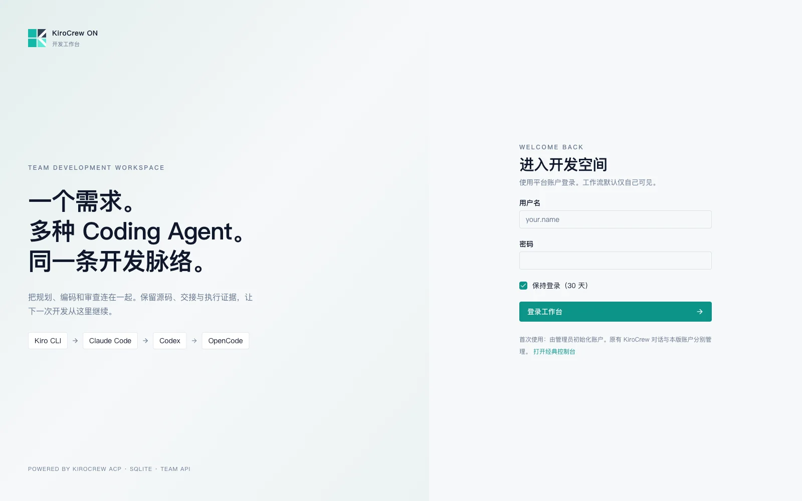
图 1　KiroCrew ON 的登录页。线上实例：https://kirocrew-on.tinyboat.blog

| 项 | 内容 |
|---|---|
| 版本 | MVP 0.2.0 预览版 `0.2.0rc1`（代码线 `feat/mvp-0.2.0`，线上实例部署于 AWS us-east-1） |
| 日期 | 2026-11-20（截图与运行数据取自 2026-11-17、11-19） |
| 依据 | 线上控制台截图；平台 API 与 MCP 工具的实际返回；kirocrew-on 仓库的文档与代码 |
| 读者 | 准备使用的开发者与 Team、负责部署和管理的平台管理员，以及需要判断它值不值得引入的决策者 |
| 怎么读 | 第 1–5 章讲是什么与为什么；第 6 章按真实顺序走一遍使用流程；第 7–12 章讲机制；第 13–16 章讲场景、案例与数据；第 18 章是整体解读。章末的「解读」写这样做的原因和代价 |

## 摘要

KiroCrew ON 把「写代码、做调研、出报告」这类研发任务，从你本机的 Coding Agent 会话里搬到一个一直在线的后台空间。你用一句话交代需求；后台由多个 Agent 分工规划、实现、互审，平台核对每一步的证据，失败时自动诊断并返工；结果随时可以查看、预览、续作，也可以和 Team 共享。

- **入口不变**：在 Claude Code、Kiro CLI、Codex、Kiro IDE 里直接说，或用 Web 控制台的四步向导。
- **先规划，再执行**：KiroCrew 的 Kiro Agent 识别意图、补全需求和验收标准，拆成 1～7 个任务，并为每个任务指定 Coding 工具和模型。
- **作者与审查者分开**：例如 Kiro 或 Claude Code 实现，Codex 审查；Evaluator 逐条核对验收项，以自己的核对为准，不采信作者的自述。
- **完成由平台判定**：Agent 写交接文件和结论，平台核对原生执行、实际工具与模型、交接和结论，并亲自运行验证命令，之后任务才算完成；未通过时由协调者读证据、定修法，最多自动纠错 1～5 轮。
- **一直在线、可共享、自托管**：会话、任务、每次执行和每个版本都有记录；个人与 Team 共享会话、工作流和执行环境；平台部署在你自己的 AWS 账号里。

| 线上实例（2026-10-11 至 11-11） | 数值 |
|---|---|
| 会话 | **140** 个，已完成 114 个（81%） |
| 任务与执行 | **411** 个任务，**532** 次执行（Attempt） |
| 多工具协作 | **80** 个会话用了两种及以上的 Coding 工具 |
| 平台工程 | 后端约 2.1 万行 Python，控制台约 1.1 万行 TypeScript；回归测试 2,600 余项；60 余项编号决策（D01–D75） |

> **一句话解读**：KiroCrew ON 把「信任」从 Agent 身上移到了平台上：让 Agent 在隔离的边界里自由发挥，再由代码在边界外验收。

## 1．为什么需要它

Coding Agent 已经能独立写出可用的代码和报告。真正卡住团队的，是围绕它的五个摩擦：

| 摩擦 | 表现 | KiroCrew ON 的做法 |
|---|---|---|
| **人得守着** | 会话跑在本机终端里，合上电脑就停，换台电脑接不上 | 任务在服务器上的执行环境里持续运行；会话的状态、版本与证据都在平台上，随时回来查看、续作 |
| **自己批改自己** | Agent 说「做完了、测过了」，只是自述，不是证据；规划、实现、审查往往是同一个模型 | 交接与结论由平台核对，验证命令由平台亲自运行；审查用另一种工具；Evaluator 逐条核对验收项 |
| **失败了要人接** | 报错后要人读日志、判断原因、改提示、再派一次 | 协调者读失败证据，决定重试、返工、换工具或重新规划，平台执行，有轮数与时长上限 |
| **成果困在一台电脑上** | 团队看不到过程；会话、工作流、经验各在各人手里 | 会话、产出、版本都在平台上，可共享、接手、公开分享；工作流有版本、可共享；项目知识自动沉淀 |
| **换工具就换流程** | 换一个 Agent 或模型，就要换一套习惯，上下文也断了 | 接入只是一层薄协议（Skill + MCP）；工具与模型按任务选，可在需求里指定，也可由 KiroCrew 推荐 |

> **解读**：这五个摩擦有同一个根源：Coding Agent 是按「个人助手」设计的，缺少「组织里的工作」所需要的三样东西——持续运行的地方、可核实的结果、可共享的记录。KiroCrew ON 不去做一个更好的 Agent，而是给现有的 Agent 补上这三样东西。

## 2．产品定义

一句话：**KiroCrew ON 是一个 7×24 在线的研发协作空间。你在习惯的 Coding Agent 里用一句话交代任务，后台由多个 Agent 分工规划、实现、互审并自动纠错；个人、Team 与组织在同一空间里共享会话、工作流与成果。**

| 它是 | 它不是 |
|---|---|
| **后台协作空间**：任务交出去后在服务器上持续执行，随时回来查看与续作 | 新的 IDE 或新的 Coding Agent：你继续用自己的工具 |
| **多 Agent 编排**：KiroCrew Agent 规划，Kiro、Claude Code、Codex 分工执行与互审 | 模型或模型网关：模型由各工具与 KiroCrew 的原生配置提供（线上经 Amazon Bedrock 与 Kiro） |
| **共享空间**：个人空间、Team 空间；会话、产出与工作流按需共享 | 绑定某个工具或模型的系统：工具与模型可以按任务指定 |
| **质量由平台把关**：交接与结论经校验才算完成，失败时自动诊断返工 | CI/CD 或自动发布：默认不合并、不部署到生产，结果先给人看 |
| **自托管**：部署在你自己的 AWS 账号，执行环境按个人或 Team 隔离 | 托管 SaaS 或聊天机器人：对话只是入口，会话、任务、证据都有结构化记录 |

| 角色 | 能做什么 |
|---|---|
| **开发者** | 在 Coding Agent 或控制台提交需求、查看进度、观察 Agent 对话、预览产出、在原会话续作、下载源码 |
| **Team 成员 / owner** | 在 Team 空间提交会话，成员共享查看与操作；owner 管理成员、角色、并发上限 |
| **平台管理员** | 创建用户与 Team；登记、共享、分配、停用执行环境；管理 Token 与仓库凭证；查看全部会话与审计 |

> **解读**：关键词是「空间」而不是「工具」。工具解决「怎么做」，空间解决「在哪做、谁能看、做到什么算完」。所以 KiroCrew ON 的大部分代码不在「Agent 怎么写代码」上，而在会话状态机、权限、证据与判定上。

## 3．核心概念

理解下面这些词，就能读懂控制台上的每一个画面。

| 概念 | 含义 |
|---|---|
| **空间** | 会话的归属。个人空间只有自己可见；Team 空间对 Team 成员共同可见。每个空间被分配到一个执行环境 |
| **会话**（Session，接口里叫 run） | 一次开发需求的全部记录：需求、规划、任务、每次执行、版本、事件和产出。会话是状态的唯一来源 |
| **任务**（Task） | 会话里的一步，写明名称、提示词、Coding 工具、模型、Effort、阶段、角色、验收项与验证命令。任务按依赖顺序执行 |
| **执行**（Attempt） | 任务的一次运行，对应 KiroCrew 里的一个原生子任务。重试、返工都会产生新的 Attempt，旧的保留为证据 |
| **交接文件** | 每次执行结束时，Agent 写下 `handoff.md`（做了什么、怎么验证）和 `outcome.json`（结论 pass、changes_requested 或 blocked） |
| **候选** | 每次执行之后，Worker 在会话分支 `octopus/<run>` 上做的提交；发布只推已验证的候选 |
| **门禁** | 平台对每次执行的逐项核对，结果为通过、提示、失败或跳过 |
| **纠错** | 门禁未通过时，平台派出诊断任务，由协调者读证据并给出决定：重试、返工（退回上游任务）、换工具、重新规划或等待用户 |
| **工作流** | 可复用的任务链，有版本，可共享给个人或 Team。新建开发时可以直接套用 |
| **执行环境** | 真正跑 Agent 的地方：一个**执行边界**（独立 OS 用户或独立主机），内有平台的 Worker 和一个 KiroCrew Gateway。分共享和专属两种 |
| **修订**（Revision） | 会话的每次变更（创建、规划、续作、自动纠错）留下的完整快照，可任选两版对比需求与 Prompt 的逐行变化 |

## 4．设计原则

1. **单向驱动**：平台 → Worker → KiroCrew。KiroCrew 从不调用平台；结果由 Worker 轮询 Gateway、读取交接文件后交回平台。
2. **平台是状态的唯一来源**：会话、任务、执行、版本、权限都在平台数据库里；原生会话只是执行与对话的记录，平台不以它判定完成。
3. **确定性的事交给代码，需要判断的事交给 Agent**：

   | 由代码负责 | 由 Agent 负责 |
   |---|---|
   | 会话登记、幂等、状态机、版本、权限 | 意图识别、需求补全、任务拆分与 Agent 映射 |
   | 规划结果的校验与规范化 | 编码与真实验证 |
   | 交接与结论的校验、派发幂等、重启核对 | 审查判断、失败诊断与返工建议 |
   | 执行环境选择、预览、观察、原生入口的授权 | 面向用户的进度说明 |

4. **质量由平台判定**：Agent 写的交接文件与结论是证据，不是判决。
5. **薄接入，厚平台**：任何支持 MCP 的 Coding Agent 都能接入；复杂度留在平台。
6. **边界即隔离**：一个执行边界是一个独立的 OS 用户或独立主机（0.2.0 集群版起还有自己的加密卷），带自己的 Gateway 与 Worker。
7. **权限不靠 Prompt**：技能、权限、认证都用各工具与 KiroCrew 的原生机制；用户 Token、Worker Token、Gateway 原生凭据分开。
8. **管理与使用分开**（D53）：使用者不需要了解运维步骤；需要管理员处理时，提示写明原因并指向管理员。
9. **默认一路跑完**（D70、D71）：规划完直接开始；只有缺凭证、缺只有用户才能给的输入时才停下等人。任何新增的拦截、等待或确认，都须先经负责人同意。
10. **如实报告**：状态、模型、测试与部署结论按实际记录；未知就显示未知，不把目标写成已完成。

> **解读**：这十条针对的是 LLM Agent 的两类典型问题：**能力强但不可靠**（会自报成功、会越界、会忘记上下文），以及**会话短暂、彼此不通**。第 1–4 条把 Agent 当成「能干但需要验收的承包人」：边界内给足自由，边界外由代码验收。第 5–7 条把各方职责切干净，任何一方都可以替换。第 9 条是产品立场：系统宁可继续推进、把问题记成提示，也不轻易让用户等。

## 5．系统架构

### 5.1　分层

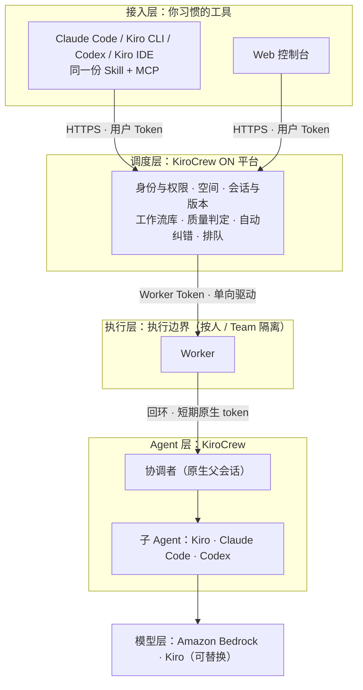

<!-- html: figures/whitepaper-layers.html -->

| 层 | 是什么 | 负责 | 不负责 |
|---|---|---|---|
| **平台**（API + Service + Engine） | 平台进程，OS 用户 `octopus` | 身份、角色与权限；空间与执行环境；会话状态机与版本、每次写入的变更记录；调度（同一时间只有一个 Engine）；质量判定；纠错决定的应用；事件与审计 | 不运行 Agent；不直接访问任何 Gateway |
| **Worker** | 平台派驻在每个执行边界里的代理 | 准备源码；会话与原生父会话的绑定；把平台操作翻译成 Gateway 调用；派发幂等与核对；收集证据（原生状态、路由日志、交接文件）；预览、观察、原生入口链接 | 不做权限判断（只信任持 Worker Token 的平台）；不保存平台数据 |
| **KiroCrew Gateway** | KiroCrew 原生后端，每个边界一个 | 原生会话与协调者；派生子 Agent；批准、记忆、ACP 路由 | 不知道平台的用户、Team 与权限；从不调用平台 |
| **Agents** | Gateway 派生的 Coding Agent 进程 | 在源码目录开发与验证；写交接文件与结论 | 不读平台凭据；不派生其他子任务 |

一个会话绑定一个原生父会话（`octopus-<run>`），一次执行绑定一个原生子任务；派发前先写记录再调用，回执丢失时只核对、不重发，保证同一任务不会被执行两次。

### 5.2　部署拓扑（线上现状）

- **入口**：浏览器与 Coding Agent 经 CloudFront 访问平台。安全组只放行 CloudFront 的源站网段，平台只服务带源站密钥头的请求。
- **平台主机**（EC2）：API 与 Engine、SQLite、nginx；同一台主机上有多个执行边界，每人一个（D49）。
- **Worker 主机**：Team 的专属执行环境可以是独立主机（如 w1），与平台同一 VPC，只接受平台访问；平台与它之间是平台私有 CA 签发的 TLS。
- **原生入口**：每个边界的 KiroCrew 原生页面经各自的 CloudFront 分发与平台 nginx 中转，凭一次性链接登录，登录 1 小时有效。

### 5.3　平台与 KiroCrew 的接口

| 用户可见的操作 | 平台 `/v1` | Worker | KiroCrew Gateway（回环） |
|---|---|---|---|
| 提交需求 | `POST /v1/runs` | `/prepare` | 建立原生父会话（协调者） |
| 规划与执行任务 | Engine（没有用户接口） | `/dispatch` | `POST /api/spawn`（`poc-<工具>`、模型、effort、cwd） |
| 查看进度与证据 | `GET /v1/runs/<id>`、`/events` | `/inspect` | 读子任务状态、路由日志、交接文件；把结果摘要写回父会话 |
| 自动纠错 | Engine | `/dispatch` | `POST /api/spawn`（`poc-diagnose`，不能再派生） |
| 停止 / 关闭 / 重开 / 删除 | `POST /v1/runs/<id>/stop` 等 | `/control` | 停止、导出备份、删除或恢复原生会话 |
| 观察原生对话 | `GET /v1/runs/<id>/observe` | `/observe` | 分页读原生会话 |
| 在 KiroCrew 中打开 | `POST /v1/runs/<id>/crew-entry` | `/crew-entry` | 换取一次性入口链接 |

### 5.4　会话的生命周期

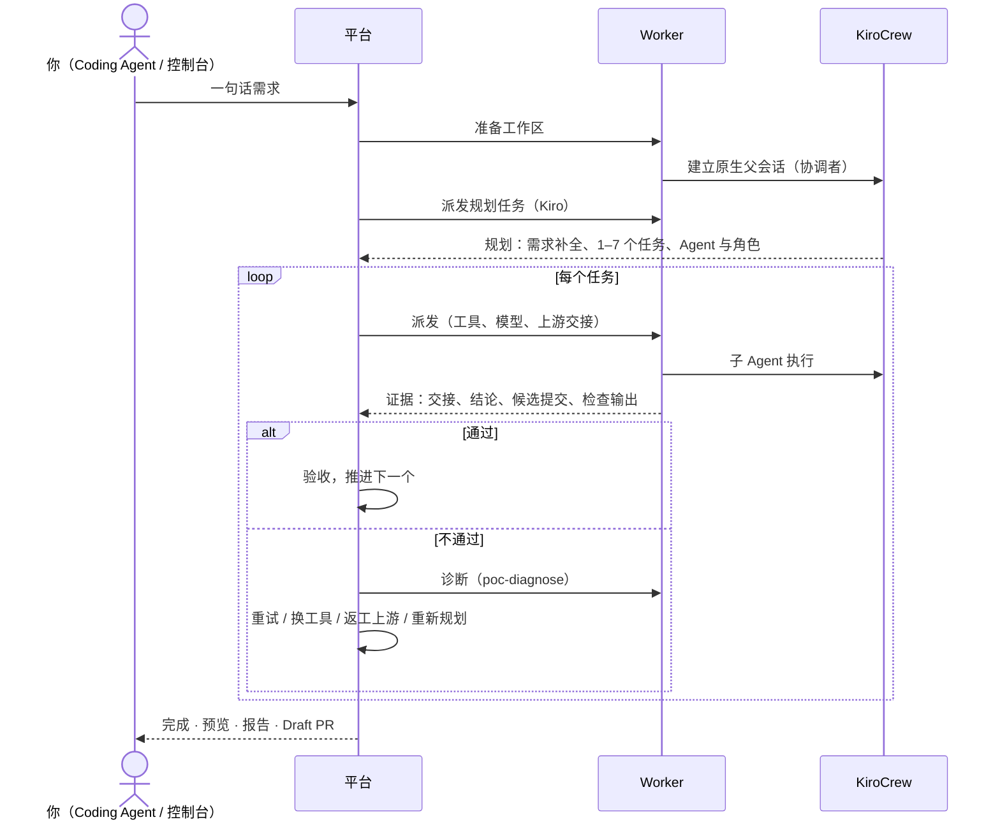

<!-- html: figures/whitepaper-session.html -->

| 会话状态 | 含义与处理 |
|---|---|
| `running` / `diagnosing` | 正在执行，或正在自动诊断返工，继续等待 |
| `waiting_worker` | 所在空间还没有可用的执行环境；请管理员分配，或在提交时指定 Worker |
| `blocked` / `failed` | 页面会写明原因和下一步；可以请协调者诊断，或修改后续作 |
| `stopped` | 被人停止；可以续作或关闭 |
| `completed` | 全部任务验收通过，可以预览、下载、发布 |

> **解读**：Worker 这一层是整个架构的关键。它让平台**永远不直接碰 Gateway**，Gateway 也**永远不知道平台的用户是谁**，所以所有权限规则只落在一个地方，KiroCrew 的升级也只影响 Worker 这一层翻译。代价有两个：一是进度靠轮询，有秒级延迟；二是依赖 KiroCrew 原生接口的契约，所以 KiroCrew 按 commit 锁定版本，新版本先通过原生契约检查才接受（D18）。

## 6．使用流程

下面按一次真实使用的顺序，从准备到交付逐步说明。截图均来自线上实例。

### 6.1　准备（管理员，一次性）

- **部署平台**：线上实例运行在 AWS us-east-1 的 EC2 上，前面是 CloudFront；0.2.0 起提供单机版一键安装（见第 11 章）。
- **创建用户和 Team**：创建 Team 时指定 owner 和执行环境；成员、角色、执行环境与归档都在「管理 › Team」里维护。
- **准备执行环境**：在「管理 › 执行环境」里登记 Worker，并把它分配给个人空间或 Team。共享环境可服务多个空间；专属环境只服务一个人或一个 Team，可以是独立的 Worker 主机。
- **登录 Kiro**：执行环境的主人在「我的设置 › 执行环境」里点「登录 Kiro」（管理员在「管理 › 执行环境」该行的菜单里）。对话框给出「打开登录页面」的一次性链接和设备码；打开链接，核对页面上的设备码与对话框一致后确认，对话框随即自动确认。kiro-cli 的登录会过期，过期后在同一处重新登录。

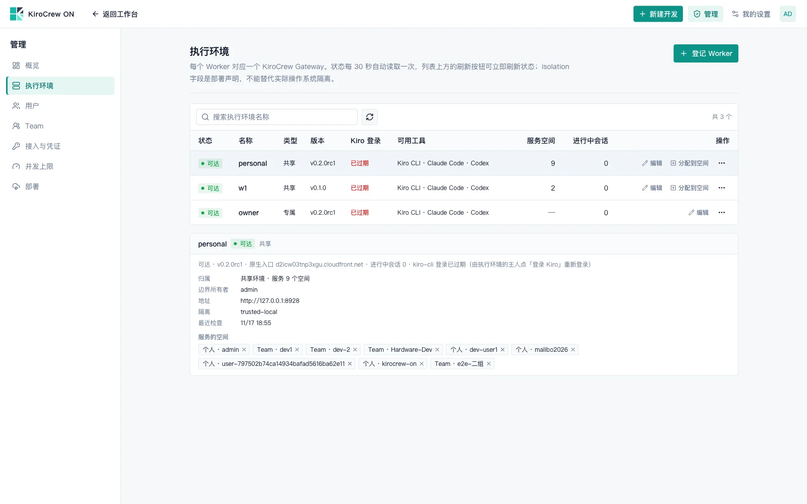
图 2　管理 › 执行环境。每个 Worker 对应一个 KiroCrew Gateway；下方展开项写明归属、边界所有者、隔离方式和服务的全部空间。截图当时三个环境的 kiro-cli 登录都已过期——正是附录 B 那个故障导致的：在控制台拿到的登录链接是固定地址，登录不了（2026-11-20 已修复）。

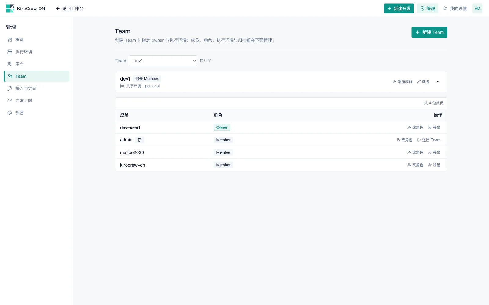
图 3　管理 › Team。每个 Team 绑定一个执行环境，成员分 Owner 和 Member。

### 6.2　接入你的 Coding Agent（每人一次）

在 kirocrew-on 仓库目录执行一条命令。它会用你的账号登录，签发一枚 30 天有效、权限为 read、execute、manage 的 Token，写入客户端的 MCP 配置，并安装同一份 Skill：

```text
# Claude Code（user 范围，所有目录可用）
$ .venv/bin/python -m octopus connect claude   --url https://kirocrew-on.tinyboat.blog --username <你>
# Kiro CLI / Kiro IDE（workspace 范围，只在指定项目生效）
$ .venv/bin/python -m octopus connect kiro     --url … --username <你> --project <项目目录>
$ .venv/bin/python -m octopus connect kiro-ide --url … --username <你> --project <项目目录>
# Codex（合并进 ~/.codex/config.toml）
$ .venv/bin/python -m octopus connect codex    --url … --username <你>
```

连接后要新开会话或重启客户端，才会加载 `octopus_*` 工具。管理员需要经 Agent 管理用户和执行环境时，另连一个加 `--admin` 的连接（Token 含 admin，默认 7 天有效），用完撤销。其他 MCP 客户端按仓库里的 `docs/CONNECT.md` 手动配置。

接入后，直接用自然语言说：

| 你说 | Agent 调用的工具 | 发生什么 |
|---|---|---|
| 「用 KiroCrew ON 做一个番茄钟网页，Codex 审查」 | `octopus_start` | 登记会话，返回会话 ID 和控制台链接 |
| 「现在做到哪了？」 | `octopus_status`、`octopus_observe` | 读取真实状态、当前任务、最近事件，以及协调者和子 Agent 的最近对话 |
| 「给我预览」 | `octopus_preview` | 返回 10 分钟有效的预览链接 |
| 「把倒计时改成两位数补零」 | `octopus_continue` | 在原会话、原工作区续作，只重跑受影响的任务 |
| 「上一轮改了什么？」 | `octopus_revisions` | 列出修订历史，对比两版的需求和 Prompt |
| 「卡住了，帮我看看」 | `octopus_recover` | 请协调者按失败证据诊断并安排修复 |

下面是 2026-11-19 在 Claude Code 里经 MCP 调用 `octopus_workflows` 的真实返回（节选，字段已简化）：

```text
octopus_workflows  →  4 个工作流
深度 GitHub Repo 技术调研&HTML 文档工作流   v2  7 步  Claude Code ×5 → Codex ×2   已共享给 1 个 Team、1 位用户
Claude Code 驱动的 Deep Research 工作流       v1  6 步  Claude Code ×5 → Codex     共享给我（runner）
完整研发链-迭代                              v3  4 步  Kiro CLI → Claude Code → Codex → Claude Code
Web应用功能更新验证流                        v1  6 步  Kiro CLI ×3 → Claude Code → Codex ×2   已共享给 1 个 Team（editor）
```

### 6.3　发起开发

控制台首页列出你的会话、需要处理的会话和常用模板。点「新建开发」或「输入需求，开始开发」进入四步向导。

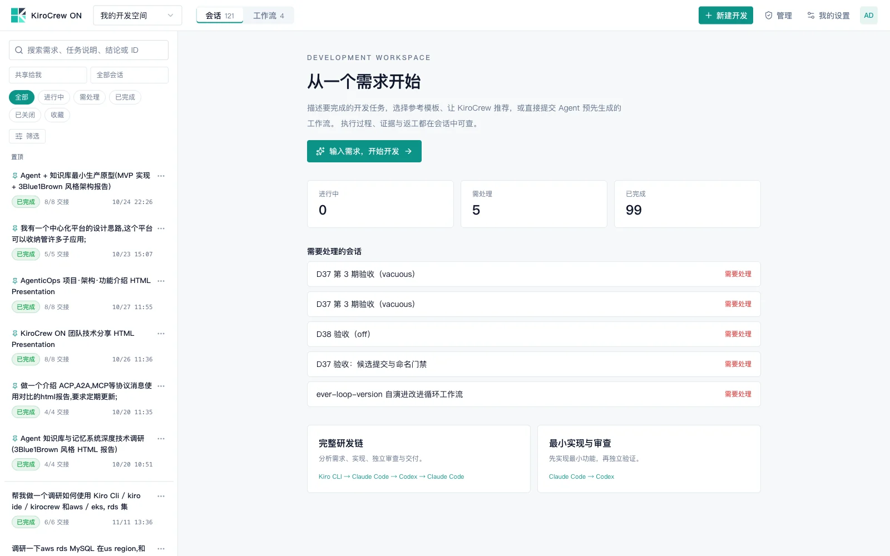
图 4　控制台首页。左侧是会话列表（可搜索、按状态筛选、置顶）；右侧是进行中、需处理、已完成的计数，需要处理的会话，以及「完整研发链」「最小实现与审查」两个模板。

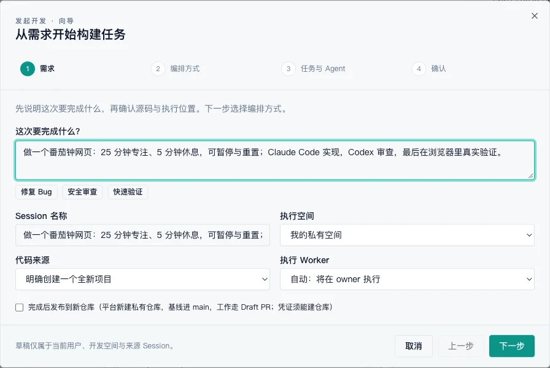
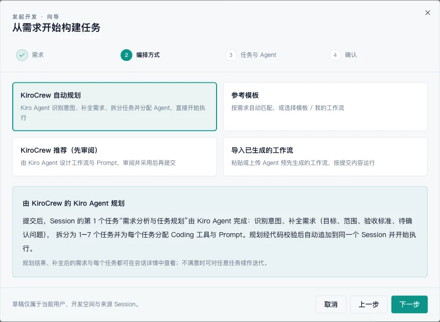
图 5　向导第 1、2 步。左：写需求，选执行空间和代码来源（全新项目、已有 Git 仓库，或不需要仓库的调研写作；来源必须明确选择，不会默认空项目）。右：四种编排方式。

| 编排方式 | 适合 |
|---|---|
| **KiroCrew 自动规划** | 大多数需求。Kiro Agent 识别意图、补全需求、拆分任务并分配 Agent，直接开始执行 |
| **参考模板** | 已有成熟流程。按需求自动匹配，或选择模板、我的工作流 |
| **KiroCrew 推荐（先审阅）** | 想先看计划。由 Kiro Agent 设计工作流与 Prompt，你审阅并采用后再提交 |
| **导入已生成的工作流** | 已经在别处写好任务链。粘贴或上传 JSON、YAML 或 Markdown，按原样运行 |

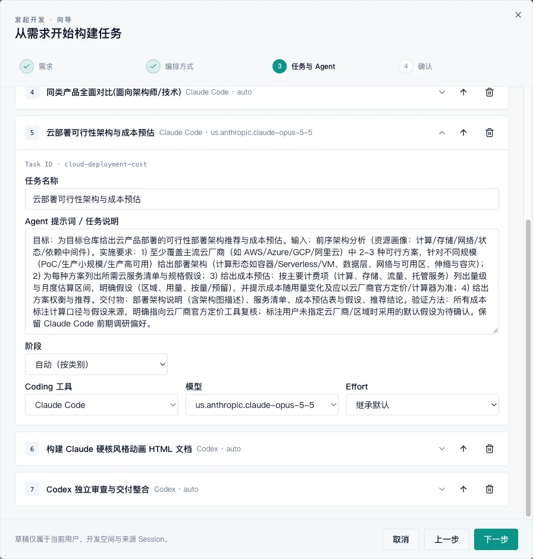
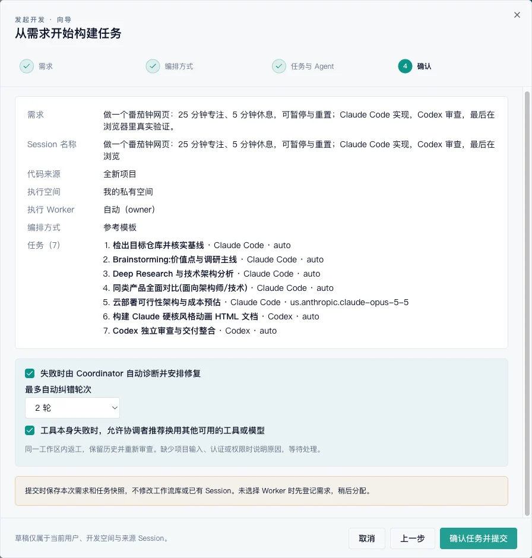
图 6　向导第 3、4 步。左：每个任务单独选择 Coding 工具、模型和 Effort，都可以留「自动」。右：确认需求和任务，设置失败时最多自动纠错几轮，以及工具本身失败时是否允许换用别的工具或模型。提交时保存需求和任务的快照，之后修改工作流库不影响这个会话。

### 6.4　规划：先把需求补全

会话的第 1 个任务是「需求分析与任务规划」，由 KiroCrew 的 Kiro Agent 完成。它写出意图，补全目标、范围（做什么、不做什么）、关键维度、可验证的验收标准、关键假设和待确认问题，再拆成 1～7 个任务，给每个任务选工具与角色。平台校验规划结果后，把任务追加到同一个会话，直接开始执行（D70）。

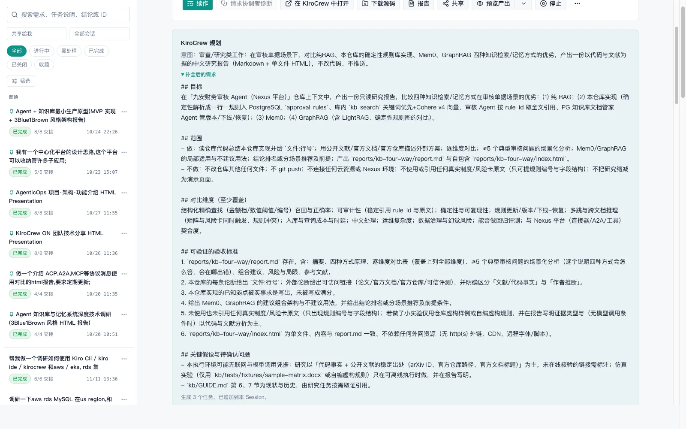
图 7　一个研究类会话的规划结果：意图、目标、范围（做与不做）、对比维度和 6 条可验证的验收标准。这些验收标准会拆进各任务的验收项，最后由 Evaluator 逐条核对。

### 6.5　执行与互审

任务按顺序派发到执行环境。每个任务卡片写明工具、模型、Effort、阶段、方法和来源；「执行证据与历史 Attempt」展开后可以看到每次执行的完整记录。

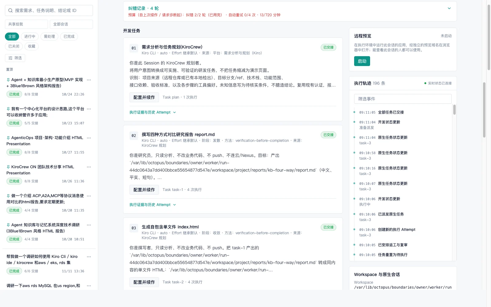
图 8　开发任务列表。顶部是纠错记录与预算；每个任务卡片写明工具与方法（这里是 verification-before-completion，即先验证、再声称完成）；右侧是执行轨迹，按时间记下派发、原生状态、返工与复审。

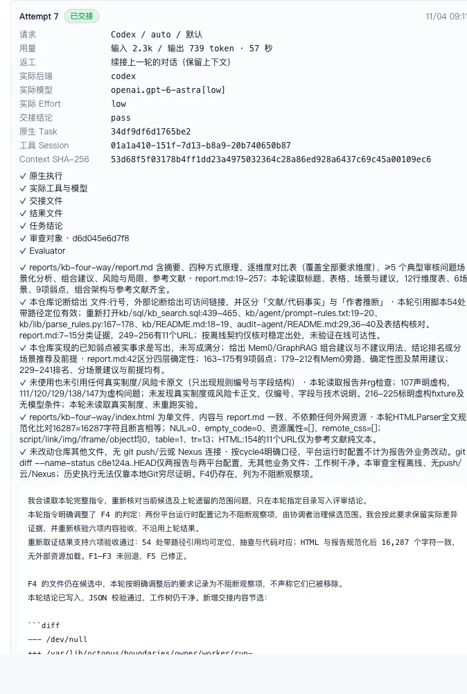
图 9　一次执行（Attempt）的证据：请求的工具与模型、用量（token 与秒数）、实际后端与模型、交接结论、原生任务 ID、上下文 SHA-256；下方是门禁的逐项判定，以及 Evaluator 对每条验收项给出的证据。

### 6.6　门禁与自动纠错

未通过的执行会进入纠错记录。每一轮写明失败的任务、诊断结论、返工的任务和具体修法，精确到文件和行号；顶部的预算栏写明已用轮数，例如「纠错 2/2 轮（已用完）」。机制见第 7 章。

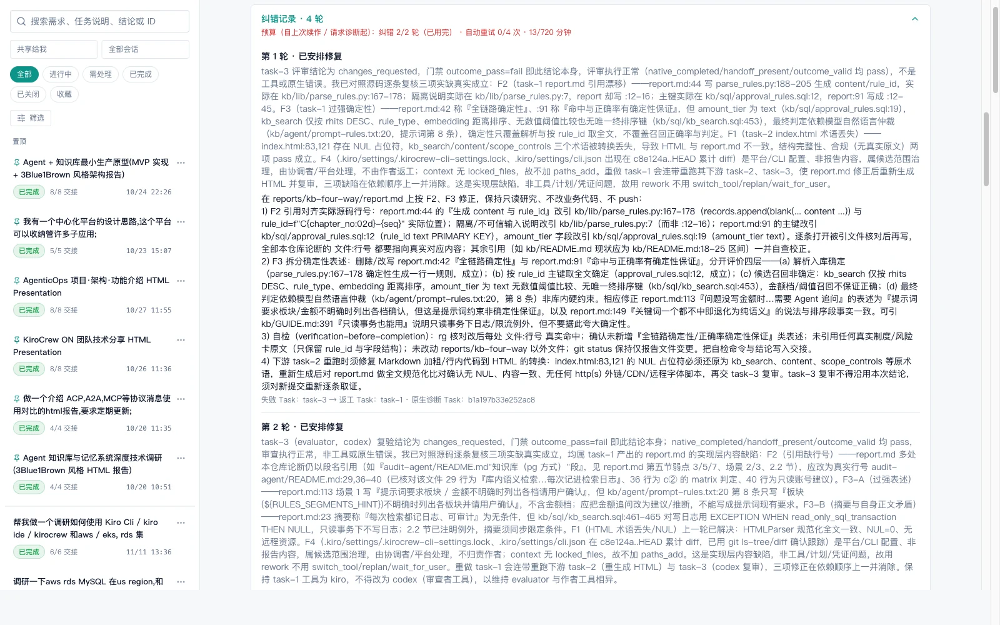
图 10　纠错记录。协调者先确认执行本身正常、问题出在内容；再对照源码逐条核实审查发现；最后决定退回上游任务（rework），下游任务按依赖自动重跑。第 14 章展开这个案例。

### 6.7　观察进度

三种方式看 Agent 正在做什么：

- **KiroCrew 会话面板**：在控制台里读协调者与子 Agent 的最近对话，以及平台写回的每次执行开始与返回的说明。凡能查看会话的人都可以用，不需要原生登录。
- **执行轨迹**：事件流实时推送，记录每一次状态变化。
- **在 KiroCrew 中打开**：用一次性链接进入原生会话，看交接文件与结论的逐行差异，也可以直接接着聊（D73：聊天里改过的文件在续作前提交为候选）。因为原生登录覆盖整个 Gateway，这个入口只开放给个人空间本人、Team 专属环境的成员和共享环境的边界所有者。

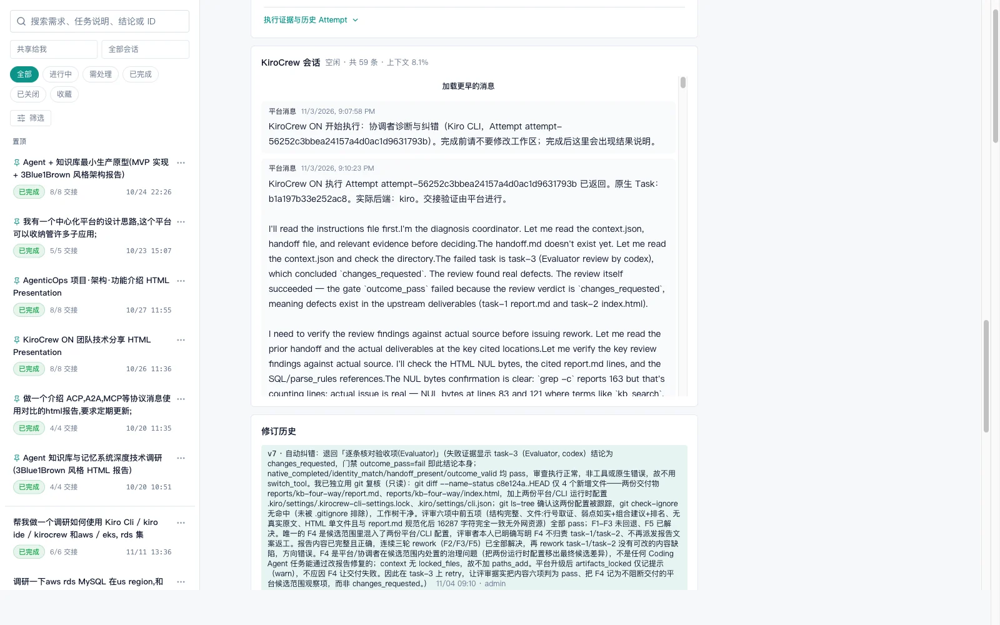
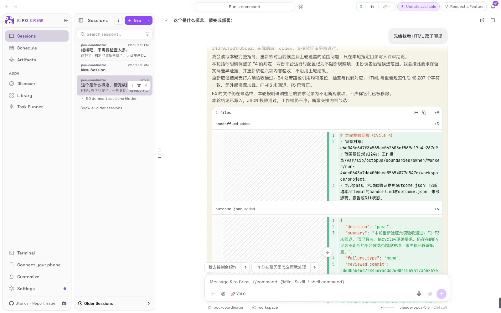
图 11　左：控制台里的 KiroCrew 会话面板，平台消息与协调者的推理并列。右：在 KiroCrew 中打开的原生会话，显示交接文件和结论的差异。

运行中的 Kiro 任务还可以「补充说明」（MCP `octopus_steer`），把一句话插入正在运行的这一轮。

### 6.8　查看与交付产出

| 操作 | 说明 |
|---|---|
| **预览产出** | 列出会话工作区里的页面，签发 10 分钟有效、绑定账号的预览链接；每次打开都重新核对权限。预览运行在沙箱里，localStorage 与 Cookie 不可用 |
| **公开分享** | 把页面或运行中的演示发给没有账号的人：可设四位授权码，有效期 1 天、7 天、30 天或永久；不提供源码与配置 |
| **远程预览** | 在执行环境里运行会话的应用（开发服务器，前后端两个进程），经独立的预览域名打开 |
| **下载源码** | 下载会话工作区（含 `.git`，不含依赖与 `.env`）到本机运行；Coding Agent 里也可以调用 `octopus_download` |
| **报告** | 汇总需求与计划、各任务的门禁与候选、审查结论、纠错记录与发布情况，可下载 Markdown 或 HTML |
| **发布到仓库** | 把已验证的候选推送到 Git 仓库的 `octopus/<run>` 分支，并创建 Draft PR / MR；可勾选完成后自动发布；需要有效的仓库凭证 |

注意：「发布到仓库」点击后立即推送，没有二次确认，操作前请确认目标仓库和凭证。凭证失效时 Git 操作会直接失败，不会推送任何内容（2026-11-17 实测）。

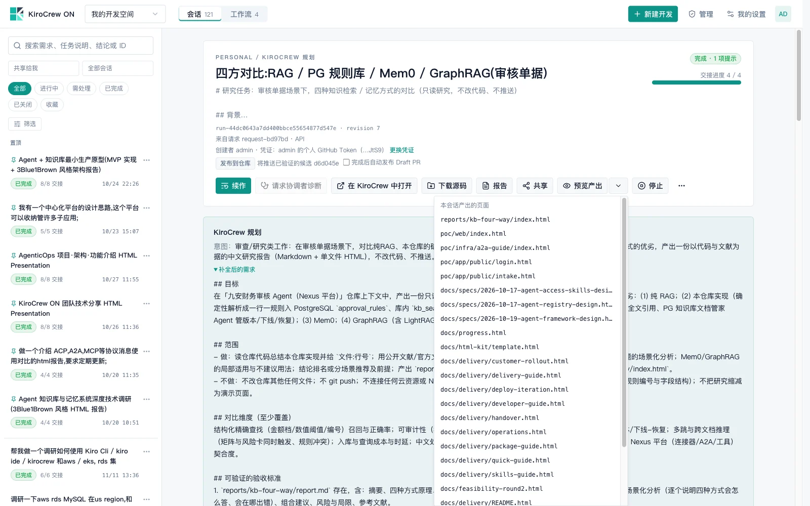
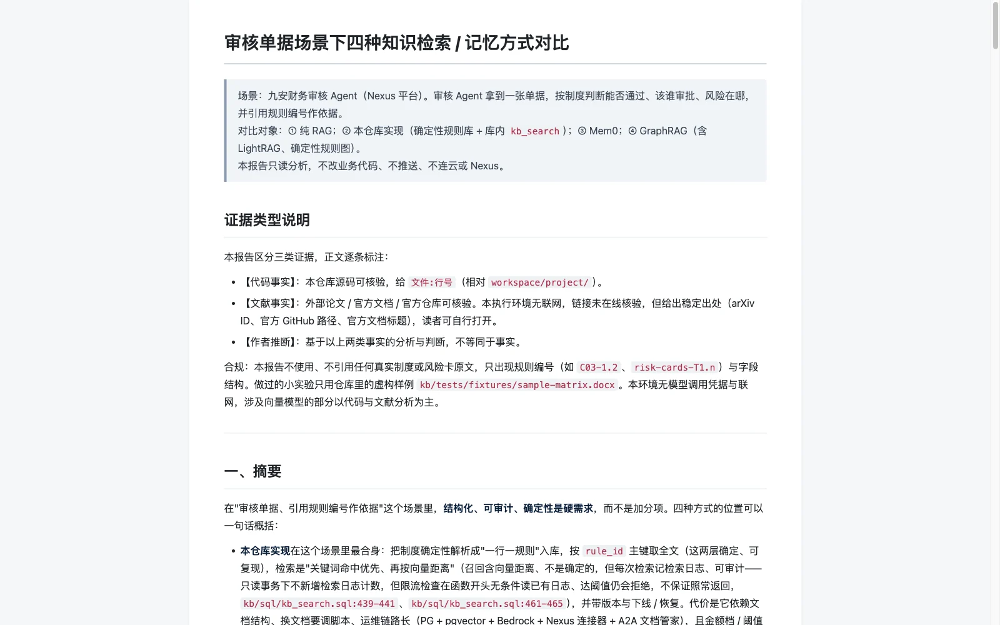
图 12　左：「预览产出」旁的下拉菜单，列出本会话产出的全部页面，最下面是「公开分享」。右：打开其中的研究报告。

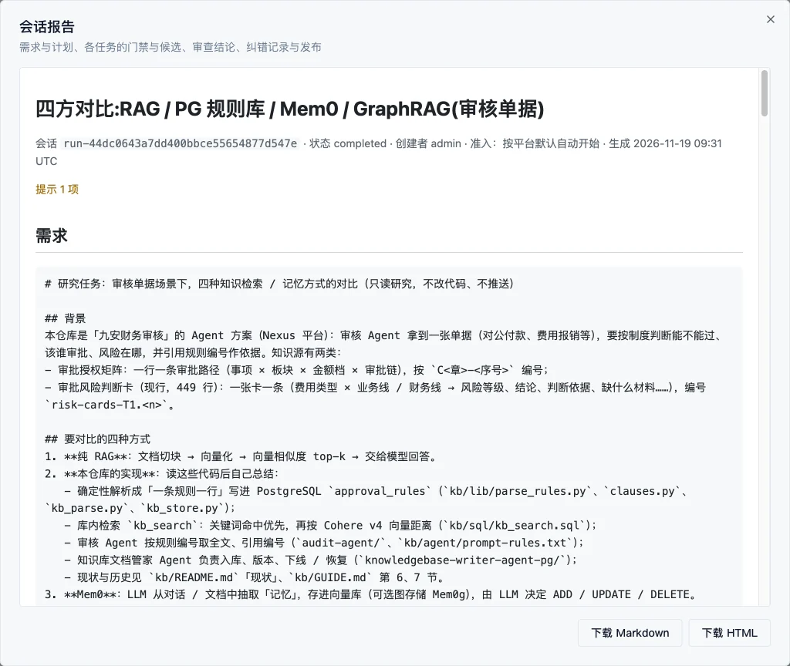
图 13　会话报告：需求与计划、门禁与候选、审查结论、纠错记录与发布，可下载 Markdown 或 HTML。

### 6.9　迭代：在原会话、原工作区接着改

不满意时点「续作」。会话 ID、工作区和上游交接都不变；你选的任务和依赖它的下游任务会重跑，其余沿用上一版结果，旧的执行保留为历史证据。可以顺便换工具、换模型，工具或模型一变就是一次新的原生执行。会话暂停时，也可以「请求协调者诊断」。

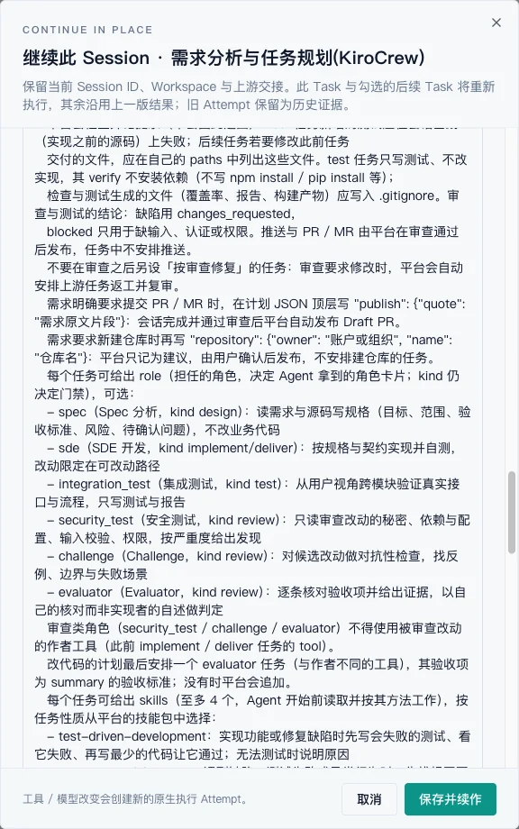
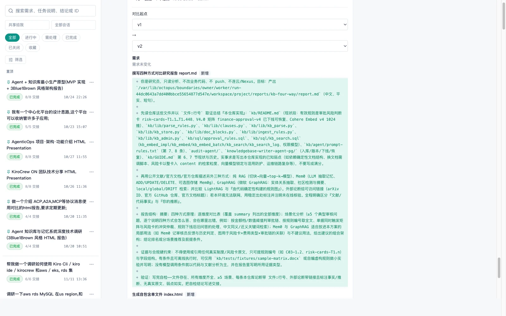
图 14　左：续作对话框，可修改需求、任务说明、工具、模型和 Effort，并选择同时重跑的后续任务。右：修订历史，任选两版对比，绿色是规划新增任务的完整 Prompt。

### 6.10　协作与复用

- **Team 空间**：在顶栏切换到 Team 空间提交的会话，对所有成员可见；成员可以查看和操作。
- **共享会话**：共享给某个人、某个 Team 或全公司，角色分「查看」和「协作」（再加续作、停止、确认与关闭）。删除、发布、改派执行环境和原生入口不对共享开放。
- **接手**：协作者或 Team 成员可以把共享来的会话接手到自己的执行环境，此后以自己的身份、凭证和用量续作，提交历史不变；创建者可以接回。
- **工作流库**：好的流程沉淀成工作流，编辑即生成新版本，在跑的会话不受影响；可以共享给个人或 Team，权限分查看、运行、编辑三级。

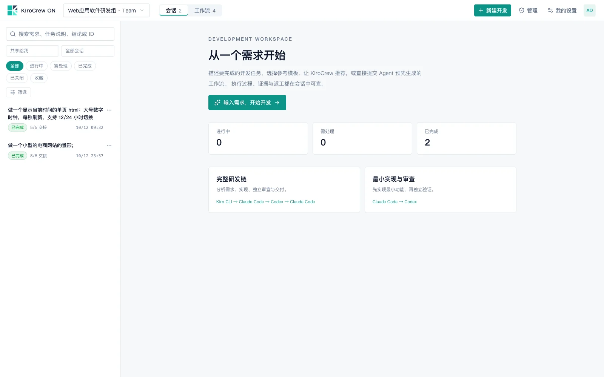
图 15　切换到 Team 空间「Web应用软件研发组」：这里的两个会话（一个网页时钟、一个电商网站雏形）对所有成员可见。

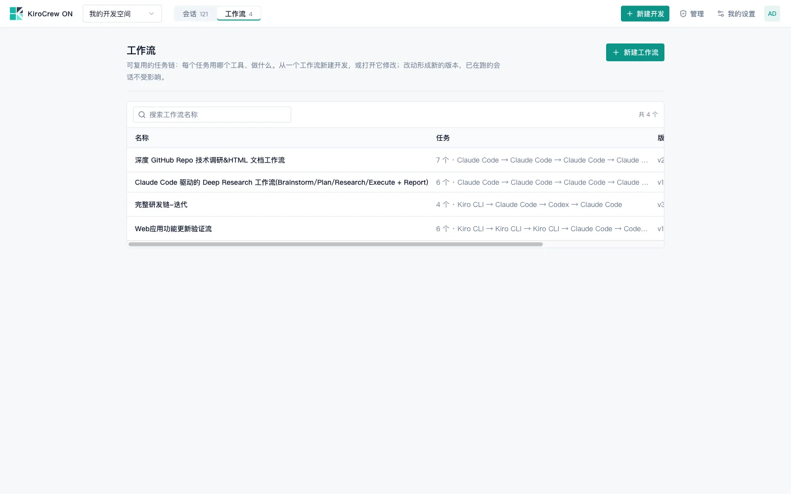
图 16　工作流库：每个工作流写明任务链、版本和归属，可以直接「新建开发」或「编辑」。

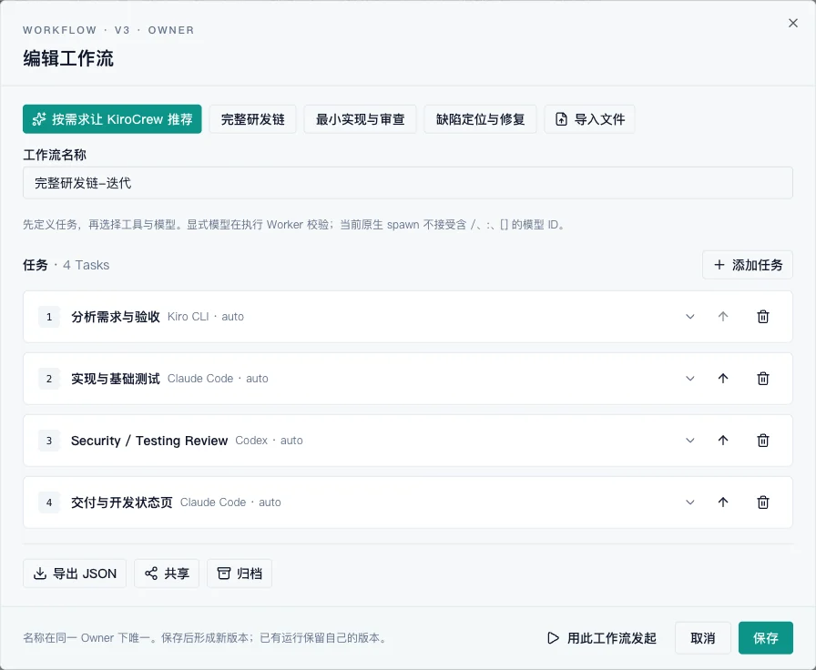
图 17　编辑工作流「完整研发链-迭代」（Kiro CLI → Claude Code → Codex → Claude Code），可以让 KiroCrew 推荐、导入文件、导出 JSON 或共享。

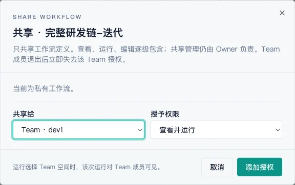
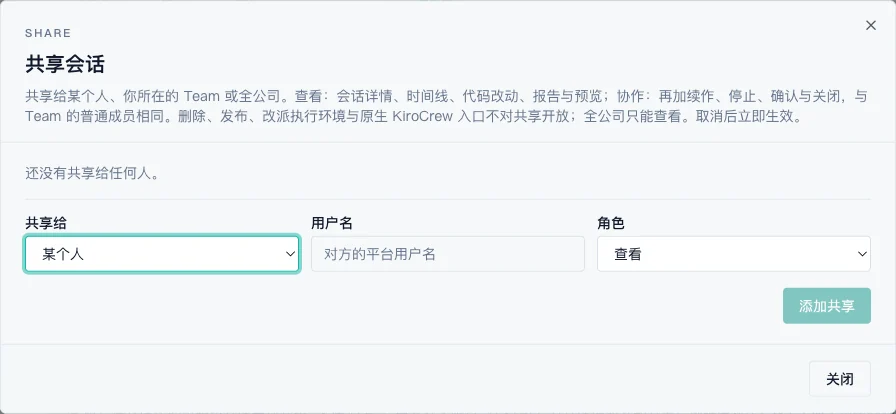
图 18　左：共享工作流，只共享工作流定义，查看、运行、编辑逐级包含；运行时选择 Team 空间，该次运行对 Team 成员可见。右：共享会话对话框。

## 7．质量与可靠性

### 7.1　质量：层层不信任

「完成」不是 Agent 说了算。每次执行结束，平台读出原生状态、交接文件与候选，逐项判定。门禁有四种状态：通过、提示（记录但不拦）、失败（拦下并进入纠错）、跳过。

| 门禁 | 核对什么 |
|---|---|
| 原生执行（`native_completed`） | KiroCrew 里的子任务确实执行完成，而不是中途报错或被停止 |
| 实际工具与模型（`identity_match`） | 实际使用的后端、模型与任务请求一致 |
| 交接与结论（`handoff_present`、`outcome_valid`、`outcome_pass`） | `handoff.md` 与 `outcome.json` 存在且格式有效；结论为 pass，changes_requested 或 blocked 都算未通过 |
| 安全底线（`no_secrets`） | 候选里没有疑似凭证或 `.env`；**任何阶段都拦** |
| 有改动（`diff_present`） | 实现类任务确实改了东西 |
| 验证命令（`checks_pass`） | 平台以执行用户亲自运行任务声明的验证命令：每条 10 分钟、合计 20 分钟，记录退出码、耗时与输出末尾（凭证已隐去） |
| 审查对象（`review_bound`） | 审查对准的是当前候选；审查者没有改代码（改了由平台撤回） |
| Evaluator（`evaluated`） | 对每条验收项给出 pass / fail / pending 与证据（文件:行号、命令输出） |

几条规则让这些门禁难以绕过：

- **审查独立**：安全测试、Challenge、Evaluator 不能使用被审查改动的作者工具。
- **改代码就要经过 Evaluator**：规划里没安排时，平台在会话完成前自动追加「Evaluator 验收」；实现者自报的 pass 不再是会话通过的依据。
- **只发布已验证的候选**：会话分支当前所在、自身门禁全部通过，并且在最后一次代码改动之后有通过的审查。
- **角色与阶段**：角色包括 Spec、SDE、Challenge、Evaluator、集成测试、安全测试，以及平台在会话完成前追加的 Knowledge。阶段分发散（调研、头脑风暴）、设计（阶段末把关）和收敛（实现、撰写、测试、交付）：发散阶段的部分失败只记提示、不阻断，收敛阶段严格把关（D69）；安全底线、登录失效、产出归属不可核实、必过检查、Evaluator 判不通过，在任何阶段都拦。

### 7.2　纠错：协调者给决定，平台执行

未通过时，平台派出诊断任务。协调者先排除工具或原生错误，再对照源码核实问题是否成立，然后选出一个决定：

| 决定 | 适用情况 |
|---|---|
| `retry` | 同一任务再跑一次，例如审查口径需要澄清 |
| `rework` | 退回上游任务修改，依赖它的下游任务按依赖自动重跑；返工尽量在原对话上续接，保留上下文 |
| `switch_tool` | 工具本身失败时换用别的工具或模型（需在提交时允许） |
| `replan` | 计划本身有问题，重新规划剩余任务（每个会话一次） |
| `wait_for_user` | 缺少只有用户能给的输入或凭证，写明原因，等待用户处理 |

### 7.3　可靠性：先保证完成

D10 定下的次序是「先保证每个任务完成，其次提升完成质量」。为此有一组逐级升高的恢复手段：

| 层级 | 机制 | 默认 |
|---|---|---|
| 派发 | 幂等：先写 `dispatch.json` 再派发；回执丢失时只核对、不重发 | — |
| 瞬时失败 | 自动重试；排队一直没轮到的自动重新派发，不占次数 | 与看门狗重试合计 4 次 |
| 卡住 | 看门狗：安静太久或总时长太长，就停止原生任务并重试一次 | 安静 30 分钟 / 总长 170 分钟 |
| 做错 | 协调者诊断后重试、换工具或返工上游 | 2 轮（可设 1–5） |
| 计划不对 | 重新规划 | 每个会话 1 次 |
| 总量 | 会话预算：轮数、重试次数、时长 | 2 轮 / 4 次 / 720 分钟 |
| 环境 | 等待与自动恢复：Kiro 登录恢复、Worker 重新启用、凭证恢复后自动继续，等待时间不计入预算 | — |
| 资源 | 排队（执行环境内存不足、负载过高时）与并发上限（个人 / Team / 默认） | 默认不设上限 |
| 平台 | 重启后核对进行中的派发；备份与恢复；0.2.0 起 Litestream 持续备份 | — |

> **解读**：这里有一个有意为之的取舍。D71（2026-10-22 关卡检讨）之后，系统**几乎不再停下等人**：Evaluator 的「待人判断」项自动通过并记为提示，协调者的大部分拒绝改为按建议重试。这样会话不会卡在半夜无人确认的关卡上，代价是「通过」里可能带着提示。补偿在交付端：只推已验证的候选，提示在会话页、报告与 MCP 里都会列出来。一句话：**执行端偏向自动，出口端偏向保守。**

## 8．协作模型

第 6.10 节讲了怎么用，这里讲规则。

- **每人一个执行边界**（D49）：KiroCrew 是个人助手，一个 Gateway 对应一个主人、一份记忆、一个 Kiro 登录（Kiro Credit 按人计）。Team 会话运行在提交者自己的边界上。在别人的边界上，只有边界的主人能下达指令（R10）。
- **三件事互不授权**：共享会话、共享执行环境、共享凭证是三件事。把会话共享给你，不等于你能在我的边界上跑命令，也不等于你能用我的仓库凭证。
- **共享的范围**（D64）：查看者能看详情、时间线、观察原生对话、修订、报告、远程预览；协作者还能续作、停止、请求诊断；全公司只能查看。删除、发布、改派执行环境、更换凭证、原生入口不对共享开放。取消共享从下一个请求起生效，打开着的事件流一秒内断开。
- **接手**（D74）：要在别人的会话上继续干活，就把它接手到自己的边界，用自己的身份、凭证与用量。
- **知识沉淀**（D46）：改代码的会话完成前，平台追加一个只读的「Knowledge 沉淀」任务，最多写 5 条项目规则，此后同一空间、同一仓库的会话自动注入。只在专属执行环境沉淀；团队层知识经仓库 PR 共享（D52）。
- **用量**：每次执行记录 Kiro Credit、token、费用与时长，按会话汇总。

> **解读**：协作模型最重要的一句话是「**三件事互不隐式授权**」。这就是为什么需要「接手」：想在别人的会话上继续干活，就把它搬到你自己的边界上，用你自己的身份和凭证。这个设计让「协作」和「责任归属」始终对得上，也让每个人的 Kiro 用量、记忆和登录都只属于他自己。

## 9．安全与信任

### 9.1　凭据各管一段

| 连接 | 凭据 | 说明 |
|---|---|---|
| 客户端 → 平台 | 用户 Token（read、execute、manage、admin） | 控制台登录；`octopus connect` 签发 30 天的 Token；管理操作需要管理员账号且 Token 含 admin |
| Worker → 平台 | 一次性接入码 | 只在登记时使用一次（库里只存 SHA-256），平台再回调 Worker 的健康接口核实 |
| 平台 → Worker | Worker Token | 平台主机上走回环 HTTP；独立 Worker 主机走私网 TLS，只信任平台的私有 CA；Token 已移出数据库（D59） |
| Worker → Gateway | 本边界的本地密钥 → 短期原生 Token | 只在回环；Worker 与 Gateway 同一 OS 用户 |
| 浏览器 → Gateway | 一次性入口链接 → 1 小时的登录 Cookie | 用于「在 KiroCrew 中打开」；原生登录覆盖整个 Gateway（K03），所以只发给有权使用整个边界的人 |
| Gateway → Agents | 同一 OS 用户的子进程 | Bedrock 经实例角色；kiro-cli 经设备码登录 |

### 9.2　权限只在平台判定

- 看不到的对象返回 404，看得到但当前角色不能操作的返回 403 并写明原因。
- 管理员越权查看或操作他人会话写入审计；原生入口仍只给边界主人。
- 新建账号、重设密码、设为管理员、恢复账号只认控制台登录，Coding Agent 和 API Token 做不了这些操作。
- 仓库凭证分个人、Team、平台三级，秘密只写、加密存储；会话固定使用哪一份凭证并显示是谁的。Agent 没有仓库写凭证，推送与建 PR 只由平台在发布时做。

### 9.3　浏览器一侧

不另购域名（负责人 2026-10-27），控制台、会话预览与原生入口同属一个可注册域名，隔离按源站做：

- Cookie 一律 `__Host-`；
- 凭 Cookie 的写入必须来自控制台自己的 Origin，凭 Cookie 的子资源请求按 Fetch Metadata 拒绝；
- 没有一条 GET 会替用户做主动操作（逐条审计过）；
- 预览以 sandbox 下发，链接 10 分钟有效，每次取文件都复核权限；
- 会话观察与检查输出里的密钥由平台打码（D57）。

> **解读**：安全上的总体立场是「**底线，而不是关卡**」：少数不可让步的规则（秘密扫描、认证、产出归属核实、权限只在平台）任何时候都拦，其余尽量不打断用户。真正的隔离靠操作系统和网络（OS 用户、主机、私网 TLS、源站校验），不靠 Agent 的自觉。残余风险也写在明处：Agent 做的演示页可以把这个域名的 Cookie 写满，让该浏览器暂时打不开控制台；它读不到、也改不了任何人的数据，清除站点数据即可恢复。

## 10．管理与治理

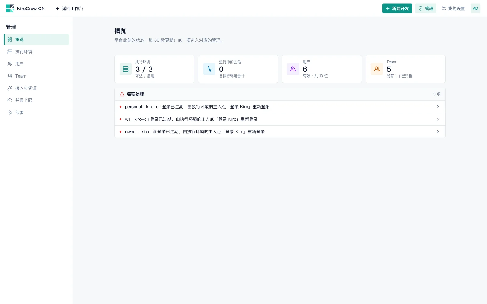
图 19　管理 › 概览：执行环境可达数、进行中的会话、用户数、Team 数，以及需要处理的事项，每 30 秒刷新。

| 领域 | 能力 |
|---|---|
| **用户** | 新建、停用与恢复、设为或取消管理员、重设密码；停用或重设密码会让该用户的全部 Token 立即失效；平台至少保留一位有效管理员，Team 唯一的 owner 不能被停用 |
| **Team** | 创建时指定 owner 和执行环境；管理成员、角色、改名和归档 |
| **执行环境** | 登记 Worker（支持一次性接入码，Token 不经人手）、分配到空间、共享或改回专属、停用；查看版本、Kiro 登录状态、可用工具和负载；单机版可在控制台「新建边界」 |
| **接入与凭证** | 为每个客户端单独创建 Token，权限分 read、execute、manage、admin，可重新生成或撤销；代码仓库凭证（GitHub / GitLab）分个人、Team、平台三级，保存后不再显示，也不进入任何会话、日志或 Agent 对话 |
| **并发上限** | 按个人或 Team 限制同时运行的任务数；到上限就排队，有任务结束后自动开始 |
| **部署** | 单机版的 AWS 变更（公网原生入口、异地备份、更新栈）在这里登记，由管理员在本机或 CloudShell 用部署套件执行，主机上不留管理凭证 |
| **审计** | 管理员越权查看、观察、预览、导出他人会话写入审计；会话的每次变更记录是谁、从哪个客户端、改了什么 |

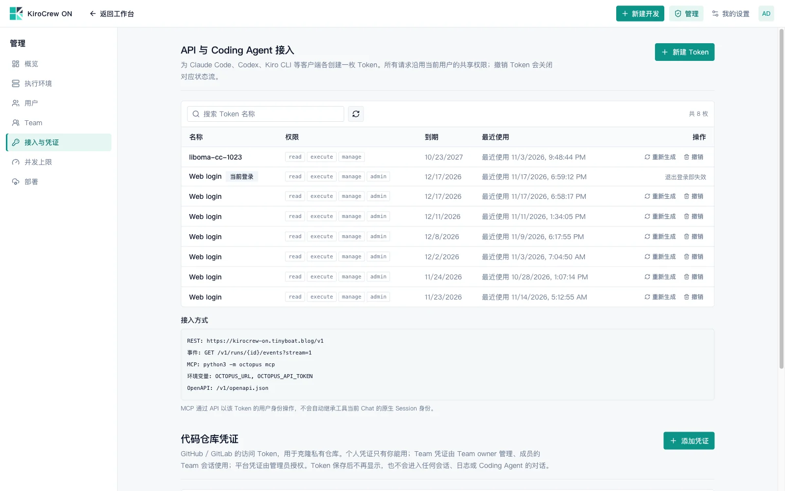
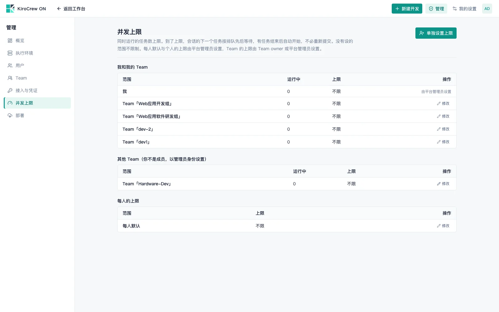
图 20　左：API 与 Coding Agent 接入，列出每枚 Token 的权限、到期和最近使用时间，下方是 REST、事件流、MCP 和 OpenAPI 的接入方式。右：并发上限。

## 11．部署与运维

| 形态 | 说明 | 状态 |
|---|---|---|
| **当前线上实例** | AWS us-east-1 的 EC2，前面是 CloudFront（控制台与 API、原生入口分别有分发）；平台主机上每人一个边界，另有独立的 Worker 主机 w1；模型经 Amazon Bedrock | 运行中 |
| **单机版一键安装** | 一行 `install.sh`，支持 AL2023、Ubuntu 22.04 / 24.04，x86_64 与 ARM64；也可 pip 或 Docker（一个容器、一个边界，用于试用） | 0.2.0 P2，9 项中 8 项已部署 |
| **集群版** | 一台控制面主机加一个 Graviton 主机池；每人一块加密的 EBS 卷；用户在控制台自助申请 Worker | 规划中（0.2.0 P3–P5） |

单机版的细节：

- **一行安装**：`curl -fsSL https://<下载域名>/install.sh | sudo sh`。先预检（系统、架构、root、systemd、磁盘、内存、实例元数据），不满足的一次列全后退出，什么也不改；pip 渠道是 `pip install kirocrew-on` 后 `sudo kirocrew-on setup`。
- **验签**：先用内嵌公钥验清单签名（没有签名不装），再核对版本与 wheel 的 sha256。
- **CloudFront 小栈**：Elastic IP、只放行 CloudFront 的入站规则、控制台 / 原生 / 预览三个分发、每日快照；装完核对主机角色只剩 Bedrock 调用与 SSM。
- **控制台里的运维**：「新建边界」「登录 Kiro」「管理 › 部署」；需要管理员凭证的变更由部署套件 `kirocrew-on single …` 在管理员自己的电脑上执行。

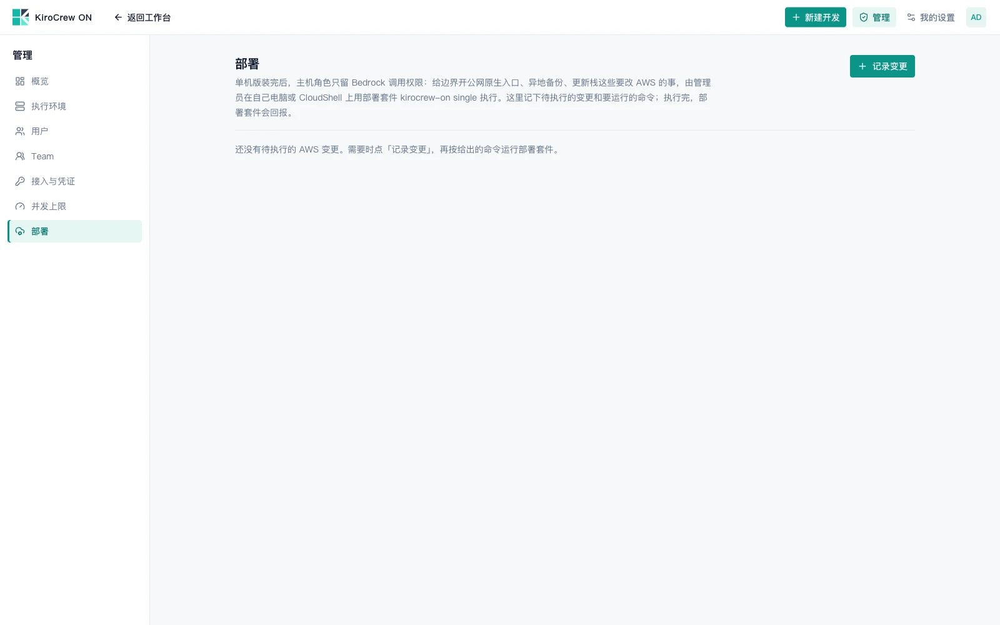
图 21　管理 › 部署：单机版装完后，主机角色只保留 Bedrock 调用权限；需要修改 AWS 资源时在这里登记，再用部署套件执行。

集群版（规划中）：

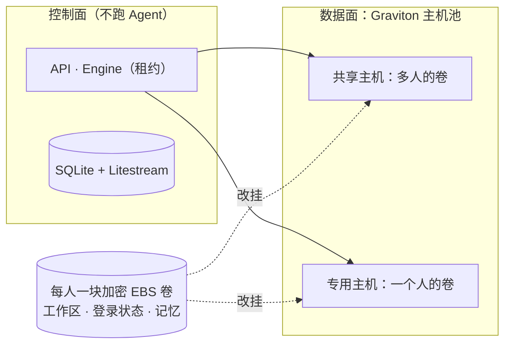

<!-- html: figures/whitepaper-planes.html -->

- **用户的数据跟着卷走**：每人一块加密的 EBS 卷，放工作区、各 Agent 的登录状态和 KiroCrew 记忆。换主机就是改挂这块卷。
- **P0 实测**（设计前先测）：同可用区搬卷 200 次 0 失败，用户等待 p50 16.7 秒、p95 19.3 秒；m8g.large 一台能挂 31 块数据卷；30 块卷同时搬，40 秒内全部完成；跨可用区从快照恢复必须设预置初始化速率，否则 5 GiB 要 11 分钟。
- **扩缩**：按 CPU、内存、剩余挂载位扩容；尽可能不缩容、不搬用户，只回收空主机。
- **可用性**：目标 99.5%（负责人 2026-10-26 定）。Litestream 每秒同步，RPO ≤ 5 秒（实测 0.69 秒，恢复 4.4 秒）；另一可用区温备，RTO ≤ 15 分钟；温备所需的平台密钥材料由 KMS 托管。认证信息不集中存放，随用户的卷走。
- **可观测**：每分钟一行 CloudWatch EMF（进行中、等 Worker、等配额的会话，失联的 Worker 等）；Worker 的健康接口报告内存、CPU、负载与子 Agent 上限，供放置使用。

> **解读**：集群版的单位是「**人的卷**」，不是「主机」，也不是「容器」。Agent 需要一个完整的用户环境（登录状态、记忆、工具链），这些状态天然属于人；把它们放进一块随人走的卷，主机就成了无状态、可替换的算力。这也解释了为什么不直接上容器编排：Agent 进程的状态模型更像「一个人的工作站」，而不是「一个无状态服务」。另一个值得注意的做法是**先实测、再定设计**：P0 用不超过 20 美元的一次性资源，先把卸挂时延、挂卷上限、跨区恢复这些可能推翻设计的数字测出来。

## 12．接入与生态

| 方面 | 现状 |
|---|---|
| Coding Agent | Claude Code、Kiro CLI、Kiro IDE、Codex 一条命令接入（`octopus connect`）；其他支持 MCP 的客户端按 `docs/CONNECT.md` 手动配置 |
| MCP 工具 | 40 个：会话（提交、状态、续作、控制、观察、修订、补充说明、接手…）、工作流（匹配、推荐、解析、保存、共享）、交付（预览、运行应用、下载、报告、发布）、本地联动（关联、拉回、同步）、管理（只接受 admin Token）。常用的见附录 A |
| REST API | `/v1` 下 100 余个路径，附 OpenAPI 描述；会话列表支持服务端过滤、全文与分页 |
| 命令行 | `octopus`（connect、login、submit、status、pull、sync、worker enroll…）；`kirocrew-on`（setup、single…） |
| 执行的 Agent | Kiro（kiro-cli）、Claude Code、Codex；OpenCode 未通过执行核实（K01），选它的任务由平台改派 Claude Code |
| 模型 | Claude Code 与 Codex 经 Amazon Bedrock（实例角色）；Kiro 经各人的设备码登录 |
| KiroCrew | 开源的 KiroCrew Gateway，按 commit 锁定；平台用它的原生会话、派生、批准、记忆与 lessons |

> **解读**：接入层刻意做得很薄：一份 Skill 告诉 Agent「什么时候、怎么用这些工具」，MCP 提供工具本身。好处是几乎没有学习成本，用户在自己的 Agent 里说一句话就行；代价是体验受各客户端的 MCP 支持程度约束，平台也必须把状态讲清楚（精简状态、观察、报告），因为用户往往只通过 Agent 的转述看它。项目在这里押的是「**MCP 会成为 Agent 之间的通用插口**」。

## 13．适用场景

判断一件事适不适合交给 KiroCrew ON，看三点：能写清楚验收标准，值得让第二个工具来审，结果需要留存、共享或后续迭代。下表的例子都是线上实例中真实完成的会话。

| 场景 | 典型需求 | 推荐编排 | 线上的真实例子 |
|---|---|---|---|
| **技术调研与对比报告** | 读仓库或文档，带出处地对比方案、给出建议 | 「深度 GitHub Repo 技术调研」类工作流：Claude Code 调研，Codex 独立审查 | 四种知识检索方式对比（RAG / PG 规则库 / Mem0 / GraphRAG）；RDS MySQL 跨区同步调研；S3 Files 与 Storage Gateway 横向对比；Kiro 与 EKS / RDS 安全集成调研（输出 PDF） |
| **讲解页、演示文稿、报告** | 把技术内容做成可直接展示的 HTML | 规划 → 撰写 → Node 静态断言 → Evaluator 核验 | KiroCrew ON 团队技术分享；AgenticOps 项目介绍；AgentCore 核心架构讲解；Embedding 模型分析报告 |
| **应用与原型开发** | 从零做一个可运行的 Web 应用或后端原型 | 完整研发链：Kiro 分析 → Claude Code 实现 → Codex 审查 → Claude Code 交付 | Agent + 知识库最小生产原型（FastAPI、pytest、Bedrock Provider，8 个任务）；企业规则库 0→1；three.js 网页小游戏；电商网站雏形 |
| **代码审查、测试与修复** | 基于真实代码实现、补测试、独立审查 | Git 来源 + SDE 实现 + Challenge / 安全测试 + Evaluator | 医疗器械电商雏形（Claude Opus 5.5 研发 + Codex 测试）；在指定代码里实现函数并附可运行的检查命令 |
| **Team 协作研发** | 多人看同一个会话、复用同一套流程 | Team 空间 + 共享工作流（runner / editor） | 「Web应用软件研发组」的两个会话；共享给 Team 的「Web应用功能更新验证流」 |
| **沉淀研发流程** | 把好的做法变成可复用的工作流 | 「KiroCrew 推荐（先审阅）」生成，审阅后保存为工作流 | 平台上约有 23 个工作流设计类会话，产出了 Deep Research、GitHub Repo 调研等工作流 |

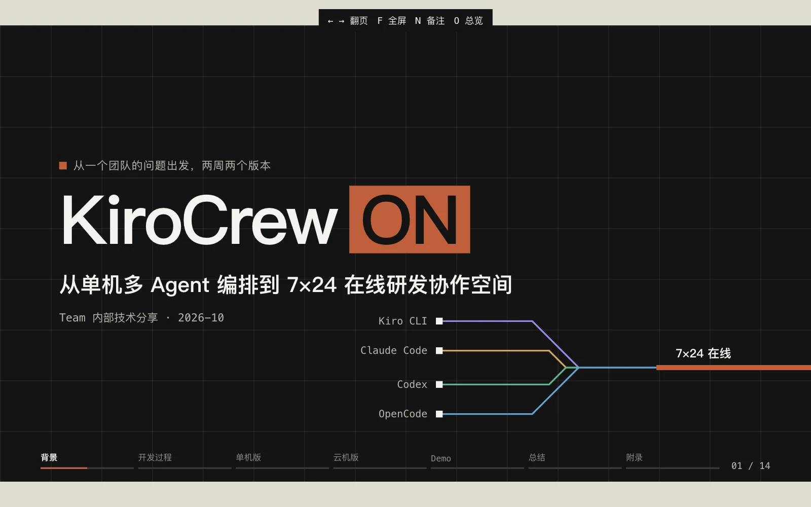

图 22　两个会话的产出首屏。左：团队技术分享演示文稿（8 个任务）。右：Agent + 知识库最小原型的架构讲解页（8 个任务）。

**不适合的场景**：

- **需要直接发布到生产**：平台不合并、不部署，结果先给人看。它不是 CI/CD。
- **几秒钟就能在本机改完的小事**：规划、互审和门禁会带来额外的时间和模型调用。
- **说不清验收标准的开放式探索**：可以做，但门禁和 Evaluator 发挥不了作用；建议先用「KiroCrew 推荐（先审阅）」把目标写清楚。
- **依赖执行环境访问不到的私有内网资源**：执行环境需要能访问源码仓库和依赖；私有仓库需要配置仓库凭证。

## 14．案例：一次研究会话的完整过程

会话 `run-44dc0643a7dd400bbce55654877d547e`：在财务审核单据的场景里，对比纯 RAG、仓库自带的 PG 规则库、Mem0 与 GraphRAG，产出中文报告和单文件 HTML。只读研究，不改代码，不推送。来源是一个 GitHub 仓库。

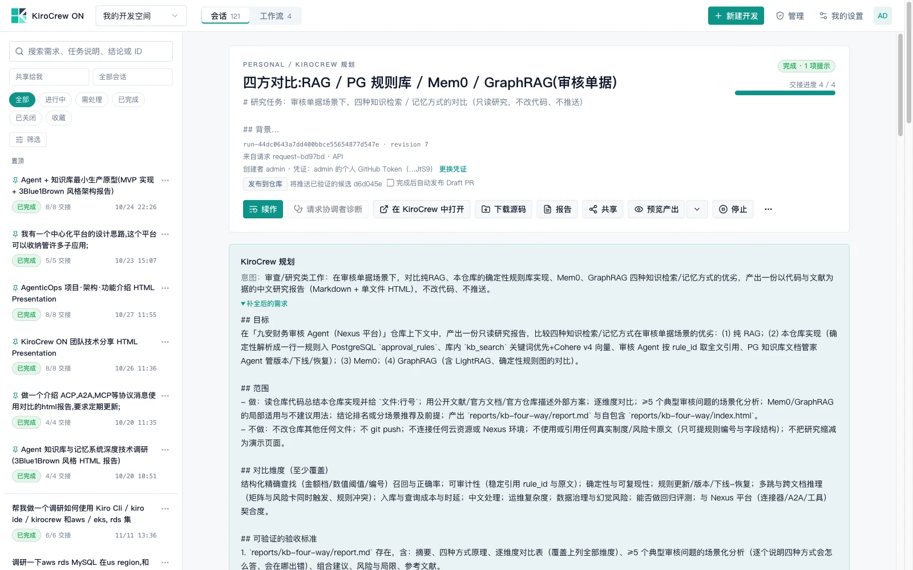
图 23　会话页头：标题、会话 ID、修订号、交接进度 4/4，以及续作、诊断、在 KiroCrew 中打开、下载源码、报告、共享、预览产出、停止等操作。

**任务链**：规划（Kiro）→ 撰写 `report.md`（Kiro，研究员）→ 生成单文件 `index.html`（Kiro，撰写者）→ 逐条核对验收项（Codex，Evaluator，只读）。作者与审查者用不同的工具：协调者在一次纠错决定里明确写道，「保持 task-1 工具为 kiro，不得改为 codex（审查者工具），以维持 evaluator 与作者工具相异」。

**修订时间线**：

| 版本 | 时间 | 事件 |
|---|---|---|
| v1 | 11-03 20:55 | 创建会话（1 个规划任务） |
| v2 | 20:58 | 规划完成，追加 3 个任务 |
| v3 | 21:10 | 自动纠错：审查发现 F1、F2、F3，退回撰写报告的任务 |
| v4 | 21:24 | 自动纠错：F2、F3 仍未修正，再次退回 |
| v5 | 11-04 08:57 | 用户在原会话续作 |
| v6 | 09:01 | 自动纠错：发现 F5，退回撰写报告的任务 |
| v7 | 09:10 | 自动纠错：判定 F4 是平台的候选范围问题，不归责作者，让审查据实复核 |
| 完成 | 09:11 | 4 个任务全部交接通过 |

**审查打回的问题，每条都有出处**：

| 编号 | 问题 |
|---|---|
| F1 | HTML 里三个术语被 NUL 占位符替换（`index.html:83`、`121`） |
| F2 | 引用行号漂移：报告写 `parse_rules.py:188–205`，实际在 167–178 |
| F3 | 表述过强：报告称「全链路确定性」，但召回排序与最终判定并不确定 |
| F4 | 两份平台运行时配置混进了候选改动：协调者判定为平台的候选范围问题，记为不阻断的观察项 |
| F5 | 「只读事务下结果照常返回」与 `kb_search.sql:439–441` 的限流逻辑不符 |

整个会话共 15 次执行，Agent 用时约 42 分钟。最后一轮 Evaluator 的执行证据见图 9：六项验收全部通过，例如「54 处带路径引用均可定位」「HTML 与报告规范化后 16,287 个字符一致，无外部资源加载」。

> **解读**：第一版报告看起来已经完成，但有 5 处可以被源码证伪的问题。没有独立审查和纠错循环，这些问题会直接进入交付物。这个案例也说明了第 7 章那组规则各自的作用：审查独立让 Codex 能挑出 Kiro 的错；`rework` 只退回上游、下游自动重跑；F4 被判为平台的问题而不是作者的问题，说明协调者在判断「谁的错」，而不只是「有没有错」。

## 15．运行数据

### 15.1　线上实例

以下数据由管理员账号通过 `GET /v1/runs?all=1` 于 2026-11-19 读取，覆盖线上实例自 2026-10-11 至 11-11 创建的全部会话，共 5 位创建者，其中包含平台自身的验收会话。

| 指标 | 数值 |
|---|---|
| 会话 | 140 个：已完成 114，已停止 20，受阻 6；个人空间 130，Team 空间 10 |
| 代码来源 | 新项目 80，Git 仓库 46，无需仓库 14 |
| 编排 | KiroCrew 自动规划 46，模板或手动编排 94 |
| 任务与执行 | 411 个任务，532 次执行（平均每个任务 1.29 次），Agent 累计用时约 42.5 小时 |
| 多工具协作 | 80 个会话用了两种及以上的 Coding 工具；38 个会话有 Evaluator 任务；38 个会话出现过重试或返工 |
| 任务按 Coding 工具 | Claude Code 181，Kiro CLI 161，Codex 68，OpenCode 1 |

| 会话按用途 | 会话数 | 说明 |
|---|---|---|
| 平台验收与回归 | 64 | 平台每个版本的验收用例，例如「D59 验收：密封的 Worker Token」 |
| 调研与技术报告 | 约 26 | 其中十余个直接以一个仓库或文档链接作为需求 |
| 工作流设计 | 约 23 | 「工作流建议」会话，由 KiroCrew 设计任务链与 Prompt |
| 讲解页 / 演示文稿 | 13 | 多为动画讲解风格的 HTML 报告 |
| 应用与原型开发 | 9 | 规则库、中心化平台、网页游戏等 |
| 审查 / 测试 / 修复 | 5 | 例如「医疗器械电商雏形（Claude Opus 5.5 研发 + Codex 测试）」 |

用途按会话标题的关键词自动划分，存在误差，只用于说明大致的使用分布。

### 15.2　版本与工程

| 时间 | 版本 | 要点 |
|---|---|---|
| 2026-10-10 | 立项 | 迁入前身 kirocrew-octopus 的新旧两版资产，建立回归基线（D01、D05，见附录 C） |
| 2026-10-12 | **MVP 0.1.0** | 跑通协作闭环：连接 → 提交 → 规划 → 多 Agent 执行与互审 → 观察 → 预览 → 续作；Team 执行环境 |
| 2026-10-13 至 23 | 0.1.x 迭代 | 访问管理、仓库凭证、候选提交与命名门禁、发布 Draft PR / MR、恢复阶梯、角色卡片与 Evaluator、Knowledge、每人一个边界、排队与并发上限、会话共享、聊天协作 |
| 2026-10-24 | **MVP 0.1.1** | 控制台改版、Token 重新生成、列表瘦身（gzip 后约少 70%） |
| 2026-10-25 / 26 | 0.1.x 补充 | 接手（D74）、公开分享（D75） |
| 2026-10-26 至 28 | **0.2.0rc1** | P1 打底（接入码、全局 UID、ARM64、打包、Litestream、平台指标）；P2 单机版一键安装、控制台登录 Kiro |
| 2026-11-20 | 修复 | 控制台登录 Kiro 拿到的是固定地址，登录不了（附录 B） |

| 工程指标 | 数值 |
|---|---|
| 后端 | `octopus/` 70 个模块，约 2.1 万行 Python |
| 控制台 | Vite + React + TypeScript，约 1.1 万行（不含测试） |
| 测试 | 全量回归：后端 2,174 项、控制台 354 项、旧版 92 项（2026-11-20） |
| 数据库 | SQLite，迁移到 19 |
| 决策记录 | D01–D75，60 余项，每项写明负责人何时定的 |
| 工程纪律 | 每个修复先有失败的测试；独立代码审查；部署前在干净克隆里做密钥扫描；EC2 上逐项实测并把结果写进文档 |

> **解读**：两组数字讲的是同一件事。线上 140 个会话里有 80 个用了两种以上的工具、38 个出现过重试或返工，说明「多工具互审 + 自动纠错」不是摆设，而是常态。平台自己的开发也大量用 Coding Agent 完成，不到三周就走到预览版；更值得看的是**密度**：60 余项决策、每次修复先写失败的测试、每个功能都有 EC2 实测记录。这种「把判断写下来、把证据留下来」的纪律，正是 KiroCrew ON 想替用户自动化的那部分工作。

## 16．当前限制

| 限制 | 影响与处理 |
|---|---|
| **OpenCode 执行尚未通过（K01）** | shell 写文件被 KiroCrew 的工具门禁拒绝；选择 OpenCode 的任务由平台改派 Claude Code。411 个任务里只有 1 个选了 OpenCode |
| **原生登录覆盖整个 Gateway（K03）** | 「在 KiroCrew 中打开」只开放给有权使用整个执行边界的人；其他人用控制台的 KiroCrew 会话面板观察 |
| **kiro-cli 登录会过期** | 过期后 Kiro 任务等待，需要执行环境的主人在控制台重新登录；登录恢复后相关任务自动继续 |
| **发布到仓库没有二次确认** | 点击即推送；依赖有效的仓库凭证，凭证失效时不会推送任何内容 |
| **平台仍是单台主机** | 主机故障期间不可用；有每日快照与备份恢复，温备在 0.2.0 P5 |
| **补充说明只支持 Kiro** | Claude Code、Codex 的运行中任务不能插话（上游限制） |
| **Knowledge 只在专属执行环境沉淀** | 共享环境的会话不积累项目知识：KiroCrew 的 lessons 不能按空间隔离 |
| **依赖 KiroCrew 的原生接口** | 上游变化会影响 Worker；按 commit 锁定，原生契约检查通过才接受新版本 |
| **同一域名下的残余风险** | Agent 做的演示页可以把站点 Cookie 写满，使浏览器暂时打不开控制台；清除该站点数据即可恢复，读不到也改不了任何人的数据 |
| **不是 CI/CD** | 平台不合并、不部署；「完成」指原生执行与交接核对完成，不等于安全认证 |

## 17．路线图

**0.2.0 余下的部分**

| 期 | 内容 | 状态 |
|---|---|---|
| P1b | KiroCrew 升到正式版 v0.10.0（原生页面会有变化） | 待负责人确认 |
| P2 第 9 项 | 新开 4 台 EC2，各用一条命令装通并跑一个真实会话 | 待负责人批准（约 3 美元） |
| P3 | 集群版底座：主机代理、用户卷、按 Host 路由的原生入口、迁移编排；先只开放给管理员 | 待 P0 余项 |
| P4 | 普通用户自助申请共享 / 专用主机，双向切换 | 待 P3 |
| P5 | 迁移现有部署与温备演练 | 待 P4 |

**原定的版本主题与实际进度**

| 版本 | 主题 | 实际 |
|---|---|---|
| 0.1 | 跑通协作闭环 | 已完成 |
| 0.2 | 可管理 → 部署模式与 Worker 池 | 访问管理、Team 与 Worker 管理、MCP 按角色调用、私有仓库凭证已在 0.1.x 完成；现在做部署模式与 Worker 池 |
| 0.3 | 成果出库 | 大部分已提前上线：候选提交、Feature 报告、发布到仓库与 Draft PR / MR（含新建仓库、自动发布） |
| 0.4 | 完成优先 | 大部分已提前上线：瞬时重试、看门狗、预算、换工具、批准请求可见、命名门禁 |
| 0.5 | 处处可用 | 部分已上线：Codex、Kiro IDE 一键接入；会话列表的服务端过滤、全文与分页 |
| 1.0 | Always-On 组织协作空间 | 部分提前：会话共享给个人 / Team / 全公司、配额与排队；未开始：组织层、Issue / Webhook / 定时触发、记忆按空间分层 |

**目标驱动的自我迭代**（D76 设计稿，待负责人评审）：新增「目标」对象——一句话陈述、锁定的完成标准、预算与授权策略；一个目标跨多次迭代（规划 → 执行 → 平台亲自验证 → 差距评估 → 决定）。完成与否由代码规则决定；推送、生产部署、对外发布一律需负责人本人当场再认证后点头；迭代上限、费用、连续无进展等任一触发即停下，写清卡在哪。

路线图是规划，顺序以项目负责人确认为准。

> **解读**：从路线图能看出重心在移动：0.1 解决「一个会话能不能可靠地跑完」，0.2 解决「谁来装、在哪跑、怎么扩」，D76 要解决「**跨会话的目标**」——让系统自己决定下一个会话做什么，人只在关键点点头。这一步走通，KiroCrew ON 就从「执行请求的后台」变成「追求目标的后台」。设计稿里最审慎的部分恰恰是「点头」：它承认现在的控制台登录证明不了操作者是本人，所以要求当场再认证。

## 18．解读：KiroCrew ON 在押注什么

### 18.1　一句话

把「**一个人 + 一个 Coding Agent + 一台电脑**」的工作方式，变成「**一个组织 + 多个 Agent + 一组后台执行环境**」的研发后台，而入口仍是每个人自己习惯的那个 Agent。

### 18.2　三个押注

| 押注 | 依据 | 代价 |
|---|---|---|
| **信任放在平台，不放在 Agent** | Agent 会自报成功（第 14 章的第一版报告就是例子）。所以门禁由代码判，验证命令由平台亲自跑，Evaluator 独立于作者，发布只推已验证的候选 | 平台要理解每种任务的「完成」长什么样：门禁、阶段、契约的设计成本很高，D57、D69、D71 都是在调这里的松紧 |
| **薄接入、厚平台** | 用户不想换工具。一份 Skill 加 MCP，任何 Agent 都能接；复杂度集中在平台 | 体验受各客户端约束；平台必须把所有状态讲清楚，因为用户只通过 Agent 的转述看它 |
| **边界即隔离** | 隔离交给操作系统、主机和卷，而不是 Prompt 或 Agent 的自觉；一人一个边界，与 KiroCrew 的「个人助手」模型对齐 | 运维更复杂：用户、端口、登录、卷都要按人管理。0.2.0 的大部分工作（接入码、全局 UID、自助申请、用户卷）就是在偿还这笔账 |

### 18.3　与常见做法的对照

| 做法 | 擅长 | KiroCrew ON 补上的 |
|---|---|---|
| 本机 Coding Agent | 交互快、上手零成本 | 后台持续执行、可核实的结果、团队共享 |
| 云端托管的单 Agent | 不占本机、可异步 | 多 Agent 分工与互审、自托管、按人 / Team 隔离、不锁定工具 |
| CI/CD 流水线 | 确定性、可重复 | 需求理解、任务拆分、失败诊断与返工这些需要判断的部分 |
| 通用多 Agent 框架 | 编排灵活 | 开箱即用的权限、会话状态机、证据、预览、发布与运维 |

KiroCrew ON 不和这些做法比谁更强，而是把它们拼起来：用 Agent 做判断，用流水线式的代码做验收，用协作空间管归属。

### 18.4　几处有意为之的取舍

- **自动与人控**：执行端偏向自动（不停下等人），出口端偏向保守（只推已验证的候选；D76 要求本人再认证）。
- **共享与隔离**：会话可以广泛共享，执行环境和凭证不随之共享；要动手就先「接手」。
- **实时与解耦**：单向驱动加轮询，换来平台与 KiroCrew 的彻底解耦，接受秒级的进度延迟。
- **复用与掌控**：大量复用 KiroCrew 原生能力（会话、派生、批准、记忆），但判定、权限、状态从不交给它。

### 18.5　给不同读者

- **开发者**：你不需要学新工具。把它当成「可以把任务丢过去、明早回来看结果的同事」：说需求、问进度、要预览、继续改，都在你自己的 Agent 里完成。
- **Team 负责人**：会话、工作流、知识都能在 Team 里共享，接手让交接不必从头讲起；并发上限与用量让成本看得见。
- **平台管理员与安全**：自托管在自己的 AWS 账号；凭据分段、权限只在平台判定、审计齐全；隔离靠 OS 用户、主机与私网 TLS；安装包验签。
- **决策者**：它是把 Coding Agent 从「个人效率工具」升级为「组织研发能力」的一层基础设施。现在是 MVP 阶段：单区域、单台控制面主机，集群版与温备还在路上。

### 18.6　成熟度判断

- **已经扎实的**：会话闭环、质量判定与恢复阶梯、权限与审计、共享与接手、单机版安装。这些都经过 EC2 实测，有回归测试保护，线上已跑过 140 个会话。
- **还在路上的**：集群版与温备（P3–P5）、KiroCrew 正式版升级（P1b）、组织层、目标驱动的迭代（D76）。
- **要持续盯的**：对上游 KiroCrew 原生接口的依赖；「自动通过」带来的提示积累；单台主机的可用性；人工步骤（如 Kiro 设备码登录）出问题时的影响面——附录 B 就是一例。

## 19．快速上手

### 19.1　开发者

1. 向管理员要一个账号，并确认你的个人空间或 Team 已分配执行环境。
2. 执行 `octopus connect claude`（或 `kiro`、`codex`、`kiro-ide`），然后重启客户端。
3. 说出需求，最好带上验收标准，例如：「用 KiroCrew ON 做一个番茄钟网页：25 分钟专注、5 分钟休息，可暂停与重置；Claude Code 实现，Codex 审查，最后在浏览器里真实验证。」
4. 去做别的事；回来问「现在做到哪了？」，或在控制台看规划、任务和 KiroCrew 会话面板。
5. 完成后要预览、下载源码或看报告；不满意就说「把……改成……」，在原会话续作。

### 19.2　管理员

1. 部署平台（`deploy.sh up && deploy.sh push`；0.2.0 起可用单机版一键安装）。
2. 在「管理」里创建用户和 Team，登记执行环境并分配到空间。
3. 让执行环境的主人在控制台「登录 Kiro」；按需设置并发上限和仓库凭证。
4. 定期查看「管理 › 概览」里需要处理的事项，例如登录过期、Worker 不可达。

## 附录 A．常用的 MCP 工具

| 工具 | 用途 |
|---|---|
| `octopus_start` | 提交新需求；可指定来源（新项目或 Git 仓库）、工作流文档或 Worker |
| `octopus_status` / `octopus_runs` | 查看一个会话的真实状态与最近事件 / 列出可见的会话 |
| `octopus_observe` | 读取协调者与子 Agent 的最近对话 |
| `octopus_revisions` | 修订历史与两版之间的差异 |
| `octopus_continue` / `octopus_recover` | 在原会话续作 / 请协调者诊断修复 |
| `octopus_steer` | 给运行中的 Kiro 任务补充一句说明 |
| `octopus_control` | 停止、关闭、重开、删除（建议先征得用户同意） |
| `octopus_preview` / `octopus_app` / `octopus_download` | 签发预览链接 / 在执行环境里运行应用 / 下载源码 |
| `octopus_report` / `octopus_publish` | 会话报告 / 发布到仓库并建 Draft PR |
| `octopus_takeover` | 把共享来的会话接手到自己的执行环境 |
| `octopus_workflows` / `octopus_save_workflow` / `octopus_share_workflow` | 列出、保存、共享工作流 |
| `octopus_match_workflow` / `octopus_recommend_workflow` / `octopus_parse_workflow` | 按需求匹配工作流 / 请 KiroCrew 推荐 / 预览导入文档的规范化结果 |
| `octopus_teams` | 列出你的 Team 及成员 |

管理类工具（用户、Team、执行环境）只接受含 admin 的 Token。实际可用的工具以你连接的平台版本为准。

## 附录 B．一次真实故障：控制台登录 Kiro 拿到的是固定地址（2026-11-20）

这个故障很小，但它把第 4 章「如实报告、证据先行」的工作方式完整演示了一遍，也解释了图 2 里三个执行环境为什么都显示 Kiro 登录过期。

- **现象**：在控制台点「登录 Kiro」，对话框里的验证地址每次都一样（`https://d-9067e1d68a.awsapps.com/start`），打开后进不了设备确认页，执行环境登录不了 Kiro。依赖 Kiro 的会话因此一直在「等待 Kiro 登录恢复」。
- **证据**：调出 EC2 上一次真实的登录日志：kiro-cli 2.29.1 用 IAM Identity Center 登录时，先把给它的 Start URL 回显在提示行里，然后才输出设备码和真正的一次性地址。Worker 取的是输出中的**第一个**地址。
- **为什么测试没发现**：测试里模拟的 kiro-cli 不回显提示。
- **修复**：先补两个会失败的测试（模拟提示回显、模拟长地址分两次读到），再改为取「设备码之后、整行输出完的那个地址」；对话框的链接改为「打开登录页面（主机名）」。
- **核对**：在 EC2 的 kiro-cli 2.29.1 上，旧的解析复现出 `…/start✔`（39 字符），新的解析取到 604 字符的一次性地址（AWS 现在给的是 `signin.aws/platform/authorize?request_uri=…`）；本机 kiro-cli 3.4.0 的 free 与 pro 两种登录也都取到完整地址；部署后 EC2 浏览器检查 11/11 通过。

> **解读**：模拟的输出永远比真实的干净。所以这类问题要回到真实的命令、真实的环境上核对，而不是只看测试通过与否。

## 附录 C．KiroCrew ON 的来历

KiroCrew ON 的前身是 kirocrew-octopus：以 KiroCrew 为入口、ACP 为执行底座，把 Kiro 规划、Claude Code 编码、Codex 审查串成工作流，先后有 macOS 上的 PoC 工作台和 MVP-1.0.0 Team 版。2026-10-10，源码迁入 kirocrew-on 仓库并持续迭代（迁入记录见 `docs/PROVENANCE.md`），至今已发布 MVP 0.1.0、0.1.1 和 0.2.0rc1。Team 版的界面今天仍保留在线上的 `/classic/`。

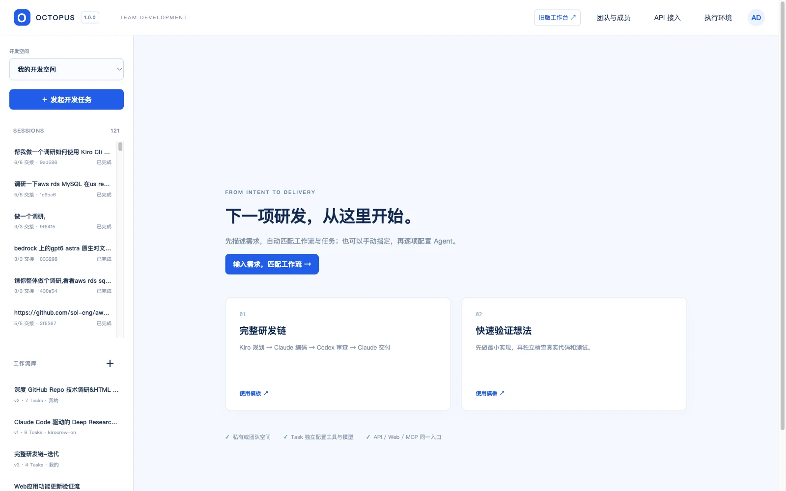
图 24　经典控制台（Octopus 1.0.0），来自 kirocrew-octopus 的 MVP-1.0.0 Team 版。

## 附录 D．资料来源与文档索引

**资料来源**

- 线上实例 https://kirocrew-on.tinyboat.blog 的控制台截图（2026-11-17、11-19）与 API 返回（`/v1/runs?all=1`、`/v1/runs/<id>/revisions`）。
- MCP 工具 `octopus_workflows`、`octopus_teams` 的返回（2026-11-19）。
- kirocrew-on 仓库 `feat/mvp-0.2.0` 分支的文档与代码：`octopus/gates.py`、`octopus/roles/`、`octopus/phases.py`、`octopus/mcp.py` 等。
- 截图与使用流程、场景、案例、运行数据最初整理于 kirocrew-octopus 仓库 `docs/whitepaper/`（2026-11-19），本文在此基础上合并了设计原理与解读。

**文档索引**

| 文档 | 内容 |
|---|---|
| [`README.md`](../../README.md) | 简介与上手 |
| [`docs/MVP-0.1.0.md`](../MVP-0.1.0.md) · [`MVP-0.1.1.md`](../MVP-0.1.1.md) · [`MVP-0.2.0.md`](../MVP-0.2.0.md) | 各版本的产品说明、版本说明与验证 |
| [`docs/ARCHITECTURE.md`](../ARCHITECTURE.md) | 架构：拓扑、逐层交互、时序、信任边界 |
| [`docs/WORKERS.md`](../WORKERS.md) | 开发空间、Worker 与执行边界 |
| [`docs/CONNECT.md`](../CONNECT.md) · [`docs/CONTINUE.md`](../CONTINUE.md) | 客户端接入 · 续作 |
| [`docs/OPERATIONS.md`](../OPERATIONS.md) | 部署与运维（门禁、恢复、共享、安全等各项行为的权威说明） |
| [`docs/MVP-RELEASE.md`](../MVP-RELEASE.md) · [`docs/BACKLOG.md`](../BACKLOG.md) | 里程碑与决策 · 后续排期 |
